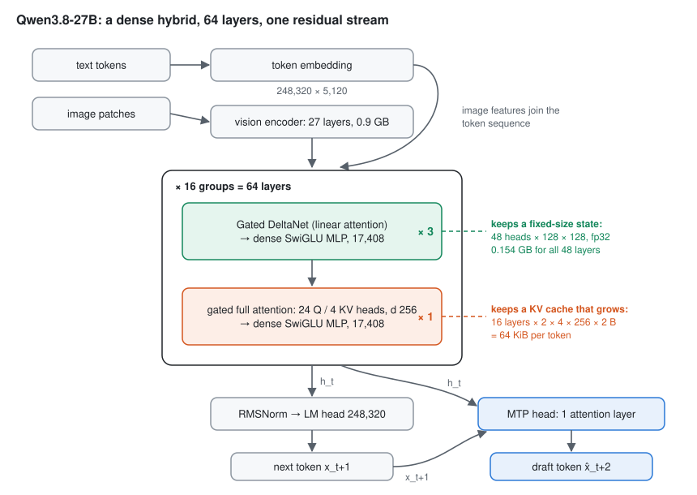
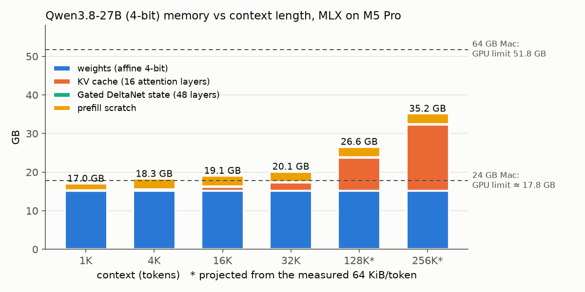
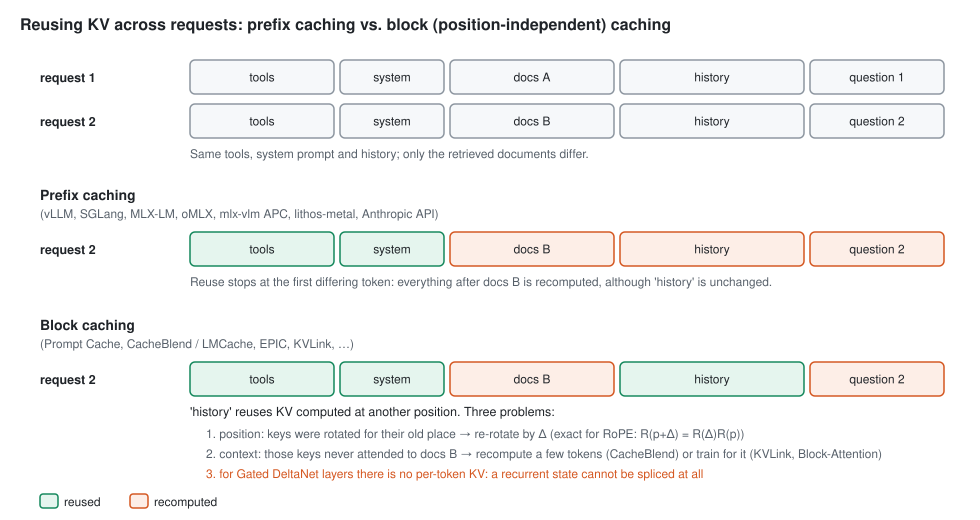
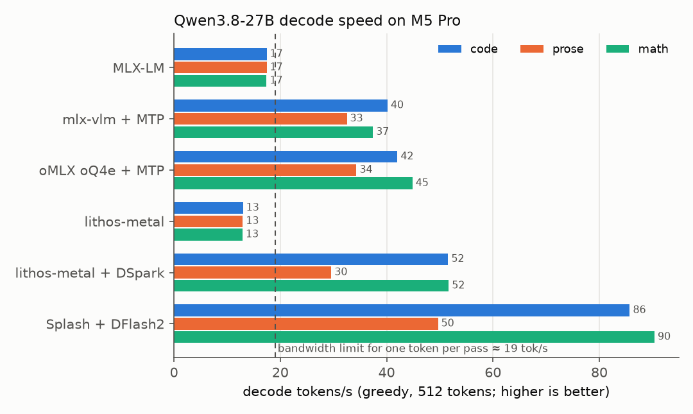
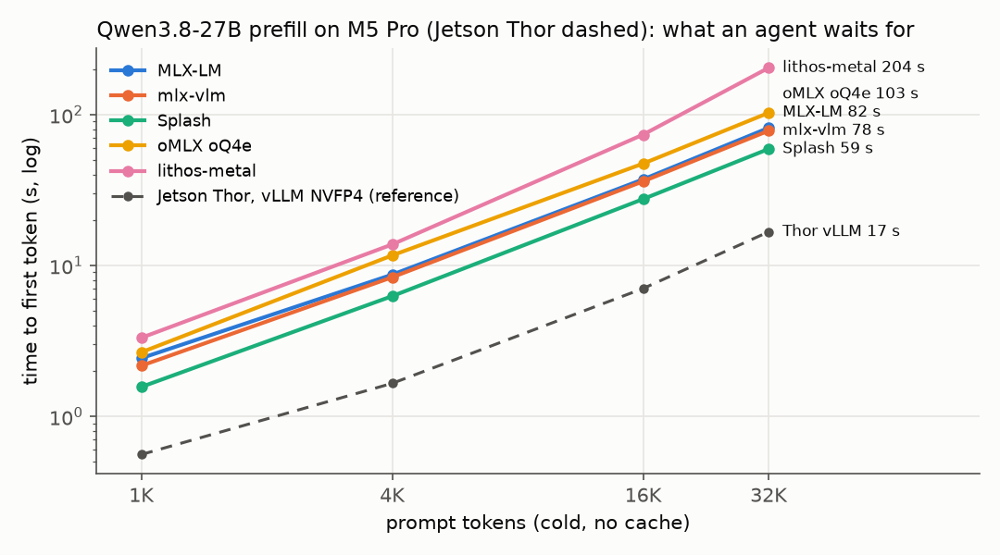
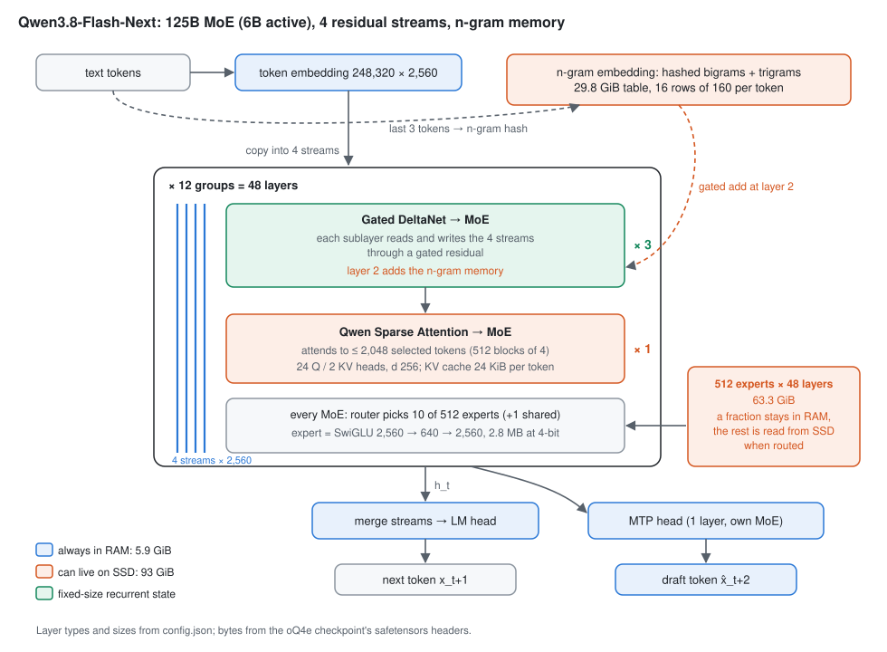
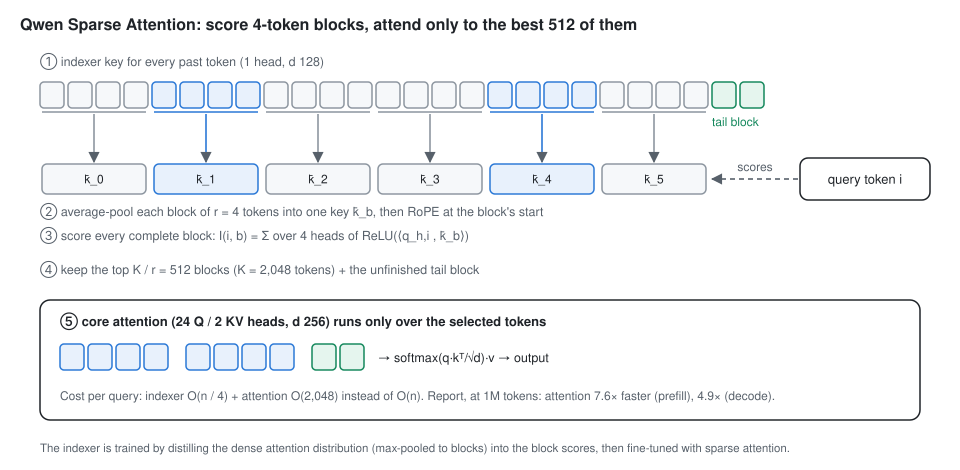
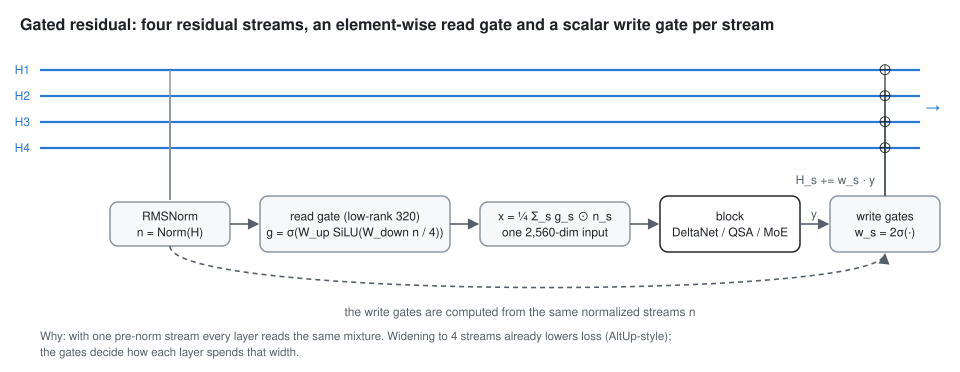
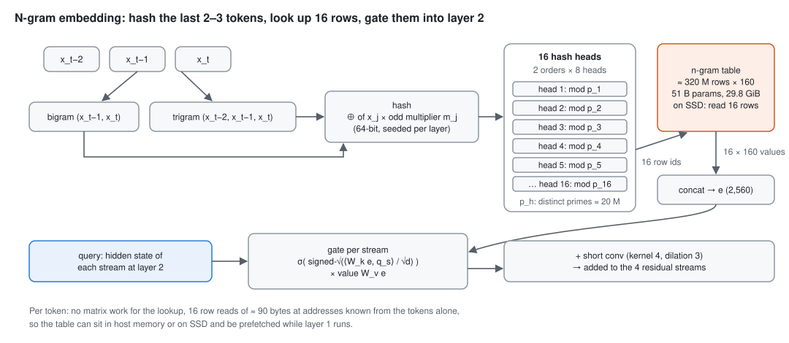
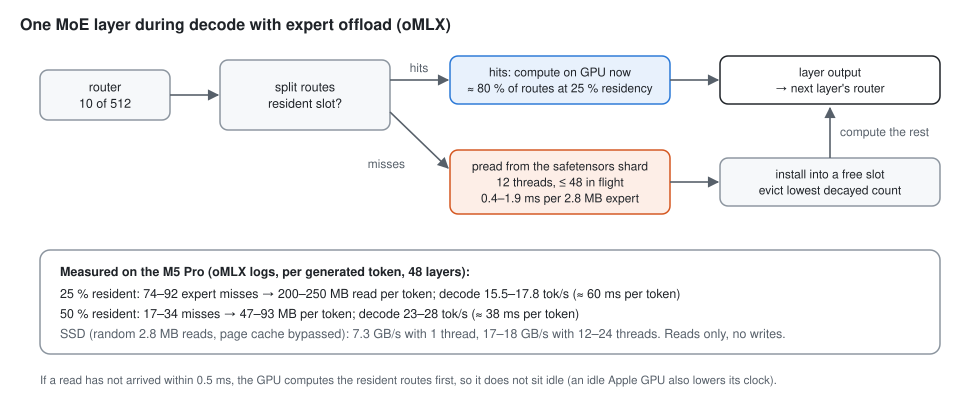

# Serving a 27B LLM on a Mac: memory, speed and inference engines

This tutorial serves **Qwen3.8-27B**, a 27-billion-parameter vision-language model, on one Apple-Silicon laptop.
It compares five engines: **MLX-LM**, **mlx-vlm**, **oMLX**, **lithos-metal** and **Splash**. It works out where every gigabyte
of memory goes and why decoding and prompt reading (prefill) are limited by different hardware resources. It also
explains the optimization each engine uses: quantization, kernel fusion, speculative decoding, prefix caching,
GPU-resident decoding, Neural Engine prefill. Every number below was measured on the machine described next, and every
measurement can be reproduced with the scripts in [`mac_inference/`](mac_inference/). §10 runs the same tests on an
NVIDIA Jetson Thor, to compare the Mac with an edge computer built around an NVIDIA GPU.

It is the inference companion to [`TUTORIAL_nanolm.md`](TUTORIAL_nanolm.md), where we *train* models up to about 11M
parameters. Part 3 of that tutorial uses pretrained models of 0.1–0.5B. Here the model is 2,500× larger than our largest
trained one, and the question changes from "how do we learn the weights?" to "how do we move them through the
chip fast enough?".

| | |
|---|---|
| machine | MacBook Pro, **Apple M5 Pro** (20-core GPU), **64 GB** unified memory |
| OS | macOS 26.5.2 |
| engines | mlx-lm 0.32.2, mlx-vlm 0.7.8, oMLX 0.7.1rc1, lithos-metal 0.1.2 (`5485ad6`), Splash 1.4.0; MLX 0.32.4 |
| model | Qwen3.8-27B: affine 4-bit (`mlx-community/Qwen3.8-27B-4bit`), oQ4e (`Jundot/Qwen3.8-27B-oQ4e-mtp`), NVFP4 (`nvidia/Qwen3.8-27B-NVFP4`) |
| date | 2026-10-18/20 |

**Results in one table** (details in §6):

| | decode tok/s (code / prose / math) | TTFT, 16K-token prompt | agent follow-up turn | vision |
|---|---:|---:|---:|:---:|
| MLX-LM | 17 / 17 / 17 | 37 s | 0.5 s | — |
| mlx-vlm + MTP (`APC_ENABLED=1`) | 40 / 32 / 37 | 34–36 s | 0.7 s | ✓ |
| **oMLX**, oQ4e + MTP | 42 / **34** / 45 | 47 s | 0.6–0.8 s | ✓ |
| lithos-metal + DSpark | 52 / 30 / 52 | 74 s | 0.9 s | — |
| **Splash** + DFlash2, ANE prefill (§5.2) | **86** / **50** / **90** | **28 s** | **0.24 s** | ✓ |
| *Qwen3.8-Flash-Next* (125B MoE, 106 GB) on oMLX with SSD expert offload (§9) | 18 / 16 / 17 | 34 s | 1.3 s | supported, not tested |
| *Qwen3.8-Flash-Next*, 2-bit GGUF (67 GB) on **Splash**, n-gram table on SSD (§9.3) | **163 / 89 / 139** | **12 s** | **0.15 s** | ✓ |
| *for comparison:* Qwen3.8-27B on a **Jetson Thor**, vLLM NVFP4 + MTP (§10) | 29 / 23 / 34 | 7 s | 0.5–0.6 s | not tested |

---

## Contents

1. [How LLM inference uses the chip](#1-how-llm-inference-uses-the-chip)
2. [The model: Qwen3.8-27B](#2-the-model-qwen38-27b)
3. [Memory: where every gigabyte goes](#3-memory-where-every-gigabyte-goes)
4. [Optimization techniques](#4-optimization-techniques), including [speculative decoding step by step](#44-speculative-decoding-step-by-step) and [prefix caching in detail](#45-prefix-caching-in-detail) (with [block KV reuse](#beyond-prefix-caching-reusing-blocks-at-any-position))
5. [The five engines and what each optimizes](#5-the-five-engines-and-what-each-optimizes), with [a closer look at lithos-metal](#51-a-closer-look-at-lithos-metal) and [at Splash](#52-a-closer-look-at-splash)
6. [Measurements](#6-measurements)
7. [What the measurements teach](#7-what-the-measurements-teach)
8. [Choosing an engine](#8-choosing-an-engine)
9. [A model that does not fit in memory: Qwen3.8-Flash-Next](#9-a-model-that-does-not-fit-in-memory-qwen38-flash-next)
10. [The same models on an NVIDIA Jetson Thor](#10-the-same-models-on-an-nvidia-jetson-thor)
11. [Reproduce it](#11-reproduce-it)
12. [Research directions](#12-research-directions)
13. [Exercises](#13-exercises)

---

## 1. How LLM inference uses the chip

Serving a request has two phases with very different costs.

**Prefill** reads the prompt. All prompt tokens are known, so the model processes them in parallel, in chunks of
128–2,048 tokens. Each weight matrix is read from memory once per chunk and multiplied with many token vectors at
once. The work per byte of weights is high, so prefill is limited by **arithmetic throughput** (FLOP/s).

**Decode** generates the answer, one token at a time, because token *t+1* depends on token *t*. To produce one
token, *every* weight is read from memory once and multiplied with a single vector. The work per byte is tiny, so
decode is limited by **memory bandwidth** (GB/s).

A forward pass of a dense model with N parameters costs about 2N FLOPs per token. Each weight takes part in one
multiply and one add. For one decode step and one prefill chunk this gives:

```math
t_{\text{decode}} \approx \frac{\text{bytes of weights}}{\text{memory bandwidth}}, \qquad
t_{\text{prefill}}(n) \approx \frac{2 N \cdot n}{\text{achieved FLOP/s}} \quad (n \text{ prompt tokens}).
```

For Qwen3.8-27B in 4-bit on the M5 Pro:

| quantity | value | source |
|---|---:|---|
| weights read per decode step | 15.1 GB | measured (§3) |
| peak read bandwidth | about 290 GB/s | lithos-metal's probe of this chip (`m5_pro/config.json`); Apple's nominal figure is 307 GB/s |
| **decode upper bound** | 290 / 15.1 ≈ **19 tok/s** | |
| measured MLX-LM decode | 17.4 tok/s, so 17.4 × 15.1 ≈ 263 GB/s, **91 % of peak** | §6.1 |
| FLOPs per prompt token | 2 × 27B ≈ 54 GFLOP | |
| measured MLX prefill | 475 tok/s at 4K, so about **26 TFLOP/s** | §6.2 |

Two consequences shape everything that follows:

- **One token per weight read cannot get much faster than about 19 tok/s on this Mac**, whatever the engine.
  The only way past it is to produce *several* tokens per read of the weights. That is what speculative decoding does (§4.4).
- **Prefill is where the Mac is far behind an NVIDIA GPU.** Decode is limited by bandwidth: an H100 has
  about 3.35 TB/s, roughly 11× this Mac. Prefill is limited by arithmetic: dense BF16 on an H100 is about 990 TFLOP/s,
  roughly 38× the 26 TFLOP/s measured here. As a rough estimate, *not measured here*: at 40–50 % utilization an H100
  would read a 16K-token prompt of this model in about 2 s, against 37 s on the M5 Pro. For an agent that sends long
  prompts, the time to first token is therefore the Mac's weak point (§6.2).

**Unified memory.** The CPU and GPU of an Apple-Silicon chip share one pool of memory. There is no copy from "host"
to "device", and a model can use most of the machine's RAM. macOS still caps how much memory the GPU may use: the
Metal "recommended max working set". On this 64 GB machine it is **51.8 GB** (oMLX logs it at start-up); on a 24 GB
M5 Pro it is about **17.8 GB** (lithos-metal's chip profile). The cap can be raised with
`sudo sysctl iogpu.wired_limit_mb=<MB>`, which oMLX suggests in its log. This tutorial did not need that.

## 2. The model: Qwen3.8-27B

Qwen3.8-27B uses the Qwen3.5 architecture (`Qwen3_5ForConditionalGeneration`). Its configuration, from `config.json`:

| | value |
|---|---|
| layers | 64: **48 Gated DeltaNet** (linear attention) + **16 full attention**, in a repeating 3 : 1 pattern |
| hidden size / MLP size | 5,120 / 17,408 (SwiGLU) |
| full attention | 24 query heads, **4 KV heads** (grouped-query attention), head dim 256, RoPE on 25 % of each head, output gate |
| Gated DeltaNet | 16 key heads and 48 value heads of dim 128; a short causal convolution (kernel 4) |
| vocabulary | 248,320 tokens; input embedding and output head are **not** tied |
| context | 262,144 tokens natively |
| extras | a 27-layer vision encoder (hidden 1,152, 16-pixel patches); **one MTP layer** for multi-token prediction |



*Figure: Qwen3.8-27B. Three of every four layers are Gated DeltaNet layers, which keep a fixed-size state (green);
every fourth is full attention, which keeps a growing KV cache (orange). Every layer has a dense MLP, so all 27B
parameters are read for every token.*

Two parts of this design matter most for serving:

- **Gated DeltaNet layers keep a fixed-size state, not a growing KV cache.** A full-attention layer must keep the
  key and value of every previous token. A DeltaNet layer folds the whole history into a matrix state S
  of shape 128 × 128 per head, and updates it with each new token. The update below is from the lithos-metal
  mixer design, simplified:

  ```math
  \bar S_t = \alpha_t S_{t-1}, \qquad
  \delta_t = \beta_t \,(v_t - \bar S_t^{\top} k_t), \qquad
  S_t = \bar S_t + k_t \delta_t^{\top}, \qquad
  o_t = S_t^{\top} q_t .
  ```

  Only 16 of the 64 layers therefore need a KV cache (§3.2). The catch is that the state *overwrites* the past.
  You can shorten a KV cache by cutting off its last tokens, but you cannot "un-apply" tokens from S. That is why
  prefix caching is harder for this model (§4.5).
- **The MTP layer** is a small extra transformer layer, trained together with the model, that predicts the token
  *after* the next one. It is a built-in draft model for speculative decoding (§4.4). Some conversions keep it and
  some drop it: `mlx-community/Qwen3.8-27B-4bit` has no MTP tensors, while `Jundot/Qwen3.8-27B-oQ4e-mtp` has 29.

## 3. Memory: where every gigabyte goes

[`mac_inference/memory_probe.py`](mac_inference/memory_probe.py) loads the model with mlx-lm and prefills 1K–32K
random tokens into a fresh cache. It records MLX's own counters (`mx.get_active_memory`, `mx.get_peak_memory`) and the
exact bytes held by every cache entry. Raw rows:
[`mac_inference/results_m5pro_qwen3.8-27b_memory.jsonl`](mac_inference/results_m5pro_qwen3.8-27b_memory.jsonl).



### 3.1 Weights

Bytes on disk of `mlx-community/Qwen3.8-27B-4bit`, by component (read from the safetensors headers):

| component | bytes | stored as |
|---|---:|---|
| 64 decoder layers | 13.70 GB | affine 4-bit, group size 64 |
| input embedding (248,320 × 5,120) | 0.72 GB | 4-bit |
| output head (248,320 × 5,120) | 0.72 GB | 4-bit |
| vision encoder | 0.92 GB | BF16 (not quantized) |
| **total** | **16.05 GB** | |

mlx-lm serves text only and **does not load the vision encoder**, so its weights take **15.13 GB** in memory, exactly
what `memory_probe.py` measures. mlx-vlm and oMLX load all 16.05 GB.

Why 4-bit is about 4.5 bits per weight. **Affine group quantization** stores each block of 64 weights as 4-bit
integers q plus one BF16 scale s and one BF16 bias b per block:

```math
w \approx s \cdot q + b, \qquad \text{bits per weight} = 4 + \frac{16 + 16}{64} = 4.5 .
```

At 4.5 bits, 27B parameters take 27 × 10⁹ × 4.5 / 8 ≈ 15.2 GB, which matches the measured size. The same model in
other formats:

| format | bits / weight | size | used by |
|---|---:|---:|---|
| BF16 (original) | 16 | about 54 GB (Unsloth lists 56 GB including vision) | — (would leave about 0 GB for context on a 64 GB Mac) |
| 8-bit affine | 8.5 | about 29 GB | (mlx-community also has this one) |
| **affine 4-bit, group 64** | 4.5 | **15.1 GB** text / 16.05 GB with vision | MLX-LM, mlx-vlm, oMLX, lithos-metal |
| **oQ4e** (oMLX mixed precision) | 4.89 average | 16.3 GB loaded, 17.0 GB on disk | oMLX |
| **NVFP4** (NVIDIA ModelOpt) | about 4.5 | 22 GB download, a 19 GB lithos-metal pack | lithos-metal |
| MTP head (separate, 4-bit) | — | 0.27 GB | mlx-vlm |
| DSpark draft head (NVFP4) | — | 1.1 GB | lithos-metal |

### 3.2 KV cache

Only the 16 full-attention layers store keys and values. Per token, in BF16 (2 bytes):

```math
\underbrace{16}_{\text{layers}} \times \underbrace{2}_{K,\,V} \times \underbrace{4}_{\text{KV heads}} \times \underbrace{256}_{\text{head dim}} \times 2\ \text{bytes} = 65{,}536\ \text{bytes} = 64\ \text{KiB per token}.
```

`memory_probe.py` measured **exactly 65,536 bytes per token** at every length. MLX grows the cache in blocks of 256
tokens.

| context | 1K | 4K | 16K | 32K | 128K | 256K (native max) |
|---|---:|---:|---:|---:|---:|---:|
| KV cache | 0.07 GB | 0.27 GB | 1.07 GB | 2.15 GB | 8.6 GB | 17.2 GB |
| if all 64 layers were full attention | 0.27 GB | 1.07 GB | 4.3 GB | 8.6 GB | 34 GB | **69 GB** |

The hybrid design is what lets a laptop hold the full 256K context. With full attention in all 64 layers, 256K tokens
would need 69 GB for the cache alone.

Grouped-query attention helps in the same way. The model has 24 query heads but only 4 KV heads, which shrinks the cache
6×. Both savings multiply.

### 3.3 Recurrent state

Each Gated DeltaNet layer keeps a recurrent state of 48 heads × 128 × 128 in FP32, plus a convolution window of 3
steps × 10,240 channels in BF16:

```math
48 \text{ layers} \times \left(48 \cdot 128 \cdot 128 \cdot 4 + 3 \cdot 10{,}240 \cdot 2\right)\ \text{bytes} = 0.154\ \text{GB},
```

measured: **0.1539 GB, constant** at every context length. It does not grow; that is the point of linear attention.

### 3.4 Prefill scratch and the total

While a chunk of 2,048 prompt tokens is processed, MLX needs temporary buffers for activations, attention scores and
MLP intermediates. The measured peak minus the resident memory is **1.7–2.7 GB**:

| context | weights | KV cache | DeltaNet state | resident after prefill | **peak during prefill** |
|---:|---:|---:|---:|---:|---:|
| 1K | 15.13 | 0.07 | 0.154 | 15.36 GB | **17.0 GB** |
| 4K | 15.13 | 0.27 | 0.154 | 15.56 GB | **18.3 GB** |
| 16K | 15.13 | 1.07 | 0.154 | 16.36 GB | **19.1 GB** |
| 32K | 15.13 | 2.15 | 0.154 | 17.44 GB | **20.1 GB** |

Resident memory = weights + KV + state, to the megabyte (15.13 + 2.15 + 0.154 = 17.44 GB at 32K). A smaller prefill
chunk (`--prefill-step-size`) lowers the scratch peak at the cost of more passes.

**What fits on which Mac** (4-bit, one request, MLX), from the table and the GPU limits in §1:

| Mac | GPU limit | usable context for Qwen3.8-27B 4-bit |
|---|---:|---|
| 24 GB | about 17.8 GB | only short prompts. 15.1 GB of weights + 2 GB of scratch already hits the limit, so use a smaller model or a 3-bit quantization. |
| 32 GB | about 24 GB | about 32K–64K tokens |
| 48 GB | about 38 GB | the full 256K (about 35 GB peak) |
| 64 GB (this machine) | 51.8 GB | 256K with room for prefix caches |

The 32 GB and 48 GB limits assume the same ~75 % ratio as the two measured machines.

### 3.5 What servers add on top

A server holds more than one request's state: prefix caches, allocator pools, sometimes a draft model. These are
the peak footprints of the serving process measured during our tests (`/usr/bin/time -l` and `footprint`):

| server | decode test (short prompts) | after the 1K–32K prefill tests | why |
|---|---:|---:|---|
| MLX-LM | 17.6 GB | **36.1 GB** | its prompt cache keeps up to 10 complete caches with no byte limit by default (`--prompt-cache-size 10`, `--prompt-cache-bytes` unset) |
| mlx-vlm + MTP | 18.4 GB | 28.7 GB | + vision encoder + MTP head; APC pool and disk tier |
| oMLX | 17–19 GB | 22–23 GB | paged hot cache sized as a fraction of RAM; cold blocks go to SSD |
| lithos-metal | 8.5 GB | 13–15 GB | weights are memory-mapped from its pack files, and file-backed pages are not counted, so this is *not* less memory |

Disk matters too. lithos-metal writes a converted weight "pack" per model and mode: **70 GB** for our four
configurations. mlx-vlm's APC disk tier is capped at 20 GB, and oMLX's SSD cache defaults to half the free disk.

## 4. Optimization techniques

### 4.1 Quantization

Decode time is proportional to the bytes of weights, so fewer bits per weight means proportionally faster decoding
and less memory. The formats used here:

- **Affine group quantization** (MLX's default; §3.1). Simple and fast to dequantize inside the matmul kernel. All
  layers get the same bits.
- **Mixed precision (oMLX's oQ).** Not all layers are equally sensitive. oQ measures each layer's sensitivity on
  calibration text (an "importance matrix") and gives more bits where errors cost the most. oQ4e averages 4.89
  bits/weight. The checkpoint's card reports a mean next-token KL divergence from BF16 of 0.012 on code and 0.060 on
  prose. The price is a more complex dequantization: oQ4e decodes at the same 17 tok/s as affine 4-bit, but its
  prefill is about 20 % slower (§6.2).
- **NVFP4** (NVIDIA's 4-bit float). Each value is a 4-bit float (E2M1), with an FP8 scale per block of 16 values and an
  FP32 scale per tensor. On NVIDIA Blackwell GPUs the tensor cores compute on it directly. On a Mac it is just a storage
  format that the kernel decodes: lithos-metal ran it slightly *faster* than affine 4-bit without drafting (13.7 vs 12.9
  tok/s), but slower with DSpark (40.9 vs 44.3).
- **KV-cache quantization** (mlx-lm `--kv-bits`, mlx-vlm TurboQuant, oMLX Affine4/Affine8). This shrinks §3.2's
  64 KiB/token. It matters at long context; we did not use it.

### 4.2 Kernel fusion and compilation

A transformer layer is dozens of small operations: norm, projections, RoPE, attention, gating, activation, residual.
Run naively, each is a separate GPU kernel that writes its result to memory, only for the next kernel to read it
back. Fusion merges such chains into one kernel that keeps intermediates in registers or on-chip memory.

- **MLX** has hand-written fused kernels (`mx.fast.scaled_dot_product_attention`, `rms_norm`, `rope`), quantized
  matmuls that dequantize on the fly, and `mx.compile` to fuse element-wise chains. The same idea made the official
  Parameter Golf MLX trainer 4.8× faster than PyTorch on MPS in our training tests (LAPTOP_QUICKSTART Step 7b).
- **oMLX** adds native Metal kernels for this model family (`qwen35_prefill`, `decode_fast`). Without them (a source
  install without the full Xcode) it falls back to a much slower path.
- **lithos-metal** goes furthest: it compiles a whole attention or DeltaNet *mixer* into one **megakernel**. The
  operators are split into tiles and tasks with dependencies, executed by persistent threadgroups ("workers") that
  keep shared intermediates local, following Mirage's Persistent Kernel design. A related trick, **input-normalization
  fusion**, moves RMSNorm into the next matmul's epilogue: it computes r(h)·((h·γ)Wᵀ) instead of (r(h)·h·γ)Wᵀ. That
  removes a kernel but changes BF16 rounding, so it can be switched off.

### 4.3 Keeping the CPU out of the loop

Python launching every kernel of every token costs time. lithos-metal encodes the whole decode step once, into a
Metal **indirect command buffer**, and replays it. The token position, accepted drafts, stop flags and the
"rewind" of the DeltaNet state all live in GPU memory, so the host only collects finished tokens. MLX reduces
host overhead differently: lazy evaluation builds a graph and submits it in large batches.

### 4.4 Speculative decoding, step by step

Speculative decoding is the only technique in this tutorial that makes decoding 2–4× faster, so it is worth going
through it slowly.

#### Step 1: why checking k tokens costs about as much as producing one

A decode step reads all 15 GB of weights to turn **one** input vector into one output token (§1). Arithmetic is
almost idle: the GPU waits for memory. Now give the same step **k + 1 input vectors** instead of one. The weights
are still read once, because every row is multiplied by the same weight tile while it sits in on-chip memory. The
extra arithmetic is nearly free, since it was idle anyway. On the M5 Pro, lithos-metal measured:

| pass | rows | time |
|---|---:|---:|
| plain decode step | 1 | 77 ms |
| a DSpark round: draft 7 tokens, then verify anchor + 7 | 8 | 105 ms |

So evaluating 8 positions costs only 1.36× one position. Each extra row, including its share of the drafting,
costs about **5 %** of a plain step. This is the whole trick: if we can *guess* the next tokens, the big model can
*check* several guesses for almost the price of one ordinary step.

#### Step 2: the greedy algorithm

Let the last committed token be the **anchor** a. One round:

1. **Draft.** A cheap drafter proposes k tokens d₁ … d_k that it thinks follow a.
2. **Verify.** The target model runs once on the k + 1 rows [a, d₁, …, d_k]. A causal mask lets row i see only
   the tokens before it, so row i yields the target's own prediction for position i + 1:
   t₁ = argmax p(· | …, a), t₂ = argmax p(· | …, a, d₁), and so on, up to t_{k+1}.
3. **Accept.** Walk left to right. Accept d₁ if d₁ = t₁, then d₂ if d₂ = t₂, and so on. Stop at the first mismatch, at m.
4. **Commit.** Output the m accepted drafts **plus** t_{m+1}. That is either the target's correction at the first
   mismatch, or, if all k were accepted, a free "bonus" token. Every round therefore produces at least 1 token and
   at most k + 1.
5. **Roll back.** The verify pass wrote state for all k + 1 rows, but only m + 1 of them are real. KV caches drop the
   last k − m entries. For a Gated DeltaNet layer that is not possible, because its state has already absorbed the
   rejected tokens (§2). The engine must restore a snapshot taken before the verify pass and replay the m + 1 kept
   tokens (see Step 7).

An illustrative example (not a logged run), with the target's greedy continuation `def parse(s: str) -> date:` and k = 4:

| row | input | target's prediction tᵢ | draft dᵢ | result |
|---:|---|---|---|---|
| 1 | anchor `def` | `parse` | `parse` | ✓ accept |
| 2 | `parse` | `(` | `(` | ✓ accept |
| 3 | `(` | `s` | `date` | ✗ reject: stop here |
| 4 | `date` | (ignored) | `_str` | — |
| 5 | `_str` | (ignored) | — | — |

The round commits `parse`, `(` and the target's correction `s`: **3 tokens for one target pass**. The next round
starts from the anchor `s`. Because every committed token is one the target itself would have chosen, **greedy
speculative decoding produces exactly the target's greedy output**, up to floating-point rounding (§6.5).

#### Step 3: sampling at temperature > 0

With sampling, "the target would have chosen it" becomes "the output must have the target's distribution p".
Let the drafter propose d with probability q(d). Then:

1. Accept d with probability min(1, p(d) / q(d)).
2. If rejected, sample a replacement from the leftover mass, renormalized:

```math
p_{\text{residual}}(x) = \frac{\max(0,\; p(x) - q(x))}{\sum_y \max(0,\; p(y) - q(y))} .
```

The probability that x is emitted is q(x)·min(1, p(x)/q(x)) + P(reject)·p_residual(x) = **p(x)**, exactly. So
speculation never changes *what* the model says, only how fast. lithos-metal implements both variants. By default
the drafter proposes its argmax, which is a point-mass q, so a draft is kept only if it equals the token the target
samples. With `--draft-sampling sample` it uses the full rule above.

#### Step 4: how many tokens per round, and how many drafts to make

If each draft is accepted with probability α, independently, the number of committed tokens per round is
1 + (the number of leading accepts). Its expectation is a geometric sum:

```math
E[\text{tokens per round}] = \sum_{i=0}^{k} \alpha^{i} = \frac{1 - \alpha^{k+1}}{1 - \alpha}, \qquad
\text{speed-up} = E[\text{tokens}] \cdot \frac{t_{\text{plain step}}}{t_{\text{round}}(k)} .
```

Measured for lithos-metal's DSpark drafter (k = 7):

| prompt | rounds for 512 tokens | tokens per round | implied α | round cost / plain step | speed-up vs its own plain decode |
|---|---:|---:|---:|---:|---:|
| code, math | 94 | 5.45 | 0.89 | 105 ms / 77 ms | 5.45 × 77 / 105 = **4.0×** (measured 51.6 / 12.9 = 4.0×) |
| prose | 163 | 3.14 | 0.70 | 105 ms / 77 ms | **2.3×** (measured 29.6 / 12.9 = 2.3×) |

The formula predicts the measurement exactly. Code and math are predictable: a drafter gets syntax and arithmetic
right. Prose has many equally good continuations, so fewer guesses survive.

**Choosing k.** More drafts give more chances, but each costs about 5 % more round time, and the chance that draft i
survives decays as αⁱ. With the fitted cost model t_round(k) ≈ t_plain · (1 + 0.052 k), the speed-up is:

| α | k = 1 | k = 3 | k = 7 | k = 15 | best k |
|---:|---:|---:|---:|---:|---|
| 0.50 | 1.43× | **1.62×** | 1.46× | 1.12× | 3 (1.62×) |
| 0.70 (prose) | 1.62× | 2.19× | **2.30×** | 1.87× | 5 (2.33×) |
| 0.89 (code) | 1.80× | 2.93× | 4.04× | 4.32× | 12 (4.37×) |

The best draft length depends on α, and α changes with the text. That is why engines adapt the verification length
instead of fixing it:
- oMLX's Lightning MTP picks a depth between 1 and its maximum for each sequence, from rolling acceptance and latency
  estimates.
- DSpark's confidence head predicts which prefix of the block will survive (Step 6).

#### Step 5: MTP, a drafter built into the model

Qwen3.8 was trained with **one extra layer** that predicts the token *two* positions ahead (multi-token prediction,
MTP). The layer is small (0.27 GB in 4-bit), and it is trained on the same data as the model, so its guesses are
well calibrated to the model's own style. Its forward pass is in the oMLX/mlx-lm source
(`patches/mlx_lm_mtp/qwen35_model.py`). Here h_t is the target's last hidden state at position t, and x_{t+1} is
the token just chosen:

```math
u = W_{fc}\,\big[\,\mathrm{RMSNorm}(\mathrm{embed}(x_{t+1}))\;;\;\mathrm{RMSNorm}(h_t)\,\big], \qquad
h'_{t+1} = \mathrm{RMSNorm}\big(\mathrm{Layer}_{\text{attn}}(u)\big), \qquad
\hat x_{t+2} = \arg\max \mathrm{LMHead}(h'_{t+1}) .
```

Here Layer_attn is one ordinary full-attention transformer layer with its own small KV cache, and LMHead is the
target's own output head. Step by step:

1. The target produces h_t and the next token x_{t+1}, as in a normal decode step.
2. The MTP layer combines "what the model was thinking" (h_t) with "what it just said" (x_{t+1}), and guesses x̂_{t+2}.
3. **Chaining:** feed the MTP layer its *own* output h′ and its guess x̂_{t+2}, to guess x̂_{t+3}, and so on. Each
   link costs one pass through one layer, about 1/64 of the model, so a chain of k drafts is cheap. Quality falls
   along the chain, because the layer was trained for one step ahead.
4. Verify the chain with the target (Step 2). The accepted tokens' hidden states become the next round's h_t.

Two engineering details matter a lot in practice (both from oMLX's source):
- **Prompt priming.** The MTP layer has its own KV cache. If it starts generation empty, its first drafts have no
  context. oMLX fills it during prefill from the (hidden state, next token) pairs the prefill computes anyway. MTPLX
  measured 0.90 acceptance with priming against 0.26 without, on depth-1 code prompts.
- **Depth.** mlx-vlm drafts a fixed block of 3 (the head's model card). oMLX chooses 1 to 4 adaptively for dense
  Qwen3.5-family models on M5; its global ceiling is 8.

#### Step 6: DSpark, a block drafter with a Markov head

[DSpark](https://arxiv.org/abs/2607.05147) (DeepSeek, 2026; used in DeepSeek-V4 serving, where it is reported 60–85 %
faster per user than the MTP-1 baseline at matched throughput) attacks the two weaknesses of a chained MTP head:
- drafting k tokens takes k *sequential* steps;
- quality decays along the chain.

Its structure, from lithos-metal's implementation (`monolith/spec/dspark/model.py`) and design notes:

1. **Read the target's mind.** After each verify, take the target's residual stream after a few chosen layers
   ("feature taps"), concatenate them, project them to the drafter's width, and normalize. Their keys and values are
   appended to the **drafter's own KV cache**, so the drafter attends to a rich summary of every committed position.
   This is "KV injection".
2. **Draft a whole block in one pass.** The input is [anchor, MASK, MASK, …, MASK]: γ = 8 positions, 7 of them
   placeholders. It goes through the drafter's few transformer layers *in parallel*, with **bidirectional** attention
   inside the block (no causal mask), so every position sees the whole block. One drafter pass yields a hidden state
   for each of the 7 positions.
3. **Restore dependencies with a Markov head.** Parallel drafting guesses each position without knowing what was
   guessed before it, so the block can contradict itself (like "New York York"). The Markov head adds a cheap
   sequential correction: the logits at position k get a bias that depends on the token chosen at position k − 1,
   W₂·W₁[prev_k]. The tokens are picked left to right, each one conditioning the next. That costs one small matrix
   lookup per position, not a transformer pass.
4. **Estimate confidence.** A confidence head, σ(w·[h_k ; W₁[prev_k]] + b), estimates the chance that each position
   survives verification. A scheduler can then verify only the confident prefix, or pick the length that maximizes
   expected tokens per unit of cost, using a measured cost table. That is the "confidence-scheduled verification" of
   the paper's title. lithos-metal's server verifies a fixed 7 + 1 by default; its lower-level API also offers
   threshold and cost-aware selection.
5. **Verify and commit** as in Step 2. Only committed positions feed new features into the drafter's cache. Rejected
   ones are discarded from both the target's and the drafter's state.

MTP and DSpark compared, on this Mac (§6.1):

| | Qwen MTP head | DSpark |
|---|---|---|
| trained by | Qwen, together with the model | separately (LithosAI checkpoint), on the target's features |
| size | 0.27 GB | 1.1 GB |
| drafting k tokens | k sequential passes of one layer | one parallel pass + a Markov chain of lookups |
| tokens per round | ≤ 4 (mlx-vlm block 3; oMLX depth ≤ 4) | ≤ 8 (7 + anchor) |
| measured, code / prose | 42 / 34 tok/s (oMLX) | **52** / 30 tok/s (lithos-metal) |

DSpark's long blocks pay off when text is predictable (code: 5.4 tokens per round). On prose the long tail of a
7-token block is mostly rejected, and the cheaper, steadier MTP chain wins.

#### Step 7: the hybrid-model complication, rolling back a recurrent state

Item 5 of Step 2 is easy for a KV cache (drop entries) but hard for Gated DeltaNet. During verification of k + 1 rows, the
recurrent state S passes through all of them, including the rejected ones. Three ways engines handle this:

- **Snapshot and replay.** Save (conv state, S) before the verify pass. If m < k drafts are accepted, restore the
  snapshot and run the m + 1 kept tokens through the layer again (mlx-vlm's cache transactions; oMLX's
  `rollback_state`). This costs a little extra work, but only on rejection.
- **Per-position states.** Store S after every verified row and keep the right one. This is simple but expensive:
  oMLX notes that on the 27B the stored states alone are about **1 GB per verify** pass.
- **Deferred commit** (oMLX's fused GDN verify kernel). Run the recurrence for the block without storing states, keep
  only the block's small k/v/gate rows, and replay the accepted rows *lazily* at the start of the next verify, in
  registers. That removes both the 1 GB of writes and the extra kernel launch. lithos-metal's GPU control state does
  the same bookkeeping on the GPU: attention cache lengths, convolution history and recurrent state must always agree
  with the committed prefix.

#### Step 8: other drafters

- **A separate small model** with the same tokenizer (mlx-lm `--draft-model`). It needs no training, but runs as
  a second full model.
- **EAGLE-3:** a light drafter on the target's features (mlx-vlm `--draft-kind eagle3`).
- **DFlash:** block *diffusion*. The drafter denoises a whole block at once (mlx-vlm, oMLX).
- **Draft trees** (mlx-vlm's DDTree). Verify a *tree* of alternatives instead of one chain, picking the nodes with
  the largest probability of being accepted under the drafter's distribution. Tree attention verifies all branches
  in one pass.
- **Prompt lookup / context copy** (oMLX): when the output repeats text already in the context (editing a file,
  quoting code), propose the tokens that followed the earlier occurrence. It is free, and very effective for coding
  agents. oMLX matches at least 12 tokens of context tail and proposes 7.

### 4.5 Prefix caching in detail

An agent sends the same long prefix (system prompt, tools, files, earlier turns) with every request. If the server
keeps the model state for that prefix, a follow-up request only needs to prefill the new tokens. On a Mac, where
prefill costs about 2.3 ms per token (§1), that is the difference between 37 s and 0.5 s (§6.3).

**What has to be saved.** For an attention layer, the K/V rows of the prefix (64 KiB per token for Qwen3.8, §3.2).
For a Gated DeltaNet layer, the recurrent state S and the convolution window *at the exact end of the prefix* (0.154 GB
for all 48 layers, §3.3). Here is the difficulty: a KV cache for 16K tokens also contains the cache for every shorter
prefix (just use the first n rows), but a DeltaNet state for 16K tokens says nothing about the state at 12K. So the
engines differ mainly in *where* they keep DeltaNet snapshots.

**MLX-LM: a trie of whole caches.**
- It keeps up to 10 complete caches, keyed by their token sequences in a trie.
- A new prompt reuses an exact match, or the longest cached entry that is a prefix of the new prompt, and prefills only
  the rest. Entries are deep-copied on use.
- A pure-KV cache could also be *trimmed* back to a shorter common prefix. Qwen3.8's DeltaNet caches cannot
  (`is_trimmable()` returns False).

So MLX-LM reuses a cache only if the new prompt *extends* a cached one. Append-only agent turns hit; an edited system
prompt or a truncated history misses. There is no byte limit by default, which is why MLX-LM reached 36 GB (§3.5).

**mlx-vlm APC: hashed blocks + checkpoints.**
- KV is stored in pageable **16-token blocks**. Each block is identified by a chained hash,
  h_i = H(h_{i−1}, tokens of block i, extra_i), so equal hashes mean equal *prefixes*, not just equal blocks.
  extra_i carries an image content hash for multimodal prompts.
- Recurrent layers get restorable **checkpoints at a common prefix boundary**, by default every 2,048 tokens.
- Blocks are LRU-evicted with reference counts, and there is a disk tier (20 GB default).
- **Off unless `APC_ENABLED=1`.**

**lithos-metal: exact-token prefix checkpoints.**
- A checkpoint is taken only after an intermediate prefill pass that neither samples nor drafts. It holds exactly the
  committed prefix and leaves at least one token to prefill, which produces the logits.
- It contains:
  - the live rows of every attention KV cache;
  - DSpark's injected-context KV;
  - both DeltaNet slots (convolution and recurrent);
  - the GPU control state (position, committed lengths).
- Checkpoints are kept at message and text-block boundaries. The in-memory tier is bounded by a fraction of the
  Metal working set.
- An optional disk tier (`--prefix-cache-dir`, quota 32 GB) writes a checkpoint on eviction once it has served a
  restore. Each file holds a JSON header plus 4 KiB-aligned blobs, each with its SHA-256. Files are written to a
  temporary name and renamed, so a crash never leaves a half-written entry.
- Every file carries an **identity digest**: engine sources, device and OS, weight packs, tokenizer, chat template,
  chunking and numerics options. A checkpoint is only ever restored into an identical engine.

**oMLX: paged KV blocks on a RAM + SSD hierarchy.** This is the most complete design, adapted from vLLM's block pool
(`omlx/cache/paged_cache.py`, `paged_ssd_cache.py`):

1. **Paged blocks.** KV is split into fixed blocks: 256 tokens by default, and **2,048 for hybrid models like
   Qwen3.8**. Each block has a chained hash, so equal hashes mean equal prefixes. A hash table maps hash → block.
2. **Sharing.** Requests with a common prefix point at the same blocks (reference counts). A request that extends a
   shared block gets its own copy first (**copy-on-write**). Free blocks sit in an O(1) doubly linked LRU list.
3. **Recurrent snapshots per block.** For DeltaNet layers, the state at each block boundary is stored with the block.
   These "boundary snapshots" are written to SSD during prefill to free GPU memory right away, and read back one block
   at a time. That is why hybrid models use 2,048-token blocks: fewer snapshot stops during prefill. The cost is a
   coarser hit granularity, since a 2,048-token block cannot serve a 1,500-token prefix. Snapshots can be compressed:
   fp32, bf16, int8, or **int8 after a randomized Hadamard rotation**, which spreads outliers before quantizing.
4. **The SSD tier.** When the hot (RAM) tier fills, blocks are written to SSD as **safetensors files** in hash-named
   subdirectories:
   - Tensors are converted to raw bytes on the inference thread, which is Metal-safe.
   - The bytes go into a pending-write queue, bounded at about 10–30 % of RAM, that also serves immediate reads.
   - A **background thread** writes them, using temporary files renamed into place.
   - At start-up oMLX scans the directory and **reuses blocks from earlier runs**, so a long system prompt stays
     cheap even after a restart.
   - The SSD budget defaults to half of the free disk.
5. **Vision.** Images are hashed (SHA-256) into the prefix key. A separate vision-feature cache, with an in-memory
   LRU plus SSD, stores the vision encoder's output, so the same screenshot in a later turn skips the encoder. That
   is the 6.7 s → 0.31 s in §6.4.

How big SSD blocks get for Qwen3.8: one 2,048-token block holds 2,048 × 64 KiB = **128 MiB of KV**, plus a DeltaNet
snapshot of up to **154 MB** in fp32. That is about 0.28 GB per block, so about 2.3 GB for a 16K-token prefix. Our
benchmark sessions, with dozens of distinct 1K–32K-token prompts, left **56 GB** of SSD cache behind. SSD reads at
several GB/s, so restoring a 16K prefix from disk should take about half a second (an estimate; our measured follow-up
turns were probably served from the RAM tier), against 37 s of prefill. But the cache needs a disk budget and an
occasional clean-up.

#### What lives on the SSD: weights or KV?

This tutorial uses the SSD for three different things. They are easy to confuse:

| what | written when | read when | example here |
|---|---|---|---|
| **KV / state of past prompts** (prefix cache, cold tier) | after a request, once | on a later request with the same prefix | oMLX's SSD tier (§4.5), mlx-vlm's APC disk tier, lithos-metal's `--prefix-cache-dir` |
| **model weights that do not fit** (offload) | never: read straight from the checkpoint | every token, for the parts it needs | Flash-Next's routed experts and n-gram table (§9.2) |
| converted weight packs | once, at first start | at start-up (memory-mapped) | lithos-metal's 15–19 GB packs |

Prefix caching saves *prefill compute*: it skips recomputing a prompt. Weight offload saves *memory*: it runs a model
larger than RAM. They can be combined, and on the 106 GB Flash-Next oMLX uses both.

#### Beyond prefix caching: reusing blocks at any position

Every engine in this tutorial does **prefix caching**, and so does the Anthropic API. Their caches are organized in
blocks: 16 tokens in mlx-vlm, 256 or 2,048 in oMLX, message boundaries in lithos-metal. But each block is keyed by a
*chained* hash of everything before it, so a block hits only if **the entire prefix up to it** matches. This is still
prefix semantics. An agent's prompt, however, is assembled from parts that change independently:
- fixed tool descriptions;
- a system prompt;
- files or documents it read earlier;
- the conversation history;
- the new message.

When one part in the middle changes, everything after it is recomputed, even unchanged parts.



**Why reusing a block at a new position is hard.** Suppose the "history" segment's KV was computed when it started at
position p, and now it starts at p′.

1. **Position.** With RoPE, a key at position p is stored rotated: k̃ = R(p)·k. Rotations compose, R(p′) = R(p′ − p)·R(p),
   so moving the block is one extra rotation of its keys. The position problem is therefore **solved exactly** for
   RoPE. Values carry no position at all. Some systems store keys *unrotated* and apply RoPE inside attention, which
   makes relocation free.
2. **Context.** This is the hard part. The block's keys and values at layer ℓ ≥ 2 were computed while it attended to
   *its old left context* (docs A), not the new one (docs B). No re-rotation can fix that. The KV is simply
   different from what a full prefill would produce, and the error grows with depth. It matters most for tokens that
   depended strongly on the context, such as references to the document.
3. **Recurrent layers.** A Gated DeltaNet layer has no per-token KV to move. Its state after "history" is a summary of
   *everything before it*, so it cannot be reused after a different prefix at all. For hybrid models like Qwen3.8, block
   reuse would only help the full-attention layers, and the DeltaNet layers would still need to run over the segment.
   This is an open problem.

**What exists.** Methods differ in how they fix the context error:

| approach | fix for the context error | trade-off |
|---|---|---|
| **Prompt Cache** (Gim et al., MLSys 2024) | prompts follow a *schema* of reusable modules with reserved positions | requires structured prompts; modules do not see each other |
| **CacheBlend** (EuroSys 2025, best paper) | per layer, recompute the small set of tokens whose KV deviates most | reported TTFT 2.2–3.3× lower, throughput 2.8–5× higher than full recompute at similar quality; shipped in **LMCache** for vLLM |
| **EPIC** (position-independent context caching) | recompute the first few tokens of each chunk (attention sinks), "AttnLink" | cheaper selection, static choice |
| **KVLink**, **Block-Attention** | *train* the model so that blocks are encoded independently, with learned link tokens or block-wise attention | needs fine-tuning; exact reuse afterwards |
| recent preprints (2026): RelaxKV, Kamera, SparseX, … | query-guided recompute, low-rank patches, segment-level paging | not yet peer-reviewed |

In production, vLLM's and SGLang's own caches are prefix-only (hashed blocks or a radix tree). Non-prefix reuse comes
from add-ons like LMCache with CacheBlend, mainly for RAG, where the same documents appear in different orders.
None of the Mac engines here implements it.

**Anthropic's prompt caching is prefix-based.** Its documentation says the cache key is "a hash of the prefix ending
at" a marked block, that "cache hits require 100% identical prompt segments", and that the prefix order is
`tools` → `system` → `messages`. A request may set up to 4 `cache_control` breakpoints. At each, the lookup walks back
at most 20 blocks to find an earlier cached prefix. So the API is *block-structured*: you mark where segments end, and
any of up to four earlier breakpoints can hit. But a segment is only reused **behind an identical prefix**, not at an
arbitrary new position. How it is implemented internally is not public.

**Practical advice for agent prompts** (on any engine with prefix caching):
- order the prompt from the most stable to the least stable: tools → system prompt → long reference documents →
  conversation history → new message;
- keep tool definitions and their order fixed; put changing values (dates, IDs) at the end, not in the system prompt;
- append to the history, never edit or reorder earlier turns. With hybrid models (Qwen3.8), MLX-LM can only reuse a
  cache that the new prompt *extends* (§4.5);
- when a document changes, put it after the parts that do not.

### 4.6 Chunked prefill and batching

Prefill runs in chunks (MLX: 2,048 tokens; lithos-metal: 128 on this chip, 512 qualified only on the M5 Max).
Larger chunks reuse each weight read for more tokens but need more scratch (§3.4). **Continuous batching** (oMLX)
interleaves several requests' decode steps in one batch, which raises total throughput when more than one client is
active. Our tests send one request at a time.

## 5. The five engines and what each optimizes

| | **MLX-LM** | **mlx-vlm** | **oMLX** | **lithos-metal** | **Splash** |
|---|---|---|---|---|---|
| what it is | Apple's reference LLM runner on MLX | MLX runner for vision-language models | a server on top of mlx-lm + mlx-vlm, with a menu-bar app | its own engine that generates Metal megakernels | its own C++/Metal engine, one draft and kernel set per model family |
| kernels | MLX quantized matmul, fused SDPA, `mx.compile` | MLX | MLX + native Qwen3.5-family prefill/decode kernels | generated per-layer megakernels, per-chip tuned recipes | precompiled Metal kernels per GPU family; M5 path feeds the neural accelerators; FFN on the **Neural Engine** in prefill |
| weights | affine 2–8-bit | affine | affine, **oQ mixed precision** | affine 4-bit (`mlx-community`), **NVFP4** | GGUF 1–8-bit, MLX affine, NVFP4; repacked at load, no requantization |
| speculative decoding | separate draft model only; **drops Qwen3.8's MTP weights** | **MTP**, EAGLE-3, DFlash drafters | **Lightning MTP** (adaptive depth), DFlash | **DSpark** (7 drafts + anchor) | **DFlash2** (8-row block: anchor + 7 proposals) |
| prefix cache | LRU of whole caches (no trimming for DeltaNet) | APC: hashed 16-token blocks + state checkpoints, RAM + disk (**opt-in**) | paged blocks, copy-on-write, RAM + **SSD** tiers | exact-token prefix checkpoints, RAM (+ optional disk) | 32-token pages, RAM + **SSD** tiers, deduplication, optional persistent |
| GPU-resident decode loop | — | — | — | **yes** (indirect command buffer) | — |
| batching | sequential | sequential | **continuous batching** | one generation at a time | **continuous batching** with priorities |
| vision | — (404 on image input) | **yes** | **yes** (images, video) | — | **yes** |
| APIs | OpenAI | OpenAI | OpenAI + **Anthropic**; admin UI; integrations for OpenCode, Codex, … | OpenAI, Responses, Anthropic, Ollama | OpenAI (Chat, Responses, Completions) + **Anthropic**; launchers for Claude Code, Codex, OpenCode |
| install | `pip install mlx-lm` | `pip install mlx-vlm` | release wheel or DMG (precompiled kernels) | build from source (22 s) or Homebrew | Homebrew or release tarball (precompiled); macOS 26.4+, M3 or newer |
| models | almost every MLX checkpoint | most VLMs | mlx-lm + mlx-vlm models | a few validated pairs (Qwen3.8-27B, Qwen3.6-35B-A3B) | three families (Qwen3.8-27B, Qwen3.6-35B-A3B, Qwen3.8-Flash-Next) |

Other options exist but were not measured here:
- **llama.cpp** (GGUF, with the vision part in a separate `mmproj` file): reports say its MTP and vision do not yet
  combine well on Apple Silicon.
- **Ollama:** reportedly has a `qwen3.8:27b-mlx` tag.
- **LM Studio:** its MLX engine builds on mlx-lm and mlx-vlm.

### 5.1 A closer look at lithos-metal

lithos-metal is the most radical of the four engines. It does not use MLX at all. It compiles the model into its own
Metal programs. It is worth studying for its ideas even where it is not the fastest choice here.

**How it works** (from its design docs, `docs/design/*.md`):

1. **Compile the model into a task graph.** A model package lowers each layer into a typed graph of operations, values
   and state updates. A coverage guard rejects any operation that has no kernel on the selected chip.
2. **Choose fusion regions per chip.** The chip backend picks operand layouts, tile sizes, which regions to fuse, scratch
   storage and synchronization points. It chooses from recipes measured on that chip. A fused version is used only
   when its *complete-region* latency beats the separate kernels; saving dispatches is not enough by itself.
3. **Layer-level megakernels.** In the selected configurations, one layer's whole **mixer**, Gated DeltaNet or full
   attention, becomes **one Metal kernel**. The MLP stays separate. Inside the kernel, persistent threadgroups
   ("workers") take tasks from bounded queues and keep values they own in registers and threadgroup memory. Values
   shared between workers go through device memory with explicit ordering and barriers. The two mixers are split
   differently:
   - **DeltaNet:** split the recurrent state by value columns. A task keeps its slice of S across a whole input block,
     so S is not read and written for every token. The output-gate projection runs in parallel with the recurrence.
   - **Attention:** split the K/V context into ranges. Each task computes a partial softmax with running statistics
     (maximum m, denominator l, weighted sum o), and a final reduction merges the partitions. This is the split-K
     "flash-decoding" idea.
4. **Use the M5's neural accelerators.** Metal 4 TensorOps let a shader do matrix arithmetic on the M5 GPU's
   neural accelerators, *inside* the same shader as the surrounding normalization and gating.
5. **Tune for the chip's on-chip memory.** From M3 on, Apple GPUs share on-chip storage dynamically between registers,
   threadgroup memory and caches. Keeping more data local leaves room for fewer concurrent workers, so tile sizes,
   lifetimes and worker counts are tuned *together*. A probe suite measures each chip. For this M5 Pro it found about
   290 GB/s of streaming bandwidth, saturated by 6 of its 20 GPU cores.
6. **Keep the decode loop on the GPU.** The whole step, including speculative rounds, is pre-encoded into a Metal
   **indirect command buffer** and replayed. Position, accepted counts, recurrent-state checkpoints, the random-number
   state and stop flags live in a GPU "StepState" buffer. The host only submits batches of work and reads finished
   tokens from a ring buffer.
7. **Repack the weights.** Checkpoint weights (affine 4-bit or NVFP4) are rearranged into "packs" laid out for the
   exact lanes and tiles that read them. No requantization is done. Packs are memory-mapped and shared between
   programs.
8. **DSpark speculative decoding** with 7 drafts per round (§4.4 Step 6), with the draft's own mixers fused by the
   same compiler.
9. **Input-normalization fusion** (§4.2) and **exact-token prefix checkpoints** with an identity-checked disk tier (§4.5).

**Effect, measured on the M5 Pro:**

| | lithos-metal | best MLX engine | ratio |
|---|---:|---:|---:|
| decode, one token per pass | 12.9 tok/s (77 ms) | 17.4 tok/s (57 ms) | **0.74×** |
| decode with its drafter | 44.3 tok/s mean, **51.6 on code** | 40.4 (oMLX + MTP) | **1.1×**; 1.2× on code, 0.86× on prose |
| prefill, 16K tokens | 223 tok/s (74 s) | 454 tok/s (36 s) | **0.49×** |
| agent follow-up turn | 0.9 s | 0.5–0.8 s | similar |
| start-up | 37–71 s | 2–7 s | |
| disk for weight packs | 15–19 GB per model and mode (101 GB after our tests) | none | |

**Limitations:**
- **Recipes are chip-specific.** The 27B recipes were measured on a 40-core M5 Max. On the M5 Pro the log shows
  `recipe contexts=[]`, so it runs its default geometry. That is why its one-token decode and its prefill are slower
  than MLX here. Other backends (M3 Max, M4 Max, …) are "unmeasured native fallbacks" with fusion and the tensor
  accelerator disabled.
- **Few models:** validated target/draft pairs only (Qwen3.8-27B in NVFP4 or affine 4-bit, Qwen3.6-35B-A3B). Each new
  model needs a model package, a trained DSpark head, and tuned recipes.
- **Text only, one generation at a time** (no batching), and no vision.
- **Prefill is not its focus.** Its kernels are built for decode and verification, which handle 1–8 rows at a time.
  For a 16K prompt it is half as fast as MLX.
- **Costs:** compile and warm-up time at every start, and large pack files on disk.
- **Headline numbers are projections.** The README's about 168 tok/s is for an M5 Max. It assumes 6 of 8 drafts are
  accepted and excludes drafting time. The project's own docs say this is "a projection", not an end-to-end rate.

lithos-metal shows what engine-level work *can* buy on the right chip: GPU-resident control, megakernels and a trained
long-block drafter. It also shows that such tuning does not transfer automatically from one Apple GPU to another.

### 5.2 A closer look at Splash

[Splash](https://github.com/incoai/splash) (Inco AI, Apache 2.0) takes the same "built around the model" approach as
lithos-metal, but for a production server. It supports only three model families. For each it ships a trained draft
and Metal kernels for that model's exact shapes. It was the fastest engine we measured, both for decoding and
for prefill.

**How it works** (from its `DEVELOPMENT.md` and our server logs):

1. **DFlash2 drafts.** Each family has a small trained draft (3.85 GB in BF16 for the 27B, quantized to 4-bit at load).
   One decode *cycle* drafts a whole block of 8 rows, the anchor plus 7 proposals. The target verifies the whole block in
   one pass, as in §4.4. The draft attends to features from up to 8 of the target's layers, so it sees what the target
   "knows", not just the tokens. On the 27B, our log shows 6.2 tokens per cycle on code and math, and 3.3–3.5 on prose
   (lithos-metal's DSpark: 5.4 and 3.1, §7).
2. **Adaptive verification for MoE models.** On a dense model, verifying 8 rows costs little more than verifying 1:
   the weights are read once either way. On a MoE model, every verified row routes its own experts. A Flash-Next cycle reads
   about 43 experts per layer with 8 rows, and 17 with 2. So `--verify-rows auto` fits an acceptance model
   (refit every 64 cycles) and a cost line, and verifies only the rows worth their cost.
3. **Weights repacked at load, no requantization.** GGUF and MLX checkpoints are both rewritten in memory into one layout
   for its kernels. That takes 2.4–2.9 s for the 27B, and nothing extra is written to disk.
4. **Kernels per GPU family.** M3/M4 use register tiles; on the M5, a "staged tile" dequantizes into threadgroup memory
   and feeds the GPU's neural accelerators. The kernels ship precompiled, with no tuning at start-up.
5. **Prefill on the GPU *and* the Neural Engine** (dense models only). Each FFN is split by channel. The GPU computes
   some channels, and the ANE computes the rest as an INT8 (W8A8) program; the two partial outputs are added. At its first
   start Splash calibrates the split. Ours logged *"Neural Engine FFN split at share 0.38 … 25.0 ms per 2048-row
   FFN layer against 36.8 on the GPU alone"*. That is the first engine here to attack the compute limit of §1 with a
   second processor. The cost is a little context: the split's buffers come out of the KV budget.
6. **Memory planned once.** One planner sizes weights, routed experts, the n-gram table, KV pages and states to the
   machine. The KV cache is **INT8 by default**, with 32-token pages and an SSD tier (up to 32 GiB). Identical blocks are
   deduplicated (`deduplicated 544` in our log), and `--persistent-cache` keeps the cache across restarts.
7. **For Flash-Next:** QSA sparse attention in Metal (top-512 blocks of 4 tokens). It can stream routed experts from the SSD
   (`--expert-memory`, with ARC replacement) and stream the 28.8 GB n-gram table row by row (`--ple-memory`). Long requests
   can spill KV to the SSD and keep only the index in memory (§9.3).

**Effect, measured on the M5 Pro** (Qwen3.8-27B, `mlx-community` 4-bit, the same clients as §6):

| | Splash | best other engine | ratio |
|---|---:|---:|---:|
| decode with its drafter (code / prose / math) | **86 / 50 / 90 tok/s** | 52 / 34 / 52 (best of oMLX, lithos-metal) | **1.5–1.7×** |
| prefill, 16K tokens | **27.6 s (595 tok/s)** | 36 s (454, mlx-vlm) | **1.3×** |
| agent follow-up turn (16K prefix) | **0.24 s** | 0.48 s (MLX-LM) | 2× |
| memory, loaded / peak at 32K | 19.0 / 20.8 GB | 15.1 / 20.1 GB (MLX-LM) | |
| start-up (first / later) | 154 s (draft download, ANE calibration) / 12 s | 2–7 s | |

Why the decode is so much faster: a cycle costs about 68 ms (91 tok/s ÷ 6.2 tokens), only 1.2× MLX-LM's single-token
step of 57 ms. Splash still reads the weights once per cycle, but it gets 6 tokens instead of 1 on code. The per-cycle
cost stays close to the bandwidth floor, and the draft is accurate enough to fill most of the block.

**Correctness.** Greedy answers to 8 checkable questions
([`quality_probe.py`](mac_inference/quality_probe.py)) were *identical* to MLX-LM's with the same weights. Splash
reports 99.3–99.45 % top-1 agreement with llama.cpp on the 27B. On MoE models, `--verify-rows auto` makes greedy outputs vary
slightly from run to run; `--verify-rows all` makes them repeat.

**Limitations:**
- **Three model families.** Each new model needs a trained DFlash2 draft and kernels for its shapes.
- **macOS 26.4+ and M3 or newer.** The ANE split uses a private framework, computes in FP16, and only helps dense models.
- **Its headline numbers have reasoning on.** The README's 74 tok/s for the 27B was measured with reasoning at "medium" on
  coding prompts, which draft well. Our 50 tok/s on prose is the other end of the range.
- **Per-process memory tools under-report it.** Its weights are memory-mapped into Metal buffers. `/usr/bin/time` and
  `footprint` showed about 0.6 GB; the system-wide wired-memory delta ([`sysmem.sh`](mac_inference/sysmem.sh)) gives the
  real 19–21 GB.
- **SSD wear.** The SSD cache writes a lot; Splash's docs mention about 50 GB/hour in one test. `--max-cache-disk 0` turns it off.

## 6. Measurements

Every engine was measured with the same clients. Requests are streamed, greedy (`temperature 0`), with thinking off.
lithos-metal always disables thinking, so the MLX engines get `enable_thinking: false`. One server runs at a time, and
nothing else uses the GPU.

### 6.1 Decode

[`bench_client.py`](mac_inference/bench_client.py) sends 3 prompts twice each: a Python function with tests, a prose
explanation, and a word problem. Each request generates 512 tokens. Decode tok/s = (tokens − 1) / (time from first to
last token), using the server-reported token count. Each pair of runs agreed within 2 %.



| engine | weights | speculative | code | prose | math | **mean** | vs MLX-LM | start-up |
|---|---|---|---:|---:|---:|---:|---:|---:|
| MLX-LM | 4-bit | — | 17.4 | 17.4 | 17.4 | **17.4** | 1.0× | 2 s |
| mlx-vlm | 4-bit | — | 17.8 | 17.6 | 17.6 | **17.6** | 1.0× | 4 s |
| mlx-vlm | 4-bit | MTP | 40.2 | 32.5 | 37.4 | **36.7** | 2.1× | 7 s |
| mlx-vlm, `APC_ENABLED=1` | 4-bit | MTP | 40.2 | 32.0 | 36.9 | **36.3** | 2.1× | 4 s |
| oMLX | 4-bit | — | 17.3 | 17.0 | 17.3 | **17.2** | 1.0× | 2 s† |
| oMLX | oQ4e | — | 17.2 | 17.1 | 17.0 | **17.1** | 1.0× | 2 s† |
| oMLX | oQ4e | Lightning MTP | 42.0 | **34.3** | 44.9 | **40.4** | 2.3× | 2 s† |
| lithos-metal | 4-bit | — | 13.0 | 12.9 | 12.9 | **12.9** | 0.74× | 40 s |
| lithos-metal | 4-bit | DSpark | **51.6** | 29.6 | **51.7** | **44.3** | **2.5×** | 37 s |
| lithos-metal | NVFP4 | — | 13.8 | 13.5 | 13.8 | **13.7** | 0.79× | 71 s |
| lithos-metal | NVFP4 | DSpark | 46.6 | 29.5 | 46.7 | **40.9** | 2.4× | 53 s |
| **Splash** | 4-bit | DFlash2 | **85.7** | **49.7** | **90.4** | **75.3** | **4.3×** | 12 s‡ |

† oMLX loads a model on its first request (about 3 s), not at start-up. lithos-metal's start-up includes building its
weight pack the first time, and compiling and warming up kernels every time. ‡ Splash's first start took 154 s
(downloading its 3.85 GB draft and calibrating the Neural Engine split); later starts take 12 s.

### 6.2 Prefill and time to first token

[`prefill_client.py`](mac_inference/prefill_client.py) sends a fresh prompt of 1K–32K tokens (this course's own
Markdown files). It starts with a random session id, so no cache can help, and asks for a one-sentence answer.
TTFT is the time until the first content token arrives.



| prompt | MLX-LM | mlx-vlm | oMLX 4-bit | oMLX oQ4e | lithos-metal | lithos-metal, 512-token chunks | **Splash** (GPU + ANE) |
|---:|---:|---:|---:|---:|---:|---:|---:|
| 1K | 2.4 s (437 tok/s) | 2.2 s (491) | 2.3 s (458) | 2.7 s (399) | 3.3 s (320) | 3.3 s (320) | **1.6 s** (678) |
| 4K | 8.7 s (475) | 8.4 s (495) | 8.9 s (467) | 11.7 s (354) | 13.8 s (300) | 13.4 s (308) | **6.3 s** (660) |
| 16K | 37 s (441) | 36 s (454) | 38 s (428) | 47 s (347) | 74 s (223) | 71 s (232) | **28 s** (596) |
| 32K | 82 s (402) | 78 s (419) | 85 s (387) | 103 s (319) | 204 s (161) | 198 s (166) | **59 s** (554) |

The lithos-metal columns are with DSpark. Without a draft it is the same: 73 s at 16K and 202 s at 32K.

### 6.3 The agent pattern

The client sends a 16K-token system prompt, then three user turns. Each request carries the whole conversation
so far (append-only), as a coding agent does.

| engine | turn 1 (cold) | turn 2 | turn 3 | prefix reuse |
|---|---:|---:|---:|---|
| MLX-LM | 39.6 s | **0.48 s** | **0.49 s** | prompt cache |
| mlx-vlm + MTP, default | 36.8 s | 37.5 s | 38.0 s | **none: APC is off by default** |
| mlx-vlm + MTP, `APC_ENABLED=1` | **33.9 s** | 0.68 s | 0.75 s | APC |
| oMLX, 4-bit | 40.6 s | 0.78 s | 0.53 s | paged RAM/SSD cache |
| oMLX, oQ4e + MTP | 49.7 s | 0.81 s | 0.59 s | paged RAM/SSD cache |
| lithos-metal + DSpark | 77.8 s | 0.96 s | 0.92 s | prefix checkpoints (`cached_prompt_tokens: 16417`) |
| **Splash** + DFlash2 | **27.0 s** | **0.24 s** | **0.25 s** | 32-token pages, RAM + SSD |

### 6.4 Vision

[`vision_client.py`](mac_inference/vision_client.py) sends one of this course's figures
([`laptop_golf_ablation_bars.png`](docs/nanolm_figs/laptop_golf_ablation_bars.png); 477 prompt tokens with the image).
It asks which bar is lowest, and sends the same request twice.

| engine | TTFT, first | TTFT, repeat | answer |
|---|---:|---:|---|
| mlx-vlm (MTP, APC) | 2.6 s | 0.17 s | "stack_verified … approximately 1.60" ✓ |
| Splash | **1.6 s** | **0.11 s** | "stack_verified … approximately 1.60" ✓ |
| oMLX (oQ4e, MTP) | 6.7 s | 0.31 s | "stack_verified … approximately 1.60" ✓ |
| MLX-LM | — | — | HTTP 404: `mlx_lm.server` serves text only |
| lithos-metal | — | — | text-only |

All three answers are correct. mlx-vlm and oMLX misread the axis label slightly ("val_pbp", "val_ppl" instead of
`val_bpb`). All three servers cache the image; the repeat request skips the vision encoder.

### 6.5 Correctness

Greedy outputs from MLX-LM and lithos-metal without drafting were identical: the first 300 characters of all 3
prompts. The oMLX outputs began with the same text. With DSpark, 2 of 3 prompts matched. The word problem diverged
after 195 characters. That is expected: batched verification of 8 positions rounds BF16 differently from one-at-a-time
decoding, and both lithos-metal and mlx-vlm document this "batch non-invariance". Exact equality would need
batch-invariant kernels.

A second check uses [`quality_probe.py`](mac_inference/quality_probe.py): 8 short questions with checkable answers
(arithmetic, facts, Python), greedy, thinking off. MLX-LM and Splash, with the same 4-bit weights, gave
**identical answers** and both scored 6/8. Both missed the same two mental-arithmetic questions ("400" for 17 × 23 + 12,
"27" for the discount question), which a model asked for "a number only" without thinking often gets wrong. Splash's 2-bit
Flash-Next scored 7/8 (§9.3). Raw rows: [`results_m5pro_quality.jsonl`](mac_inference/results_m5pro_quality.jsonl).

## 7. What the measurements teach

1. **Decode is a bandwidth problem, and MLX is already near the ceiling.** MLX-LM reaches 91 % of the chip's
   measured bandwidth. Kernel work can only take a single-token decode from 17 to at most 19 tok/s. lithos-metal's
   megakernels are *slower* here (12.9 tok/s, 77 vs 57 ms per token), because the project has no tuned 27B recipes for
   the M5 Pro: its log shows `recipe contexts=[]`. Its 27B kernels are tuned on a 40-core M5 Max.
2. **Speculative decoding is the only large decode win: 2–5×.** It reads the weights once for several tokens. Its benefit
   depends on the text: DSpark accepts 5.4 tokens per round on code but 3.1 on prose (α = 0.89 vs 0.70). Qwen's own MTP head
   in oMLX's Lightning MTP is the most even (34–45 tok/s). Splash's DFlash2 is the strongest: 6.2 tokens per cycle on code
   and 3.3–3.5 on prose, at a cycle cost only 1.2× a single-token step. That gives 4.3× over MLX-LM, and it is the best on
   prose too (50 tok/s). **A better-trained draft matters more than faster kernels.**
3. **Prefill is a compute problem, and that is the Mac's real limit for agents.** About 26 TFLOP/s means 36–37 s for a
   16K-token prompt on the GPU alone. Neither kernel fusion nor speculation helps here, but **a second processor does**:
   Splash runs part of every FFN on the Neural Engine in INT8 and reaches 28 s (1.3×). Among GPU-only engines:
   - lithos-metal is 2× slower (its prefill kernels are untuned on this chip). Larger chunks gained 3 %, and DSpark adds nothing.
   - oQ4e is 20 % slower than affine 4-bit, because of the more expensive dequantization.
   - oMLX's INT8-activation prefill for M5 (`qwen35_oq_a8_enabled`) is designed for exactly this, but its kernels were
     not in the pip wheel (`oq_a8_available()` returned `False`). oMLX ignored the setting silently, so we could not measure it.
4. **For agents, prefix caching matters more than raw prefill speed.** With the cache on, every engine answers a
   follow-up turn in under 1 s instead of 34–78 s. A cache that is *off by default* (mlx-vlm) makes a fast engine look slow.
5. **Hybrid models change memory and caching.** The DeltaNet layers make the KV cache 4× smaller (§3.2) and hold a
   constant 0.15 GB of state. In return, a cache cannot be shortened, so engines need state checkpoints, and MLX-LM can
   only reuse a cache when the prompt extends it.
6. **Read headline numbers carefully.** lithos-metal's README quotes about 168 tok/s for this model. That figure is for a
   40-core M5 Max with about twice the bandwidth. It is also a *projection*: it assumes 6 of 8 drafts are accepted and
   leaves out drafting time. Measured end to end on the M5 Pro we got 29–52 tok/s.

A rough per-turn budget for an agent, estimated from the measured rates (not measured end to end): append 2K tokens of
tool output, then write 300 tokens.

| engine | prefill 2K | decode 300 tokens | per turn |
|---|---:|---:|---:|
| MLX-LM | about 4.4 s | 17 s | **about 22 s** |
| mlx-vlm + MTP (APC) | about 4.1 s | 8–9 s | **about 13 s** |
| oMLX oQ4e + MTP | about 5.6 s | 7–9 s | **about 13–15 s** |
| lithos-metal + DSpark | about 6.6 s | 6–10 s | **about 13–17 s** |
| **Splash** + DFlash2 | about 3.0 s | 3.5–6 s | **about 7–9 s** |

## 8. Choosing an engine

| need | choice | why |
|---|---|---|
| text or vision agent with many turns, on a supported model | **Splash** | fastest decode (75 tok/s mean), fastest prefill (GPU + ANE), 0.24 s follow-up turns, vision, Anthropic API |
| any other model, or a pip-installable server | **oMLX** (oQ4e + MTP) or **mlx-vlm** + MTP with `APC_ENABLED=1` | 2.1–2.3× decode, prefix reuse under 1 s, Anthropic API (oMLX) |
| vision with a model Splash does not support | **mlx-vlm** (+ APC) or **oMLX** | both serve images and cache them |
| a Mac older than M3, or macOS before 26.4 | **mlx-vlm**, **MLX-LM**, or **oMLX** | Splash needs M3+ and macOS 26.4 |
| studying engine design | **lithos-metal** (megakernels, GPU-resident loop) and **Splash** (drafts, ANE prefill) | both are open source and documented |
| learning, reference numbers, scripting | **MLX-LM** | simplest; the baseline every other engine builds on |

On this Mac the best all-round setup for the 27B was **Splash**: 86 / 50 / 90 tok/s, a 28 s TTFT for a 16K prompt, 0.24 s
follow-up turns, and vision. Before Splash, the best were **oMLX with the oQ4e-mtp checkpoint** (40 tok/s) and
**mlx-vlm with MTP and `APC_ENABLED=1`**. They remain the choice for models outside Splash's three families. For a larger
MoE model that does not fit in memory, see §9.

## 9. A model that does not fit in memory: Qwen3.8-Flash-Next

Everything so far used a 27B model that fits in RAM. **Qwen3.8-Flash-Next** is a different kind of model, the
"experimental preview of the architecture that will underpin Qwen4" (model card):
- **125B parameters, of which only 6B are active per token**;
- plus a **51B-parameter n-gram embedding**, a 4B MTP head and a vision encoder.

In BF16 it is 360 GB, and every 4-bit build is 70–113 GB. That is more than this 64 GB Mac's memory. It still
runs here, at 15–28 tok/s, because most of its parameters are needed only rarely and can stay on the SSD.
This section explains the architecture and how SSD offload works, measures it on this Mac, collects what others
report with llama.cpp and MLX engines, and compares it with Qwen3.8-27B for local agents.

### 9.1 The architecture

From `config.json`, the model card and the technical report
([`tech_report.pdf`](https://github.com/QwenLM/Qwen3.8-Flash-Next)):

| | Qwen3.8-Flash-Next | Qwen3.8-27B (§2) |
|---|---|---|
| parameters | 125B total, **6B active** + 51B n-gram embedding + 4B MTP | 27B, all active |
| layers | 48 = 12 × (3 × [Gated DeltaNet → MoE] + 1 × [**QSA** → MoE]) | 64 = 16 × (3 × DeltaNet + 1 × full attention), dense MLP |
| hidden size | 2,560, carried in **4 parallel residual streams** | 5,120, one residual stream |
| MLP | **MoE**: 512 experts (intermediate 640), **10 routed + 1 shared** per token | dense SwiGLU, 17,408 |
| attention layers | **Qwen Sparse Attention**: 24 Q / 2 KV heads of 256, attends to ≤ 2,048 selected tokens | full attention, 24 Q / 4 KV heads of 256 |
| extra | **n-gram embedding** at layer 2 (bigrams and trigrams, about 320M rows) | — |
| context | 262,144 (extensible to 1M) | 262,144 |

Where the 99 GiB of the 4-bit `Jundot/Qwen3.8-Flash-Next-oQ4e-mtp` checkpoint go (read from its safetensors headers):

| part | size | share | needed per token |
|---|---:|---:|---|
| routed experts (48 layers × 512) | 63.3 GiB | 64 % | only the 10 routed per layer, about 1.3 GiB |
| n-gram embedding table | 29.8 GiB | 30 % | 16 rows of about 90 bytes, about 1.4 KB |
| everything else: MTP head 1.4, DeltaNet 1.3, vision 0.8, LM head 0.6, token embedding 0.6, QSA 0.4, shared experts 0.2, norms and routers 0.5 | 5.9 GiB | 6 % | all of it |

This table is the key to everything below. **94 % of the bytes are rarely touched.**



*Figure: Qwen3.8-Flash-Next. Compared with the 27B: the MLP becomes a 512-expert MoE; every fourth layer becomes
sparse attention (QSA); the hidden state is carried in four residual streams; and an n-gram memory is added at layer 2.
Blue parts are always needed; orange parts are large but read sparsely, so they can live on SSD.*

The next three subsections explain the three new mechanisms. Each one changes a different cost:
- **QSA** reduces attention work at long context;
- **the gated residual** adds expressiveness cheaply;
- **the n-gram embedding** adds 51B parameters for almost no compute.

#### QSA: sparse attention at micro-block granularity

**The problem.** Full attention compares each query with *every* earlier key: O(n) work per token and O(n²) per
prompt. At 256K–1M tokens that dominates. Sparse attention attends to only the K most relevant keys. Then
the problem becomes *finding* them cheaply. DeepSeek's DSA uses a small "indexer" that scores every token, but that
indexer is itself O(n) per query. QSA makes the indexer cheaper by scoring **blocks of 4 tokens** instead of tokens.



The steps, from the report's equations (12)–(16) and mlx-vlm's `Qwen4ExpQSAIndexer`:

1. **Indexer projection.** A tiny MQA indexer (4 query heads, 1 shared key head, dim 128) computes a query q̂ⁱ for the
   current token and a key kⱼ for every earlier token. It is much smaller than the real attention: 24 Q heads of 256.
2. **Compress keys into micro-blocks.** Keys are cut into non-overlapping blocks of r = 4 tokens, average-pooled and
   normalized: k̂_b = RMSNorm(AvgPool(k_{4b … 4b+3})). RoPE is applied *after* pooling, at the block's start position.
   Averaging rotated keys would mix four different phases.
3. **Score blocks.** For query i and every *complete* block b (block-causal, so no peeking):
   I(i, b) = Σ over the 4 indexer heads of ReLU(⟨qʰᵢ, k̄_b⟩).
4. **Select.** Keep the top K/r = 2,048/4 = **512 blocks**, expand them back to their tokens, and always include the
   unfinished last block.
5. **Core attention** runs only over those ≤ 2,048 + 3 tokens, with the full 24 Q / 2 KV heads.

Cost per query becomes O(n/4) for the indexer plus O(2,048) for attention, instead of O(n). The report measures this at
1M tokens: indexer prefill/decode 3.8×/4.4× faster than token-level indexing, and attention including the indexer
**7.6× faster than dense GQA in prefill and 4.9× in decode**. The indexer is trained in two stages:
1. **Distillation:** it learns to predict the dense model's attention distribution. That distribution is summed over
   heads and max-pooled to blocks, and the loss is KL(teacher ‖ softmax(I)).
2. **Sparse training:** it is then trained with the sparse attention switched on.

Only 12 of the 48 layers are QSA layers. The other 36 are Gated DeltaNet, which has no attention cost growth at all.

**What it means on a Mac.** The KV cache still stores every token: 12 layers × 2 × 2 KV heads × 256 × 2 B = 24 KiB per
token, against 64 KiB for the 27B. But each decode step *reads* only about 2K of them. That is why prefill stays fast at
16K (§9.3) even though the model is much larger.

#### Gated residual: four streams with read and write gates

**The problem.** In a standard pre-norm transformer every block reads the same single residual vector and adds its
output to it. Features written early must compete with everything written later, and every block sees the same
mixture. Hyper-Connections and AltUp widen the residual into several parallel streams. The report finds that widening
alone, with fixed read weights and round-robin writes, already lowers the loss of a 25B MoE by about 0.01.



Flash-Next keeps **4 streams of 2,560** values: a 10,240-value residual for a model whose blocks are only 2,560 wide.
Around every mixer and every MoE block (`Qwen4ExpGatedResidual`):

```math
n = \mathrm{RMSNorm}(H),\quad
g = \sigma\!\big(W_{up}\,\mathrm{SiLU}(W_{down}\, n / 4)\big),\quad
x = \tfrac14 \textstyle\sum_{s} g_s \odot n_s,\quad
y = \mathrm{Block}(x),\quad
H_s \leftarrow H_s + 2\,\sigma(w_s^{\top} n / 4)\; y .
```

- **Read gate g** (element-wise, data-dependent): each of the 10,240 values gets its own weight in (0, 1), computed
  through a rank-320 bottleneck, so it is cheap. The block reads a *learned, token-dependent mixture* of the streams.
- **Write gate** (one scalar per stream, in (0, 2)): the block's output is added to each stream with its own strength.
  For example, an attention block can write mostly to one stream that later blocks read.

The cost is small: the blocks still compute on 2,560 values, and the extra work is the gate projections plus
carrying 4× the residual memory traffic. The report traces how the gates route one block's output to different
"readers" near and far with different strengths.

#### N-gram embedding: 51B parameters of memory for almost no compute

**The idea.** An MoE adds parameters but still does matrix work for every active expert. An *embedding* adds
parameters with no matrix work at all: a lookup. A unigram embedding only knows the current token. An **n-gram
embedding** looks up a vector for the *phrase* ending at this token, such as "New York" or "def __init__". It works
like a huge, sparse memory of local context.



Step by step (`Qwen4ExpNGramEmbedding`, `Qwen4ExpPLELayer`):

1. **Collect the n-grams** ending at position t: the bigram (x_{t−1}, x_t) and the trigram (x_{t−2}, x_{t−1}, x_t).
   N-grams do not cross document boundaries: positions before an end-of-text token are filled with that token.
2. **Hash each n-gram** to a 64-bit number: multiply each token id by a fixed odd multiplier and XOR the products,
   h = (x_t · m₀) ⊕ (x_{t−1} · m₁) ⊕ (x_{t−2} · m₂). The multipliers come from a seeded splitmix64 generator.
3. **Split into 16 hash heads**: 8 for the bigram and 8 for the trigram. Head h takes the hash **modulo its own prime
   p_h**, a distinct prime just above 20,000,000, and adds the head's offset in the table. With 20M slots per head,
   unrelated n-grams do collide in one head. But because every head uses a different prime, two n-grams that collide
   in one head almost never collide in another. Together the 16 heads give each n-gram a near-unique 16-row
   signature. This is the same trick as a count-min sketch or a Bloom filter.
4. **Look up 16 rows** of 160 values each and concatenate them into e ∈ ℝ^2560. The table has about 16 × 20M =
   320M rows: **51B parameters, 29.8 GiB at 4-bit**, of which each token touches 16 rows, about 1.4 KB.
5. **Gate it into the model at layer 2.** The hidden state of each residual stream is a *query* q_s; the n-gram vector
   gives a key W_k e and a value W_v e. The gate σ(sign(a)·√|a|), with a = ⟨W_k e, q_s⟩/√d, decides how much of the
   value each stream takes. So the model can ignore a memory that does not fit the context, for example a hash
   collision. A short depthwise convolution (kernel 4, dilation 3 = the n-gram size) then mixes neighbouring positions.

**Why it can live on SSD.** The addresses depend only on the *token ids*, not on any activation. They are known the
moment the tokens are, before layer 1 even runs. The report places the lookup at layer 2 deliberately, so the rows
can be **prefetched from host memory while layer 1 computes**. The report's ablations:
- one n-gram layer is enough; its placement matters little, and layer 2 is among the best;
- loss falls monotonically as the table grows from 20× to 200× the 250K base vocabulary;
- Chinese benchmarks gain the most;
- under a *fixed* total budget, moving parameters from experts into n-grams did not help downstream. The two play
  different roles, so the n-gram table is added on top.

The same idea, a hashed n-gram memory gated by the hidden state, appears as "Engram" in recent DeepSeek models
(oMLX's `deepseek_v41_engram_ssd_offload`).

### 9.2 How SSD offload works

Two different things live on the SSD, and they are read differently.

**The n-gram table** (29.8 GiB): each token needs 16 rows of about 90 bytes at known addresses. mlx-vlm's
`QuantizedMMapNGramEmbedding` maps the safetensors byte ranges and materializes only the selected rows. oMLX turns
this on with `qwen4_ple_ssd_offload`, and forces it on when a resident load cannot fit. One detail matters here: with
plain `mmap` every lookup can page-fault, so the llama.cpp fork described below switched to direct file reads for
this table.

**The routed experts** (63.3 GiB): oMLX's MoE expert offload (`docs/experimental/MoE_Expert_Offload.md`) works like this:

1. **Slots.** Each layer keeps a fixed fraction of its 512 experts resident in a slot tensor (the *residency*). The full
   expert tables are never loaded: the lazy references are dropped before anything materializes them.
2. **Exact routing.** The router runs as shipped. A miss changes *when* an expert's weights are read, never *which*
   expert runs, so the output is identical to a resident run: bit-identical in decode, up to kernel rounding in long
   prefills.
3. **Reads.** Missing experts are read with `pread` straight from the original safetensors shards, with 12 threads and
   at most 48 experts in flight. There is no converted copy and no extra disk.
4. **Eviction.** A miss evicts the expert with the lowest *decayed routing count* (+1 per use, ×0.7 every 4 calls).
   On Flash-Next routing traces this misses 5–7 % less often than LRU. Predicting the next layer's experts and
   prefetching them was tried and rejected: it covered 59 % of misses, but the wrong guesses competed with real reads
   and made decode 2–15 % slower.
5. **Overlap.** If a read has not arrived within 0.5 ms, the GPU first computes the routes whose experts are
   resident, then the rest. That keeps the GPU from idling, which on Apple GPUs also lowers the clock.
6. **Prefill.** A long prompt routes to almost every expert, so prefill is chunked *by expert* (8,192-token steps for
   this model) and each expert is read at most once per layer per call.
7. **The MTP head stays resident** while the backbone's experts stream, so speculative decoding still works.



#### Doesn't per-token expert switching make SSD traffic explode? Measured latency

Each token routes to a different set of 10 experts in each of the 48 layers, so this is a natural worry. The
measurements answer it. All counters below are from oMLX's per-request logs on this Mac; the SSD probe is
[`mac_inference/ssd_probe.py`](mac_inference/ssd_probe.py): random reads of 2.76 MB, the size of one expert, with the
page cache bypassed.

| per generated token | 25 % resident | 50 % resident |
|---|---:|---:|
| expert uses | 340–460 | 335–470 |
| hit rate | 78–85 % | 91–96 % |
| misses (SSD reads) | 74–92 | 17–34 |
| bytes read from SSD | 200–250 MB | 47–93 MB |
| decode speed | 15.5–17.8 tok/s, **about 60 ms per token** | 23–28 tok/s, **about 38 ms per token** |

Five reasons it does not explode:

1. **Routing is skewed and local, not random.** If every token picked 10 random experts out of 512, a cache holding 25 %
   of them would hit only 25 % of the time. We measured **about 80 %**. A few experts are used far more than others,
   and consecutive tokens of the same text tend to reuse experts. The decayed-count eviction keeps exactly those.
2. **Speculation shares expert reads.** A Lightning MTP verify pass runs several tokens through each layer together,
   and they share the experts they route to. That is why uses per committed token are 340–460, not the naive
   10 × 48 = 480, and why misses are paid once per pass rather than once per token.
3. **The SSD is fast and parallel.** We measured random 2.76 MB reads at **7.3 GB/s with one thread** (0.36 ms per
   expert) and **17–18 GB/s with 12–24 threads** (1.9 ms per read, but 12 at a time). 230 MB per token at 17 GB/s is
   only about 14 ms of transfer.
4. **It is latency, not bandwidth, that sets the pace.** A layer's experts are only known after its router runs, so
   the reads cannot start earlier. Prefetching the next layer's experts was tried and rejected (§9.2). Each layer
   therefore waits for its own few misses, about 0.4–1 ms, 48 times per pass. That puts roughly 20–45 ms of
   the 60 ms per token at 25 % residency in waiting for the SSD. Our *average* read rate was only about 4 GB/s
   (230 MB × 17 tok/s), far below the drive's 17 GB/s. The overlap trick (compute resident routes first) hides part
   of each wait.
5. **Reads only.** Nothing is written during inference. Reading does not wear an SSD the way writing does.

Prefill is different: a long prompt routes to nearly every expert in every layer. oMLX therefore processes it in
8,192-token chunks *in expert order*, reading each missing expert once per layer per chunk. That is up to
63 GiB × (1 − residency) per chunk, about 47 GiB at 25 %, or roughly 3 s at 17 GB/s. That is part of the 34 s TTFT
for 16K tokens.

**The design rule** that follows: the more RAM you can give the expert cache, the fewer SSD waits per token. Decode
time falls roughly as memory^0.5 (oMLX's measurement). But the cache must leave room for the KV cache and prefill
buffers, or the memory guard refuses requests (§9.3).

### 9.3 Running it on this Mac

```bash
hf download Jundot/Qwen3.8-Flash-Next-oQ4e-mtp          # 106 GB (99 GiB), 25 min here
sudo sysctl iogpu.wired_limit_mb=59392                  # optional: GPU may wire 58 GiB (default about 51.8 GB on 64 GB)
ln -s ~/.cache/huggingface/hub/models--Jundot--Qwen3.8-Flash-Next-oQ4e-mtp/snapshots/* ~/omlx_bench/models/Flash-Next-off25
```

Then add the model's entry to `~/omlx_bench/model_settings.json` (the file from §11), and serve it with oMLX as
before (`OMLX_BASE_PATH=~/omlx_bench omlx serve --model-dir ~/omlx_bench/models`):

```json
"Flash-Next-off25": {"moe_expert_offload_enabled": true, "moe_expert_offload_resident_fraction": 0.25,
                     "qwen4_ple_ssd_offload": true, "mtp_enabled": true,
                     "chat_template_kwargs": {"enable_thinking": false}}
```

The log confirms the setup: `wrapped 48 layers at 25.0% residency`, `Qwen4-Exp PLE mode: mmap`,
`keeping MTP head resident`, and `Lightning MTP enabled`. **Measured on Mac** with the same clients as §6. These runs
used the raised 58 GiB limit:

| | 25 % resident | 50 % resident | 60 % resident |
|---|---:|---:|---:|
| decode tok/s: code / prose / math | 17.8 / 15.5 / 16.8 | 27.5 / 23.3 / 27.1 | — |
| TTFT, 1K / 4K / 16K prompt | 6.7 / 11.4 / **34 s** | 9.9 / 19.4 / 51 s | — |
| prefill, 16K | **482 tok/s** | 323 tok/s | — |
| agent turn 1 / turns 2–3 (16K prefix) | 34.7 s / **1.3 s** | 45.2 s / rejected | — |
| peak memory of the server | 31 GB | 42 GB | — |
| outcome | works for agents | short prompts only | does not load |

Why 50 % and 60 % fail:
- **oMLX's memory guard sets a dynamic ceiling.** In its default "balanced" tier it subtracts a reserve for macOS
  and other apps from the 58.9 GB static cap, which left **43.5 GB**.
- **60 % does not load.** It needs 46 GB resident and is refused with HTTP 507.
- **50 % loads but cannot serve long sessions.** A 16K agent session pushed it to 42 GB, so the second turn was
  refused (HTTP 400), to protect the system from swapping.

25 % leaves room for the KV cache and prefill buffers. It also prefills *faster*: its expert-major prefill reads each
expert once, without working near the ceiling. Reports from the llama.cpp side agree that pushing the expert cache to
the limit backfires: decode collapsed to 3.7 tok/s at a 38 GiB cache once the server started swapping.
Raw rows: [`mac_inference/results_m5pro_flashnext.jsonl`](mac_inference/results_m5pro_flashnext.jsonl),
[`results_m5pro_flashnext_prefill.jsonl`](mac_inference/results_m5pro_flashnext_prefill.jsonl).

**The same model on Splash: offload the n-gram table, not the experts.** Splash (§5.2) serves a 2-bit GGUF,
`ISTA-DASLab/Qwen3.8-Flash-Next-GSQ-RCO-GGUF:Q2_0` (67 GB, a 2-bit GGUF from IST Austria's DAS Lab). With
`--expert-memory auto` and `--ple-memory auto`, its memory planner chose an unusual split on this 64 GB Mac:

```
Routed experts load with their layers: memory holds their 32402 MiB (--expert-memory auto).
Table per_layer_token_embd.weight streams from its file: 27465 MiB stay on the SSD;
  row cache of 4427535 rows in 511 MiB ... 32 readers.
```

At 2 bits **all routed experts fit in RAM** (32.4 GB), so decode never waits for the SSD to deliver an expert. What
stays on the SSD is the 27.5 GB **n-gram embedding table** (§9.1). It is the ideal thing to stream: each token reads only
16 rows of about 90 bytes, its hashed n-gram rows, and a 511 MiB row cache absorbs repeats. This is the reverse of oMLX's
choice (experts on the SSD, the table mmapped): streaming experts moves megabytes per token, streaming the table
moves about 1.5 KB.

```bash
splash serve --model ISTA-DASLab/Qwen3.8-Flash-Next-GSQ-RCO-GGUF:Q2_0 --default-reasoning-effort none --idle-release off
```

| Flash-Next on this M5 Pro | Splash, Q2_0, table on SSD | oMLX, oQ4e, 25 % experts resident |
|---|---:|---:|
| decode tok/s: code / prose / math | **162.5 / 88.9 / 139.3** | 17.8 / 15.5 / 16.8 |
| tokens per verify cycle (code / prose / math) | 6.0 / 3.0 / 5.0 | MTP |
| TTFT, 1K / 4K / 16K / 32K | **0.86 / 3.1 / 12.3 / 25.6 s** | 6.7 / 11.4 / 34 / — s |
| prefill, 16K | **1,337 tok/s** | 482 tok/s |
| agent turn 1 / turns 2–3 (16K prefix) | 12.7 s / **0.15 s** | 34.7 s / 1.3 s |
| vision, TTFT first / repeat | 0.57 / 0.08 s ✓ | not tested |
| quality probe (8 questions, §6.5) | 7/8 | — |
| download | 67 GB (+ 3.9 GB draft) | 106 GB |
| memory (system-wide wired delta) | 40.6 GB loaded, 41.3 GB at 32K | 31 GB |
| first start | 1,178 s, mostly the download | |

Splash is **9× faster at decoding and nearly 3× faster at prefill** than oMLX with this model, and it beats every 27B
setup on this Mac (§6). Three effects multiply: the 2-bit weights halve the bytes per token; with all experts resident
there are no SSD stalls; and DFlash2 accepts 5–6 tokens per cycle on code and math. With only about 6B active parameters
per token, a cycle takes about 37 ms. Prefill is fast for the same reasons plus QSA (§9.1); MoE models do not use the ANE split.

The price is the **2-bit quantization**. Our 8-question probe cannot measure a small quality loss. It only shows that
the model is not broken: 7/8, one more than the 4-bit 27B. Before relying on it for agent work, measure the 2-bit build on
your own tasks against a 4-bit one; a 4-bit build would need expert streaming on a 64 GB Mac.

### 9.4 What others report: llama.cpp, MLX engines and more

There is no controlled cross-engine benchmark for this model yet. The figures below are self-reported, with
different quantizations, prompts and settings, so compare them with care.

**Macs that cannot hold the model (offload from SSD):**

| engine | machine | setup | decode | prefill | source |
|---|---|---|---:|---:|---|
| **llama.cpp fork** (npanj) | **M5 Pro, 64 GB** (same as ours) | 95.5 GiB Q4_0 GGUF, `--moe-stream --moe-stream-cache 36`, MTP draft head, wired limit 58 GiB | 18–18.6 tok/s; **27.6** with MTP; 20.6 at 29K context | about 367 tok/s at 4K | [prismix.dev](https://prismix.dev/news/ad3aaa720620), [npanj/llama.cpp](https://github.com/npanj/llama.cpp) |
| **oMLX** (this tutorial) | M5 Pro, 64 GB | oQ4e, 25 % / 50 % resident, PLE on SSD, Lightning MTP | 16.7 / 26 tok/s | 482 / 323 tok/s at 16K | §9.3 |
| **Splash** (this tutorial) | M5 Pro, 64 GB | 2-bit GGUF (Q2_0), all experts resident, n-gram table on SSD, DFlash2 | **89–163 tok/s** (mean 130) | **1,337 tok/s** at 16K | §9.3 |
| Splash (its README) | M5 Pro, 64 GB | the same Q2_0, reasoning on | 95 tok/s | 1,312 tok/s at 32K | [incoai/splash](https://github.com/incoai/splash) |
| oMLX (author's tests) | 24 GB host emulated on an M3 Ultra; M4 Air 32 GB + USB4 SSD | oQ4e, 10–19 % resident | 6–8 tok/s; 3.6–5 tok/s | 19.7 s TTFT at 4.3K | [oMLX MoE offload doc](https://github.com/jundot/omlx/blob/main/docs/experimental/MoE_Expert_Offload.md) |
| slotstream (Swift + MLX) | 48 GB Mac | streams experts, caches the busiest | about 12 tok/s | — | [Show HN](https://www.libhunt.com/posts/1535805-show-hn-running-104gb-qwen3-8-flash-next-on-48gb-mac-with-at-~12-tok-s) |
| Whallm | about 20 GB used | streams weights from SSD | about 8 tok/s | about 60 tok/s | a Reddit post (unverified) |

**Macs that hold it resident (≥ 128 GB):**

| engine | machine | decode, MTP off | decode, MTP on | source |
|---|---|---:|---:|---|
| MTPLX (MLX) | M5 Max, 128 GB | 44–47 tok/s | **74–76** | [LLMCheck](https://llmcheck.net/blog/qwen3-8-flash-next-on-mac/) |
| oMLX 0.6.3 | M5 Max, 128 GB | 28.5 tok/s | — | LLMCheck |
| oMLX, oQ4e-mtp | Mac Studio | — | 83 peak (code prompt), prefill 215 tok/s | [Context Studios](https://www.contextstudios.ai/local-ai/weschera--qwen38-flash-next-omlx-mtp6-mac-studio-m4-max) |
| llama.cpp, IQ4_NL | M5 Ultra | 57 tok/s | **100** | LLMCheck |
| Rapid-MLX, 4-bit | — | 23 tok/s, prefill 868 tok/s at 8K | — | [Rapid-MLX](https://github.com/raullenchai/Rapid-MLX) |

**Which is best on a Mac?** On a 64 GB Mac, **Splash** with the 2-bit GGUF is far ahead of everything else we measured
or found, at the price of 2-bit weights. The pattern in the other reports:
- **Below 128 GB, SSD offload is required.** The llama.cpp fork and oMLX reach similar speeds on the same 64 GB M5 Pro:
  about 18 tok/s plain, and 26–28 tok/s with MTP at the largest cache that fits. The llama.cpp fork depends on six
  unmerged pull requests and a manual wired-limit setting. oMLX is a supported release with a memory guard, at the cost
  of the conservative ceiling we hit.
- **With 128 GB or more**, the model fits at 4-bit. MLX engines with MTP (MTPLX, oMLX) report about 75–83 tok/s on
  M5 Max-class machines, and llama.cpp with MTP about 100 tok/s on an M5 Ultra.
- **Support status** (LLMCheck): the architecture is in llama.cpp (merged 27 August, MTP drafting 1 October) and in
  mlx-vlm ≥ 0.7, but stock mlx-lm support is still an open pull request, and Ollama needs ≥ 0.33.1.

### 9.5 Flash-Next or Qwen3.8-27B for a local agent?

**Quality.** Qwen's own table (Flash-Next model card, BF16 weights) compares the two directly:

| benchmark | Flash-Next | 27B | | benchmark | Flash-Next | 27B |
|---|---:|---:|---|---|---:|---:|
| DeepSWE 1.1 (agentic coding) | **58.7** | 42.2 | | Toolathlon Verified (tool use) | **73.5** | 67.1 |
| SWE-bench Pro | **62.5** | 61.7 | | CoWorkBench (office work) | **73.9** | 70.7 |
| SWE-bench Multilingual | **81.0** | 73.8 | | JobBench (professional tasks) | **55.7** | 33.4 |
| NL2Repo-Bench | **48.1** | 42.3 | | Agents' Last Exam (score) | **51.2** | 42.9 |
| OSWorld 2.0 (partial) | **52.3** | 48.0 | | AndroidWorld | **84.5** | 81.9 |
| GPQA Diamond | **91.7** | 89.2 | | HLE | **35.9** | 30.8 |

Flash-Next is ahead on every agent benchmark, by a lot on long tasks (JobBench +22, DeepSWE +16). These are BF16
results. The 4-bit oQ4e build adds some error: its card reports KL divergence for the 27B, not measured here for
Flash-Next. Expert offload itself adds none.

**Speed and cost on this 64 GB M5 Pro** (best configuration of each, measured):

| | Qwen3.8-27B, Splash (4-bit) | Qwen3.8-27B, oMLX oQ4e + MTP | Flash-Next, oMLX, 25 % resident (4-bit) | Flash-Next, Splash (2-bit) |
|---|---:|---:|---:|---:|
| decode (code / prose / math) | 86 / 50 / 90 tok/s | 42 / 34 / 45 tok/s | 18 / 16 / 17 tok/s | **163 / 89 / 139 tok/s** |
| TTFT, 16K prompt | 28 s | 47 s | 34 s | **12 s** |
| agent follow-up turn | 0.24 s | 0.6–0.8 s | 1.3 s | **0.15 s** |
| server memory | 19–21 GB | 19–23 GB | 31 GB, plus heavy SSD reads | 41 GB wired (+0.7 GB at 32K), light SSD reads |
| download | 16 GB + 3.9 GB draft | 17 GB | 106 GB | 67 GB + draft |
| license | Apache 2.0 | Apache 2.0 | Qwen Community 1.0 | Qwen Community 1.0 |

On the license, LLMCheck's summary says local and internal use is unrestricted, but serving the model as a product
(model-as-a-service, or a coding or office "AI work assistant" for third parties) needs a separate commercial license.
Read the license yourself before building on it.

**Verdict for local agents:**
- **On a 64 GB Mac with Splash**, Flash-Next at 2 bits is *both* the stronger agent model (by Qwen's BF16 benchmarks)
  and the faster one: 130 tok/s mean, a 12 s TTFT at 16K, 0.15 s follow-up turns. It is the first choice, provided its
  2-bit quality holds on your tasks. Check that first.
- **When 2-bit is not acceptable, or the license matters:** **Qwen3.8-27B** on Splash (75 tok/s mean) or oMLX
  (40 tok/s). It leaves more RAM for the rest of the machine and is Apache 2.0.
- **4-bit Flash-Next on 64 GB** (oMLX, 25 % resident) only makes sense where answer quality matters far more than speed:
  16–18 tok/s.
- **On a 128 GB Mac**, 4-bit Flash-Next fits resident and reports 75–100 tok/s with MTP. Then it is the better choice outright.

## 10. The same models on an NVIDIA Jetson Thor

How does the Mac compare with an NVIDIA edge machine that has as much unified memory? We ran the same clients
(`bench_client.py`, `prefill_client.py`, thinking off) against Qwen3.8-27B on a **Jetson AGX Thor developer kit**.
We used the recipes from NVIDIA's Jetson AI Lab
([Qwen3.8-27B](https://www.jetson-ai-lab.com/models/qwen3-8-27b/), [Qwen3.8-Flash-Next](https://www.jetson-ai-lab.com/models/qwen3-8-flash-next/)).

| | Jetson AGX Thor | MacBook Pro M5 Pro (this tutorial) |
|---|---|---|
| memory | 128 GB LPDDR5X unified (122 GiB visible), about **273 GB/s** | 64 GB unified, about 307 GB/s |
| GPU | Blackwell, 2,560 CUDA cores, 96 tensor cores with **FP4**; NVIDIA quotes 2,070 FP4 TFLOP/s (sparse) | 20-core GPU with neural accelerators, about 26 TFLOP/s used in prefill (§1) |
| software | JetPack 7.1 (L4T R38.4), CUDA 13, 120 W mode; engines in containers | macOS 26.5 |
| engines | llama.cpp (`ghcr.io/nvidia-ai-iot/llama_cpp:latest-jetson-thor`, build 10373), vLLM 0.28.1rc1 (`…/vllm:qwen3.8-next-jetson-thor`) | §5 |

**The runs.** Each configuration gets one fresh container. [`jetson_run_one.sh`](mac_inference/jetson_run_one.sh) and [`jetson_run_rest.sh`](mac_inference/jetson_run_rest.sh)
start the server, wait for `/v1/models`, run both clients, then stop it:

```bash
# llama.cpp, Q4_K_M GGUF, with Qwen's MTP head as the draft (the AI Lab recipe)
docker run --runtime=nvidia --network host -v ~/.cache/huggingface:/root/.cache/huggingface \
  ghcr.io/nvidia-ai-iot/llama_cpp:latest-jetson-thor \
  llama-server -hf unsloth/Qwen3.8-27B-GGUF:Q4_K_M -ngl all --spec-type draft-mtp --port 8000
# vLLM, NVIDIA's NVFP4 checkpoint, MTP with 3 speculative tokens
docker run --runtime=nvidia --network host --ipc=host -v ~/.cache/huggingface:/root/.cache/huggingface \
  ghcr.io/nvidia-ai-iot/vllm:qwen3.8-next-jetson-thor nvidia/Qwen3.8-27B-NVFP4 --gpu-memory-utilization 0.4 \
  --max-num-seqs 1 --max-model-len 65536 --mamba-ssm-cache-dtype bfloat16 \
  --speculative-config '{"method":"mtp","num_speculative_tokens":3}'
```

### 10.1 Results: Qwen3.8-27B

| | decode tok/s, code / prose / math (mean) | TTFT 1K / 4K / 16K / 32K | prefill tok/s | agent turns 2–3 | memory in use |
|---|---:|---:|---:|---:|---:|
| Thor, llama.cpp Q4_K_M | 12.0 / 12.0 / 12.0 (12.0) | 3.3 / 12.3 / 50 / 107 s | 310–335 | 0.51–0.56 s | not recorded |
| Thor, llama.cpp Q4_K_M + MTP | 19.9 / 16.2 / 19.0 (18.4) | 3.5 / 12.8 / 52 / 111 s | 295–320 | 0.67–0.71 s | not recorded |
| Thor, vLLM NVFP4 | 11.7 / 12.4 / 12.4 (12.2) | 0.5 / 1.9 / 8.1 / 18.7 s | 1,760–2,200 | 0.28–0.34 s | 79 GB (pre-allocated) |
| **Thor, vLLM NVFP4 + MTP** | 28.7 / 22.6 / 33.5 (**28.3**) | **0.5 / 1.7 / 7.0 / 16.7 s** | **1,960–2,500** | 0.50–0.63 s | 76 GB (pre-allocated) |
| Mac, MLX-LM 4-bit (§6) | 17.4 / 17.4 / 17.4 (17.4) | 2.4 / 8.7 / 37 / 82 s | 400–475 | 0.48 s | 15–20 GB |
| **Mac, Splash + DFlash2 (§5.2)** | **85.7 / 49.7 / 90.4 (75.3)** | 1.6 / 6.3 / 28 / 59 s | 554–680 | **0.24 s** | 19–21 GB |

Raw rows: [`results_thor_qwen3.8.jsonl`](mac_inference/results_thor_qwen3.8.jsonl). An earlier vLLM + MTP run with
`--gpu-memory-utilization 0.55` gave 33.9 / 26.6 / 33.9 tok/s; MTP acceptance varies with the prompt.

**What this shows:**

1. **Decode is bandwidth-bound on both machines, and Thor has less bandwidth.** Without speculation the NVFP4 27B (about
   22 GB read per token) decodes at 12.2 tok/s, exactly 273 GB/s ÷ 22 GB. The Mac reads 15 GB of 4-bit weights over 307 GB/s
   and gets 17.4 tok/s. Blackwell's tensor cores cannot help a step that is limited by reading weights.
2. **Prefill is compute-bound, and there Thor wins by 4–5×.** FP4 tensor cores give vLLM 2,000–2,500 tok/s: a 16K-token
   prompt takes **7 s on Thor** against 28 s (Splash) to 37 s (MLX-LM) on the Mac. This is the gap that §7 calls the Mac's real
   limit for agents. llama.cpp on Thor does not use the FP4 path and prefills at Mac speed (about 320 tok/s).
3. **The engine matters as much as the chip.** On the same Thor, vLLM prefills 7× faster than llama.cpp. On the same Mac,
   Splash decodes 4.3× faster than MLX-LM. Thor's best decode (28 tok/s with MTP, three draft tokens) is far behind
   Splash's 75 tok/s, because DFlash2 accepts about 6 tokens per cycle against MTP's 2–3.
4. **Prefix caching works everywhere.** Every engine answers a follow-up turn of a 16K session in 0.24–0.7 s.

**Per agent turn** (append 2K tokens of tool output, write 300 tokens; estimated from the measured rates):

| | prefill 2K | decode 300 | per turn |
|---|---:|---:|---:|
| Thor, vLLM NVFP4 + MTP | about 0.9 s | 9–13 s | **about 10–14 s** |
| Mac, Splash + DFlash2 | about 3.0 s | 3.5–6 s | **about 7–9 s** |
| Mac, oMLX oQ4e + MTP | about 5.6 s | 7–9 s | about 13–15 s |

For **short turns** the Mac with Splash is faster, because the answer dominates. For turns that add a lot of **new
context** (reading a 16K-token file: 7 s on Thor against 28 s on the Mac) Thor is faster. Thor also has twice the memory,
but vLLM on Jetson reserves it up front (`--gpu-memory-utilization`).

### 10.2 Qwen3.8-Flash-Next on Thor: three pitfalls

The AI Lab recipe serves `local-inference-lab/Qwen3.8-Flash-Next-NVFP4` with vLLM, `--gpu-memory-utilization 0.93`, and an MTP
head baked into the image at `/opt/qwen38-mtp-model`. We have not yet completed a measured run. Getting it to start
taught three lessons that apply to any large model on Jetson:

1. **The checkpoint revision must match the image.** The image's MTP head symlinks point to revision `ada4da32…` of the
   repository (34 shards). The repository was later re-published (41 shards, MXFP8 attention). Pass
   `--revision ada4da32a583a78aa47299f45a70603c950490b8`, and set `-e HF_HUB_OFFLINE=1` so the container never downloads.
2. **A container that downloads runs as root and can fill the disk.** Without a revision, vLLM inside the container
   started downloading `main` (another 106 GB) into the shared Hugging Face cache. That filled the 937 GB disk to 100 %
   and the start-up failed. The files it left were owned by root, so they could only be deleted as root.
3. **Jetson keeps freed GPU memory in a driver pool.** After a CUDA process exits, tens of GB stay out of `MemFree`. vLLM's
   start-up check asks CUDA for free memory, which on Jetson reports only `MemFree`, so a 0.93 utilization fails with
   `Free memory on device cuda:0 (69.82/122.82 GiB) on startup is less than desired GPU memory utilization (0.93, 114.23 GiB)`.
   - A container that stopped too fast is *not* the cause. A graceful stop (SIGTERM, 1–2 s) left 69 GB held as well.
   - After a **clean** stop, memory pressure gets it back. [`memory_balloon.py`](mac_inference/memory_balloon.py) allocates
     and touches memory until `MemAvailable` is low, then exits. That recovered 115 GiB in 9–16 s without root.
   - After a **failed** vLLM start, about 49 GB stayed held even under pressure. Only root can recover it:
     `sudo sh -c 'sync; echo 3 > /proc/sys/vm/drop_caches'`, or a reboot.
   - Our course's Jetson scripts ([edgeAI](https://github.com/lkk688/edgeAI)) do the same before every vLLM start
     (`sudo -n sysctl -w vm.drop_caches=3`), and kill stray `VLLM::EngineCore` processes.

What to expect once it runs: the model card's recipe uses MTP with 3 tokens. Flash-Next activates about 6B parameters
per token, so decode reads about 4–5 GB of NVFP4 weights per token and should be much faster than the 27B's 12 tok/s.
That is an estimate, not a measurement.

## 11. Reproduce it

Everything runs from `DeepDataMiningLearning/llm`. Each engine gets its own venv (Python 3.12 via `uv`, see
[`LAPTOP_QUICKSTART.md`](LAPTOP_QUICKSTART.md) Step 1a).

```bash
uv python install 3.12; PY=$(uv python find 3.12)
$PY -m venv ~/venvs/mlxlm  && ~/venvs/mlxlm/bin/pip install mlx-lm
$PY -m venv ~/venvs/mlxvlm && ~/venvs/mlxvlm/bin/pip install mlx-vlm
$PY -m venv ~/venvs/omlx   && ~/venvs/omlx/bin/pip install \
  https://github.com/jundot/omlx/releases/download/v0.7.1rc1/omlx-0.7.1rc1-cp312-cp312-macosx_15_0_universal2.whl
git clone https://github.com/lithos-ai/lithos-metal.git ~/src/lithos-metal
$PY -m venv ~/venvs/lithos && ~/venvs/lithos/bin/pip install "$HOME/src/lithos-metal[serve]"

hf download mlx-community/Qwen3.8-27B-4bit          # 16 GB: all engines
hf download mlx-community/Qwen3.8-27B-MTP-4bit      # 0.27 GB: MTP head for mlx-vlm
hf download Jundot/Qwen3.8-27B-oQ4e-mtp             # 17 GB: oMLX's oQ4e with MTP
hf download LithosAI/Qwen3.8-27B-DSpark-NVFP4       # 1.1 GB: DSpark head for lithos-metal
hf download nvidia/Qwen3.8-27B-NVFP4                # 22 GB: optional
```

Each download took about 4–5 min here.
- **oMLX:** install it from the release wheel or the DMG, which ship the native kernels precompiled. Check with
  `python -c "from omlx.custom_kernels import native_kernel_status; print(native_kernel_status())"`.
- **lithos-metal:** compiles its Metal shaders at run time, so the Command Line Tools are enough.

oMLX serves the model directories under `--model-dir`, with per-model options in `model_settings.json`. We used an
isolated base directory:

```bash
mkdir -p ~/omlx_bench/models
ln -s ~/.cache/huggingface/hub/models--Jundot--Qwen3.8-27B-oQ4e-mtp/snapshots/* ~/omlx_bench/models/Qwen3.8-27B-oQ4e-mtp
cat > ~/omlx_bench/model_settings.json <<'EOF'
{"version": 1, "models": {"Qwen3.8-27B-oQ4e-mtp":
  {"mtp_enabled": true, "chat_template_kwargs": {"enable_thinking": false}}}}
EOF
```

The runs ([`serve_bench.sh`](mac_inference/serve_bench.sh) starts a server, waits for it, runs a client, stops it and
records the serving process's peak memory):

```bash
cd mac_inference
M=mlx-community/Qwen3.8-27B-4bit
bash serve_bench.sh mlx_4bit ~/venvs/mlxlm $M -- \
  mlx_lm.server --model $M --port 8000 --chat-template-args '{"enable_thinking": false}'
APC_ENABLED=1 bash serve_bench.sh mlxvlm_mtp ~/venvs/mlxvlm $M -- \
  python -m mlx_vlm server --model $M --draft-model mlx-community/Qwen3.8-27B-MTP-4bit --draft-kind mtp --port 8000
bash serve_bench.sh lithos_dspark ~/venvs/lithos $M -- lithos-metal serve --model $M --max-context 40960
bash run_omlx.sh Qwen3.8-27B-oQ4e-mtp                  # decode + prefill for one oMLX model id

CLIENT=prefill_client.py OUT=prefill.jsonl bash serve_bench.sh ...   # prefill/agent test, same server commands
CLIENT=vision_client.py  OUT=vision.jsonl  bash serve_bench.sh ...   # vision test
~/venvs/mlxlm/bin/python memory_probe.py --sizes 1024 4096 16384 32768
~/venvs/nanolm-pip/bin/python make_figures.py          # the three figures above
```

[`run_prefill_all.sh`](mac_inference/run_prefill_all.sh) lists every prefill configuration we ran.

**Splash** ships as a precompiled release (or `brew install incoai/tap/splash`). We used the release tarball, checked
against its published SHA-256, and unpacked it to `~/opt/splash-1.4.0-arm64-macos26`.
[`run_splash.sh`](mac_inference/run_splash.sh) runs the decode and prefill clients against it. Splash downloads the
model and its DFlash2 draft on the first start:

```bash
zsh run_splash.sh mlx-community/Qwen3.8-27B-4bit splash_27b
zsh run_splash.sh ISTA-DASLab/Qwen3.8-Flash-Next-GSQ-RCO-GGUF:Q2_0 splash_fn
zsh splash_footprint.sh mlx-community/Qwen3.8-27B-4bit 32768    # memory via sysmem.sh (wired delta)
~/venvs/mlxlm/bin/python quality_probe.py --model <id> --label <label> --out quality.jsonl
```

**Clean-up.** This uses about 36 GB of models in `~/.cache/huggingface`, plus 17 GB for oQ4e. lithos-metal's packs take
70 GB in `~/.cache/lithos-metal`, and mlx-vlm's APC disk tier up to 20 GB in `~/.cache/mlx-vlm/apc`. There are also four
venvs and `~/omlx_bench`.

**Gotchas we hit.**
- `mlx_lm.server` ignores Ctrl-C; stop it with SIGTERM.
- oMLX's launcher starts a detached `omlx-server` process. It renames its process title, and it keeps running when the
  launcher exits; `serve_bench.sh` stops whatever listens on port 8000.
- oMLX also auto-discovers every model in the Hugging Face cache.
- `/usr/bin/time -l` on Splash's launcher measures the launcher, not the `engine/splash` child process. Even the
  child's `footprint` misses its memory-mapped Metal buffers, so use the system-wide wired-memory delta.

## 12. Research directions

The measurements point to open problems. Each one below is a possible course project. Each can be measured with
the scripts of §11 on a single Mac.

1. **Faster prefill on Apple Silicon.** This is the agent bottleneck (§6.2): about 26 TFLOP/s against an H100's about 990.
   - INT8 or FP8 activation matmuls on the M5's tensor units (oMLX's `qwen35_oq_a8` exists but was not in the wheel).
   - Splitting prefill between the GPU and the Neural Engine. Splash does this for dense FFNs (1.3× end to end, §5.2);
     oMLX has experimental `qwen35_ane_prefill_*` options. Can attention or MoE experts go to the ANE too?
   - Better tile shapes for long chunks.
   - Sparse prefill that skips unimportant prompt tokens (oMLX's experimental SpecPrefill, for MoE models).
2. **Speculative decoding for hybrid models.**
   - Cheaper rollback of recurrent state (§4.4 Step 7): what is the minimal state to store, and can the replay be
     fused into the next verify everywhere?
   - Draft *trees* for DeltaNet layers, which cannot branch a state cheaply.
3. **Adaptive verification.**
   - Predict α per position: DSpark's confidence head, oMLX's depth controller.
   - Choose k to maximize E[tokens]/t_round(k) from a per-chip cost table (§4.4 Step 4). How close does a simple
     controller get to the best k for each prompt?
4. **Drafters for agents.** Splash's DFlash2 shows that the draft is the biggest lever (6 tokens per cycle on code, §5.2).
   - Combine prompt lookup (copying from files in the context) with MTP or DSpark.
   - Train a DSpark-style block drafter for a model that has none, using the target's own outputs.
   - Measure acceptance on real agent traces, not chat prompts.
5. **Prefix caches for hybrid models.**
   - Where should DeltaNet snapshots be placed (every message? every 2,048 tokens?) to maximize hits per gigabyte?
   - How much can snapshots be compressed? oMLX offers int8 and Hadamard-rotated int8. What does each cost in output
     agreement?
   - When does an SSD restore beat recomputation?
   - Block (non-prefix) KV reuse for agents: segments such as tools, documents and history change independently.
     CacheBlend-style selective recompute works for attention layers, but how do you reuse anything for Gated DeltaNet
     layers, whose state summarizes everything before a segment (§4.5)?
6. **Memory at long context.**
   - KV-cache quantization (TurboQuant, Affine4/8) and its effect on quality at 128K–256K tokens.
   - The trade-off between the attention and DeltaNet layer ratio and the cache size (§3.2).
7. **Quantization quality vs speed.**
   - Mixed precision (oQ), NVFP4 and affine 4-bit have different prefill costs (§6.2) and different KL divergences.
     Measure the Pareto front of accuracy against TTFT and decode speed.
   - Design a format whose dequantization is cheap in *prefill*.
8. **Portable kernel tuning.** lithos-metal's recipes do not transfer between chips (§5.1). Can autotuning on a new
   chip find good megakernel geometries in minutes, and how close can it get to hand-measured recipes?
9. **Batching on a laptop.** Continuous batching (oMLX) raises total throughput, but costs per-user latency. For a
   multi-agent setup on one Mac, which schedule minimizes the total task time?
10. **Honest benchmarking.** Engines report different scopes: projections, single-layer minima, end-to-end. Define and
    publish a reproducible end-to-end benchmark for local agents: TTFT, follow-up latency, decode speed and memory,
    on agent traces.

## 13. Exercises

1. **Bandwidth ceiling.** Measure MLX-LM's decode with the 8-bit checkpoint (`mlx-community/Qwen3.8-27B-8bit`). Predict
   the speed from §1 before running it. How close is the result to bandwidth ÷ bytes?
2. **Acceptance rate.** Run the decode client against mlx-vlm with `--draft-block-size` 1, 2 and 3. From the measured
   speed-ups, estimate α with the formula of §4.4. Does α depend on the block size?
3. **Context capacity.** Extend `memory_probe.py` to 64K and 128K tokens. Check §3.2's projection, and find where peak
   memory crosses 24 GB and 32 GB.
4. **Cache breakers.** Change one word near the *start* of the 16K-token system prompt between agent turns. Which
   engines still answer in under 1 s, and why (§4.5)?
5. **Prefill chunk.** Vary MLX-LM's `--prefill-step-size` (512, 1024, 2048, 4096). Plot TTFT and peak memory against chunk
   size and explain the trade-off with §3.4.
6. **Quality vs speed.** Extend [`quality_probe.py`](mac_inference/quality_probe.py) to 20 or more questions with known
   answers. Use oMLX serving the affine 4-bit checkpoint and the oQ4e checkpoint. Count how many
   greedy answers differ and how many are wrong. Is the gap consistent with the KL divergences on the oQ4e model card (§4.1)?

7. **Neural Engine prefill.** Run `prefill_client.py` against Splash with and without `--disable-ane`. How much of the
   1.3× gain over MLX does the ANE split explain? Splash logs the context it gives up for the split's buffers: compare
   the maximum context in both runs.
8. **Mac vs Jetson per agent turn.** Using §10.1's measured rates, find the size of new context per turn at which Thor
   (fast prefill, slower decode) overtakes the Mac with Splash (slower prefill, fast decode). Plot the per-turn time
   against new tokens for answers of 100, 300 and 1,000 tokens.
---

**Sources.**
- Engines: [mlx-lm](https://github.com/ml-explore/mlx-lm), [mlx-vlm](https://github.com/Blaizzy/mlx-vlm),
  [oMLX](https://github.com/jundot/omlx), [lithos-metal](https://github.com/lithos-ai/lithos-metal)
  (its design docs: `docs/design/*.md`), [Splash](https://github.com/incoai/splash) (its `DEVELOPMENT.md`, and
  [the DFlash 2 post](https://inco.ai/blog/dflash2/)).
- Jetson Thor: [Jetson AI Lab model pages](https://www.jetson-ai-lab.com/models/qwen3-8-27b/),
  [edgeAI course scripts](https://github.com/lkk688/edgeAI).
- Model and checkpoints: [Qwen3.8 guide (Unsloth)](https://unsloth.ai/docs/models/qwen3.8),
  [`Jundot/Qwen3.8-27B-oQ4e-mtp`](https://huggingface.co/Jundot/Qwen3.8-27B-oQ4e-mtp),
  [`mlx-community/Qwen3.8-27B-MTP-4bit`](https://huggingface.co/mlx-community/Qwen3.8-27B-MTP-4bit).
- Megakernels: [Mirage Persistent Kernel](https://arxiv.org/abs/2512.22219). DSpark: [arXiv 2607.05147](https://arxiv.org/abs/2607.05147).
- Qwen3.8-Flash-Next: [model card](https://huggingface.co/Qwen/Qwen3.8-Flash-Next), [technical report](https://github.com/QwenLM/Qwen3.8-Flash-Next), [oMLX MoE expert offload](https://github.com/jundot/omlx/blob/main/docs/experimental/MoE_Expert_Offload.md), [npanj/llama.cpp](https://github.com/npanj/llama.cpp), [LLMCheck](https://llmcheck.net/blog/qwen3-8-flash-next-on-mac/).
- KV reuse: [CacheBlend](https://arxiv.org/abs/2405.16444) and [its LMCache write-up](https://blog.lmcache.ai/2025-03-31-eurosys), [LMCache](https://github.com/LMCache/LMCache), [Anthropic prompt caching](https://platform.claude.com/docs/en/build-with-claude/prompt-caching), [Kamera](https://arxiv.org/pdf/2606.23581), [SparseX](https://arxiv.org/pdf/2606.01751).
- llama.cpp and Apple Silicon: [MTP on Metal issue](https://github.com/ggml-org/llama.cpp/issues/23752),
  [MTP and mmproj](https://github.com/unslothai/unsloth/issues/5534).
