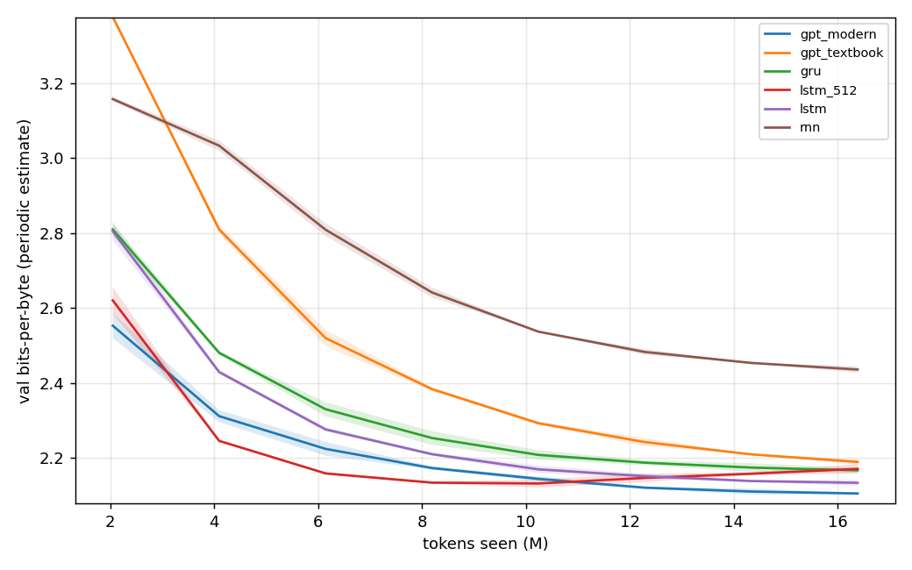
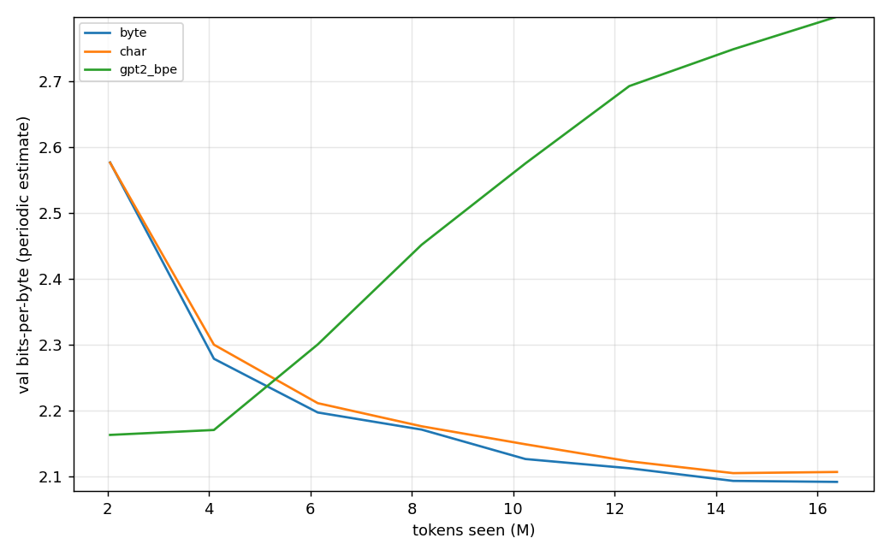
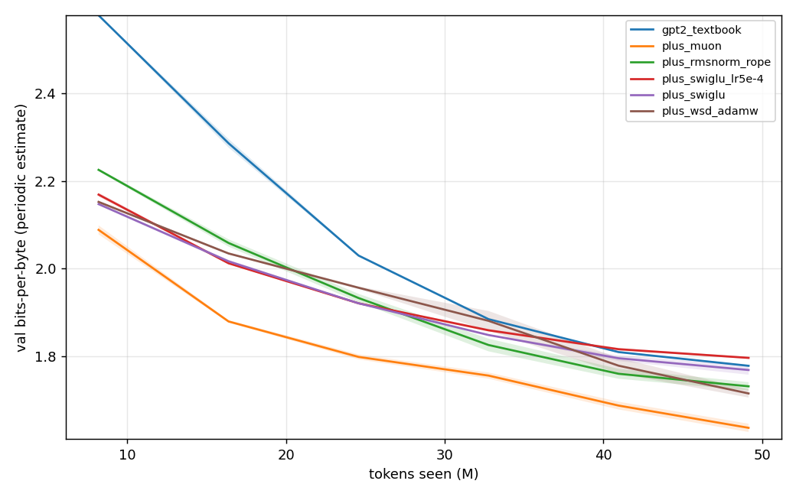
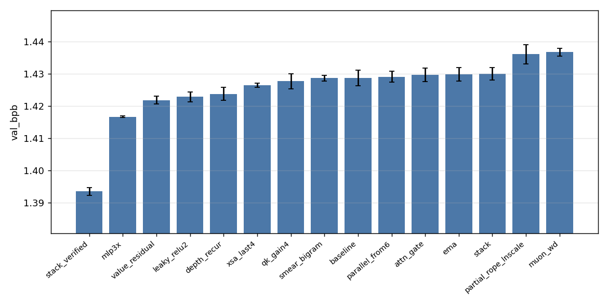

# From RNNs to Parameter Golf: a hands-on language-modeling course with `nanolm`

This tutorial goes from a character-level RNN to the techniques behind the winning entries of
OpenAI's **Parameter Golf** challenge (2026). The same small codebase, `llm/nanolm/`, is used
throughout. Every experiment is a **YAML config**. You run it with one command on a **Mac (Apple
Silicon)**, a **CUDA GPU**, or a plain **CPU**. Every run writes its config, metadata, logs and final
metrics to disk, so results can be analyzed, compared across seeds, and reproduced.

| Chapter | Topic | Config(s) | Runs on a laptop? |
|---|---|---|---|
| 0 | Setup, design of the codebase, the experiment workflow | `00_smoke.yaml` | yes (30 s) |
| 1 | The language-modeling task and the right metric (bits-per-byte) | — | — |
| 2 | RNN → GRU → LSTM | `01_char_rnn.yaml` | yes (minutes) |
| 3 | The character-level Transformer (textbook vs. modern) | `02_*.yaml` | yes (minutes) |
| 4 | Tokenizers: char vs. byte vs. BPE | `sweeps/02_tokenizers.yaml` | yes |
| 5 | Real pre-training on web text (FineWeb) + Muon | `03_gpt_fineweb.yaml` | slow on Mac; GPU recommended |
| 6 | Parameter Golf: the challenge, the winners, and our ablations | `04_*`, `05_*`, `sweeps/04_*` | GPU |
| 7 | Experiment methodology: seeds, noise, and a post-mortem | `analyze.py` | yes |
| 8 | Exercises and projects | | |

> **Where the numbers come from.** Every result table in this tutorial was produced by the commands
> shown next to it, on one shared NVIDIA H100 (another job was using most of the GPU at the
> same time, so wall-clock times are pessimistic). The raw run directories are under
> `outputs/nanolm/sweeps/`. Numbers about the public leaderboard are quoted from the official
> repository and linked. Nothing is copied from memory.

---

## 0. Setup and the shape of the code

### 0.1 Install

```bash
# any machine: Python >= 3.10, PyTorch >= 2.4
pip install torch numpy pyyaml sentencepiece tiktoken pandas matplotlib scipy huggingface_hub datasets pytest
cd DeepDataMiningLearning/llm                 # all commands below run from this directory
python -m pytest nanolm/tests -q              # 26 correctness tests, ~5 s on CPU
python -m nanolm.train -c nanolm/configs/00_smoke.yaml     # 30-second end-to-end run
```

`device: auto` chooses **CUDA → MPS (Apple Silicon) → CPU** in that order. Nothing in the code says
`.cuda()`. The device-specific choices all live in `nanolm/device.py`:

| | CUDA | MPS (Mac) | CPU |
|---|---|---|---|
| mixed precision (`precision: auto`) | bf16 autocast | fp32 (opt in with `precision=bf16`, needs macOS 14+) | fp32 |
| `torch.compile` (`train.compile`) | yes | ignored | ignored |
| fused AdamW | yes | no | no |
| Muon Newton-Schulz | bf16 | fp32 | fp32 |
| multi-GPU (`torchrun`) | NCCL | — | gloo |

The official challenge shipped a separate Apple-MLX script (`train_gpt_mlx.py`) next to its CUDA
script. That means two codebases that drift apart. We chose one PyTorch codebase with a device
abstraction instead: every feature works on every backend, and a student's Mac result and a GPU
result come from the same code.

> **Honest caveat.** The MPS path is written to avoid CUDA-only operations, and the CPU path
> (which exercises the same non-CUDA branches) is tested. It has **not** been benchmarked on a Mac by
> us. If something fails on MPS, run with `device=cpu` to check whether it is MPS-specific, and
> please report it.

### 0.2 Code map

```
llm/nanolm/
  config.py      typed dataclass configs; YAML + inheritance + key=value overrides; rejects typos
  device.py      cuda/mps/cpu selection, autocast, seed_everything(), synchronize()
  data.py        tokenizers (char, byte, gpt2-BPE, SentencePiece) -> uint16 token shards -> batches;
                 per-token byte lookup tables for bits-per-byte
  models/rnn.py  RNN / GRU / LSTM (+ a hand-written LSTM cell)
  models/gpt.py  ONE GPT class; every parameter-golf trick is a config switch (default off)
  optim.py       AdamW groups, Muon (Newton-Schulz), cosine / WSD schedules, EMA
  evaluate.py    loss, bpb, sliding-window eval (each token scored exactly once), sampling
  quant.py       int8/6/5/4 per-row quantization + zlib/lzma -> "artifact" size + round-trip bpb
  train.py       the single training entry point
  sweep.py       experiments x seeds from one sweep file; resumable; one run per GPU slot
  analyze.py     tables (mean +- std over seeds, paired t-test vs. baseline) + plots
  posttrain.py   re-evaluate a saved model: quantization bits x compressor x eval stride
  prepare.py     download / tokenize data ahead of time
  configs/       one YAML per experiment; configs/sweeps/ one YAML per study
  tests/         correctness tests (causality of every feature, bpb byte counting, ...)
```

The older modules in `llm/` (`transformer.py`, `train_lm.py`, `lm_dataset.py`, RL/SFT scripts) are
kept for the HuggingFace / instruction-tuning / RL lectures. `nanolm` replaces them for
*pre-training* experiments. Section 1.4 explains what was wrong with the old pre-training pipeline.

### 0.3 The experiment workflow (the important part)

**Rule 1: an experiment is a config, never an edited line of code.** Configs inherit:

```yaml
# configs/02b_char_transformer_modern.yaml  -- the whole file
defaults: [02_char_transformer.yaml]
name: char_gpt_modern
model: {norm: rmsnorm, pos: rope, mlp: swiglu, bias: false}
```

Any key can also be overridden from the command line:

```bash
python -m nanolm.train -c nanolm/configs/02_char_transformer.yaml model.n_layers=6 train.lr=5e-4 seed=2
```

Every key is typed, and a misspelled key is an error. For example, `model.n_layer=6` stops with
`unknown config key(s) ['n_layer']`. In our own parameter-golf code, configuration went through
environment variables, and an unknown key only produced a warning. Several "ablations" there
silently changed nothing (§7.3).

**Rule 2: every run leaves a complete record.** `outputs/nanolm/<date>_<name>/` holds:

| file | content |
|---|---|
| `config.yaml` | the fully resolved config; rerun the run with `--config <this file>` |
| `meta.json` | git commit + dirty flag, seed, date, host, device, torch version, command line |
| `train_log.jsonl` | step, loss, lr, tokens/s every `log_every` steps |
| `eval_log.jsonl` | val loss / bpb every `eval_every` steps |
| `metrics.json` | final full-validation bpb, sliding-window bpb, quantized size and round-trip bpb, time, memory |
| `sample.txt`, `model.pt` | generated text, checkpoint |

**Rule 3: a study is a sweep file, and every claim needs seeds.**

```bash
python -m nanolm.sweep  --sweep nanolm/configs/sweeps/04_golf_ablation.yaml --gpus 0,1,2,3
python -m nanolm.analyze outputs/nanolm/sweeps/golf_ablation
```

The sweep validates every config before launching anything. It runs each (experiment, seed) in its
own process, and skips runs that already have a `metrics.json`, so rerunning the command resumes a
crashed sweep. `analyze.py` reports mean ± std over seeds and a paired t-test against the baseline,
and plots the curves. §7 explains why this is not optional.

**Rule 4: the code is tested.** The most important test is causality. Every model feature is
checked to make sure that changing *future* tokens cannot change *past* predictions. A model that
leaks the future gets a spectacular and meaningless score (§7.3 shows how this happened to us).

---

## 1. Language modeling and how to measure it

### 1.1 The task

A language model assigns a probability to the next token given the past:
p(x_t | x_<t). Training minimizes the cross-entropy, i.e. the average −ln p(x_t | x_<t) over the
training tokens. In `nanolm`, every model maps `idx[B, T] → logits[B, T, V]`, and the loss in
`train.py` is one line:

```python
loss = F.cross_entropy(logits.float().view(-1, V), y.reshape(-1))     # y = idx shifted by one
```

### 1.2 Why bits-per-byte, not loss or perplexity

Per-token loss and perplexity depend on what a "token" is. A character model predicts about 1 byte
per step. A GPT-2 BPE model predicts about 4 bytes per step, so its per-token loss is naturally
larger. Comparing the two numbers is meaningless. The old tokenizer-comparison experiment in this
folder (`experiments.py: run_tokenizer_comparison_experiment`) made exactly this mistake.

**Bits-per-byte** removes the unit. It is the number of bits the model needs to compress the
validation text, divided by the length of that text in UTF-8 bytes:

```
bpb = (sum over scored tokens of -ln p(token)) / ln 2 / (number of UTF-8 bytes those tokens cover)
```

It is the official Parameter Golf metric, and it is what `nanolm` reports as `val_bpb`.
Counting bytes per token is subtle for SentencePiece, where the leading "▁" stands for a space byte
that is not counted after a document boundary. `data.py` builds three lookup tables per tokenizer
that reproduce the challenge's rule exactly:
`bytes(y) = base_bytes[y] + (has_leading_space[y] & ~is_boundary[x_prev])`.
`tests/test_nanolm.py` checks that the counted bytes equal `len(text.encode("utf-8"))`.

Reference points: a uniform guess over 256 byte values costs 8 bpb. gzip on English text gets about
2.5–3 bpb. The Parameter Golf baseline (a 17M-parameter GPT, 10 min on 8xH100) gets 1.2244, and the
winning entry gets 1.0565.

### 1.3 The data pipeline (borrowed from Parameter Golf)

1. **Tokenize once.** Store all token ids as one flat `uint16` array in the challenge's `.bin` shard
   format (a 256-int header, then the tokens), and memory-map it (`data.py: write_shard, read_shard`).
   A 100M-token shard costs no RAM until it is read.
2. **Sample windows.** Each training batch is `B` random windows of `T+1` tokens (`sampler: random`),
   or the next contiguous chunk of the stream (`sampler: sequential`, the golf loader, which never
   repeats data).
3. **Count steps and tokens, not epochs.** `train.max_steps × batch_size × seq_len × grad_accum` is
   the token budget. The log prints how many passes over the training set that is.
4. **Fix the validation split by the data, not by the run seed.** Use the contiguous tail of a
   corpus (Shakespeare), a seeded *document* shuffle (`split_by: doc`), or the challenge's fixed
   first-50k-documents split.

### 1.4 What was wrong with the old pipeline (worth discussing in class)

| Old behavior (`lm_dataset.py` / `train_lm.py`) | Consequence | nanolm |
|---|---|---|
| sliding windows with `stride=1`, stored as Python lists | 13.7M overlapping 64-token "sequences" for 13.7M characters; one "epoch" shows each character 64 times; about 12 min per epoch for a 2-layer RNN | windows sampled from a memory-mapped token array |
| validation = last 10% of an **alphabetically sorted** dictionary | validation is all words starting with late letters (distribution shift). The log shows val loss *rising* from epoch 1 while train loss falls | data-defined random doc split or contiguous tail |
| tokenizer comparison by per-token loss / perplexity | units differ, so the ranking is meaningless | bits-per-byte |
| device = `cuda` or `cpu` | Mac students fall back to CPU | cuda → mps → cpu |
| `FullTransformer` built `[layer for _ in range(n)]` | the same layer object was repeated, so all N layers shared weights | fixed in `transformer.py` |
| hyper-parameters spread over `Args` classes inside `experiments.py` | an experiment means editing code | YAML + overrides |

---

## 2. Recurrent language models: RNN → GRU → LSTM

Code: `nanolm/models/rnn.py`. Config: `configs/01_char_rnn.yaml`.

A recurrent LM reads one token at a time and carries a hidden state h_t:

- **Vanilla RNN:** h_t = tanh(W_x x_t + W_h h_{t-1}). Gradients flowing back through T steps are
  multiplied by W_h about T times, so they explode or vanish. Gradient clipping (`train.grad_clip`)
  fixes the explosion. Nothing simple fixes the vanishing.
- **LSTM:** adds a cell c_t that is updated *additively*, c_t = f ⊙ c_{t-1} + i ⊙ g. The forget gate f
  lets information (and gradient) flow across long spans. `LSTMScratch` writes the four gates out
  explicitly, and initializes the forget-gate bias to 1 so the cell remembers by default.
- **GRU:** a cheaper two-gate variant.

Training uses **truncated back-propagation through time**: each window of `seq_len` characters
starts from a zero state. RNNs and Transformers therefore share the data pipeline and the evaluation
exactly.

```bash
python -m nanolm.train -c nanolm/configs/01_char_rnn.yaml                      # LSTM
python -m nanolm.train -c nanolm/configs/01_char_rnn.yaml model.arch=gru name=char_gru
python -m nanolm.train -c nanolm/configs/01_char_rnn.yaml model.arch=lstm_scratch train.max_steps=200  # readable, slow
```

The results for all architectures are in the table in §3.3.

---

## 3. The character-level Transformer

Code: `nanolm/models/gpt.py`. Configs: `02_char_transformer.yaml` (textbook), `02b_char_transformer_modern.yaml`.

### 3.1 The textbook (GPT-2) block

```
x = tok_emb(idx) + pos_emb(positions)
for each layer:   x = x + Attention(LayerNorm(x))         # tokens exchange information
                  x = x + MLP(LayerNorm(x))               # per-token computation (GELU, 4x width)
logits = LayerNorm(x) @ tok_emb.weight^T                  # tied input/output embedding
```

The attention is causal: `F.scaled_dot_product_attention(q, k, v, is_causal=True)`, so position t
only sees positions ≤ t. This one flag is what makes it a *language model*. Remove it and the model
reads the answer.

### 3.2 The modern ("Llama") block

| Textbook | Modern | Why |
|---|---|---|
| LayerNorm | **RMSNorm** | no mean subtraction or bias; cheaper, equally stable |
| learned absolute positions | **RoPE** (rotary) | relative positions enter q·k directly; no position table |
| GELU MLP | **SwiGLU** | gated MLP; the 2/3 width keeps the parameter count equal |
| biases | none | fewer parameters, no loss in quality |

Each row is one config key (`model.norm`, `model.pos`, `model.mlp`, `model.bias`).

### 3.3 Results: RNN vs. Transformer (Tiny Shakespeare, characters)

```bash
python -m nanolm.sweep   --sweep nanolm/configs/sweeps/01_char_models.yaml
python -m nanolm.analyze outputs/nanolm/sweeps/char_models --baseline gpt_textbook --metric val_bpb
```

Setup: 1.0M training / 0.11M validation characters. 2000 steps × 32 × 256 = 16.4M training
characters (about 16 passes). Final evaluation on the full validation split. Two seeds.

| model | params | val bpb (mean ± std, 2 seeds) | Δ vs. textbook GPT | paired p | train time |
|---|---:|---:|---:|---:|---:|
| **GPT modern** (RMSNorm+RoPE+SwiGLU, 4L×256) | 3.16M | **2.105 ± 0.002** | −0.084 | 0.03 | 37 s |
| LSTM 2×256 | 1.07M | 2.134 ± 0.008 | −0.056 | 0.005 | 51 s |
| GRU 2×256 | 0.81M | 2.167 ± 0.007 | −0.022 | 0.26 | 48 s |
| LSTM 2×512 (parameter-matched) | 4.24M | 2.171 ± 0.013 | −0.019 | 0.13 | 58 s |
| GPT textbook (LayerNorm+learned pos+GELU) | 3.44M | 2.189 ± 0.007 | 0 | — | 26 s |
| vanilla RNN 2×256 | 0.28M | 2.436 ± 0.009 | +0.246 | 0.003 | 17 s |

Seed noise floor (median within-experiment std): **0.0076 bpb**. With only 2 seeds a paired t-test
has 1 degree of freedom, so treat the p-values as a rough guide.



What to notice:
- **The vanilla RNN is far behind** (+0.25 bpb). The gated cells (GRU, LSTM) fix most of that.
- **The modern recipe matters more than "Transformer vs. LSTM".** The textbook GPT is *worse* than a
  1M-parameter LSTM at this budget. The same-size model with RMSNorm + RoPE + SwiGLU is the best
  model. (2.105 bpb = 1.46 nats/char, in line with the well-known nanoGPT Shakespeare-char result.)
- **The bigger LSTM overfits.** LSTM-512 is best at about 10M tokens and then gets *worse*: its final
  train loss is 1.02 nats against 1.51 on validation (LSTM-256: 1.28 vs. 1.48). At 1 MB of text,
  data is the bottleneck, not parameters. This is a regularization lesson, not an architecture lesson.
- These conclusions hold **at this budget** (16 passes over 1 MB). Exercise 1 asks how they change
  with context length; more data (Chapter 5) changes them more.

---

## 4. Tokenizers: what a "token" should be

```bash
python -m nanolm.sweep --sweep nanolm/configs/sweeps/02_tokenizers.yaml
python -m nanolm.analyze outputs/nanolm/sweeps/tokenizers --metric val_bpb
```

Same modern Transformer, same 2000 × 32 × 256 token budget, three tokenizers. Because the token
budget is fixed, the BPE model sees about 3–4× more *text*, but it must also learn a
50,257-row embedding table from 1 MB of data.

| tokenizer | vocab | params (non-emb.) | bytes/token | train passes | val loss (nats/token) | val ppl | **val bpb** |
|---|---:|---:|---:|---:|---:|---:|---:|
| char | 65 | 3.16M (3.15M) | 1.00 | 16 | 1.460 | 4.31 | **2.107** |
| byte | 256 | 3.21M (3.15M) | 1.00 | 16 | 1.450 | 4.26 | **2.092** |
| GPT-2 BPE | 50,257 | 16.0M (3.15M) | 3.09 | 54 | 5.998 | 402 | **2.798** (best checkpoint, step 250: 2.163) |

(One seed each. The char/byte difference of 0.015 is about 2× the seed noise floor measured in §3.3,
so do not over-read it.)



Three lessons in one table:
1. **Loss and perplexity are not comparable across tokenizers.** By perplexity, BPE looks 100× worse
   (402 vs. 4.3). In bpb it is 33% worse at the end and nearly equal at its best point. Only bpb
   measures the same thing for all three.
2. **A large vocabulary needs data.** Shakespeare has only 302k GPT-2 tokens. The fixed token budget
   becomes 54 passes, and the 12.9M-parameter embedding table memorizes: train loss 1.30 nats/token
   against 6.0 on validation. The BPE model was best after 250 steps (2.163 bpb) and got worse from
   then on. Early stopping, or more data, would rescue it.
3. On a small corpus, bytes are as good as characters and need no vocabulary building. This is the
   byte-level-model argument in miniature.

Parameter Golf turned this trade-off into one of its biggest levers. The vocabulary grew from
sp1024 → sp4096 → sp8192 over the competition, about −0.012 bpb per step, combined with other
changes (§6.2). A larger vocabulary means more bytes per token, which means more text per
step and per unit of attention context. But the embedding table must fit in the 16 MB budget,
which is why quantizing the embeddings (int7/int6 GPTQ) arrived together with the large vocabularies.

---

## 5. Real pre-training: FineWeb, the Parameter Golf data

```bash
python -m nanolm.prepare --golf-shards 1 --dest data/golf    # val (62M tokens) + 1 train shard (100M) + sp1024 tokenizer
python -m nanolm.train -c nanolm/configs/03_gpt_fineweb.yaml
python -m nanolm.sweep --sweep nanolm/configs/sweeps/03_transformer_recipe.yaml
```

The data is the challenge's FineWeb export: web documents tokenized with a 1024-token SentencePiece
BPE (`sp1024`). Because we report bpb on the same validation documents, our numbers sit on the same
axis as the public leaderboard. Ours use about 50M training tokens, while leaderboard runs use about
7B tokens (8 GPUs × 10 minutes).

### 5.1 Muon

AdamW scales every coordinate of the update separately. **Muon** (Keller Jordan, used by every
golf record) treats each hidden weight matrix as a whole. It takes the momentum-averaged gradient
G = U S Vᵀ and applies **U Vᵀ** instead: every singular direction gets the same step size, so
directions with small gradients are not starved. U Vᵀ is approximated in 5 matrix-multiply-only
Newton–Schulz iterations (`optim.py: zeropower_via_newtonschulz5`). Embeddings, the output head and
all vectors/scalars stay on Adam (`build_optimizers`). A test checks that the iteration maps the
singular values into roughly [0.7, 1.2].

### 5.2 Schedules

- **Cosine** (textbook): warm up, then cosine decay to `min_lr_frac`.
- **WSD / "warmdown"** (golf): constant LR, then linear decay over the last `warmdown_frac` of
  training. Progress is `max(step/max_steps, time/max_time_sec)`, so the same schedule works under
  a wall-clock budget, which is how golf runs were limited.

### 5.3 Results: the recipe, one change at a time

Setup: 6 layers × 384, 11M parameters, 3000 steps × 16k tokens = 49M training tokens (half of one
shard, streamed once). Final evaluation on the first 4.2M validation tokens. Two seeds. "p" is a
paired t-test with 1 degree of freedom, so it is a rough guide only.

| step in the recipe | val bpb (2 seeds) | change vs. the previous row | paired p |
|---|---:|---:|---:|
| GPT-2 textbook (LayerNorm, learned pos, GELU, bias), AdamW + cosine | 1.790 ± 0.001 | — | — |
| + RMSNorm + RoPE, no bias | 1.744 ± 0.010 | **−0.046** (both seeds −0.04 to −0.05) | 0.10 |
| + SwiGLU (same parameter count) | 1.786 ± 0.013 | **+0.042** (worse on both seeds) | 0.23 |
| ↳ SwiGLU at half the LR (5e-4) | 1.814 ± 0.001 | +0.029 vs. SwiGLU | 0.20 |
| + WSD schedule instead of cosine (still AdamW) | 1.728 ± 0.010 | **−0.058** | 0.02 |
| + **Muon** (matrices) + Adam (rest), WSD | **1.647 ± 0.010** | **−0.081** | 0.001 |



Reading the table as a researcher:
- **The two biggest wins are about optimization, not architecture.** Holding the LR high and then
  decaying it linearly to 0 (WSD) beats cosine by 0.058. Muon adds another 0.081 on top of the same
  schedule. Together they are worth more than all the block changes combined. This is also what
  Parameter Golf found.
- **The `plus_muon` row is not a pure optimizer effect on its own.** That run also switched cosine →
  WSD. Only the `plus_wsd_adamw` control row lets us split the gain into schedule and optimizer.
  When a run changes two things, add the control.
- **SwiGLU did *not* help here.** It learned faster for the first ~1,500 steps (training loss up to
  0.18 lower), then crossed over and finished worse on both seeds. Halving the LR made it *worse*,
  which suggests this short, cosine-decayed run is under-trained rather than unstable. We report the
  result as it is: the published benefit of SwiGLU did not reproduce at 49M tokens with this LR. With
  only 2 seeds, p = 0.23, this is a weak negative result, and finding out why is a good student project.
- Seed noise here is about 0.01 bpb. That is larger than on Shakespeare, because a 50M-token run is
  still far from converged.

---

## 6. Parameter Golf

### 6.1 The challenge

[OpenAI Parameter Golf](https://github.com/openai/parameter-golf) (March 18 – April 30, 2026, more than
1,000 participants): train the language model with the lowest FineWeb validation bpb, subject to:

- the **artifact** (compressed weights + training code) is at most **16 MB**;
- training takes at most **10 minutes on 8×H100**; evaluation has its own time limit;
- evaluation is **tokenizer-agnostic** (bpb) on a fixed set of 50k documents.

This is "L(N)" optimization: the best loss for a fixed parameter/byte budget. It complements the
NanoGPT *speedrun* (best time for a fixed loss). With a budget this tight, the winning ideas are
about **using every byte** (quantization, compression, weight sharing) and **using every FLOP of
evaluation** (context, test-time training), as much as about architecture.

### 6.2 Final leaderboard (10 min / 16 MB track)

From the [official README](https://github.com/openai/parameter-golf/blob/main/README.md) (final
audited update, May 2026). Scores are 3-seed means.

| bpb | Author | What the record adds (on top of the previous one) |
|---:|---|---|
| **1.0565** | codemath3000 | PR #2130 architecture rerun on clean CaseOps data; token-only n-gram tilt, AsymLogit, more GPTQ calibration batches |
| 1.0576 | simonbissonnette | progressive context growth to 3k; short-document score-first TTT |
| 1.0586 | andrewbaggio1 | 2560-token eval/TTT context; no-Q/V TTT mask; QK-gain 5.25 |
| 1.0594 | alertcat | AWQ-lite mixed GPTQ + AsymLogit |
| 1.0611 | codemath3000 | BOS-fixed SmearGate, LQER, SparseAttnGate, per-group lrzip |
| 1.0634 | nprime06 | Polar-Express Newton–Schulz, MIN_LR, SparseAttnGate, fused CE |
| 1.0655 | dexhunter | CaseOps + gated attention + quant gate + loop 4–5 + phased TTT |
| 1.0678 | romeerp | CaseOps lossless case-transform tokenizer, tapered WD |
| 1.0810 | bigbag | SP8192 + 3-layer recurrence + parallel residuals + QK-gain 5.25 + legal TTT |
| 1.0856 | Kevin Clark | SP8192 + GPTQ embeddings + depth recurrence + SDClip |
| 1.0979 | Kevin Clark | SP4096 + 4× MLP + high WD, *removing* hash embeddings / SmearGate / value residual |
| 1.1194 | abaybektursun | LeakyReLU² + legal score-first TTT + parallel Muon (late March) |
| 1.1925 | Matthew Li | sliding-window eval only (stride 64) |
| 1.2244 | baseline | 9 layers × 512, 1024 vocab, tied embeddings, 4 KV heads |

How to read this table:
1. It is a **lineage**: almost every record is "previous stack + 1–3 changes".
2. The top 5 are within 0.005 bpb of each other, and several were accepted at p = 0.01–0.06. Their
   order is close to the seed noise.
3. The audit **excluded** many submissions that leaked the target or counted bytes wrongly (n-gram
   channels that depend on the target token, unnormalized byte mixtures, wrong byte denominator).
   Metric hygiene was a real part of the competition (§7.3).

### 6.3 The techniques, grouped by lever

The impact numbers are quoted from the record write-ups. Most are single-seed and/or bundled with
other changes, so treat them as rough.

**A. Evaluation (free at training time)**

| technique | what it does | reported gain |
|---|---|---|
| sliding-window eval | score each token with nearly the full context instead of on average half (`eval.sliding_stride`) | **−0.032** (03-19) |
| legal score-first TTT | adapt (LoRA) weights on validation chunks *after* scoring them | −0.002 early … −0.013 late (phased) |
| longer eval context | 2k–3k tokens at eval | ~−0.001 |

**B. Bytes: quantization × compression × weight decay**

| technique | what it does | reported gain |
|---|---|---|
| int8 → int6 per-row + zstd/lzma | ~25% fewer bytes per weight, spent on a bigger model (3× MLP) | −0.029 together with MLP3×/SmearGate/BigramHash (03-19/20) |
| QAT (fake-quant STE) | train through the rounding (`train.qat_bits`) | small; removed later |
| GPTQ (Hessian-aware rounding), SDClip, AWQ-lite, LQER | better rounding / clipping / low-rank error correction | −0.0046 (full-Hessian GPTQ) … −0.0003 |
| high weight decay (0.09) | smaller weights compress better (weight RMS predicts compressed size, R² ≈ 0.99), so room for more parameters | part of −0.012 (04-01) |

**C. Tokenizer**: sp1024 → sp4096 → sp8192 (about −0.012 per step, bundled), CaseOps (−0.004).

**D. Architecture** (each is a key in `ModelConfig`):

| technique | key | what it does | reported gain |
|---|---|---|---|
| U-Net skips | `unet_skips` | encoder-half outputs feed mirrored decoder layers | baseline |
| relu² / LeakyReLU(0.5)² | `mlp` | squared activation; leaky keeps gradient for x<0 | −0.002 … −0.003 |
| XSA (exclusive self-attn) | `xsa_last_n` | subtract each head's projection onto the token's *own* value vector | −0.005 with EMA |
| partial RoPE + LN scale | `rope_dims`, `ln_scale` | rotate 16/64 dims; damp layer i's input by 1/√(i+1) | −0.0023 |
| QK-gain | `qk_gain_init` | learnable per-head temperature after QK-norm, initialized 4–5.25 | ~−0.003 (4→5) |
| SmearGate | `smear_gate` | blend each token's embedding with the previous token's | part of −0.029 |
| BigramHash | `bigram_buckets` | hashed (prev, cur) pair embedding | part of −0.029, later removed |
| value residual | `value_residual` | mix layer-0 values into later layers | later removed |
| depth recurrence | `recur_layers` | re-run layers 3–5 (or 4–5): more depth, zero extra bytes | −0.002 … −0.003 |
| parallel residuals | `parallel_from` | attention and MLP read the same input in late layers | −0.002 |
| gated attention | `attn_gate` | sigmoid gate per head on the attention output | ~−0.002 |

**E. Optimizer**: Muon everywhere; momentum 0.95 → 0.97–0.99; Muon weight decay; EMA of weights
(−0.0006 alone); long warmdown + LR floor; MuonEq-R and Polar-Express coefficients (~−0.001 each).

**What this tells a student.** The big, robust wins were *not* clever blocks. They were:
(1) evaluate with more context, (2) spend bytes better (quantize, compress, then buy parameters with
the savings), (3) a larger vocabulary, and (4) test-time training. Most architectural tweaks were
worth about 0.002 bpb, a size that only shows up inside an already-tuned stack and that is
comparable to the seed noise. Some (BigramHash, value residual) were later *removed*: they helped a
weak model and became useless once the model was stronger. An independent analysis of about 2,000
submissions (["Parameter Golf: What Really Works?", arXiv 2607.01517](https://arxiv.org/abs/2607.01517))
reaches a similar conclusion, although its correlational method is weak evidence.

### 6.4 The golf baseline in `nanolm`

`configs/04_golf_baseline.yaml` re-implements the challenge baseline with config switches:
9 layers, d = 512, 8 heads / 4 KV heads (GQA), relu² MLP ×2, tied embeddings (init std 0.005),
U-Net skips, x0 residual mixing, QK-norm with gain 1.5, logit softcap 30, zero-initialized output
projections, Muon (lr 0.04) + Adam (embeddings 0.05, scalars 0.04), constant LR then linear warmdown,
int8 + compression export. With `torchrun --nproc_per_node=8` and `max_time_sec: 600` this matches the
official budget.

On one GPU, `04_golf_lab.yaml` keeps the same model and shrinks the budget to 2000 steps × 65,536
tokens = 131M tokens. That is about 2% of an official run, so absolute numbers are higher than the
leaderboard. The *differences* between techniques are what we measure.

### 6.5 Our ablation: each technique alone, two seeds

```bash
python -m nanolm.sweep   --sweep nanolm/configs/sweeps/04_golf_ablation.yaml
python -m nanolm.analyze outputs/nanolm/sweeps/golf_ablation --baseline baseline --metric val_bpb
```

Setup: the golf baseline model (17.07M parameters), 2000 steps × 65,536 tokens = 131M FineWeb
tokens, the same data order for every run, and evaluation on the first 4.2M validation tokens
(non-overlapping windows). Each technique is switched on **alone**. Two seeds; "p" is a paired
t-test (1 degree of freedom). Seed noise floor: **0.0017 bpb**.

| technique (alone) | val bpb (2 seeds) | Δ vs. baseline | paired p | params | int8 size | verdict |
|---|---:|---:|---:|---:|---:|---|
| MLP 3× (instead of 2×) | 1.4167 ± 0.0003 | **−0.0121** | 0.10 | 21.8M | 19.8 MB ✗ | helps (both seeds), but needs int6 to fit |
| value residual | 1.4218 ± 0.0013 | **−0.0069** | 0.08 | 17.1M | 15.7 MB | helps (both seeds) |
| LeakyReLU(0.5)² | 1.4228 ± 0.0015 | **−0.0059** | 0.07 | 17.1M | 15.8 MB | helps (both seeds) |
| depth recurrence (layers 3–5 ×2 from 35%) | 1.4238 ± 0.0019 | **−0.0049** | 0.05 | 17.1M | 15.7 MB | helps, zero extra bytes |
| XSA, last 4 layers | 1.4265 ± 0.0006 | −0.0023 | 0.33 | 17.1M | 15.7 MB | small, ~1 noise floor |
| QK-gain init 4.0 | 1.4277 ± 0.0023 | −0.0010 | 0.05 | 17.1M | 15.7 MB | within noise |
| SmearGate + BigramHash(4096) | 1.4287 ± 0.0009 | −0.0001 | 0.99 | 17.7M | 16.3 MB | nothing (and costs 0.6 MB) |
| **baseline** | **1.4287 ± 0.0025** | 0 | — | 17.1M | 15.7 MB | |
| parallel residual from layer 6 | 1.4291 ± 0.0017 | +0.0003 | 0.65 | 17.1M | 15.7 MB | nothing |
| gated attention | 1.4297 ± 0.0021 | +0.0010 | 0.16 | 17.1M | 15.8 MB | nothing |
| EMA (0.997) | 1.4299 ± 0.0021 | +0.0012 | 0.14 | 17.1M | 15.7 MB | nothing at 2000 steps |
| partial RoPE (16/64) + LN-scale | 1.4361 ± 0.0029 | **+0.0073** | 0.03 | 17.1M | 15.7 MB | **hurts** (both seeds) |
| Muon weight decay 0.04 | 1.4367 ± 0.0012 | **+0.0080** | 0.07 | 17.1M | 15.7 MB | **hurts**, saves only 0.3% bytes |
| "record stack" (10 tricks from records, see `stack`) | 1.4300 ± 0.0020 | +0.0013 | 0.75 | 22.4M | 19.6 MB | **nothing**: the harmful ones cancel the good ones |
| **verified stack** (only the 5 that helped) + int6 | **1.3935 ± 0.0012** | **−0.0352** | 0.016 | 21.8M | **14.6 MB (int6)** ✓ | sum of the parts (−0.032 expected) |



What this experiment teaches:
1. **Ablate one thing at a time, then stack only what survived.** The "record stack" (everything a
   record write-up recommended) is *no better than the baseline*. Two of its components hurt at our
   scale, and EMA and SmearGate/BigramHash did nothing. Stacking only the five techniques that helped
   on both seeds gives −0.035, almost exactly the sum of their separate effects (−0.032). At this scale
   the good effects are close to additive.
2. **Context matters for "what works".** Partial RoPE + LN-scale and Muon WD were real gains in the
   records: in an 11-layer model trained on about 7B tokens, with a size budget that WD helped meet.
   In a 9-layer model trained on 131M tokens they cost 0.007–0.008. Muon WD exists to make weights
   compress better, but with int8 at our scale it saved only 0.3% of the bytes. A technique is a
   claim about a regime, not a law.
3. **Bytes are a currency.** 3× MLP is the largest single gain, but it breaks the 16 MB budget at int8
   (19.8 MB). It only "counts" because int6 brings it back to 14.6 MB for a +0.0016 bpb rounding cost
   (§6.6). In golf, an architecture result without its artifact size is half a result, and that is
   why `metrics.json` always records both.
4. **Two seeds is a minimum, not a luxury.** The noise floor (0.0017) is about the size of the
   XSA and QK-gain effects. We call those "within noise", not "helps".

### 6.6 The free levers: evaluation stride and quantization (no retraining)

```bash
python -m nanolm.posttrain outputs/nanolm/sweeps/golf_ablation/baseline_s1337 --bits 8 6 5 4 --strides 0 256 64
```

Golf-lab baseline (seed 1337, 17.07M parameters), evaluated on the first 4.2M validation tokens
with a 1024-token context:

**Evaluation stride (same weights):**

| eval | val bpb | eval time |
|---|---:|---:|
| non-overlapping 1024-token windows (average context ≈ 512) | 1.4270 | 5.5 s |
| sliding, stride 256 (context ≥ 768) | 1.3915 (−0.0355) | 20 s |
| sliding, stride 64 (context ≥ 960) | **1.3904 (−0.0366)** | 81 s |

This is the single largest effect in the whole tutorial, and it comes with *zero* training change.
It reproduces the leaderboard record (−0.032). Most of the gain is already there at stride 256 for
a quarter of the cost. Nothing about the model changed: non-overlapping evaluation simply
under-reports what the model can do, because a token at the start of a window has almost no context.

**Quantization × compressor (round-trip = de-quantize and re-evaluate):**

| export | baseline: size | bits/param | round-trip bpb gap | stack (22.4M params): size | gap |
|---|---:|---:|---:|---:|---:|
| int8 + zlib | 15.68 MB | 7.35 | +0.0001 | 19.87 MB | +0.0001 |
| int8 + lzma | 15.72 MB | 7.37 | +0.0001 | 19.57 MB | +0.0001 |
| int6 + lzma | 11.52 MB | 5.40 | +0.0019 | **14.24 MB** | +0.0012 |
| int5 + lzma | 9.81 MB | 4.60 | +0.0075 | 11.90 MB | +0.0052 |
| int4 + lzma | 7.78 MB | 3.64 | +0.0302 | 9.77 MB | +0.0225 |

- int8 is essentially free (+0.0001) but cannot fit a model of more than about 17M parameters into 16 MB.
- **int6 costs about 0.002 bpb and saves 27% of the bytes.** That is how the 22M-parameter (MLP 3×)
  model fits into 14.2 MB, and 3× MLP alone was worth −0.012 (§6.5). Every golf record made this trade.
- int4 with simple rounding is too lossy (+0.03). The records that went below 6 bits used GPTQ
  (Hessian-aware rounding) or ternary/binary *training*, not post-hoc rounding.
- lzma squeezes the unused high bits of int6/int5 values stored in int8 bytes (5.40 bits/param at
  "6 bits"). At int8 there is nothing to squeeze, and lzma is even slightly larger than zlib.

### 6.7 Putting it together (lab scale, 131M training tokens, 2 seeds)

| | val bpb | artifact |
|---|---:|---:|
| golf baseline, int8 | 1.4287 | 15.7 MB |
| + verified architecture stack (3× MLP, value residual, LeakyReLU², depth recurrence, XSA) | 1.3935 | 14.6 MB at int6 |
| + sliding-window eval, stride 64 | **1.3558** | |
| int6 round-trip cost (measured at stride 0) | +0.0016 | |

That is about −0.073 bpb (−5%) from a 2% compute budget. On the leaderboard, baseline → winner was
−0.168 with about 50× more training tokens, a larger vocabulary, GPTQ and test-time training: the
techniques we did not implement, which make good exercises.

---

## 7. Methodology: seeds, noise, and a post-mortem

### 7.1 One seed is an anecdote

Two runs that differ only in the random seed differ in val bpb. `analyze.py` prints the median
within-experiment standard deviation (the **noise floor**). On the leaderboard, the seed std was
about 0.0003–0.001 bpb, while many claimed improvements were 0.001–0.003. Rules of thumb:

- Use **the same seeds** for the baseline and the variant, and compare *paired* differences
  (`paired_p` in `summary.md`). The data order is fixed by the data, not the seed, so pairing removes
  most of the shared variance.
- A difference smaller than about 2× the noise floor needs more seeds, not more enthusiasm.
- Decide the metric *before* looking at the results. Report `val_bpb`, `sliding_bpb` and
  `quant_val_bpb` separately; they answer different questions.

### 7.2 Debug or negative result?

When a variant does not help, check these **before** concluding that the idea is dead:
1. Did the switch actually change the model? Compare `params` in `metrics.json`, and look for the
   "depth recurrence ON" / "QAT ON" lines in the log.
2. Is the run comparable? Same tokens seen, same data order, same eval tokens.
3. Is the effect larger than the noise floor at this scale? Many golf tricks only matter for a
   well-trained model. A 131M-token run is not a 7B-token run.

If all three check out, it is a genuine negative result at this scale. Write it down; it is a result.

### 7.3 Post-mortem of our own 2026 submission (why this codebase looks the way it does)

We entered Parameter Golf with a 3,400-line script (`mytrain_gpt_v6_1.py`) and a JSON →
environment-variable launcher. A careful audit after the challenge found:

| What happened | Effect | Fixed here by |
|---|---|---|
| A "PPM byte-mixture" eval built the network's byte probability *using the true byte* | reported 0.83–0.94 bpb; **invalid** (the real numbers were around 1.16–1.28), and the launcher ranked runs by this number | metric code separated from model code; causality tests; bpb defined in one place |
| The launcher's size regex did not match the new script's log line | artifact size was `None` for every run; our best model (1.1586 bpb) was **32 MB**, twice the limit, and nobody noticed | size computed and written to `metrics.json` by the trainer itself (`fits_budget`) |
| Unknown config keys only produced a warning; several flags were never read | ablations of features that were not running | typed configs that reject unknown keys |
| Late QAT was scheduled on the step limit while the run stopped on wall-clock | QAT never switched on in time-limited runs | progress-based switches (`progress = max(step, time)`) with a log line |
| Sliding-window eval was used for the in-training curve but not for the final number | curves and final numbers disagreed (1.238 vs 1.273) | one `evaluate()` with an explicit, logged stride |
| Decisions made from single seeds at the 0.002 level | noise was chased | sweeps with seeds + paired tests |

Our best *valid* submission scored about 1.277–1.281 bpb (3 seeds, 15.97 MB). The baseline was
1.2244 and the winner 1.0565. The lesson is not that the ideas were bad. Without a trustworthy
measurement pipeline we could not tell which ideas were good.

---

## 8. Exercises

1. **Context length.** Train `02b` with `train.seq_len=64, 128, 256, 512`. Plot bpb against context
   for the Transformer and the LSTM. Where does the LSTM stop benefiting?
2. **Scaling law in one afternoon.** Sweep `model.dim` × `model.n_layers` on `03_gpt_fineweb.yaml`
   at a fixed token budget. Plot bpb against non-embedding parameters (`params_non_embedding`).
3. **AdamW vs. Muon at equal tuning effort.** Give each optimizer the same 4-point LR grid
   (use `grid:` in a sweep file). Is the gap larger or smaller than with default LRs?
4. **The byte budget.** With `posttrain.py`, find the smallest bits/weight that costs less than
   0.01 bpb. Then make the model wider until int6 + lzma reaches exactly 16 MB. Does it beat the int8
   model of the same size?
5. **Reproduce a record claim.** Pick one row of §6.3 and test it with 3 seeds in `04_golf_lab`.
   Report the mean, std and paired p-value. Does the claimed gain survive at our scale?
6. **Break it on purpose.** Remove `is_causal=True` from `Attention.forward` and run the tests.
   Then train for 100 steps and look at the bpb. Explain why the number is meaningless.
7. **Implement a new technique** as one config key in `models/gpt.py` (e.g. multi-token prediction,
   or SwiGLU vs. relu² at equal parameters), add a causality test case, and run an ablation sweep.

---

## Appendix A. Mac quick reference

```bash
python -m nanolm.train -c nanolm/configs/01_char_rnn.yaml                  # device auto -> mps
python -m nanolm.train -c nanolm/configs/02b_char_transformer_modern.yaml
# FineWeb on a laptop: fewer, shorter steps
python -m nanolm.train -c nanolm/configs/03_gpt_fineweb.yaml train.max_steps=600 train.batch_size=16
# golf model on a laptop (expect hours for the full lab budget):
python -m nanolm.train -c nanolm/configs/04_golf_lab.yaml train.max_steps=300 train.grad_accum=1 eval.final_eval_tokens=524288
```
If MPS errors on an operation, prefix the command with `PYTORCH_ENABLE_MPS_FALLBACK=1`, or use `device=cpu`.

## Appendix B. Multi-GPU

```bash
torchrun --standalone --nproc_per_node=8 -m nanolm.train -c nanolm/configs/04_golf_baseline.yaml
```
Each rank reads its own slice of the sequential stream. Muon orthogonalizes a slice of the matrices
on each rank and all-reduces the updates. Under `max_time_sec`, the ranks agree on when to stop.

> **Not yet tested.** Every result in this tutorial was produced on a single GPU. The DDP path follows
> the official baseline's design, but we have not run it on multiple GPUs. Run
> `torchrun --nproc_per_node=2 -m nanolm.train -c nanolm/configs/00_smoke.yaml` and check that it
> matches a single-GPU run before relying on it.

## Appendix C. Adding a new experiment

1. Add a key to `ModelConfig` (or `TrainConfig`) in `config.py`, with a default that means *off*.
2. Implement it in `models/gpt.py` behind that key.
3. Add it to `GOLF_FEATURES` in `tests/test_nanolm.py` and run the tests.
4. Add a run to a sweep file. Do not edit the base config.
