# Language Models from Scratch to Frontier: a hands-on course with `nanolm`

This course builds language models step by step. You start with a character-level RNN and work up to
the architectures inside today's open LLMs (Qwen3.5 and others). Every idea comes with
**the math, the code that implements it, a configuration you can run, and a measured result**,
usually with a figure. The same small codebase, `llm/nanolm/`, is used throughout. It runs on a
**Mac (Apple Silicon)**, a laptop with an **NVIDIA GPU**, a **server GPU**, or a plain **CPU**.

**On a laptop? Start with [`LAPTOP_QUICKSTART.md`](LAPTOP_QUICKSTART.md).** It lists the exact
commands, downloads, run times, memory use, and the numbers you should get.

| Part | You will learn | Main code |
|---|---|---|
| **0** | Setup; how experiments are configured, recorded and compared | `config.py`, `train.py`, `sweep.py`, `analyze.py` |
| **1** | **Language models from scratch:** the probability model, the loss, data and tokenizers, RNN → LSTM → Transformer (every component, with equations), optimization, sampling | `data.py`, `models/`, `optim.py`, `evaluate.py` |
| **2** | **Pre-training a GPT on web text:** real data, the modern recipe (RMSNorm, RoPE, SwiGLU, Muon, WSD), what each change is worth | `configs/03_*`, `sweeps/03_*` |
| **3** | **From GPT to modern LLMs:** how the architecture evolved (GQA, MoE, linear attention, ...), inside Qwen3.5, evaluating a pretrained model (perplexity and benchmarks such as MMLU and GPQA), fine-tuning with LoRA, SFT and DPO | `finetune.py`, `benchmarks.py` |
| **4** | **Parameter Golf: exploring next-generation architectures.** What wins when the model must fit in 16 MB, measured technique by technique | `models/gpt.py` switches, `sweeps/04_*` |
| **5** | **Research methodology:** seeds, noise, telling a bug from a negative result | `analyze.py` |
| **HW** | **Four homework assignments** (one per part): experiments to design and run, figures to make, a report to write, and a grading rubric | — |

> **Where the numbers come from.** Every number and figure in this tutorial comes from running the
> command shown next to it. We ran them on NVIDIA H100 GPUs; the laptop-track reference numbers used
> fp32, the Mac default. Every figure can be regenerated with `python -m nanolm.viz all`, and the raw
> runs are under `outputs/nanolm/`. Numbers about other people's models (leaderboards, model cards)
> are quoted from the linked source. Nothing is reproduced from memory.

---

# Part 0 — Getting started

## 0.1 Install

```bash
# Python >= 3.10, PyTorch >= 2.4, any OS
pip install torch numpy pyyaml sentencepiece tiktoken pandas matplotlib scipy huggingface_hub datasets pytest
pip install transformers peft lm-eval         # Part 3 only (pretrained models, benchmarks)
cd DeepDataMiningLearning/llm                 # every command below runs from this directory
python -m pytest nanolm/tests -q              # correctness tests (~15 s on CPU)
python -m nanolm.train -c nanolm/configs/00_smoke.yaml     # a 30-second end-to-end run
```

`device: auto` picks **CUDA → MPS (Apple Silicon) → CPU**. Nothing in the code calls `.cuda()`
directly; all device-specific choices are in `nanolm/device.py`:

| | CUDA | MPS (Mac) | CPU |
|---|---|---|---|
| mixed precision (`precision: auto`) | bf16 autocast | fp32 (`precision=bf16` on macOS 14+) | fp32 |
| `torch.compile` (`train.compile`) | yes | skipped | skipped |
| Muon's Newton–Schulz iteration | bf16 | fp32 | fp32 |
| multi-GPU (`torchrun`) | NCCL | — | gloo |

## 0.2 The laptop track

Every stage has a laptop-sized configuration: `nanolm/configs/laptop/` for training from scratch and
`nanolm/configs/part2/` for pretrained models. The rules for sizing them:
- at most about 4 PFLOP of training (FLOPs ≈ 6 × parameters × tokens, see §1.6.7);
- a wall-clock cap (`train.max_time_sec`), so a slow machine finishes on time with a slightly weaker
  model instead of running all night;
- measured peak memory of at most 2.9 GB in fp32.

**Measure your own machine first:** `python -m nanolm.bench -c <config>` runs 13 real training steps
and prints tokens/s, peak memory, and the projected time of the whole config.

| config | trains | FLOPs | est. Mac time* | peak memory (fp32) | reference result |
|---|---|---:|---:|---:|---:|
| `laptop/L1_char_lstm` | 2-layer LSTM, Shakespeare | 0.1 P | 1–3 min | 0.3 GB | 2.154 bpb |
| `laptop/L2_char_gpt` | 4-layer Transformer, Shakespeare | 0.36 P | 4–12 min | 0.8 GB | 2.106 bpb |
| `laptop/L3_tokenizer` | same, your own BPE tokenizer | 0.36 P | 4–12 min | 0.9 GB | 2.279 bpb |
| `laptop/L4q_gpt_fineweb_quick` | 4 × 256 GPT on web text | 0.4 P | 5–14 min | 0.9 GB | 1.879 bpb |
| `laptop/L4_gpt_fineweb` | 6 × 384 GPT, 49M tokens, Muon | 3.8 P | 45–130 min | 1.8 GB | 1.647 bpb |
| `part2/P1_eval_bpb` | score Qwen2.5-0.5B (no training) | — | 5–15 min | ~3 GB (est.) | 0.951 bpb |
| `part2/P2_sft_alpaca` | LoRA SFT of SmolLM2-360M | ~3 P | 30–90 min | 2.0 GB | answer loss 1.556 → 1.321 |
| `part2/P3_dpo` | LoRA DPO of Qwen2.5-0.5B-Instruct | ~3 P | 30–90 min | 2.9 GB | reward acc. 0.50 → 0.68 |
| `laptop/L5_golf_mini` | Parameter-Golf baseline, 6 × 384 | 2.1 P | 25–70 min | 1.8 GB | 1.633 bpb |
| `laptop/L6_golf_mini_stack` | + verified golf techniques | 3.1 P | 35–105 min | 2.9 GB | 1.554 bpb (sliding eval) |

\* *Estimated* from each config's FLOP count at 0.5–1.5 TFLOP/s; `bench` gives the real figure for
your machine. Your bpb should match the reference to within about ±0.01, unless the time cap ended
your run early.

## 0.3 Code map

```
llm/nanolm/
  config.py      typed configs: YAML + inheritance + key=value overrides; a misspelled key is an error
  device.py      cuda / mps / cpu selection, autocast, seed_everything()
  data.py        tokenizers (char, byte, word, BPE, any HuggingFace tokenizer) -> token shards -> batches
  models/rnn.py  RNN / GRU / LSTM (+ an LSTM cell written gate by gate)
  models/gpt.py  ONE Transformer class; every architectural variant is a config switch
  optim.py       AdamW, Muon, learning-rate schedules, weight averaging (EMA)
  evaluate.py    loss, bits-per-byte, sliding-window evaluation, sampling
  train.py       entry point: train a model from scratch
  finetune.py    entry point: evaluate / SFT / DPO a pretrained HuggingFace model
  benchmarks.py  entry point: MMLU, GPQA, GSM8K, IFEval, ... via lm-evaluation-harness (+ our own scorer)
  generate.py    sample text from a trained model
  sweep.py, analyze.py   run many experiments x seeds; tables with statistics; plots
  bench.py, compress.py, viz.py, prepare.py   machine benchmark, quantization study, figures, data download
  configs/       one YAML file per experiment;   tests/   correctness tests
```

## 0.4 How every experiment works

**An experiment is a config file, never an edited line of code.** Configs inherit from each other,
so a variant is a few lines:

```yaml
# configs/02b_char_transformer_modern.yaml  -- the whole file
defaults: [02_char_transformer.yaml]
name: char_gpt_modern
model: {norm: rmsnorm, pos: rope, mlp: swiglu, bias: false}
```

Any key can also be overridden on the command line, for example
`python -m nanolm.train -c nanolm/configs/02_char_transformer.yaml model.n_layers=6 train.lr=5e-4 seed=2`.
Every key is typed, and a typo such as `model.n_layer=6` stops the run with
`unknown config key(s) ['n_layer']`, instead of silently doing nothing.

**Every run leaves a complete record** in `outputs/nanolm/<date>_<name>/`:
- `config.yaml`: the exact, fully resolved settings;
- `meta.json`: git commit, seed, date, machine and command line;
- `train_log.jsonl` and `eval_log.jsonl`: the curves;
- `metrics.json`: the final numbers;
- `sample.txt`: generated text;
- `model.pt`: the checkpoint.

**A study is a sweep file, and every claim needs several random seeds.**
`python -m nanolm.sweep --sweep <file>` runs every experiment × seed, each in its own process, and
skips finished runs, so it can resume after a crash. `python -m nanolm.analyze <dir>` then reports
mean ± standard deviation and a paired test against the baseline (Part 5).

---

# Part 1 — Language models from scratch

## 1.1 What a language model computes

A language model assigns a probability to every possible text. It does this with the chain rule of
probability. A text is first cut into tokens $x_1, \dots, x_T$ (characters, bytes, or word pieces;
§1.4). Then

```math
p(x_1, \dots, x_T) \;=\; \prod_{t=1}^{T} p_\theta(x_t \mid x_1, \dots, x_{t-1}) .
```

So the model only ever has to answer one question: **given the text so far, what is the probability
of each possible next token?** For a vocabulary of $V$ tokens, the network outputs $V$ real numbers
(the *logits* $z \in \mathbb{R}^V$), and a softmax turns them into a distribution:

```math
p_\theta(x_t = v \mid x_{\lt t}) \;=\; \mathrm{softmax}(z)_v \;=\; \frac{e^{z_v}}{\sum_{u=1}^{V} e^{z_u}} .
```

Generating text means repeating this: compute the distribution, pick a token (§1.9), append it, and
repeat. Every model in this course, from a vanilla RNN to Qwen3.5, has the same interface:

```python
logits = model(idx)        # idx: [B, T] token ids  ->  logits: [B, T, V]
```

Position $t$ of the output holds the prediction for token $t+1$. A batch of $B$ sequences of length
$T$ therefore yields $B \times T$ predictions at once, and every one of them is a training example.

## 1.2 Measuring a language model: loss, perplexity and bits-per-byte

All three numbers come from the same quantity: **the probability the model gave to each actual next
token.** They differ in what they average over and in their units, and confusing them is one of the
most common mistakes in reading LM results.

### 1.2.1 Cross-entropy loss: what we train on

When the true next token is $x_t$, the model's "surprise" at that position is $-\ln p_\theta(x_t \mid x_{\lt t})$.
This is 0 if it was certain and right, and it grows without bound as the probability goes to 0.
The **loss** is the average surprise over all $N$ predicted tokens:

```math
\mathcal{L}(\theta) \;=\; -\frac{1}{N} \sum_{t=1}^{N} \ln p_\theta(x_t \mid x_{\lt t}) \qquad \text{(nats per token)}
```

In code it is one line (`train.py`; `y` is the input shifted left by one position):

```python
loss = F.cross_entropy(logits.float().view(-1, V), y.reshape(-1))      # natural log -> nats
```

- **Units.** With the natural log the unit is the *nat*; with $\log_2$ it is the *bit*. One nat is
  $1/\ln 2 = 1.443$ bits.
- **Why this loss.** Minimizing it is *maximum likelihood*: it makes the real text as probable as
  possible. It is also called *cross-entropy* because it estimates
  $H(p_{\text{data}}, p_\theta) = H(p_{\text{data}}) + \mathrm{KL}(p_{\text{data}} \,\Vert\, p_\theta)$.
  The loss therefore can never go below the true entropy of the text. Training can only shrink the
  KL term, the gap between the model and reality.
- **A built-in sanity check.** A model that knows nothing gives every token probability $1/V$, so its
  loss is $\ln V$. Our untrained character Transformer ($V = 65$) starts at **4.22 nats**, against
  $\ln 65 = 4.17$. A fresh model that starts far from $\ln V$ usually means an initialization or
  data bug.
- **Use it for:** training (it is differentiable), and comparing models that use **the same
  tokenizer on the same evaluation text**.

### 1.2.2 Perplexity: the same number, made intuitive

```math
\mathrm{PPL} \;=\; e^{\mathcal{L}} \;=\; \exp\!\Big(-\frac{1}{N}\sum_{t} \ln p_\theta(x_t \mid x_{\lt t})\Big)
```

- **Meaning.** Perplexity is the *effective number of equally likely choices* the model is torn
  between at each step. A model that guesses uniformly among $V$ tokens has perplexity exactly $V$.
  Our trained character model has perplexity 4.3: on average it is as uncertain as a fair choice among
  about 4 characters, out of 65.
- **Use it for:** an intuitive reading of the loss. It is very common in papers.
- **Pitfalls.**
  - Perplexity is an exponential, so small loss differences look large: 1.46 vs 1.50 nats is
    4.31 vs 4.48.
  - Like the loss, it is **per token**. Two models with different tokenizers are measured in different
    units, so their perplexities cannot be compared (example below).
  - It also depends on how much context each token gets during evaluation (Part 4, sliding windows).

### 1.2.3 Bits-per-byte: the fair comparison

```math
\text{bpb} \;=\; \frac{\sum_{t} -\log_2 p_\theta(x_t \mid x_{\lt t})}{\text{number of UTF-8 bytes of the evaluated text}}
\;=\; \underbrace{\frac{\mathcal{L}}{\ln 2}}_{\text{bits per token}} \;\times\; \underbrace{\frac{N_{\text{tokens}}}{N_{\text{bytes}}}}_{\text{tokens per byte}}
```

- **Meaning: bpb is a compression rate.** Shannon's source-coding theorem says a symbol of
  probability $p$ can be encoded in $-\log_2 p$ bits, and arithmetic coding achieves this to within
  2 bits for a whole file. A language model plus an arithmetic coder *is* a text compressor, and
  bpb is its output size per input byte. That makes it directly comparable with ordinary compressors
  (table below).
- **Why it is fair.** The numerator is the total information in bits, whatever the token size. The
  denominator is the size of the text itself, which does not depend on the tokenizer. Character, byte,
  word and BPE models, and any two pretrained LLMs, can therefore be compared. For plain ASCII text
  the same quantity is often called *bits per character* (bpc).
- **Use it for:** comparing models with **different tokenizers**: §1.8, Part 3 (GPT-2 vs. Qwen vs.
  SmolLM), and Part 4 (it is the official Parameter Golf metric).

### 1.2.4 One worked example: why per-token numbers mislead

Three models from the tokenizer study (§1.8), all evaluated on the same Shakespeare validation text:

| tokenizer | loss (nats/token) | perplexity | bits/token = loss / ln 2 | bytes/token | **bpb** = bits/token ÷ bytes/token |
|---|---:|---:|---:|---:|---:|
| characters | 1.459 | 4.3 | 2.105 | 1.00 | **2.105** |
| words (V = 2048) | 2.339 | 10.4 | 3.374 | 1.62 | **2.080** |
| GPT-2 BPE (V = 50257) | 6.055 | 426 | 8.736 | 3.09 | **2.825** |

By loss or perplexity, the word model looks 2.4× worse than the character model (10.4 vs 4.3). In
fact it is the **best** of the three: each of its tokens covers 1.62 bytes, so it is allowed more
bits per token. The GPT-2 model looks 100× worse by perplexity; by bpb it is 34% worse. **Only bpb
ranks these models correctly.**

| quantity | definition | unit | depends on the tokenizer? | use it for |
|---|---|---|:---:|---|
| loss | mean $-\ln p$ per token | nats / token | yes | training; comparisons with the same tokenizer |
| perplexity | $e^{\text{loss}}$ | "choices" | yes | intuition; papers (same tokenizer only) |
| bits/token | loss / ln 2 | bits / token | yes | an intermediate step |
| **bpb** | total bits / total bytes | bits / byte | **no** | comparing any two models; compression; Parameter Golf |

### 1.2.5 Reference points

Bits-per-byte is literally a compression rate, so classic compressors are natural baselines:

| what | bpb |
|---|---:|
| guessing uniformly among 256 byte values | 8.0 |
| gzip -9 on the Shakespeare validation text (measured) | 3.19 |
| bzip2 on the same text (measured) | 2.64 |
| our 3M-parameter character Transformer on the same text | 2.11 |
| GPT-2 small on web text (Part 3) | 1.08 |
| Qwen2.5-0.5B on web text (Part 3) | 0.95 |

### 1.2.6 Counting bytes exactly

bpb needs the number of bytes each predicted token covers. `data.py` builds three lookup tables per
tokenizer: bytes per token, a "has a leading space" flag (SentencePiece's ▁), and a "document
boundary" flag. With them,

```math
\text{bytes}(y_t) = \text{base}[y_t] + \mathbb{1}\left[\text{leading-space}[y_t] \wedge \neg\,\text{boundary}[x_t]\right]
```

This is the exact rule of the Parameter Golf challenge. A unit test checks that the counted bytes equal
`len(text.encode("utf-8"))` for every tokenizer.

## 1.3 Data: from raw text to training batches

**The corpus.** Part 1 uses *Tiny Shakespeare*: 1,115,394 characters of plays. `data.py` downloads
it automatically. Here is how it begins:

```
First Citizen:
Before we proceed any further, hear me speak.

All:
Speak, speak.

First Citizen:
You are all resolved rather to die than to famish?
```

**Step 1: split.** The last 10% of the text becomes the validation set. The split is fixed by the
data, not by the random seed, so every run is evaluated on the same 111,540 characters. They are
never trained on.

**Step 2: build a vocabulary and encode.** For a character model, the vocabulary is just the 65
distinct characters that occur, sorted:

```
\n !$&',-.3:;?ABCDEFGHIJKLMNOPQRSTUVWXYZabcdefghijklmnopqrstuvwxyz
```

Each character maps to its index. For example, `encode("ROMEO:") = [30, 27, 25, 17, 27, 10]`.

**Step 3: store the tokens once, as one flat array.** The whole training set becomes 1,003,854
integers, written to `train.bin` as `uint16` values after a 256-integer header. This is the shard
format of the Parameter Golf challenge. The file is *memory-mapped*: the operating system loads only
the pages that are actually read, so a 100M-token file costs no RAM until it is used.

**Step 4: sample training windows.** A training example is any window of $T+1$ consecutive tokens.
The input $x$ is the first $T$ tokens and the target $y$ is the last $T$, the same window shifted by
one position:

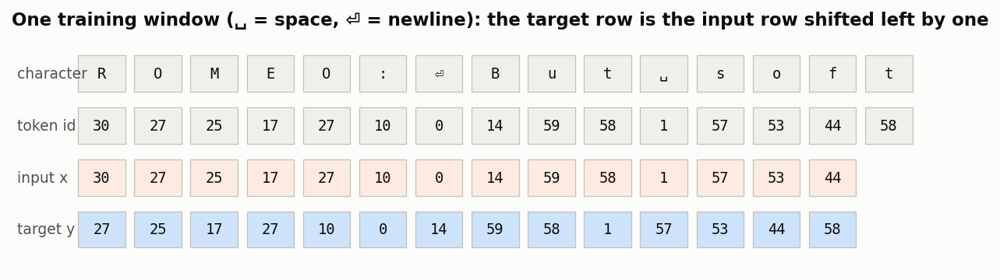

A real batch from `TokenData.train_batch(B=2, T=16)`, decoded:

```
x[0] = [ 1, 44, 53, 53, 50,  6,  1, 42, 53,  1, 52, 53, 58,  1, 44, 50]   ' fool, do not fl'
y[0] = [44, 53, 53, 50,  6,  1, 42, 53,  1, 52, 53, 58,  1, 44, 50, 39]   'fool, do not fla'
```

Every position is a prediction problem: after `' '` predict `'f'`, after `' f'` predict `'o'`, and
so on. Windows start at random positions (`sampler: random`), or are read in order without repetition
(`sampler: sequential`, used for the large web-text corpus in Part 2). The training budget is counted in
**tokens and optimizer steps**, not epochs: `max_steps × batch_size × seq_len` tokens. Every run
prints how many passes over the training set that is.

## 1.4 Tokenizers: what is a "token"?

The model sees integers, so text must be cut into pieces from a fixed vocabulary. The choice is a
trade-off:
- **Small vocabulary (characters, bytes).** Long sequences. Every word must be assembled letter by
  letter. A tiny embedding table.
- **Large vocabulary (words, BPE).** Short sequences: one step covers several characters. But the
  embedding table is large, and a rare piece has few training examples.

**Byte-pair encoding (BPE)**, used by GPT-2, Llama and Qwen, learns its vocabulary from data. It
starts from single characters (or bytes) and repeatedly **merges the most frequent adjacent pair into a
new token**. The whole algorithm fits in 20 lines. Here is a run on a toy corpus of word counts
(`_` marks the end of a word):

```python
words = {"low_": 5, "lower_": 2, "newest_": 6, "widest_": 3}
merges = bpe_train(words, 6)
# merge 1: 'es'   (pair seen 9 times)      merge 4: 'lo'   (7 times)
# merge 2: 'est'  (9 times)                merge 5: 'low'  (7 times)
# merge 3: 'est_' (9 times)                merge 6: 'ne'   (6 times)
# words now:  low _ | low e r _ | ne w est_ | w i d est_
```

Frequent fragments such as `est_` and `low` become single tokens. Encoding new text applies the same
merges in the same order. Production tokenizers work on **bytes** rather than characters, so any
string, in any language, can be encoded with no "unknown" token.

`nanolm` lets you swap the tokenizer with one config key, `data.tokenizer`:

| spec | what it is |
|---|---|
| `char`, `byte` | one token per character / per UTF-8 byte |
| `word:<V>` | the most frequent words, spaces and punctuation; unknown words fall back to bytes, so nothing is lost |
| `sp_train:bpe:<V>`, `sp_train:unigram:<V>` | train your own BPE or unigram vocabulary of size V on the training split |
| `sp:<file>` | a trained SentencePiece model (e.g. the 1024-token tokenizer of Parameter Golf) |
| `gpt2`, `hf:<name>` | a pretrained tokenizer (GPT-2's 50,257 tokens, Qwen's 151k or 248k, ...) |

The same sentence through five of them (real output; box width = bytes covered, ␣ = space):

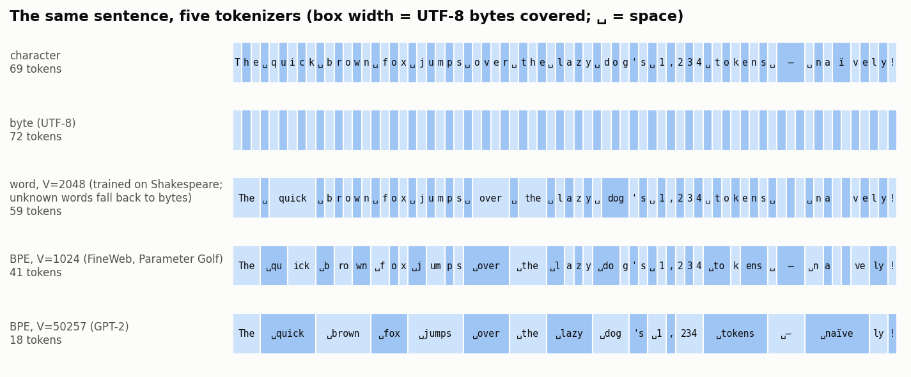

What the figure shows:
- The word tokenizer was trained on Shakespeare, so "brown", "fox" and "jumps" are not in its
  vocabulary. They fall back to single bytes.
- The 1024-token BPE learned from web text splits words into frequent fragments (`␣qu`, `ick`, `␣over`).
- GPT-2's 50k vocabulary has whole words (`␣quick`, `␣brown`), even `␣naïve`.
- Fewer tokens per byte means shorter sequences, but every token must be learned.

§1.8 measures which tokenizer gives the best model.

## 1.5 Recurrent networks: RNN, GRU, LSTM

Code: `nanolm/models/rnn.py`. Configs: `configs/01_char_rnn.yaml` (`laptop/L1_char_lstm.yaml`).

A recurrent network reads one token at a time and keeps a **hidden state** $h_t \in \mathbb{R}^d$, a
fixed-size summary of everything it has read so far:

```math
e_t = E[x_t], \qquad h_t = \tanh(W_x e_t + W_h h_{t-1} + b), \qquad z_t = W_o h_t .
```

Here $E$ is the embedding table (one learned vector per token) and $W_o$ maps the state to logits.
Training uses **back-propagation through time**. The gradient that reaches step $t-k$ is multiplied
by roughly $k$ Jacobians $\partial h_{s}/\partial h_{s-1} = \mathrm{diag}(1-h_s^2)\,W_h$. When their
norms are below 1 the gradient *vanishes* exponentially; above 1, it *explodes*. Clipping the
gradient norm (`train.grad_clip`) fixes explosions. Nothing simple fixes vanishing, so a vanilla RNN
cannot learn long-range structure.

**The LSTM** adds a separate *cell* $c_t$ that is updated *additively*, controlled by three gates
with values in $(0,1)$:

```math
\begin{aligned}
i_t &= \sigma(W_i[e_t, h_{t-1}]),\quad f_t = \sigma(W_f[e_t, h_{t-1}]),\quad o_t = \sigma(W_o[e_t, h_{t-1}]),\quad g_t = \tanh(W_g[e_t, h_{t-1}]),\\
c_t &= f_t \odot c_{t-1} + i_t \odot g_t, \qquad h_t = o_t \odot \tanh(c_t).
\end{aligned}
```

When the forget gate $f_t \approx 1$, $\partial c_t / \partial c_{t-1} \approx 1$. Information and
gradient then pass through many steps unchanged. `LSTMScratch` in `rnn.py` implements exactly these
equations, with the forget-gate bias set to 1 so the cell remembers by default. The **GRU** is a cheaper
two-gate variant. In practice we use PyTorch's `nn.LSTM`/`nn.GRU` (fast cuDNN kernels), which compute
the same function.

Each training window starts from $h_0 = 0$ (*truncated* back-propagation over `seq_len` steps).
That way RNNs and Transformers use exactly the same data and evaluation, and the comparison in
§1.6.8 is fair.

```bash
python -m nanolm.train -c nanolm/configs/laptop/L1_char_lstm.yaml                   # LSTM, ~2 min
python -m nanolm.train -c nanolm/configs/laptop/L1_char_lstm.yaml model.arch=rnn    # vanilla RNN
python -m nanolm.train -c nanolm/configs/laptop/L1_char_lstm.yaml model.arch=lstm_scratch train.max_steps=200
```

## 1.6 The Transformer, piece by piece

Code: `nanolm/models/gpt.py` (class `GPT`). Configs: `configs/02_char_transformer.yaml` (the
textbook GPT-2 design) and `02b_char_transformer_modern.yaml` (the modern design), plus
`laptop/L2_char_gpt.yaml`.

An RNN squeezes the past into one vector. A Transformer instead lets **every position look directly at
every earlier position**. The whole model is a stack of $L$ identical blocks around a "residual stream":

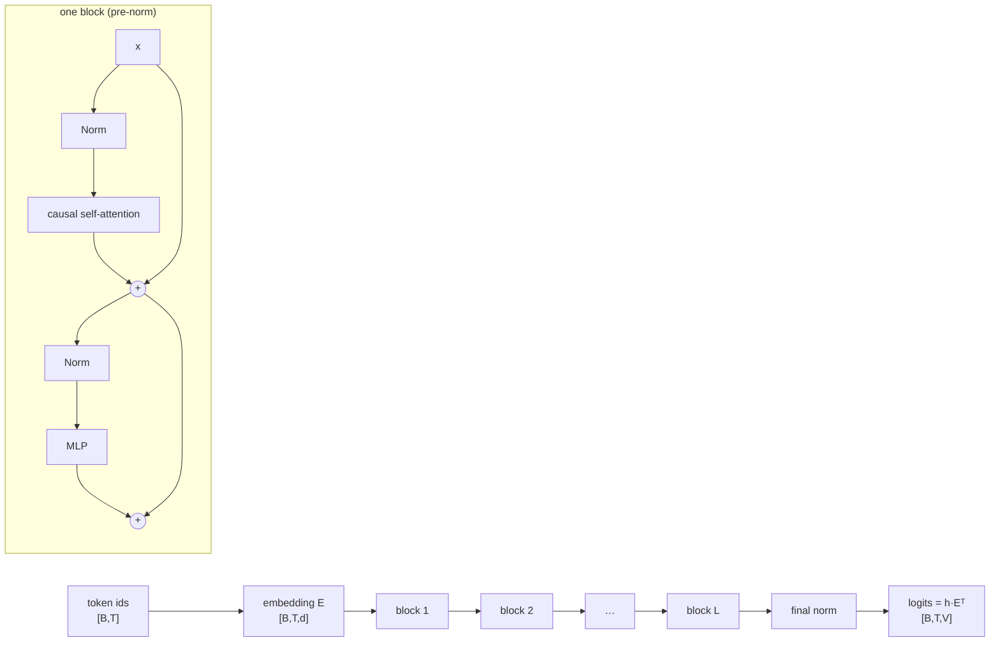

### 1.6.1 Embeddings and positions

The input is $X^{(0)} = E[x_{1..T}] \in \mathbb{R}^{T\times d}$: one learned vector per token.
**Attention by itself is blind to order.** It computes a weighted average over a *set* of positions,
so if you shuffled the input tokens, each output would be shuffled the same way. "dog bites man" and
"man bites dog" would look identical. The model must therefore be *told* where each token is. Three
generations of solutions:

**(1) Sinusoidal encodings (original Transformer, 2017).** Add a fixed vector to each token embedding:

```math
\mathrm{PE}(p, 2i) = \sin(p\,\omega_i), \qquad \mathrm{PE}(p, 2i+1) = \cos(p\,\omega_i), \qquad \omega_i = 10000^{-2i/d}.
```

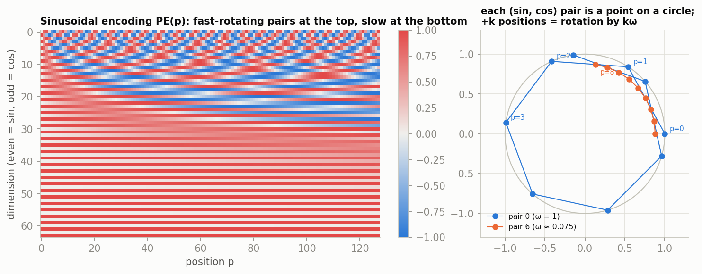

- **Why many frequencies?** They work like the hands of a clock, or the digits of a binary counter.
  High-frequency pairs (top of the heatmap) change quickly and tell neighbouring positions apart.
  Low-frequency pairs (bottom) change slowly and encode coarse position. Together they give every
  position a unique code, and all values stay within $[-1, 1]$.
- **Why sin *and* cos, side by side?** Each $(\sin p\omega_i,\, \cos p\omega_i)$ pair is a point on
  a circle (right panel). Moving $k$ positions forward *rotates* that point by the angle $k\omega_i$:

```math
\begin{pmatrix} \sin (p+k)\omega \\ \cos (p+k)\omega \end{pmatrix}
= \begin{pmatrix} \cos k\omega & \sin k\omega \\ -\sin k\omega & \cos k\omega \end{pmatrix}
\begin{pmatrix} \sin p\omega \\ \cos p\omega \end{pmatrix}
```

  The rotation matrix depends only on the offset $k$, not on $p$. So "the token $k$ steps back" is
  the same linear transformation at every position, which a layer can learn once. A sine alone could
  not do this: $\sin((p+k)\omega)$ cannot be computed from $\sin(p\omega)$ without its cosine partner.
- **Limitations.**
  - The encoding is *added* to the content embedding, so position and meaning share the same dimensions.
  - Relative offsets are only *implicitly* available, through what the layers learn.

**(2) Learned absolute positions (BERT, GPT-2).** Simply learn a table $P \in \mathbb{R}^{T_{\max}
\times d}$ (GPT-2: 1,024 × 768) and add $P_p$ to the token embedding. The motivation is "let the data
decide". The left panel below shows the cosine similarity between GPT-2's *learned* position vectors,
from its real weights:

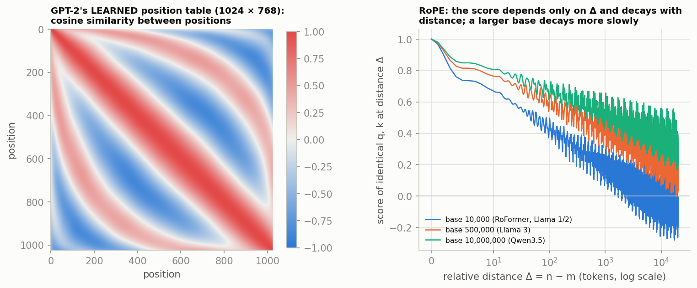

Without being told to, GPT-2 learned a **smooth, wave-like code**. Nearby positions are similar, and
the stripes parallel to the diagonal mean the similarity depends mainly on the *distance* between two
positions. It largely rediscovered what the sinusoids hard-code. The costs:
- $T_{\max} \times d$ extra parameters;
- **no extrapolation**: position 1,025 has no row, so a model trained on 1,024 tokens cannot read 1,025;
- still additive and absolute.

**(3) Rotary position embedding, RoPE** (Su et al., 2021; used by Llama, Qwen, Mistral, Gemma, and
in `nanolm` with `model.pos: rope`). Instead of adding anything to the embedding, *rotate the query
and key vectors inside attention*. Each pair of coordinates $(q_{2i}, q_{2i+1})$ at position $m$ is
rotated by the angle $m\,\omega_i$, with $\omega_i = \text{base}^{-2i/d_h}$; the same is done to the
keys at position $n$:

```math
R_m = \bigoplus_{i} \begin{pmatrix} \cos m\omega_i & -\sin m\omega_i \\ \sin m\omega_i & \cos m\omega_i \end{pmatrix},
\qquad q_m' = R_m q_m, \quad k_n' = R_n k_n .
```

Rotations are orthogonal, and they compose ($R_m^\top R_n = R_{n-m}$). The attention score therefore becomes

```math
\langle q_m', k_n' \rangle = q_m^\top R_m^\top R_n\, k_n = q_m^\top R_{\,n-m}\, k_n ,
```

which depends on the content ($q, k$) and **only on the relative offset $n - m$**. This solves the
problems of (1) and (2):
- position enters exactly where it is used: the query–key comparison, not the value or embedding;
- relative distance is built in;
- there are no parameters;
- any position can be encoded.

The right panel above shows a useful side effect. Compute the score of identical $q$ and $k$ as the
distance grows: it **decays with distance** (on average), a mild built-in preference for nearby tokens.

RoPE has its own long-context problem. A model trained on 4k tokens has never seen the large rotation
angles of position 100k. Two fixes:
- **A larger base.** Lower frequencies rotate more slowly, so the decay is slower (Llama 3 uses 500,000;
  Qwen3.5 uses $10^7$).
- **Rescaling the frequencies after training** (Position Interpolation, NTK scaling, YaRN) to stretch a
  trained model to longer contexts.

**Partial RoPE** (Qwen3.5, and in `nanolm` via `model.rope_dims`) rotates only part of each head,
leaving some dimensions position-free for purely content-based matching.

| method | where position enters | parameters | relative distance | longer than training | used today |
|---|---|---|---|---|---|
| sinusoidal (2017) | added to the embedding | 0 | implicit | in principle | rarely, in new LLMs |
| learned absolute (GPT-2, BERT) | added to the embedding | $T_{\max} d$ | implicit (learned) | **no** | rarely, in new LLMs |
| **RoPE** (2021–) | rotates $q$, $k$ | 0 | **exact** | with base scaling / YaRN | **almost all open LLMs** |

### 1.6.2 Causal self-attention

For each position, the block computes a **query** ("what am I looking for?"), a **key** ("what do I
contain?") and a **value** ("what do I pass on?"):

```math
Q = XW_Q,\quad K = XW_K,\quad V = XW_V \qquad (\in \mathbb{R}^{T\times d_h}),
```

```math
\mathrm{Attention}(Q,K,V) = \mathrm{softmax}\!\left(\frac{QK^\top}{\sqrt{d_h}} + M\right)V, \qquad
M_{ts} = \begin{cases} 0 & s \le t \\ -\infty & s \gt  t \end{cases}
```

- The score $q_t\cdot k_s$ measures how relevant position $s$ is to position $t$.
- Dividing by $\sqrt{d_h}$ keeps the scores' variance near 1, so the softmax does not saturate.
- The **causal mask** $M$ forbids looking at future tokens. Without it, the model could read the
  answer, and training would be meaningless. A unit test checks causality for every model variant in
  `nanolm`.
- **Multi-head attention** runs $H$ such attentions in parallel on $d/H$-dimensional slices
  ($d_h = d/H$). It concatenates the results and mixes them with an output matrix $W_O$. Different heads
  learn different patterns.

In `gpt.py` this is one call to PyTorch's fused kernel: `F.scaled_dot_product_attention(q, k, v,
is_causal=True)`. Here are the actual attention weights of our trained 4-layer character model
(`laptop/L2_char_gpt`) reading `ROMEO:⏎But soft! what light through`. Row $t$ shows where position
$t$ looks; the upper triangle is empty because of the causal mask:

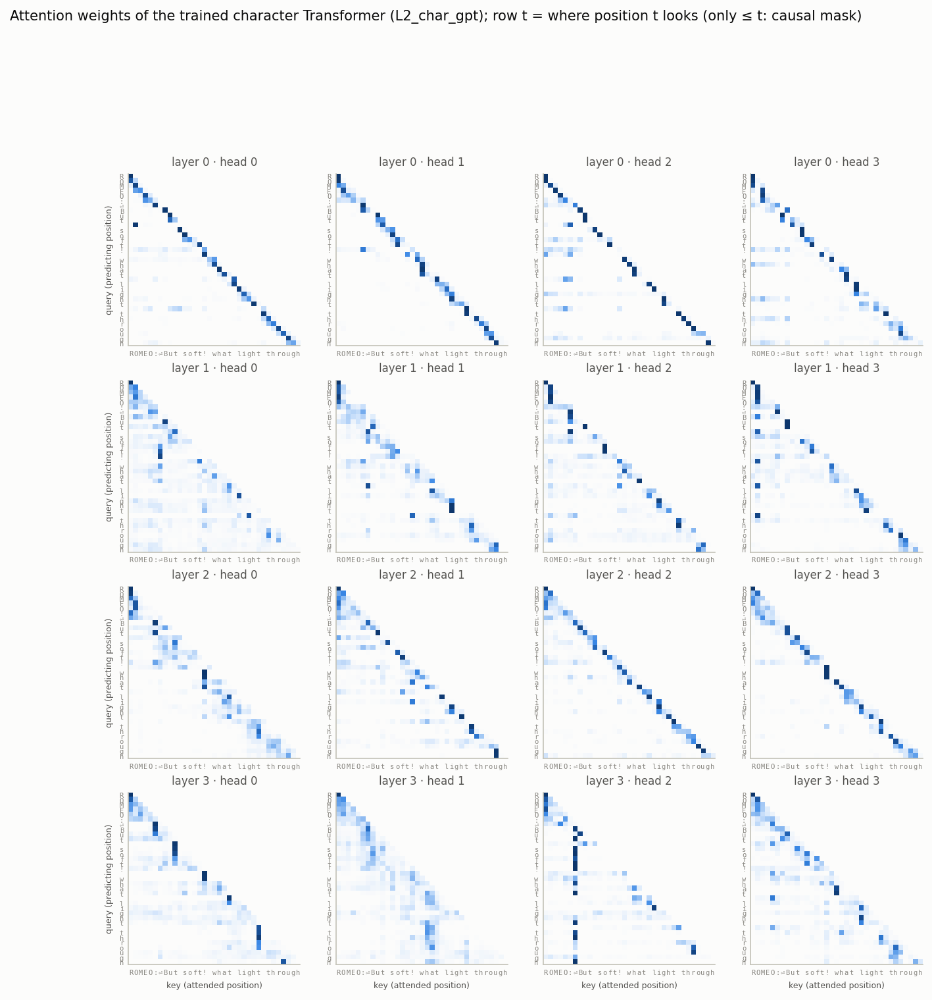

Several heads are interpretable. These numbers are measured on this sentence, with the weights averaged over positions:
- **Layer 0:** all four heads mostly look one step back. 30–62% of their weight goes to the
  previous character, so they act like learned bigram/trigram detectors.
- **L2·H3 and L3·H3:** about 30% of their weight goes to the **first letter of the current word**.
  They help spell out the rest of a word.
- **L3·H2:** **50%** of its weight goes to the `:` and newline after the speaker's name, wherever
  the current position is. It "remembers" that a line of dialogue has started. Its average look-back
  distance (7.8 characters) is the longest of all 16 heads.

Regenerate the figure for your own model with `python -m nanolm.viz attention --run <your run dir> --text "..."`.

### 1.6.3 The MLP

After attention mixes information *across* positions, the MLP processes each position *separately*:

```math
\text{GELU MLP (GPT-2):}\quad \mathrm{MLP}(x) = W_2\,\mathrm{GELU}(W_1 x), \qquad W_1 \in \mathbb{R}^{4d\times d}
```

```math
\text{SwiGLU (Llama, Qwen):}\quad \mathrm{MLP}(x) = W_2\big(\mathrm{SiLU}(W_1 x) \odot W_3 x\big), \qquad W_1, W_3 \in \mathbb{R}^{\frac{8}{3}d\times d}
```

SwiGLU multiplies two projections: a *gate*, $\mathrm{SiLU}(W_1x)$, and a *value*, $W_3x$. The width
factor 8/3 keeps its parameter count equal to the 4× GELU MLP. Selected with `model.mlp:
gelu | swiglu | relu2 | leaky_relu2`. The last two come from Part 4.

### 1.6.4 Residual stream and normalization

Each block *adds* its output to its input: $x \leftarrow x + \mathrm{Attn}(\mathrm{Norm}(x))$, then
$x \leftarrow x + \mathrm{MLP}(\mathrm{Norm}(x))$. This is the "pre-norm" residual design. The addition
gives gradients a direct path from the loss to every layer, like the LSTM's cell. The normalization
keeps the activation scale stable:

```math
\mathrm{LayerNorm}(x) = \gamma \odot \frac{x - \mu(x)}{\sqrt{\sigma^2(x)+\epsilon}} + \beta, \qquad
\mathrm{RMSNorm}(x) = \gamma \odot \frac{x}{\sqrt{\tfrac{1}{d}\sum_i x_i^2 + \epsilon}} .
```

RMSNorm (`model.norm: rmsnorm`) drops the mean subtraction and the bias. It is cheaper and works equally well.

### 1.6.5 Output layer

The final hidden state is normalized and multiplied by the transposed embedding matrix,
$z = \mathrm{Norm}(h_t)\,E^\top$. This *weight tying* (`model.tie_embeddings`) reuses the input
table as the output layer and saves $V \times d$ parameters.

### 1.6.6 The training objective: next-token loss at every position

A Transformer LM is trained with the loss of §1.2, applied to **every position of every sequence at
once**. For a batch of $B$ windows of length $T$:

```math
\mathcal{L} = -\frac{1}{BT}\sum_{b=1}^{B}\sum_{t=1}^{T} \log p_\theta\big(x^{(b)}_{t+1} \,\big|\, x^{(b)}_{1..t}\big)
```

This works because of the causal mask (§1.6.2): the output at position $t$ has seen only tokens
$1..t$. A *single* forward pass therefore produces $T$ honest next-token predictions per sequence.
This is called *teacher forcing*: at every position the model is given the true prefix, not its own
earlier guesses.

**In code: the shift.** The target sequence is the input sequence shifted by one token. In `nanolm`
the shift happens when the batch is cut from the token stream (`data.py: TokenData.train_batch`):

```python
window = tokens[i : i + T + 1]          # T+1 consecutive tokens
x, y = window[:-1], window[1:]          # input = first T, target = last T (shifted by one)
logits = model(x)                       # [B, T, V]: position t predicts y[t] = x[t+1]
loss = F.cross_entropy(logits.view(-1, V), y.view(-1))     # mean over all B*T positions
```

HuggingFace models do the same shift *inside* the loss. You pass `labels = input_ids` and the
library moves the labels one step left (`transformers/loss/loss_utils.py: ForCausalLMLoss`):

```python
labels = F.pad(labels, (0, 1), value=-100)    # append an "ignore" label at the end
shift_labels = labels[..., 1:]                # position t is scored against token t+1
loss = F.cross_entropy(logits.view(-1, V), shift_labels.view(-1), ignore_index=-100)
```

The label −100 means "do not score this position". It marks padding, and in fine-tuning (§3.8) it
also marks prompt tokens.

**Why every position, and not just the last one?** One could score only the final prediction of
each window ("given 256 characters, predict the next one"). That is a valid objective, and it is how
a sequence *classifier* is trained, but it wastes almost all the computation. Our experiment
(`sweeps/loss_positions.yaml`) uses the same model, data, steps, seeds and FLOPs, and changes only
`train.loss_on`:

| loss computed on | targets per step | val bpb (2 seeds) | val bpb, long context only (stride 16) |
|---|---:|---:|---:|
| **every position** (`loss_on: all`) | 32 × 256 = 8,192 | **2.105 ± 0.002** | **2.085** |
| last position only (`loss_on: last`) | 32 | 3.459 ± 0.061 | 3.346 |

The last-position model gets **256× fewer training targets** for the same compute, and is still
far behind after 2,000 steps. It is not an evaluation artifact: the gap remains when we score only
tokens that have ≥ 240 characters of context, the situation the last-position model was trained for.
Per-token training also teaches every context length from 1 to $T$. That is exactly what generation
needs, since text is produced one token at a time from a growing prefix.

### 1.6.7 Counting parameters and compute

A block with width $d$ has $4d^2$ attention weights ($W_Q, W_K, W_V, W_O$) and $8d^2$ MLP weights.
A model with $L$ layers therefore has

```math
N \approx 12\,L\,d^2 \;(+\; V d \text{ for the embedding}), \qquad
\text{training FLOPs} \approx 6\,N\,D
```

for $D$ training tokens: 2 FLOPs per weight per token for the forward pass and 4 for the backward
pass. For our 4-layer, 256-wide character model, $12 \cdot 4 \cdot 256^2 = 3.1$M, which matches the
3.16M that `train.py` prints. Training it on 16.4M tokens costs about $6 \times 3.1\text{M} \times
16.4\text{M} \approx 3 \times 10^{14}$ FLOPs. That is the number used to size the laptop configs.

### 1.6.8 Results: RNNs vs. Transformers

```bash
python -m nanolm.sweep   --sweep nanolm/configs/sweeps/01_char_models.yaml        # 12 runs (6 models x 2 seeds)
python -m nanolm.analyze outputs/nanolm/sweeps/char_models --baseline gpt_textbook --metric val_bpb
```

All models get the same data, the same 16.4M training characters (about 16 passes over the
corpus), and the same evaluation on the full validation set. Two seeds each:

| model | params | val bpb (mean ± std) | Δ vs. GPT-2-style | train time |
|---|---:|---:|---:|---:|
| **Transformer, modern** (RMSNorm + RoPE + SwiGLU, 4 × 256) | 3.16M | **2.105 ± 0.002** | −0.084 | 37 s |
| LSTM 2 × 256 | 1.07M | 2.134 ± 0.008 | −0.056 | 51 s |
| GRU 2 × 256 | 0.81M | 2.167 ± 0.007 | −0.022 | 48 s |
| LSTM 2 × 512 (similar parameter count) | 4.24M | 2.171 ± 0.013 | −0.019 | 58 s |
| Transformer, GPT-2 style (LayerNorm + learned positions + GELU) | 3.44M | 2.189 ± 0.007 | 0 | 26 s |
| vanilla RNN 2 × 256 | 0.28M | 2.436 ± 0.009 | +0.246 | 17 s |

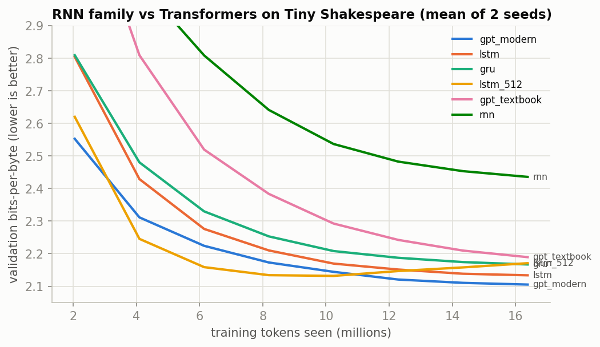

What to learn from this:
- **Gates matter.** The vanilla RNN is far behind (+0.25 bpb); GRU and LSTM close most of the gap.
- **The recipe matters as much as the architecture.** The GPT-2-style Transformer is *worse* than a
  small LSTM here. The same Transformer with RMSNorm + RoPE + SwiGLU is the best model. Its 2.105 bpb
  equals 1.46 nats per character.
- **Bigger is not always better: watch for overfitting.** The 512-wide LSTM reaches its best score at
  about 10M tokens and then gets *worse*. Its final training loss is 1.02 nats against 1.51 on validation.
  With only 1 MB of text, it memorizes. Always look at the curves, not just the final number.

## 1.7 Optimization

**AdamW** (`train.optimizer: adamw`) keeps running averages of each parameter's gradient
$g_t$ and squared gradient:

```math
m_t = \beta_1 m_{t-1} + (1-\beta_1) g_t,\quad v_t = \beta_2 v_{t-1} + (1-\beta_2) g_t^2,\quad
\theta_t = \theta_{t-1} - \eta_t\Big(\frac{\hat m_t}{\sqrt{\hat v_t}+\epsilon} + \lambda\,\theta_{t-1}\Big)
```

($\hat m, \hat v$ are bias-corrected.) Each coordinate thus gets its own step size. The $\lambda\theta$
term is *decoupled* weight decay; `nanolm` applies it only to weight matrices, not to norms or biases.

**The learning rate $\eta_t$ follows a schedule** (`train.schedule`). A short linear warm-up avoids
early instability. After it:
- **cosine** decays smoothly to a floor;
- **WSD** (warmup–stable–decay) holds the LR constant and then decays it linearly to zero at the end.

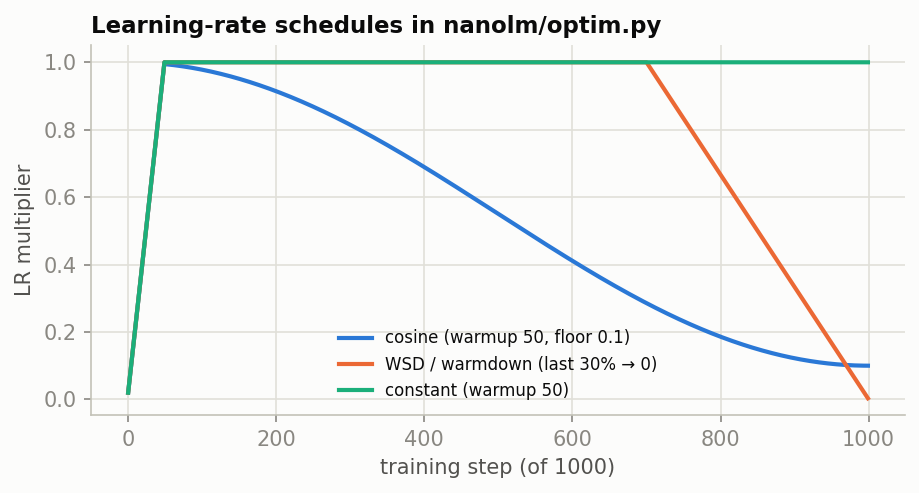

Two more ingredients:
- **Gradient clipping.** If $\lVert g \rVert \gt  c$, rescale $g$ to norm $c$ (`train.grad_clip`).
- **Mixed precision.** On a GPU the forward pass runs in bfloat16 (`precision: auto`); master weights
  and the loss stay in float32.

Part 2 compares cosine with WSD and AdamW with **Muon**.

## 1.8 Which tokenizer gives the best model?

```bash
python -m nanolm.sweep   --sweep nanolm/configs/sweeps/laptop_tokenizers.yaml       # 8 runs, ~1-2 h on a laptop
python -m nanolm.analyze outputs/nanolm/sweeps/laptop_tokenizers --baseline char --metric val_bpb
```

The same 4-layer Transformer and the same 2,000 × 8,192-token budget, with eight tokenizers. Learned
vocabularies are trained on the training split only. *Passes* is how often the 1 MB corpus is seen:
a bigger vocabulary packs more text into each token, so the fixed budget covers the corpus more often.

| tokenizer | vocab | bytes/token | passes | final val bpb | **best val bpb** (step) |
|---|---:|---:|---:|---:|---:|
| byte | 256 | 1.00 | 16 | 2.092 | 2.088 (1750) |
| char | 65 | 1.00 | 16 | 2.105 | 2.105 (1750) |
| **word, 2048** | 2048 | 1.62 | ~27 | **2.080** | **2.047** (1250) |
| BPE, 512 | 512 | 1.76 | 29 | 2.163 | 2.123 (1250) |
| BPE, 2048 | 2048 | 2.41 | 42 | 2.368 | 2.104 (500) |
| unigram, 2048 | 2048 | 2.36 | 43 | 2.340 | 2.113 (500) |
| word, 8192 | 8192 | 1.98 | ~32 | 2.318 | 2.113 (750) |
| GPT-2 BPE | 50257 | 3.09 | 54 | 2.825 | 2.171 (500) |

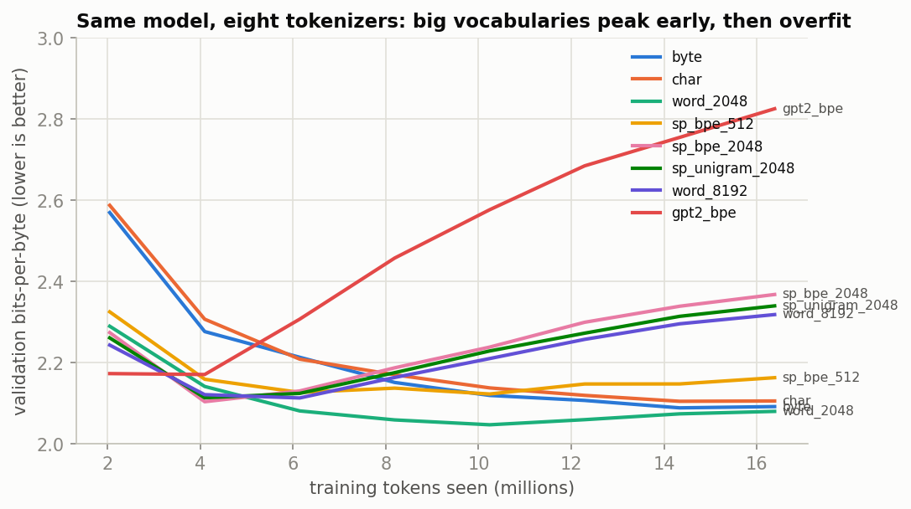

Three lessons:
1. **Compare in bits-per-byte.** GPT-2's BPE has validation perplexity 402, against 4.3 for characters.
   That looks 100× worse, but in bpb it is 2.83 vs 2.11 at the end, and at its best checkpoint (2.17)
   the gap nearly closes.
2. **Large vocabularies need data.** Every large vocabulary peaks within the first few hundred steps
   and then overfits. With only 1 MB of text, the many passes and the big embedding table let the model
   memorize. At their best checkpoints, word-2048 (2.047) and BPE-2048 (2.104) beat characters.
3. **The answer depends on the regime.** With little data, small vocabularies and early stopping win.
   With billions of tokens, large vocabularies win: the Parameter Golf vocabulary grew from 1,024 to
   8,192 during the competition (Part 4), and Qwen3.5 uses 248,320 tokens.

## 1.9 Sampling: turning probabilities into text

A trained model gives $p(\cdot \mid x_{\lt t})$. The *decoding* rule decides which token to emit
(`evaluate.py: sample_next`):

```math
p_\tau(v) = \frac{e^{z_v/\tau}}{\sum_u e^{z_u/\tau}} .
```

- **temperature** $\tau$: $\tau \to 0$ is greedy (always the most likely token), $\tau = 1$ is the
  model's own distribution, and $\tau \gt  1$ flattens it toward noise.
- **top-k** keeps only the $k$ most likely tokens.
- **top-p (nucleus)** keeps the smallest set of tokens whose total probability reaches $p$. The set
  is small when the model is confident and large when it is unsure.

The next-character distribution of our model after `…through yonder wi` (real values):

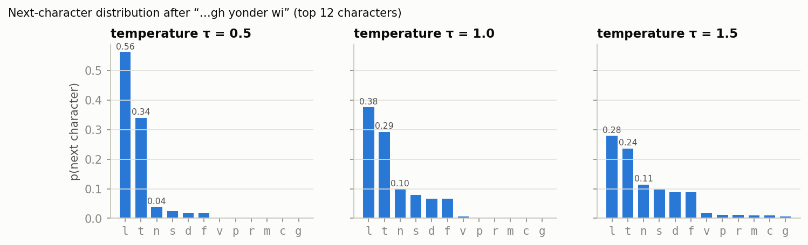

At $\tau = 0.5$, "l" (→ "will"/"wild") gets 56%. At $\tau = 1.5$ the distribution spreads out, and
unlikely letters start to appear. Samples from the same model:

```
τ=0.0  That the sun shall be so soon to the state, / And therefore shall be so soon t...   (repeats)
τ=0.5  The more than self-made a merry brother, / The true of the house of Lancaster is not live.
τ=1.0  Three fairest self it one means! would help me Menenius, / Or now here hath not seen like...
τ=1.5  Threehold her! Therefore, meank! woud I tles, grey / further forwardre hath not seemed...
```

```bash
python -m nanolm.generate <run dir> --prompt "ROMEO:" --compare-temperatures
python -m nanolm.generate <run dir> --top-k 0 --top-p 0.9 --interactive
```

Decoding changes how the output *looks*, never the model's bpb. bpb measures the distribution itself.

---

# Part 2 — Pre-training a GPT on web text

Shakespeare is 1 MB. Real language models are pre-trained on terabytes of web text. Part 2 uses
the web-text corpus of the Parameter Golf challenge, so our numbers sit on the same scale as
published results.

## 2.1 The data: FineWeb

```bash
python -m nanolm.prepare --golf-shards 1 --dest data/golf    # 324 MB, once
```

[FineWeb](https://huggingface.co/datasets/HuggingFaceFW/fineweb) is a large, filtered crawl of
English web pages. The challenge's export contains:
- a **fixed validation set**: the first 50,000 documents, 62,021,846 tokens;
- **training shards** of 100M tokens each (one is enough here);
- a **1,024-token SentencePiece BPE** tokenizer, "sp1024".

Each document starts with a special beginning-of-sequence token (id 1). Here is the start of
validation document 0, decoded back to text:

```
Insurance Company Declares Living Man Dead George Johannesen is very much alive. Which is why it was so
surprising when the Canadian man received a letter addressed "To the Estate of George Johannesen." ...
```

And how sp1024 cuts its first words (▁ marks a leading space):

```
ids    [966, 945, 946, 343, 551, 795, 954, 803, 834, 951, 949, 942, 448, 387, 456, 280, ...]
pieces ['I', 'n', 's', 'ur', 'ance', '▁Com', 'p', 'any', '▁De', 'c', 'l', 'a', 'res', '▁L', 'iv', 'ing', ...]
```

With only 1,024 tokens, frequent words such as "the" and "over" get their own token, but most words are
built from 2–5 pieces. On average one sp1024 token covers 2.4 bytes. The vocabulary also contains 256
*byte* tokens (`<0x00>` … `<0xFF>`), so any text can be encoded.

## 2.2 The modern recipe

Config: `configs/03_gpt_fineweb.yaml` (laptop: `laptop/L4_gpt_fineweb.yaml`). The model has 6
layers, width 384, 6 heads and 11M parameters, and trains on 49M tokens (3,000 steps × 16k tokens).
We start from the 2019 GPT-2 design and change **one thing at a time**:

| step | change | config keys |
|---|---|---|
| 0 | GPT-2 textbook: LayerNorm, learned positions, GELU, biases, AdamW + cosine | `norm: layernorm, pos: learned, mlp: gelu, bias: true` |
| 1 | + RMSNorm and RoPE, no biases (§1.6) | `norm: rmsnorm, pos: rope, bias: false` |
| 2 | + SwiGLU MLP (§1.6.3) | `mlp: swiglu` |
| 3 | + WSD schedule instead of cosine (§1.7) | `train.schedule: wsd` |
| 4 | + **Muon** optimizer for the weight matrices | `train.optimizer: muon` |

### 2.2.1 Muon

AdamW treats every coordinate of a weight matrix independently. **Muon** (Jordan et al., 2024),
used by every top Parameter Golf entry and by Kimi K2, treats each 2-D weight matrix as a whole.
Take the momentum-averaged gradient and its singular value decomposition $G = U\Sigma V^\top$. Muon
replaces it by the closest *orthogonal* matrix:

```math
\Delta W = -\eta\, U V^\top \qquad (\text{all singular values set to } 1).
```

A gradient is usually dominated by a few directions (large singular values). Plain gradient descent
spends almost the whole step on them and barely moves in the others. Muon gives every direction the
same step size. Computing an SVD every step would be too slow, so Muon approximates $UV^\top$ with
five iterations of a polynomial that pushes every singular value toward 1. This is the
**Newton–Schulz iteration** in `optim.py: zeropower_via_newtonschulz5`, and it uses only matrix
multiplications:

```math
X_0 = G/\lVert G\rVert_F, \qquad X_{k+1} = a X_k + b\,(X_k X_k^\top)X_k + c\,(X_k X_k^\top)^2 X_k, \qquad (a,b,c) = (3.4445,\,-4.7750,\,2.0315).
```

The real gradient of one weight matrix in our model, before and after:

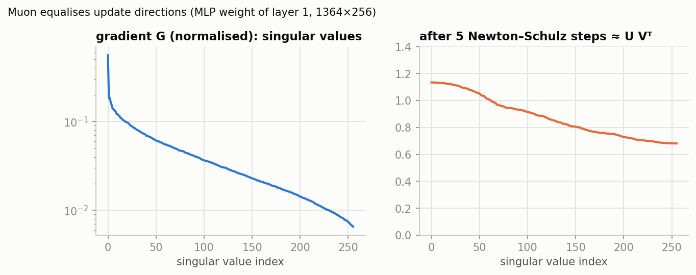

The raw gradient's singular values span two orders of magnitude, from 0.6 down to 0.007. After 5
iterations they all lie between about 0.7 and 1.1. Embeddings, the output layer, and all vectors and
scalars still use Adam, because orthogonalization only makes sense for hidden-layer matrices.

### 2.2.2 Results

```bash
python -m nanolm.sweep   --sweep nanolm/configs/sweeps/03_transformer_recipe.yaml
python -m nanolm.analyze outputs/nanolm/sweeps/transformer_recipe --baseline gpt2_textbook
```

Validation bpb on the first 4.2M validation tokens, mean of 2 seeds. "p" is a paired t-test (Part 5):

| recipe | val bpb | change vs. the row above | paired p |
|---|---:|---:|---:|
| GPT-2 textbook, AdamW + cosine | 1.790 ± 0.001 | — | — |
| + RMSNorm + RoPE, no bias | 1.744 ± 0.010 | **−0.046** | 0.10 |
| + SwiGLU | 1.786 ± 0.013 | **+0.042** (worse on both seeds) | 0.23 |
| + WSD schedule (still AdamW) | 1.728 ± 0.010 | **−0.058** | 0.02 |
| + **Muon** (WSD) | **1.647 ± 0.010** | **−0.081** | 0.001 |

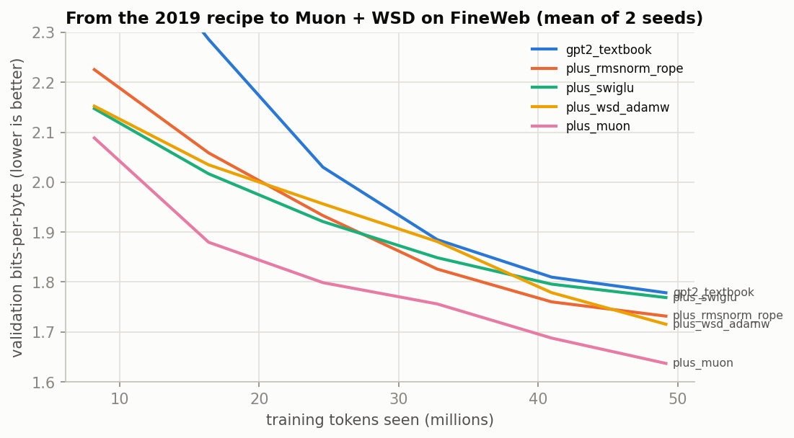

How to read this like a researcher:
- **The two largest gains come from optimization, not architecture.** Keeping the learning rate high
  and decaying it at the end (WSD) is worth −0.058. Muon is worth another −0.081.
- **Control experiments matter.** The Muon run uses the WSD schedule. Only because the
  `plus_wsd_adamw` row exists can the gain be split into its schedule part and its optimizer part.
- **Not every published improvement reproduces.** SwiGLU learned faster for the first ~1,500 steps,
  then fell behind on both seeds. Halving its learning rate made it worse still (1.814). With 2 seeds
  and p = 0.23 this is a *weak* negative result for this budget (49M tokens), not a refutation of
  SwiGLU. Investigating it is the extra-credit task of HW 2.
- **Seed noise here is about 0.01 bpb.** A 50M-token run is far from converged, so differences
  smaller than about 0.02 need more seeds.

## 2.3 How far is this from a "real" model?

Our best 11M-parameter model reaches **1.647 bpb** after 49M tokens. For scale, here are other models
on the same validation documents:
- GPT-2 small (124M parameters, 2019): **1.079**.
- Qwen2.5-0.5B: **0.951**. It was trained on about 18 trillion tokens, roughly 370,000× more than ours.
  §3.5 measures these numbers.

The rough law behind this gap is the **compute-optimal scaling** result of Hoffmann et al. (2022,
"Chinchilla"). For a fixed compute budget $C \approx 6ND$, loss is lowest when parameters $N$ and
tokens $D$ grow together, at roughly $D \approx 20N$. Our run used $D/N \approx 4.5$, so it is
under-trained for its size. Today's small open models go far in the other direction, training on
thousands of tokens per parameter, because a model that is trained once and then served billions of
times should be small.

---

# Part 3 — From GPT to modern LLMs

Parts 1–2 built a GPT from scratch. Part 3 looks at how today's open models differ from it, how to
*use* them, how they are *evaluated* (perplexity, and benchmarks such as MMLU and GPQA), and how they
are *adapted* (LoRA, SFT, DPO). Every code path runs on a laptop with models of 0.1–0.8B parameters.

## 3.1 Seven years of architecture changes

The 2026 decoder-only Transformer is still recognizably GPT-2: embeddings, a stack of attention +
MLP blocks with residual connections, and a softmax over the vocabulary. Almost every change since
then attacks one of four problems:
1. **training stability** at depth and scale;
2. **quality per FLOP**;
3. **memory and speed at inference**, above all the KV cache;
4. **context length**.

Each change below is listed with the problem it solved, the idea, and whether models still use it in
2026.

### 3.1.1 The timeline

| year | model | headline change | source |
|---|---|---|---|
| 2017 | Transformer | attention-only encoder–decoder, sinusoidal positions, post-norm | [1706.03762](https://arxiv.org/abs/1706.03762) |
| 2018 | GPT-1 | decoder-only LM pre-training, 12 layers × 768, BPE, 512 tokens | [paper](https://cdn.openai.com/research-covers/language-unsupervised/language_understanding_paper.pdf) |
| 2019 | GPT-2 | pre-norm, learned positions, 50,257-token byte-level BPE, 1,024 tokens | [paper](https://cdn.openai.com/better-language-models/language_models_are_unsupervised_multitask_learners.pdf) |
| 2020 | GPT-3 | scale to 175B; alternating dense and locally banded sparse attention; 2,048 tokens | [2005.14165](https://arxiv.org/abs/2005.14165) |
| 2022 | PaLM | SwiGLU, parallel blocks, multi-query attention, RoPE, no biases | [2204.02311](https://arxiv.org/abs/2204.02311) |
| 2023 | Llama 1 / 2 | the "standard recipe" (pre-RMSNorm + SwiGLU + RoPE); GQA (Llama 2, 34B/70B) | [2302.13971](https://arxiv.org/abs/2302.13971), [2307.09288](https://arxiv.org/abs/2307.09288) |
| 2023 | Mistral 7B | sliding-window attention (4,096) | [2310.06825](https://arxiv.org/abs/2310.06825) |
| 2024 | Mixtral 8×7B | mixture of experts: 8 experts, 2 active per token | [2401.04088](https://arxiv.org/abs/2401.04088) |
| 2024 | Llama 3 | GQA at all sizes, 128k vocabulary, RoPE base 500k | [2407.21783](https://arxiv.org/abs/2407.21783) |
| 2024 | DeepSeek-V2/V3 | multi-head latent attention, fine-grained MoE, multi-token prediction, FP8 training | [2405.04434](https://arxiv.org/abs/2405.04434), [2412.19437](https://arxiv.org/abs/2412.19437) |
| 2025 | Qwen3 | QK-norm instead of QKV bias; 128-expert MoE; thinking modes | [2505.09388](https://arxiv.org/abs/2505.09388) |
| 2025 | Gemma 3 | 5 local : 1 global attention layers; QK-norm replaces logit soft-capping | [2503.19786](https://arxiv.org/abs/2503.19786) |
| 2025 | Kimi K2 | Muon at 1T scale (MuonClip) | [2507.20534](https://arxiv.org/abs/2507.20534) |
| 2025 | gpt-oss | alternating banded/dense attention, attention sinks, 4-bit MoE weights | [2508.10925](https://arxiv.org/abs/2508.10925) |
| 2025 | Qwen3-Next | hybrid: 3 Gated DeltaNet : 1 gated-attention layers; 512-expert MoE | [model card](https://huggingface.co/Qwen/Qwen3-Next-80B-A3B-Instruct) |
| 2026 | Qwen3.5 | that hybrid design across a whole family (0.8B–397B), natively multimodal | [model card](https://huggingface.co/Qwen/Qwen3.5-0.8B) |

### 3.1.2 Each change: problem, idea, status in 2026

**Block structure and normalization**

| change | problem it solved | idea | status (2026) |
|---|---|---|---|
| **post-norm → pre-norm** (GPT-2) | the original "add, then normalize" ($x \leftarrow \mathrm{Norm}(x + f(x))$) made deep models unstable to train; they needed careful warm-up | normalize the *input* of each sub-block, and leave the residual path untouched (§1.6.4) | **universal** |
| **LayerNorm → RMSNorm** (Llama) | LayerNorm's mean subtraction and bias cost time and add little | divide by the root-mean-square only | **near-universal** |
| **encoder–decoder → decoder-only** (GPT) | two stacks, and a task-specific input/output split | one causal stack; every task becomes "continue the text" | **dominant** for LLMs |
| **biases removed** (PaLM, Llama) | extra parameters with little benefit; they can hurt stability | `bias=False` everywhere | mostly removed. Qwen2.5 still had a QKV bias, which Qwen3 replaced by QK-norm |
| **parallel attention + MLP** (GPT-J, PaLM) | sequential sub-blocks are slower to run | compute both from the same input and add both | **not standard**; sequential blocks remain the default (it reappears in Part 4) |
| **weight tying** (GPT-2) | the output layer duplicates the $V \times d$ embedding | share them | **small models only** (Qwen3.5 ties at 0.8B–4B, not at 9B and above) |

**Feed-forward and activations**

| change | problem | idea | status |
|---|---|---|---|
| **ReLU/GELU → SwiGLU** (PaLM, Llama) | better quality for the same parameters and FLOPs | gated MLP $W_2(\mathrm{SiLU}(W_1x)\odot W_3x)$ (§1.6.3) | **standard** in open LLMs |
| **dense MLP → mixture of experts** (Mixtral, DeepSeek, Qwen3, gpt-oss, Kimi K2) | knowledge capacity grows with parameters, but dense compute grows with them too | route each token to $k$ of $E$ expert MLPs (§3.2.5) | **dominant among the largest open models** (DeepSeek-V3, Kimi K2, Qwen3.5-397B: 256–512 experts); smaller models are often dense (Qwen3.5 is dense up to 27B) |

**Positions and context length**

| change | problem | idea | status |
|---|---|---|---|
| **sinusoidal → learned absolute** (GPT-2) | let the data choose the code | a learned table $P \in \mathbb{R}^{T_{\max}\times d}$ | **abandoned** for new LLMs: it cannot go beyond $T_{\max}$ |
| **→ RoPE** (PaLM, Llama, Qwen, ...) | relative offsets and longer contexts | rotate $q$, $k$ by position (§1.6.1) | **near-universal** |
| **larger RoPE base, YaRN** | reach 128k–1M tokens | slower rotations; rescale frequencies after training | **standard**: Qwen3.5 uses base $10^7$, 262k context natively, YaRN beyond |
| **partial RoPE** | some dimensions should compare content only | rotate only part of each head | **in use** (Qwen3.5: 25% of each head) |

**Attention: the KV cache and long contexts**

| change | problem | idea | status |
|---|---|---|---|
| **MHA → MQA → GQA** (PaLM; Llama 2/3) | the KV cache dominates inference memory (§3.2.1) | share K/V heads among groups of query heads | **GQA is the default** |
| **multi-head latent attention** (DeepSeek-V2/V3, Kimi K2) | an even smaller KV cache (DeepSeek-V2 reports −93% vs. its predecessor) | cache one low-rank latent vector per token | **in use** in the DeepSeek line and models derived from it |
| **sparse / sliding-window attention** (GPT-3 bands, Mistral) | $O(T^2)$ compute and an $O(T)$ cache | attend only to the last $W$ tokens | **in use, usually interleaved** with global layers (Gemma 3: 5 local : 1 global; gpt-oss alternates) |
| **attention sinks** (gpt-oss) | a head may need to attend to "nothing" | a learned per-head term in the softmax denominator | **in use** in gpt-oss |
| **linear attention / Gated DeltaNet hybrids** (Qwen3-Next, Qwen3.5) | even sliding windows leave some layers with a growing cache | most layers keep a fixed-size recurrent state; every 4th layer keeps full attention (§3.2.2, §3.3) | **new and spreading** (the whole Qwen3.5 family) |
| **QK-norm** (Qwen3, Gemma 3) | attention logits blowing up, causing training loss spikes | RMSNorm on $q$ and $k$ | **widespread**; it replaced Gemma 2's logit soft-capping |
| **gated attention output** (Qwen3-Next, Qwen3.5) | a head cannot easily output "nothing" | multiply by $\sigma(xW_g)$ | **in use** in Qwen's hybrid models |

**Training and inference efficiency**

| change | problem | idea | status |
|---|---|---|---|
| **AdamW → Muon** (Kimi K2) | AdamW under-updates rare directions (§2.2.1) | orthogonalized matrix updates | **emerging**: used at 1T scale by Kimi K2 (MuonClip) and in Parameter Golf (Part 4); AdamW remains the common default |
| **multi-token prediction** (DeepSeek-V3, Qwen3.5) | one target per position is a thin training signal; decoding is sequential | extra heads predict token $t+2$ (and beyond), and are reused for speculative decoding | **in use** in the DeepSeek-V3 and Qwen3.5 lines |
| **fp32 → bf16 → FP8 training; 4-bit weights** (DeepSeek-V3; gpt-oss MXFP4) | memory and bandwidth | lower-precision formats with per-block scaling | bf16 is **standard**; FP8 training and 4-bit weights are **in use at the frontier** |
| **bigger vocabularies** (50k → 128k → 248k) | non-English text and code split into too many tokens | larger BPE vocabularies | **trend continues** (Qwen3.5: 248k) |
| **native multimodality** (Qwen3.5) | separate vision and language models | a vision encoder trained jointly with the LM | **in use**: every Qwen3.5 checkpoint is a vision-language model |

## 3.2 The modern components, with their math

### 3.2.1 Fewer key/value heads: MHA → MQA → GQA → MLA

When a model generates text, it caches the keys and values of all earlier tokens (the **KV cache**),
so they are not recomputed at every step. Its size is

```math
\text{KV bytes} = 2 \times L \times H_{kv} \times d_h \times T \times \text{bytes per value},
```

which grows linearly with the context length $T$. It often dominates inference memory.

- **Multi-head attention (MHA)**: every query head has its own key/value head, so $H_{kv} = H$.
- **Multi-query attention (MQA)**: all query heads share one K/V head, $H_{kv} = 1$.
- **Grouped-query attention (GQA)**: groups of query heads share a K/V head, $1 \lt  H_{kv} \lt  H$. This is
  the default today. In `nanolm`, `model.n_kv_heads: 4` with `n_heads: 8` gives GQA.
- **Multi-head latent attention (MLA)** (DeepSeek, Kimi): cache one low-rank latent vector per token
  (rank 512) and reconstruct K and V from it.

A worked example. Qwen2.5-0.5B has 24 layers, 14 query heads, 2 KV heads, $d_h = 64$. At a 32k
context in bf16 its KV cache is $2 \cdot 24 \cdot 2 \cdot 64 \cdot 32768 \cdot 2\,\text{B} = 0.40$ GB.
With full MHA (14 KV heads) it would be 2.8 GB, more than five times the 1 GB of weights.

### 3.2.2 Attention that does not see everything: sliding windows and linear attention

Full attention costs $O(T^2)$ compute and an $O(T)$ cache. Two families cut this:

- **Local (sliding-window) attention**: each token attends only to the last $W$ tokens. Models
  interleave local and global layers (Gemma 3: 5 local : 1 global; gpt-oss: alternating). Global layers
  pass information further, so long-range information still flows.
- **Linear attention / state-space layers** replace the growing KV cache with a **fixed-size state
  matrix** $S_t \in \mathbb{R}^{d_v \times d_k}$, updated once per token like an RNN. Qwen3.5 uses
  **Gated DeltaNet** (Yang et al., 2024):

```math
S_t = S_{t-1}\,\alpha_t\big(I - \beta_t\, k_t k_t^{\top}\big) + \beta_t\, v_t k_t^{\top}, \qquad o_t = S_t\, q_t .
```

  Think of $S$ as a key→value associative memory:
  - $S_{t-1}k_t$ is what the memory currently returns for key $k_t$.
  - The *delta rule* term moves that answer toward the new value $v_t$, with step size $\beta_t \in (0,1)$.
  - The *gate* $\alpha_t \in (0,1)$ lets the memory forget.

  In the transformers implementation, $\beta_t = \sigma(\cdot)$ and
  $\alpha_t = \exp\!\big(-e^{A}\,\mathrm{softplus}(\cdot)\big)$ are both computed from the input, and
  $q, k$ are L2-normalized. Compared with §1.5, this is an RNN with a *matrix* state and an
  error-correcting update. Training processes it in parallel chunks. Generation costs $O(1)$ memory
  per token, however long the context.

### 3.2.3 Stabilizers: QK-norm and gated attention

- **QK-norm** (Qwen3, Gemma 3): apply RMSNorm to $q$ and $k$ before the dot product, so
  attention logits cannot grow without bound. This prevents a classic cause of training loss spikes.
  (`model.qk_norm` in `nanolm`; the Parameter Golf baseline has it too.)
- **Gated attention** (Qwen3-Next / Qwen3.5): multiply the attention output by a learned sigmoid gate,
  $o = \sigma(x W_g) \odot \mathrm{Attn}(x)$. This lets a head output (near) zero when it has nothing
  useful to say. (`model.attn_gate` in `nanolm`, Part 4.)

### 3.2.4 Positions for long contexts

RoPE (§1.6.1) rotates by angles $m\,\omega_i$ with $\omega_i = \text{base}^{-2i/d_h}$. A larger base
(Llama 3: 500,000; Qwen3.5: 10,000,000) slows the rotation, so distant positions stay
distinguishable. Context extension methods such as **YaRN** rescale the frequencies after training.
**Partial RoPE** rotates only part of each head and leaves the rest position-free. Qwen3.5 rotates 25%
of each head, exactly the "16 of 64 dimensions" setting that also appeared in Parameter Golf (Part 4).

### 3.2.5 Mixture of experts (MoE)

An MoE layer replaces the single MLP with $E$ expert MLPs and a **router** that picks $k$ of them per
token:

```math
g = \mathrm{softmax}(W_r x), \qquad \mathcal{T} = \mathrm{top}k(g), \qquad
y = \sum_{i \in \mathcal{T}} \frac{g_i}{\sum_{j\in\mathcal{T}} g_j}\, \mathrm{Expert}_i(x).
```

Total parameters grow with $E$, but compute per token grows only with $k$. Qwen3.5-35B-A3B has 35B
parameters and runs about 3B per token: 256 experts, 8 routed + 1 shared. If the router sends most
tokens to a few experts, the rest never learn. Training therefore adds a **load-balancing** term. In
the classic Switch-Transformer form it is $\mathcal{L}_{aux} = E \sum_i f_i P_i$, where $f_i$ is the
fraction of tokens routed to expert $i$ and $P_i$ its mean router probability. DeepSeek-V3 instead
nudges per-expert routing biases ("auxiliary-loss-free").

### 3.2.6 Predicting more than one token: MTP

**Multi-token prediction** adds a small extra module, trained to predict token $t+2$ (and beyond)
alongside the main head. DeepSeek-V3 and Qwen3.5 use it during training, and at inference for
*speculative decoding*: draft several tokens cheaply, then verify them in one forward pass.

## 3.3 Inside Qwen3.5

All numbers below come from the models' `config.json` files. The script `nanolm/viz.py` reads
them; no weights are needed.

| model | layers (linear / full) | width | MLP | full-attn Q/KV heads | vocab | tied emb. |
|---|---|---:|---|---|---:|:---:|
| Qwen3.5-0.8B | 24 (18 / 6) | 1024 | 3,584 | 8 / 2 | 248,320 | yes |
| Qwen3.5-2B | 24 (18 / 6) | 2048 | 6,144 | 8 / 2 | 248,320 | yes |
| Qwen3.5-9B | 32 (24 / 8) | 4096 | 12,288 | 16 / 4 | 248,320 | no |
| Qwen3.5-27B | 64 (48 / 16) | 5120 | 17,408 | 24 / 4 | 248,320 | no |
| Qwen3.5-35B-A3B | 40 (30 / 10) | 2048 | MoE: 256 experts, 8 + 1 shared, expert width 512 | 16 / 2 | 248,320 | no |
| Qwen3.5-397B-A17B | 60 (45 / 15) | 4096 | MoE: 512 experts, 10 + 1 shared, expert width 1,024 | 32 / 2 | 248,320 | no |

Common to all sizes:
- **Layer pattern.** `full_attention_interval: 4`, i.e. three Gated DeltaNet layers, then one
  full-attention layer, repeated:

  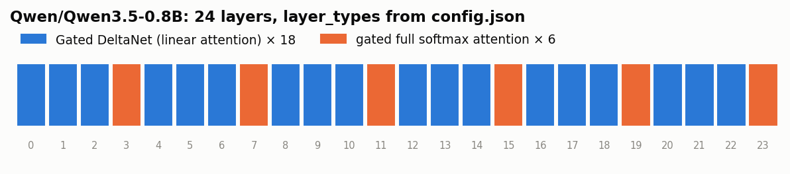

- **Full-attention layers.** Head dimension 256, gated output, QK-norm, and RoPE on 25% of each head
  with base $10^7$.
- **Gated DeltaNet layers.** 16 key heads of dimension 128.
- **Context.** 262,144 tokens natively.
- **Other.** One MTP layer, and a vision encoder: every checkpoint is a vision-language model.

**Why hybrid?** Count the memory at the full 262k context for Qwen3.5-0.8B:
- Only the 6 full-attention layers keep a KV cache: $2 \cdot 6 \cdot 2 \cdot 256 \cdot 262144 \cdot 2\,\text{B} \approx 3.2$ GB.
  If all 24 layers were full attention, it would be about 12.9 GB.
- The 18 Gated DeltaNet layers each keep a fixed $16 \times 128 \times 128$ state: about 19 MB in
  total, *independent of the context length*.

**Where the parameters are.** The breakdown below builds each model on PyTorch's `meta` device from
its config (no weights downloaded) and counts parameters by component:

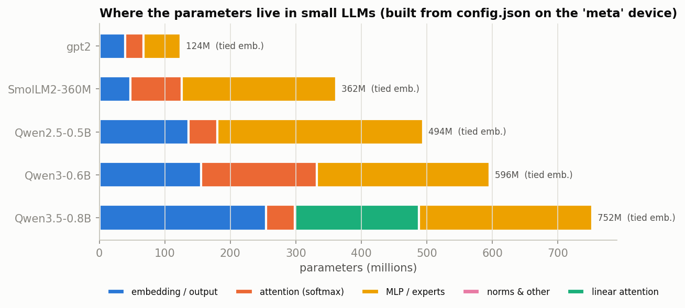

- In small models the **embedding table is a large share**. Qwen3.5-0.8B's 248k-token vocabulary
  takes 254M of its 752M language-model parameters (34%).
- Linear attention (green) replaces most of the softmax attention in Qwen3.5.

Inspect any model yourself:

```python
from transformers import AutoConfig, AutoModelForCausalLM
import torch
cfg = AutoConfig.from_pretrained("Qwen/Qwen3.5-0.8B")
cfg = getattr(cfg, "text_config", cfg)               # Qwen3.5 configs are multimodal; the LM is in text_config
print(cfg.layer_types[:8], cfg.vocab_size, cfg.num_key_value_heads, cfg.head_dim)
with torch.device("meta"):                           # build the model without allocating weights
    model = AutoModelForCausalLM.from_config(cfg)
print(model)                                         # the full module tree
print(sum(p.numel() for p in model.parameters()) / 1e6, "M parameters")
```

The small Qwen3.5 models run in plain PyTorch. If the `flash-linear-attention` kernels are missing,
transformers falls back to a pure-PyTorch implementation of the Gated DeltaNet layer: slower, but
correct. We use that fallback on Mac and CPU.

### 3.3.1 The Gated DeltaNet layer in code, and how to make it fast

Read the implementation in `transformers/models/qwen3_5/modeling_qwen3_5.py`, class
`Qwen3_5GatedDeltaNet`. For one layer of Qwen3.5-0.8B (width 1024; 16 heads with key and value
dimension 128), the forward pass is:

1. **Projections.** `in_proj_qkv` gives $q, k, v$ for all heads at once. `in_proj_z` gives an output
   gate $z$. `in_proj_b` and `in_proj_a` give one scalar per head and token: the write strength
   $\beta_t$ and the decay $\alpha_t$.
2. **Short causal convolution.** A depthwise `Conv1d` with kernel 4 over the $q, k, v$ channels,
   followed by SiLU. Each token's $q, k, v$ thus mixes in the previous 3 tokens: cheap local context
   before the recurrence.
3. **Gates.** $\beta_t = \sigma(b_t)$, and $\log\alpha_t = g_t = -e^{A}\cdot\mathrm{softplus}(a_t + b_{\mathrm{dt}})$.
   $A$ and $b_{\mathrm{dt}}$ (`A_log`, `dt_bias` in the code) are learned per head, so $0 \lt  \alpha_t \lt  1$. $q$ and $k$ are L2-normalized and
   $q$ is scaled by $1/\sqrt{d_k}$.
4. **The delta rule** (§3.2.2; the code stores the transposed state $S \in \mathbb{R}^{d_k \times d_v}$, so it reads $S^\top k$). The
   library's pure-PyTorch *reference* version is literally this loop
   (`torch_recurrent_gated_delta_rule`):

```python
for t in range(T):
    S = S * exp(g[t])                      # forget:  S <- alpha_t * S
    kv_mem = (S * k[t, :, None]).sum(0)    # what the memory returns for key k_t   (= S^T k_t)
    delta = (v[t] - kv_mem) * beta[t]      # error-correcting update (the "delta rule")
    S = S + k[t, :, None] * delta[None]    # write:   S <- S + k_t (beta_t (v_t - S^T k_t))^T
    o[t] = (S * q[t, :, None]).sum(0)      # read:    o_t = S^T q_t
```

5. **Output.** Each head's output is RMS-normalized and multiplied by $\mathrm{SiLU}(z)$ (a *gated*
   RMSNorm). `out_proj` then maps it back to width 1024.

When *generating*, the layer keeps only two small things per sequence: the last 3 inputs of the
convolution, and the $16 \times 128 \times 128$ state $S$. That is why its memory does not grow with
the context. When *training* or reading a prompt, a token-by-token loop would be slow on a GPU.
`chunk_gated_delta_rule` instead splits the sequence into **chunks of 64 tokens**. It computes
everything inside a chunk with matrix multiplications (in parallel), and runs the recurrence only
*across* chunks.

**The fast path.** transformers picks each piece independently:

| piece | fast implementation | fallback (always available) |
|---|---|---|
| chunked delta rule (prompt / training) | `fla.ops.gated_delta_rule.chunk_gated_delta_rule` (Triton) | `torch_chunk_gated_delta_rule` |
| recurrent delta rule (generation, 1 token) | `fla...fused_recurrent_gated_delta_rule` (Triton) | `torch_recurrent_gated_delta_rule` |
| gated RMSNorm | `fla.modules.FusedRMSNormGated` | `Qwen3_5RMSNormGated` |
| causal convolution | `causal_conv1d_fn` / `causal_conv1d_update` (CUDA) | `nn.Conv1d` / `torch_causal_conv1d_update` |

If any of these is missing, it logs *"The fast path is not available … Falling back to torch
implementation"*. The model still computes the same function, up to floating-point rounding.
Installation, on a CUDA machine only:

```bash
pip install flash-linear-attention     # "fla": Triton kernels, pure-Python install, needs an NVIDIA GPU
pip install causal-conv1d              # CUDA extension: needs nvcc matching PyTorch's CUDA version
                                       # (it compiles from source if no prebuilt wheel fits; can take minutes)
python -c "import transformers.models.qwen3_5.modeling_qwen3_5 as m; print(m.is_fast_path_available)"
```

On a Mac or a CPU neither package works. The pure-PyTorch fallback runs: correct, but slower.

**What the kernels buy, measured** on an H100, Qwen3.5-0.8B-Base in bf16, one forward pass on a batch
of 4. Our environment has `fla` but not `causal-conv1d`, so the convolution uses `nn.Conv1d`:

| delta-rule implementation | first call, 512 tokens | repeat, 512 tokens | first call, 1024 tokens | repeat, 1024 tokens |
|---|---:|---:|---:|---:|
| `fla` Triton kernels | 27.4 s | **0.075 s** | 23.9 s | **0.14 s** |
| pure PyTorch fallback | 0.39 s | 0.28 s | 0.46 s | 0.48 s |

- **Once compiled, the Triton kernels are 3.4–3.7× faster** than the PyTorch fallback.
- **The first call for each new input shape costs about 25 s.** Triton compiles and autotunes the
  kernels for that shape. The compiled kernels are cached on disk (`~/.triton`), so a second run of the
  same evaluation is fast.
- Benchmark harnesses feed batches of many different padded lengths, and each new length pays the
  compile cost once. Our first, naive estimate blamed the missing `causal-conv1d` for a slow evaluation.
  The measurement shows that the compile cost was the main factor. (`causal-conv1d` replaces only the
  short convolution; we did not measure its separate effect.) Two lessons: *measure before optimizing*,
  and *JIT-compiled kernels are fast only after warm-up*. Padding inputs to a few fixed
  lengths (multiples of 64 or 128) limits the number of compilations.
- With everything warmed up, a full forward pass of Qwen3.5-0.8B costs about 2× that of Qwen2.5-0.5B
  (0.05 s vs 0.025 s per 512-token sequence; 11.5 s vs 6.4 s for our 100-document bpb evaluation),
  for a 1.5× larger model.

The benchmark config for the Qwen3.5 models is `nanolm/configs/part3/B3_qwen35.yaml`. It writes into the
same results directory as the other models, so `benchmarks summary` shows them together.

## 3.4 Using a pretrained model: chat templates and thinking mode

A **base** model continues text. An **instruct/chat** model has been post-trained (§3.8–3.9) to
answer. It expects its input wrapped in a **chat template**: special tokens that mark who is speaking.
The tokenizer applies the template; here is what the model actually sees (real output of
`tok.apply_chat_template(messages, tokenize=False)`):

```
Qwen2.5-0.5B-Instruct                                  Qwen3.5-0.8B (non-thinking mode)
<|im_start|>system                                     <|im_start|>user
You are Qwen, created by Alibaba Cloud. You are a      Give three tips for staying healthy.<|im_end|>
helpful assistant.<|im_end|>                           <|im_start|>assistant
<|im_start|>user                                       <think>
Give three tips for staying healthy.<|im_end|>
<|im_start|>assistant                                  </think>
1. Eat well. 2. Sleep. 3. Move.<|im_end|>
                                                       1. Eat well. 2. Sleep. 3. Move.<|im_end|>
```

**Thinking models** (Qwen3, Qwen3.5) can write a chain of reasoning inside `<think> … </think>`
before the answer. `apply_chat_template(..., enable_thinking=False)` inserts an empty think block
instead, which is what you want for short answers and for most benchmarks below.

```python
from transformers import AutoModelForCausalLM, AutoTokenizer
tok = AutoTokenizer.from_pretrained("Qwen/Qwen2.5-0.5B-Instruct")
model = AutoModelForCausalLM.from_pretrained("Qwen/Qwen2.5-0.5B-Instruct")
ids = tok.apply_chat_template([{"role": "user", "content": "What is RoPE?"}],
                              add_generation_prompt=True, return_tensors="pt")
out = model.generate(ids, max_new_tokens=100, do_sample=False)
print(tok.decode(out[0, ids.shape[1]:], skip_special_tokens=True))
```

## 3.5 Evaluating a model (1): perplexity and bits-per-byte

The most direct evaluation of a language model is the one from Part 1: how well does it predict
held-out text? `finetune.py` (method `eval_bpb`) decodes the first 200 FineWeb validation documents from
Part 2 back into text (570,218 bytes). Each model tokenizes them with its own tokenizer and is scored
in bits per byte, so the comparison is fair across tokenizers:

```bash
python -m nanolm.finetune -c nanolm/configs/part2/P1_eval_bpb.yaml                                   # Qwen2.5-0.5B
python -m nanolm.finetune -c nanolm/configs/part2/P1_eval_bpb.yaml model.name=gpt2 name=P1_gpt2
```

| model | released | parameters | tokenizer vocabulary | bytes / token | **val bpb** |
|---|---|---:|---:|---:|---:|
| our L4 model (Part 2), 49M training tokens | — | 11M | 1,024 | 2.4 | 1.647 (first 4.2M val tokens) |
| GPT-2 small | 2019 | 124M | 50,257 | 4.56 | 1.079 |
| *Parameter Golf winner (16 MB artifact, full val set; Part 4)* | *2026* | | *8,192* | | *1.057* |
| SmolLM2-135M | 2024 | 135M | 49,152 | 4.44 | 1.010 |
| Qwen3.5-0.8B-Base | 2026 | 752M (language model) | 248,077 | 4.58 | 0.988 |
| Qwen3-0.6B-Base | 2025 | 596M | 151,669 | 4.57 | 0.953 |
| Qwen2.5-0.5B | 2024 | 494M | 151,665 | 4.57 | 0.951 |
| **SmolLM2-360M** | 2024 | 362M | 49,152 | 4.44 | **0.928** |

How to read it:
- **The 16 MB golf winner beats GPT-2 small**, a 2019 model with 15× the bytes. Five years of
  architecture, optimizer, quantization and evaluation improvements are worth more than a 15×
  larger model.
- **Newer and bigger is not automatically better *on a given test*.** SmolLM2-360M is the best model
  here, ahead of Qwen models up to twice its size. SmolLM2 was trained largely on FineWeb-Edu, the
  same kind of text as this test. Qwen3.5 was trained for many languages, code, images and reasoning,
  and spends a third of its parameters on a 248k-token vocabulary. Perplexity measures fit to *one*
  distribution. Benchmarks (next section) measure other things.
- The evaluation uses non-overlapping 1,024-token windows for every model, so long-context models get
  no advantage. (Caveat: the golf number uses the full 50k-document set, the others the first 200
  documents. Read the comparison to about ±0.02.)

## 3.6 Evaluating a model (2): benchmarks

Model releases report scores on dozens of benchmarks. To read those tables you need to know three
things about each benchmark: **what it asks**, **how an answer is scored**, and **what random
guessing would score**.

### 3.6.1 What the common benchmarks measure

| benchmark | what it asks | size | scoring | chance |
|---|---|---|---|---:|
| **MMLU** | 57 school/university subjects (law, medicine, physics, ...) | 14,042 questions, 4 choices | log-likelihood multiple choice | 25% |
| **MMLU-Pro** | harder, reasoning-heavy MMLU successor | 12,032 questions, up to 10 choices | generated answer, usually with chain-of-thought | ~10% |
| **MMLU-Redux** | 5,700 MMLU questions re-annotated; it estimates 6.5% of MMLU's labels are wrong | | | 25% |
| **GPQA Diamond** | "Google-proof" graduate-level biology, physics, chemistry. Experts score 65%, skilled non-experts with web access 34% | 198 questions, 4 choices | log-likelihood or generated (CoT) | 25% |
| **SuperGPQA** | graduate-level questions in 285 fields | 26,529 questions | multiple choice | low (many options) |
| **HellaSwag** | pick the most plausible continuation of an everyday scenario | 10,042, 4 endings | log-likelihood (length-normalized) | 25% |
| **ARC-Easy / Challenge** | grade-school science exam questions | 2,376 / 1,172 | log-likelihood multiple choice | 25% |
| **WinoGrande**, **PIQA** | pronoun resolution; physical commonsense | 1,267 / 1,838, 2 options | log-likelihood | 50% |
| **GSM8K** | grade-school math word problems | 1,319 | generated; exact match on the final number | ~0% |
| **MATH-500**, **AIME** | competition mathematics (AIME: 30 problems per year) | 500 / 30 | generated; answer equivalence | ~0% |
| **HumanEval**, **LiveCodeBench** | write a program that passes unit tests (LiveCodeBench uses problems released after a date, against contamination) | 164 / growing | pass@k by *executing* the code | 0% |
| **IFEval** | follow verifiable format instructions ("answer in 3 bullet points, no commas") | 541 prompts | rule-checked, no judge | — |
| **Arena-Hard**, **MT-Bench** | open-ended chat quality | 500 / 80 | **LLM-as-judge** (another model compares answers) | — |
| **HLE** (Humanity's Last Exam) | 2,500 expert-written frontier questions | 2,500 | exact match + judge | ~0% |
| **C-Eval**, **CMMLU** | Chinese-language exams | C-Eval: 13,948 questions | log-likelihood multiple choice | 25% |

The GPQA authors ask that its questions **not be published in plain text online**, so that they do
not leak into future training data. This tutorial shows no GPQA examples. The dataset is gated: accept
its terms on HuggingFace before running it.

### 3.6.2 How an answer is scored

**Log-likelihood multiple choice** (MMLU, ARC, HellaSwag, GPQA zero-shot). The model never generates
anything. For a question $q$ and choices $c_1 \dots c_K$, sum the log-probabilities of each choice's
tokens:

```math
s_i = \sum_{t} \log p_\theta\big(c_i[t] \mid q, c_i[\lt t]\big), \qquad
\hat\imath = \arg\max_i s_i, \qquad
\hat\imath_{\mathrm{norm}} = \arg\max_i \frac{s_i}{|c_i|} .
```

`acc_norm` divides by the length $|c_i|$ (characters of the choice text) so that long answers are not
penalized for having more tokens. For
ARC the prompt is literally `"Question: <question>\nAnswer:"`, and each choice is scored as
`" <choice text>"`. `benchmarks.py: mc_accuracy` implements this in about 20 lines.

**Checking our understanding against the standard tool.** We ran our scorer and
lm-evaluation-harness on SmolLM2-360M, ARC-Easy, all 2,376 questions:

| scorer (fp32, first 300 questions) | acc | acc_norm |
|---|---:|---:|
| lm-evaluation-harness 0.4.11 | 0.6833 | 0.6633 |
| our `mc_accuracy`, first version | 0.6833 | 0.6867 |
| our `mc_accuracy`, after the fix | **0.6833** | **0.6633** |

The first version agreed on `acc` but not on `acc_norm`: 7 of 300 answers differed. Two
explanations seemed natural. Precision was the first: lm_eval ran in bf16. A missing
beginning-of-sequence token was the second. Both were tested and both were wrong:
- our scorer gave the same result in bf16 and fp32;
- adding the token made the gap larger;
- the token ids fed to the model were identical.

The cause was in the definition. lm_eval divides by the length of the choice text *without* the
space that separates it from "Answer:". We had counted that space. Recomputing lm_eval's own logged
log-likelihoods both ways reproduces both numbers exactly. **A one-character difference in a
normalization changed 2.3 points of accuracy.** Benchmark numbers from different tools, or different
versions of one tool, are only comparable when the scoring code is the same.

**Generative exact match** (GSM8K, MATH). The model writes a solution, and a regular expression
extracts the final answer, which must equal the reference. Scores therefore depend on the *answer
format* as much as on the reasoning. A model that gets the right number in the wrong format scores 0.

**pass@k** (code). Generate $n$ programs per problem, of which $c$ pass the unit tests. The unbiased
estimate of "at least one of $k$ samples passes" is $1 - \binom{n-c}{k}\big/\binom{n}{k}$.

**LLM-as-judge** (Arena-Hard, MT-Bench): a strong model compares or grades answers. It scales to
open-ended tasks, but it inherits the judge's biases: it prefers longer answers, the first-shown
answer, and answers in its own style.

### 3.6.3 Running benchmarks

The standard tool is EleutherAI's [lm-evaluation-harness](https://github.com/EleutherAI/lm-evaluation-harness).
It is what most small-model numbers are computed with:

```bash
lm_eval --model hf --model_args pretrained=HuggingFaceTB/SmolLM2-360M,dtype=bfloat16 \
        --tasks mmlu,arc_easy,arc_challenge,hellaswag --num_fewshot 0 --batch_size 32
lm_eval --model hf --model_args pretrained=Qwen/Qwen3.5-0.8B,enable_thinking=False \
        --tasks ifeval --apply_chat_template --batch_size 32          # chat models: use the chat template
lm_eval --model hf --model_args pretrained=HuggingFaceTB/SmolLM2-360M,peft=<adapter dir> --tasks arc_easy   # a LoRA model
```

`nanolm.benchmarks` wraps this in a config: models × task groups, run in parallel, resumable, with a
summary table and a figure:

```bash
python -m nanolm.benchmarks run -c nanolm/configs/part3/B1_small_models.yaml --slots 4    # GPU: ~2 h for 11 models
python -m nanolm.benchmarks run -c nanolm/configs/part3/B2_laptop.yaml                    # laptop: ~30-60 min
python -m nanolm.benchmarks summary outputs/nanolm/benchmarks/small_models
```

### 3.6.4 Results: small open models

> **Results pending.** The benchmark runs for this section (`configs/part3/B1_small_models.yaml`) are
> still in progress. The table and figure will be added here when they finish. Meanwhile you can run
> `python -m nanolm.benchmarks run -c nanolm/configs/part3/B2_laptop.yaml` yourself.

### 3.6.5 Reading a model-release table

The Qwen3.5-0.8B [model card](https://huggingface.co/Qwen/Qwen3.5-0.8B) reports, among others
(numbers copied from the card):

| benchmark | Qwen3-1.7B | **Qwen3.5-0.8B** | Qwen3.5-2B | mode |
|---|---:|---:|---:|---|
| MMLU-Pro | 40.2 | **29.7** | 55.3 | non-thinking |
| MMLU-Redux | 64.4 | **48.5** | 69.2 | non-thinking |
| SuperGPQA | 21.0 | **16.9** | 30.4 | non-thinking |
| IFEval | 68.2 | **52.1** | 61.2 | non-thinking |
| MMLU-Pro | 56.5 | **42.3** | 66.5 | thinking |
| GPQA | 40.1 | **11.9** | 51.6 | thinking |
| IFEval | 72.5 | **44.0** | 78.6 | thinking |

Questions to ask of any such table:
1. **Under what settings?** Thinking vs. non-thinking, few-shot or zero-shot, chain-of-thought or
   log-likelihood, sampling temperature. The same model's MMLU-Pro is 29.7 without thinking and 42.3
   with it. Our §3.6.4 numbers use log-likelihood scoring, which is a *different measurement* from the
   card's generated-answer scores. Compare like with like.
2. **What is chance?** The card's GPQA score for Qwen3.5-0.8B in thinking mode is **11.9**, *below*
   the 25% of random guessing on a 4-choice test. A score below chance usually means answers were not
   produced in a parseable format (for example, the model ran out of tokens while thinking), not that
   the model "knows less than nothing". This is our interpretation; the card does not explain it. Note
   also that a small model's IFEval score is *lower* with thinking (44.0) than without (52.1).
3. **Could the test data have leaked into training?** Benchmarks published years ago (MMLU 2020, GSM8K
   2021) are on the web, and so possibly in pre-training data. Newer benchmarks fight this with
   post-cutoff problems (LiveCodeBench, AIME by year) or by keeping test answers private.
4. **Is it saturated?** When strong models all score above ~90% (MMLU-Redux 93.3 for Qwen3.5-35B-A3B),
   the remaining errors are often label noise. The field moves to harder tests (MMLU-Pro, GPQA, HLE).

## 3.7 Fine-tuning: full vs. LoRA

Adapting a pretrained model means continuing to train it on new data. **Full fine-tuning** updates
every weight. With AdamW in fp32 that costs 16 bytes per parameter:
- 4 bytes for the weight;
- 4 bytes for its gradient;
- 8 bytes for Adam's two moment estimates.

For a 360M model that is 5.8 GB before any activations, too much for many laptops.

**LoRA** (Hu et al., 2021) freezes the pretrained weight $W_0$ and learns a low-rank correction:

```math
W = W_0 + \frac{\alpha}{r} B A, \qquad A \in \mathbb{R}^{r \times d_{in}},\; B \in \mathbb{R}^{d_{out} \times r},\; r \ll d .
```

$B$ starts at zero, so training starts exactly from the pretrained model. With $r = 16$ on every
attention and MLP projection of SmolLM2-360M, only **8.7M of 370M weights (2.3%)** are trained. Their
gradients and optimizer state are tiny, and the saved "adapter" is a few MB. `finetune.py` uses the
`peft` library for LoRA and adds two more memory savers:
- gradient checkpointing;
- computing the vocabulary softmax only at the answer positions, in chunks.

## 3.8 Instruction tuning (SFT)

A base model continues documents. Ask it a question and it may continue with more questions.
**Supervised fine-tuning** on (instruction, answer) pairs teaches it to *answer, then stop*. The loss
is the usual cross-entropy, but **only on the answer tokens**:

```math
\mathcal{L}_{\text{SFT}} = -\frac{1}{|\mathcal{A}|} \sum_{t \in \mathcal{A}} \log p_\theta(x_t \mid x_{\lt t}),
\qquad \mathcal{A} = \text{positions of the answer (including the end-of-turn token)}.
```

The prompt positions get label −100, which PyTorch ignores. The model is not trained to reproduce
questions. The end-of-turn token *is* in $\mathcal{A}$: that is how the model learns to stop.

```bash
python -m nanolm.finetune -c nanolm/configs/part2/P2_sft_alpaca.yaml     # 8 GB Mac: model.name=HuggingFaceTB/SmolLM2-135M
```

Reference run:
- **Model:** SmolLM2-360M (base), with LoRA r = 16.
- **Data:** 2,000 Alpaca instruction/answer pairs, 100 held out.
- **Training:** 250 steps × 16 examples, fp32.
- **Peak memory:** **1.97 GB**.

| | before SFT | after SFT |
|---|---:|---:|
| held-out answer loss (nats/token) | 1.556 | **1.321** |
| held-out answer perplexity | 4.74 | 3.75 |

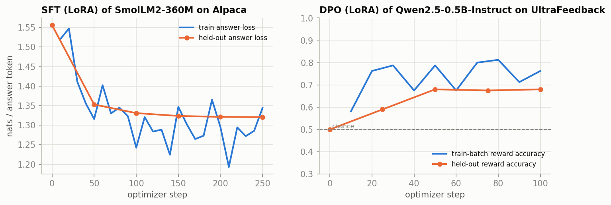

The before/after samples (greedy decoding, from `samples_before.txt` / `samples_after.txt`):

```
### Give three tips for staying healthy.
BEFORE: • Eat a balanced diet. • Exercise regularly. • Get enough sleep. ...
        ### Question 2:  Give three tips for staying healthy.  ### Response: • Eat a balanced diet. ...
        ### Question 3: ...                                   <- never stops: it continues a "document"
AFTER:  1. Eat a balanced diet: A healthy diet is essential for maintaining good health. It should
        include a variety of fruits, vegetables, whole grains, ... 2. Stay active: ... 3. Get enough sleep: ...

### Write a haiku about autumn.
AFTER:  Autumn's golden hues / Shimmer in the breeze, / Nature's silent symphony.

### What is the capital of France, and why is it famous?
AFTER:  The capital of France is Paris, which is located in the region of Normandy ...      <- wrong
### Translate 'good morning' into Spanish and Chinese.
AFTER:  Good morning in Spanish: ¡Hola!   Good morning in Chinese: 你好！                  <- wrong
```

**SFT teaches format and behaviour, not knowledge.** After two passes over 2,000 examples the model
answers in the right shape and stops. But it states falsehoods with the same confidence: Paris is not
in Normandy, and "¡Hola!" and "你好" mean "hello", not "good morning". This is hallucination in its
simplest form. A 360M model does not know enough, and SFT cannot add what pre-training did not
provide.

## 3.9 Preference tuning (DPO)

SFT imitates given answers. **Preference tuning** learns from *comparisons*: for a prompt $x$, a
person (or a model) preferred answer $y_w$ over $y_l$. The **Bradley–Terry** model says preferences
follow a hidden reward $r$:

```math
P(y_w \succ y_l \mid x) = \sigma\big(r(x, y_w) - r(x, y_l)\big).
```

Classic RLHF first fits a reward model, then optimizes the policy with reinforcement learning (PPO)
under a KL penalty toward the original model. **DPO** (Rafailov et al., 2023) shows that the optimal
policy of that objective satisfies $r(x,y) = \beta \log \frac{\pi_\theta(y\mid x)}{\pi_{\text{ref}}(y\mid x)} + \text{const}$.
Substituting this into Bradley–Terry gives a loss that trains the policy *directly*, with no reward
model and no sampling:

```math
\mathcal{L}_{\text{DPO}} = -\log \sigma\Big(\beta\Big[\log\frac{\pi_\theta(y_w\mid x)}{\pi_{\text{ref}}(y_w\mid x)} - \log\frac{\pi_\theta(y_l\mid x)}{\pi_{\text{ref}}(y_l\mid x)}\Big]\Big).
```

The bracket times $\beta$ is the **implicit reward margin**. In `finetune.py`, $\pi_{\text{ref}}$ is
the same network with the LoRA adapter switched off. No second copy of the model is needed.

```bash
python -m nanolm.finetune -c nanolm/configs/part2/P3_dpo.yaml
```

Reference run:
- **Model:** Qwen2.5-0.5B-Instruct, with LoRA r = 16.
- **Data:** 800 UltraFeedback pairs whose quality scores differ by at least 2 points.
- **Training:** 100 steps × 8 pairs, β = 0.1.
- **Evaluation:** 100 held-out pairs.
- **Peak memory:** **2.85 GB in fp32**.

| | before DPO | after DPO |
|---|---:|---:|
| implicit-reward accuracy (margin > 0) | 0.50 (policy = reference: all ties) | **0.68** |
| mean implicit-reward margin | 0.00 | 0.63 |
| the model alone prefers $y_w$ (per-token log-probability) | 0.61 | 0.63 |

- **0.68 is real.** The standard error on 100 pairs is about 0.047, so this is 3.8 standard errors
  above chance.
- **The model's own ranking of answers barely moved** (0.61 → 0.63). DPO shifted probabilities
  *relative to the reference model*. It did not make the model a better judge.
- **The samples changed mostly in style.** After DPO the model drops "Certainly!" and the markdown
  bold. A factual error survived: both versions give the pinyin of 早上好 as "Wǎng bù duì"; the
  correct pinyin is "zǎo shang hǎo".

PPO and GRPO (the reinforcement-learning methods behind "reasoning" models) generate answers during
training, so they are far slower. They are best run on a GPU server, not a laptop.

## 3.10 Did post-training change the benchmark scores?

> **Results pending.** This section compares the base models with our SFT and DPO models (§3.8–3.9)
> on the §3.6 benchmarks. Those runs are in `configs/part3/B1_small_models.yaml` (models `+ourSFT`,
> `+ourDPO`) and are still in progress.

---

# Part 4 — Parameter Golf: exploring next-generation architectures

Part 3 showed where the field's architectures came from. Part 4 asks how *new* ideas get found and
tested. The setting is a 2026 competition in which hundreds of people raced to build the best
language model under a hard size limit. It works as a laboratory for architecture research: every
idea is scored on the same data, with the same metric, under the same budget.

Several ideas that won here also appear in the newest production models:
- **partial RoPE** (Qwen3.5 rotates 25% of each head; Golf's best setting was 16 of 64 dimensions);
- **gated attention outputs** and **QK-norm** (Qwen3-Next/3.5);
- **Muon** (Kimi K2);
- **multi-token prediction** (DeepSeek-V3, Qwen3.5);
- **parameter sharing through depth recurrence**.

Part 4 shows how to tell which such ideas actually help.

## 4.1 The challenge

[OpenAI Parameter Golf](https://github.com/openai/parameter-golf) (March 18 – April 30, 2026, more than
1,000 participants): train the language model with the lowest FineWeb validation bpb, subject to:

- the **artifact** (compressed weights + training code) is at most **16 MB**;
- training takes at most **10 minutes on 8×H100**; evaluation has its own time limit;
- evaluation is **tokenizer-agnostic** (bpb) on a fixed set of 50k documents.

This is "L(N)" optimization: the best loss for a fixed parameter/byte budget. It complements the
NanoGPT *speedrun* (best time for a fixed loss). With a budget this tight, the winning ideas are
about **using every byte** (quantization, compression, weight sharing) and **using every FLOP of
evaluation** (context, test-time training), as much as about architecture.

## 4.2 Final leaderboard (10 min / 16 MB track)

From the [official README](https://github.com/openai/parameter-golf/blob/main/README.md) (final
audited update, May 2026). Scores are 3-seed means.

| bpb | Author | What the record adds (on top of the previous one) |
|---:|---|---|
| **1.0565** | codemath3000 | PR #2130 architecture rerun on clean CaseOps data; token-only n-gram tilt, AsymLogit, more GPTQ calibration batches |
| 1.0576 | simonbissonnette | progressive context growth to 3k; short-document score-first TTT |
| 1.0586 | andrewbaggio1 | 2560-token eval/TTT context; no-Q/V TTT mask; QK-gain 5.25 |
| 1.0594 | alertcat | AWQ-lite mixed GPTQ + AsymLogit |
| 1.0611 | codemath3000 | BOS-fixed SmearGate, LQER, SparseAttnGate, per-group lrzip |
| 1.0634 | nprime06 | Polar-Express Newton–Schulz, MIN_LR, SparseAttnGate, fused CE |
| 1.0655 | dexhunter | CaseOps + gated attention + quant gate + loop 4–5 + phased TTT |
| 1.0678 | romeerp | CaseOps lossless case-transform tokenizer, tapered WD |
| 1.0810 | bigbag | SP8192 + 3-layer recurrence + parallel residuals + QK-gain 5.25 + legal TTT |
| 1.0856 | Kevin Clark | SP8192 + GPTQ embeddings + depth recurrence + SDClip |
| 1.0979 | Kevin Clark | SP4096 + 4× MLP + high WD, *removing* hash embeddings / SmearGate / value residual |
| 1.1194 | abaybektursun | LeakyReLU² + legal score-first TTT + parallel Muon (late March) |
| 1.1925 | Matthew Li | sliding-window eval only (stride 64) |
| 1.2244 | baseline | 9 layers × 512, 1024 vocab, tied embeddings, 4 KV heads |

How to read this table:
1. It is a **lineage**: almost every record is "previous stack + 1–3 changes".
2. The top 5 are within 0.005 bpb of each other, and several were accepted at p = 0.01–0.06. Their
   order is close to the seed noise.
3. The audit **excluded** many submissions that leaked the target or counted bytes wrongly (n-gram
   channels that depend on the target token, unnormalized byte mixtures, wrong byte denominator).
   Metric hygiene was a real part of the competition (§5.3).

## 4.3 The techniques, grouped by lever

The impact numbers are quoted from the record write-ups. Most are single-seed and/or bundled with
other changes, so treat them as rough.

**A. Evaluation (free at training time)**

| technique | what it does | reported gain |
|---|---|---|
| sliding-window eval | score each token with nearly the full context instead of on average half (`eval.sliding_stride`) | **−0.032** (03-19) |
| legal score-first TTT | adapt (LoRA) weights on validation chunks *after* scoring them | −0.002 early … −0.013 late (phased) |
| longer eval context | 2k–3k tokens at eval | ~−0.001 |

**B. Bytes: quantization × compression × weight decay**

| technique | what it does | reported gain |
|---|---|---|
| int8 → int6 per-row + zstd/lzma | ~25% fewer bytes per weight, spent on a bigger model (3× MLP) | −0.029 together with MLP3×/SmearGate/BigramHash (03-19/20) |
| QAT (fake-quant STE) | train through the rounding (`train.qat_bits`) | small; removed later |
| GPTQ (Hessian-aware rounding), SDClip, AWQ-lite, LQER | better rounding / clipping / low-rank error correction | −0.0046 (full-Hessian GPTQ) … −0.0003 |
| high weight decay (0.09) | smaller weights compress better (weight RMS predicts compressed size, R² ≈ 0.99), so room for more parameters | part of −0.012 (04-01) |

**C. Tokenizer**: sp1024 → sp4096 → sp8192 (about −0.012 per step, bundled), CaseOps (−0.004).

**D. Architecture** (each is a key in `ModelConfig`):

| technique | key | what it does | reported gain |
|---|---|---|---|
| U-Net skips | `unet_skips` | encoder-half outputs feed mirrored decoder layers | baseline |
| relu² / LeakyReLU(0.5)² | `mlp` | squared activation; leaky keeps gradient for x<0 | −0.002 … −0.003 |
| XSA (exclusive self-attn) | `xsa_last_n` | subtract each head's projection onto the token's *own* value vector | −0.005 with EMA |
| partial RoPE + LN scale | `rope_dims`, `ln_scale` | rotate 16/64 dims; damp layer i's input by 1/√(i+1) | −0.0023 |
| QK-gain | `qk_gain_init` | learnable per-head temperature after QK-norm, initialized 4–5.25 | ~−0.003 (4→5) |
| SmearGate | `smear_gate` | blend each token's embedding with the previous token's | part of −0.029 |
| BigramHash | `bigram_buckets` | hashed (prev, cur) pair embedding | part of −0.029, later removed |
| value residual | `value_residual` | mix layer-0 values into later layers | later removed |
| depth recurrence | `recur_layers` | re-run layers 3–5 (or 4–5): more depth, zero extra bytes | −0.002 … −0.003 |
| parallel residuals | `parallel_from` | attention and MLP read the same input in late layers | −0.002 |
| gated attention | `attn_gate` | sigmoid gate per head on the attention output | ~−0.002 |

**E. Optimizer**: Muon everywhere; momentum 0.95 → 0.97–0.99; Muon weight decay; EMA of weights
(−0.0006 alone); long warmdown + LR floor; MuonEq-R and Polar-Express coefficients (~−0.001 each).

**What this tells a student.** The big, robust wins were *not* clever blocks. They were:
(1) evaluate with more context, (2) spend bytes better (quantize, compress, then buy parameters with
the savings), (3) a larger vocabulary, and (4) test-time training. Most architectural tweaks were
worth about 0.002 bpb, a size that only shows up inside an already-tuned stack and that is
comparable to the seed noise. Some (BigramHash, value residual) were later *removed*: they helped a
weak model and became useless once the model was stronger. An independent analysis of about 2,000
submissions (["Parameter Golf: What Really Works?", arXiv 2607.01517](https://arxiv.org/abs/2607.01517))
reaches a similar conclusion, although its correlational method is weak evidence.

## 4.4 The golf baseline in `nanolm`

`configs/04_golf_baseline.yaml` re-implements the challenge baseline with config switches:
9 layers, d = 512, 8 heads / 4 KV heads (GQA), relu² MLP ×2, tied embeddings (init std 0.005),
U-Net skips, x0 residual mixing, QK-norm with gain 1.5, logit softcap 30, zero-initialized output
projections, Muon (lr 0.04) + Adam (embeddings 0.05, scalars 0.04), constant LR then linear warmdown,
int8 + compression export. With `torchrun --nproc_per_node=8` and `max_time_sec: 600` this matches the
official budget.

On one GPU, `04_golf_lab.yaml` keeps the same model and shrinks the budget to 2000 steps × 65,536
tokens = 131M tokens. That is about 2% of an official run, so absolute numbers are higher than the
leaderboard. The *differences* between techniques are what we measure.

## 4.5 Our ablation: each technique alone, two seeds

```bash
python -m nanolm.sweep   --sweep nanolm/configs/sweeps/04_golf_ablation.yaml
python -m nanolm.analyze outputs/nanolm/sweeps/golf_ablation --baseline baseline --metric val_bpb
```

Setup: the golf baseline model (17.07M parameters), 2000 steps × 65,536 tokens = 131M FineWeb
tokens, the same data order for every run, and evaluation on the first 4.2M validation tokens
(non-overlapping windows). Each technique is switched on **alone**. Two seeds; "p" is a paired
t-test (1 degree of freedom). Seed noise floor: **0.0017 bpb**.

| technique (alone) | val bpb (2 seeds) | Δ vs. baseline | paired p | params | int8 size | verdict |
|---|---:|---:|---:|---:|---:|---|
| MLP 3× (instead of 2×) | 1.4167 ± 0.0003 | **−0.0121** | 0.10 | 21.8M | 19.8 MB ✗ | helps (both seeds), but needs int6 to fit |
| value residual | 1.4218 ± 0.0013 | **−0.0069** | 0.08 | 17.1M | 15.7 MB | helps (both seeds) |
| LeakyReLU(0.5)² | 1.4228 ± 0.0015 | **−0.0059** | 0.07 | 17.1M | 15.8 MB | helps (both seeds) |
| depth recurrence (layers 3–5 ×2 from 35%) | 1.4238 ± 0.0019 | **−0.0049** | 0.05 | 17.1M | 15.7 MB | helps, zero extra bytes |
| XSA, last 4 layers | 1.4265 ± 0.0006 | −0.0023 | 0.33 | 17.1M | 15.7 MB | small, ~1 noise floor |
| QK-gain init 4.0 | 1.4277 ± 0.0023 | −0.0010 | 0.05 | 17.1M | 15.7 MB | within noise |
| SmearGate + BigramHash(4096) | 1.4287 ± 0.0009 | −0.0001 | 0.99 | 17.7M | 16.3 MB | nothing (and costs 0.6 MB) |
| **baseline** | **1.4287 ± 0.0025** | 0 | — | 17.1M | 15.7 MB | |
| parallel residual from layer 6 | 1.4291 ± 0.0017 | +0.0003 | 0.65 | 17.1M | 15.7 MB | nothing |
| gated attention | 1.4297 ± 0.0021 | +0.0010 | 0.16 | 17.1M | 15.8 MB | nothing |
| EMA (0.997) | 1.4299 ± 0.0021 | +0.0012 | 0.14 | 17.1M | 15.7 MB | nothing at 2000 steps |
| partial RoPE (16/64) + LN-scale | 1.4361 ± 0.0029 | **+0.0073** | 0.03 | 17.1M | 15.7 MB | **hurts** (both seeds) |
| Muon weight decay 0.04 | 1.4367 ± 0.0012 | **+0.0080** | 0.07 | 17.1M | 15.7 MB | **hurts**, saves only 0.3% bytes |
| "record stack" (10 tricks from records, see `stack`) | 1.4300 ± 0.0020 | +0.0013 | 0.75 | 22.4M | 19.6 MB | **nothing**: the harmful ones cancel the good ones |
| **verified stack** (only the 5 that helped) + int6 | **1.3935 ± 0.0012** | **−0.0352** | 0.016 | 21.8M | **14.6 MB (int6)** ✓ | sum of the parts (−0.032 expected) |

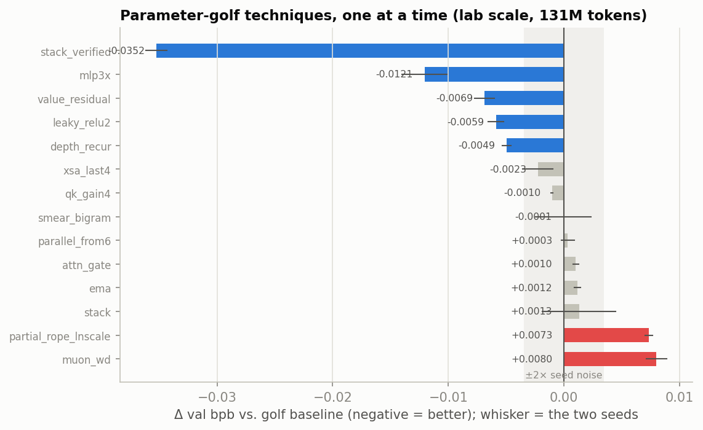

What this experiment teaches:
1. **Ablate one thing at a time, then stack only what survived.** The "record stack" (everything a
   record write-up recommended) is *no better than the baseline*. Two of its components hurt at our
   scale, and EMA and SmearGate/BigramHash did nothing. Stacking only the five techniques that helped
   on both seeds gives −0.035, almost exactly the sum of their separate effects (−0.032). At this scale
   the good effects are close to additive.
2. **Context matters for "what works".** Partial RoPE + LN-scale and Muon WD were real gains in the
   records: in an 11-layer model trained on about 7B tokens, with a size budget that WD helped meet.
   In a 9-layer model trained on 131M tokens they cost 0.007–0.008. Muon WD exists to make weights
   compress better, but with int8 at our scale it saved only 0.3% of the bytes. A technique is a
   claim about a regime, not a law.
3. **Bytes are a currency.** 3× MLP is the largest single gain, but it breaks the 16 MB budget at int8
   (19.8 MB). It only "counts" because int6 brings it back to 14.6 MB for a +0.0016 bpb rounding cost
   (§4.6). In golf, an architecture result without its artifact size is half a result, and that is
   why `metrics.json` always records both.
4. **Two seeds is a minimum, not a luxury.** The noise floor (0.0017) is about the size of the
   XSA and QK-gain effects. We call those "within noise", not "helps".

## 4.6 The free levers: evaluation stride and quantization (no retraining)

```bash
python -m nanolm.compress outputs/nanolm/sweeps/golf_ablation/baseline_s1337 --bits 8 6 5 4 --strides 0 256 64
```

Golf-lab baseline (seed 1337, 17.07M parameters), evaluated on the first 4.2M validation tokens
with a 1024-token context:

**Evaluation stride (same weights):**

| eval | val bpb | eval time |
|---|---:|---:|
| non-overlapping 1024-token windows (average context ≈ 512) | 1.4270 | 5.5 s |
| sliding, stride 256 (context ≥ 768) | 1.3915 (−0.0355) | 20 s |
| sliding, stride 64 (context ≥ 960) | **1.3904 (−0.0366)** | 81 s |

This is the single largest effect in the whole tutorial, and it comes with *zero* training change.
It reproduces the leaderboard record (−0.032). Most of the gain is already there at stride 256 for
a quarter of the cost. Nothing about the model changed: non-overlapping evaluation simply
under-reports what the model can do, because a token at the start of a window has almost no context.

**Quantization × compressor (round-trip = de-quantize and re-evaluate):**

| export | baseline: size | bits/param | round-trip bpb gap | stack (22.4M params): size | gap |
|---|---:|---:|---:|---:|---:|
| int8 + zlib | 15.68 MB | 7.35 | +0.0001 | 19.87 MB | +0.0001 |
| int8 + lzma | 15.72 MB | 7.37 | +0.0001 | 19.57 MB | +0.0001 |
| int6 + lzma | 11.52 MB | 5.40 | +0.0019 | **14.24 MB** | +0.0012 |
| int5 + lzma | 9.81 MB | 4.60 | +0.0075 | 11.90 MB | +0.0052 |
| int4 + lzma | 7.78 MB | 3.64 | +0.0302 | 9.77 MB | +0.0225 |

- int8 is essentially free (+0.0001) but cannot fit a model of more than about 17M parameters into 16 MB.
- **int6 costs about 0.002 bpb and saves 27% of the bytes.** That is how the 22M-parameter (MLP 3×)
  model fits into 14.2 MB, and 3× MLP alone was worth −0.012 (§4.5). Every golf record made this trade.
- int4 with simple rounding is too lossy (+0.03). The records that went below 6 bits used GPTQ
  (Hessian-aware rounding) or ternary/binary *training*, not post-hoc rounding.
- lzma squeezes the unused high bits of int6/int5 values stored in int8 bytes (5.40 bits/param at
  "6 bits"). At int8 there is nothing to squeeze, and lzma is even slightly larger than zlib.

## 4.7 Putting it together (lab scale, 131M training tokens, 2 seeds)

| | val bpb | artifact |
|---|---:|---:|
| golf baseline, int8 | 1.4287 | 15.7 MB |
| + verified architecture stack (3× MLP, value residual, LeakyReLU², depth recurrence, XSA) | 1.3935 | 14.6 MB at int6 |
| + sliding-window eval, stride 64 | **1.3558** | |
| int6 round-trip cost (measured at stride 0) | +0.0016 | |

That is about −0.073 bpb (−5%) from a 2% compute budget. On the leaderboard, baseline → winner was
−0.168 with about 50× more training tokens, a larger vocabulary, GPTQ and test-time training: the
techniques we did not implement. They make good final projects (HW 4).

---

## 4.8 Parameter Golf on a laptop

Everything in this Part runs on a laptop at a smaller scale. `laptop/L5_golf_mini.yaml` is the golf
baseline architecture at 6 layers × 384 (U-Net skips, x0 mixing, QK-norm with gain, relu² MLP, logit
softcap, tied embeddings, Muon + Adam, warmdown), trained on 41M FineWeb tokens. It has a
laptop-sized "golf budget" of **6.5 MB**.

```bash
python -m nanolm.train -c nanolm/configs/laptop/L5_golf_mini.yaml          # baseline
python -m nanolm.train -c nanolm/configs/laptop/L6_golf_mini_stack.yaml    # verified stack + int6 + sliding eval
python -m nanolm.sweep --sweep nanolm/configs/sweeps/laptop_golf_ablation.yaml   # overnight: one technique at a time
```

On a Mac, the official MLX trainer (`parameter_golf_mlx/`) trains the same L5 model about 4.8× faster
than nanolm on PyTorch MPS: 4.9 vs 23.3 min on an M5 Pro. Measurements and caveats are in
[`LAPTOP_QUICKSTART.md`](LAPTOP_QUICKSTART.md), Step 7b.

Reference runs (fp32, as on a Mac):

| | params | val bpb | + sliding eval (stride 128) | artifact | fits 6.5 MB? | peak memory |
|---|---:|---:|---:|---:|:---:|---:|
| L5 golf-mini baseline (int8) | 6.6M | 1.633 | — | 6.11 MB | ✓ | 1.8 GB |
| L6 verified stack (int6) | 8.4M | 1.601 | **1.554** (int6 round-trip 1.555) | 5.59 MB | ✓ | 2.9 GB |

The laptop ablation (`sweeps/laptop_golf_ablation.yaml`) was run here with **two seeds**
(`--seeds 1337 42 --set precision=fp32`). On a laptop you would run one seed overnight. Noise
floor: 0.0018 bpb.

| technique (alone, on L5) | val bpb | Δ vs. baseline | paired p | same technique at lab scale (§4.5) |
|---|---:|---:|---:|---:|
| depth recurrence (layers 2–3) | 1.6284 ± 0.0018 | **−0.0053** | 0.001 | −0.0049 |
| LeakyReLU(0.5)² | 1.6285 ± 0.0022 | **−0.0053** | 0.04 | −0.0059 |
| value residual | 1.6305 ± 0.0024 | −0.0033 | 0.08 | −0.0069 |
| **baseline** | 1.6338 ± 0.0018 | 0 | — | 0 |
| MLP 3× | 1.6341 ± 0.0018 | **+0.0003** | 0.92 | **−0.0121** |
| partial RoPE + LN-scale | 1.6478 ± 0.0011 | **+0.0140** | 0.09 | +0.0073 |
| **verified stack** (all of the helpful ones + XSA, int6) | **1.6011 ± 0.0017** | **−0.0327** | 0.0006 | −0.0352 |

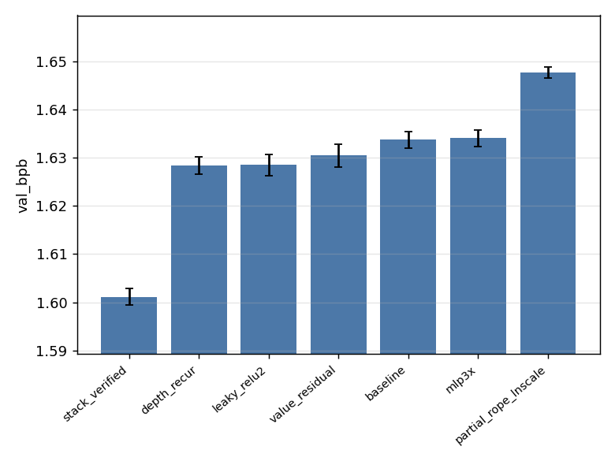

What carries over from the server-scale results, and what does not:
- **Carries over:** recurrence and LeakyReLU² help (both scales, about −0.005), and partial RoPE +
  LN-scale hurts (both scales). The verified stack gives about −0.033 at both scales.
- **Does not carry over: 3× MLP**, the largest single gain at lab scale, does nothing here. We have
  not tested *why*. One hypothesis: a 384-wide model with a 6-layer budget is limited by something
  other than MLP width at 41M tokens. Note that the tokens-per-parameter ratio (~5) is similar to the
  lab run (~6), so "too little data" alone does not explain it. Treat this as an open question.
- **The stack is more than the sum of its parts here.** The individually measured parts add up to about
  −0.014 (XSA was not tested alone), but together they give −0.033. The parts interact: for example,
  3× MLP may only pay off together with value residual and recurrence. The way to find out is a
  *leave-one-out* ablation, which is part of HW 4. Whether effects add up is itself something to
  measure, not assume.
- The whole laptop golf track (L5, L6 and the one-seed ablation) is about one night of laptop compute.
  It reproduces the main lessons of a multi-GPU study.

---

---

# Part 5 — Research methodology: seeds, noise, debug vs. negative result

## 5.1 One seed is an anecdote

Two runs that differ only in the random seed differ in val bpb. `analyze.py` prints the median
within-experiment standard deviation (the **noise floor**). On the leaderboard, the seed std was
about 0.0003–0.001 bpb, while many claimed improvements were 0.001–0.003. Rules of thumb:

- Use **the same seeds** for the baseline and the variant, and compare *paired* differences
  (`paired_p` in `summary.md`). The data order is fixed by the data, not the seed, so pairing removes
  most of the shared variance.
- A difference smaller than about 2× the noise floor needs more seeds, not more enthusiasm.
- Decide the metric *before* looking at the results. Report `val_bpb`, `sliding_bpb` and
  `quant_val_bpb` separately; they answer different questions.

## 5.2 Debug or negative result?

When a variant does not help, check these **before** concluding that the idea is dead:
1. Did the switch actually change the model? Compare `params` in `metrics.json`, and look for the
   "depth recurrence ON" / "QAT ON" lines in the log.
2. Is the run comparable? Same tokens seen, same data order, same eval tokens.
3. Is the effect larger than the noise floor at this scale? Many golf tricks only matter for a
   well-trained model. A 131M-token run is not a 7B-token run.

If all three check out, it is a genuine negative result at this scale. Write it down; it is a result.

## 5.3 Post-mortem of our own 2026 submission (why this codebase looks the way it does)

We entered Parameter Golf with a 3,400-line script (`mytrain_gpt_v6_1.py`) and a JSON →
environment-variable launcher. A careful audit after the challenge found:

| What happened | Effect | Fixed here by |
|---|---|---|
| A "PPM byte-mixture" eval built the network's byte probability *using the true byte* | reported 0.83–0.94 bpb; **invalid** (the real numbers were around 1.16–1.28), and the launcher ranked runs by this number | metric code separated from model code; causality tests; bpb defined in one place |
| The launcher's size regex did not match the new script's log line | artifact size was `None` for every run; our best model (1.1586 bpb) was **32 MB**, twice the limit, and nobody noticed | size computed and written to `metrics.json` by the trainer itself (`fits_budget`) |
| Unknown config keys only produced a warning; several flags were never read | ablations of features that were not running | typed configs that reject unknown keys |
| Late QAT was scheduled on the step limit while the run stopped on wall-clock | QAT never switched on in time-limited runs | progress-based switches (`progress = max(step, time)`) with a log line |
| Sliding-window eval was used for the in-training curve but not for the final number | curves and final numbers disagreed (1.238 vs 1.273) | one `evaluate()` with an explicit, logged stride |
| Decisions made from single seeds at the 0.002 level | noise was chased | sweeps with seeds + paired tests |

Our best *valid* submission scored about 1.277–1.281 bpb (3 seeds, 15.97 MB). The baseline was
1.2244 and the winner 1.0565. The lesson is not that the ideas were bad. Without a trustworthy
measurement pipeline we could not tell which ideas were good.

---

---

---

# Homework assignments

There are four assignments, one per part of the course. Each is a small research project: you design
experiments, run them with `nanolm`, analyze the results with statistics and figures, and write a
report. Every assignment fits on a laptop (§0.2). Run `python -m nanolm.bench` first and plan your
runs within your machine's budget.

## General requirements (all assignments)

**Reproducibility.**
- Every number in your report must come from a run directory produced by `nanolm`.
- Each experiment is a YAML config or sweep file. Do not edit the library code to change an
  experiment; adding a new feature as a config key is fine (HW 4).
- Submit your config/sweep files and the `summary.csv` written by `python -m nanolm.analyze`.
- State the git commit (from any run's `meta.json`), your device, and the wall-clock time of your
  runs (from `metrics.json`).

**Statistics.**
- Any claim that A is better than B needs **at least 2 seeds per configuration** (3 for HW 4), with
  the same seeds for A and B.
- Report mean ± standard deviation and the paired p-value from `analyze.py`.
- Call a difference smaller than about twice the seed noise floor "not resolved", not "better".

**Figures.**
- At least one learning-curve figure (validation bpb vs. training tokens) and one summary figure (final
  metric per configuration, with error bars) per assignment.
- Label both axes with units, and include a legend when there is more than one series.
- Use `analyze.py` and `viz.py` outputs, or your own plotting script, submitted with the report.

**The report** is a PDF or Markdown file of at most 5 pages plus an appendix, with these sections:
1. *Question and hypothesis*: what you expected, and why.
2. *Setup*: model, data, tokenizer, token budget, FLOPs ($\approx 6ND$), seeds, device.
3. *Results*: figures and tables.
4. *Analysis*: what the results mean. When something did not work as expected, say whether you believe
   it is a **bug** or a **genuine negative result**, and what evidence supports that (§5.2).
5. *Conclusion and limitations*.

A well-supported negative result earns full credit; an unsupported positive one does not.

**Submission.**
- The report.
- The `configs/` you used.
- `summary.csv` / `summary.md`.
- Your figures and any plotting scripts.
- Do **not** submit checkpoints or datasets.

**Grading (every assignment):**

| criterion | weight | what we look for |
|---|---:|---|
| correctness and reproducibility | 30% | configs reproduce the numbers; no leakage; metrics computed correctly |
| experimental design | 25% | controlled comparisons (one change at a time), seeds, fair budgets, control runs |
| analysis and interpretation | 30% | claims match the evidence; uncertainty stated; bug vs. negative result reasoned |
| presentation | 15% | clear figures and tables; concise writing |

---

## HW 1 — Language models from scratch (Part 1)

**Goal:** understand what the metrics mean, and how RNNs and Transformers differ in practice.
**Budget:** about 2–3 hours of laptop compute.

Required:
1. **Metrics by hand.** For one trained character model, recompute loss, perplexity, bits/token and
   bits-per-byte from the `val_loss`, `val_tokens` and `val_bytes` in `metrics.json`, and check them
   against the logged `val_ppl` and `val_bpb`. Then measure the loss of an *untrained* model (for
   example `train.max_steps=1`) for two different tokenizers. Compare each with $\ln V$.
2. **RNN vs. LSTM vs. GRU vs. Transformer.** Use `sweeps/01_char_models.yaml` or a laptop version with
   fewer steps. Give every model the same token budget; 2 seeds. Produce a learning-curve figure and a
   results table with parameter counts.
3. **Context length.** Train the LSTM and the modern Transformer with `train.seq_len` = 64, 128, 256 and
   512. Plot bpb against context length for both. Where does each stop benefiting from more context?
4. **Attention analysis.** Use `python -m nanolm.viz attention --run <run> --text "..."` on three
   kinds of text. Identify at least two kinds of heads (e.g. previous-token, word-start), and support
   each with a number: the average attention weight on the relevant position, as in §1.6.2.

Questions to answer in the report:
- Why does the vanilla RNN fall so far behind?
- Is the larger LSTM better or worse, and what in your curves shows why?
- Which architecture uses longer context more effectively?

Extra credit (pick one):
- Write a GRU cell gate by gate (like `LSTMScratch`) and verify that it matches `nn.GRU` numerically.
- Measure sample diversity (the fraction of distinct 4-grams) against temperature and top-p, at fixed
  bpb.

## HW 2 — Tokenizers and pre-training on web text (Parts 1–2)

**Goal:** design controlled comparisons, and learn to separate the effect of an idea from the effect
of its budget. **Budget:** about 4–6 hours of laptop compute.

Required:
1. **Tokenizer study.** Run `sweeps/laptop_tokenizers.yaml` (or a subset of at least 5 tokenizers).
   Report the final *and* best validation bpb, and the number of passes over the data for each.
   Pick one large-vocabulary tokenizer that overfits, propose a fix (early stopping, more data, a
   smaller embedding, …), and test it.
2. **The training recipe.** On FineWeb at `laptop/L4q_gpt_fineweb_quick` size, compare four
   configurations, 2 seeds each:
   - the textbook GPT;
   - + RMSNorm/RoPE;
   - + WSD;
   - + Muon.

   Include the control that separates the schedule from the optimizer (§2.2.2). Plot the curves; give
   the paired differences.
3. **A scaling plot.** At a fixed token budget, sweep at least 4 model sizes (`model.dim` ×
   `model.n_layers`). Plot bpb against non-embedding parameters and against training FLOPs.
   Describe the trend you see. Does it flatten?

Questions to answer in the report:
- Why can't per-token loss be used to compare tokenizers?
- Which recipe change mattered most at your budget? Did any published improvement *not* reproduce?
  Why might that be?
- With your compute, would you rather have a 2× larger model or 2× more tokens? Use your scaling plot.

Extra credit: investigate the SwiGLU result of §2.2.2 (learning rate? token budget?) with 2 seeds per
hypothesis.

## HW 3 — Working with modern LLMs (Part 3)

**Goal:** evaluate, adapt and critically read results about pretrained models.
**Budget:** about 4–6 hours of laptop compute (GPU recommended for SFT/DPO, but not required).

Required:
1. **Evaluate small models.** Choose at least 3 pretrained models of ≤ 0.8B parameters. Measure their
   FineWeb bpb (`part2/P1_eval_bpb.yaml`) and run `part3/B2_laptop.yaml`, adding your models. Make one
   table and one figure, with chance levels and standard errors ($\sqrt{p(1-p)/n}$). Where the model
   card publishes numbers for the same benchmark, compare them with yours and explain the
   differences: few-shot setting, generated vs. log-likelihood scoring, chat template, thinking mode.
2. **Check the scoring rule.** Run `python -m nanolm.benchmarks crosscheck <model> --limit 300` and
   the matching `lm_eval` command. Show that the two agree. Then change the normalization in
   `mc_accuracy` from characters to tokens: how many answers flip, and why?
3. **Instruction tuning.** Run one SFT study, 2 seeds per setting. Either:
   - LoRA rank $r \in \lbrace 4, 16, 64 \rbrace$, or
   - training-set size $\in \lbrace 500, 2000, 8000 \rbrace$.

   Report the held-out answer loss, show before/after samples for the same prompts, and measure
   whether SFT changed the scores of task 1 (the "alignment tax").
4. **Preference tuning.** Sweep the DPO $\beta \in \lbrace 0.05, 0.1, 0.5 \rbrace$. Plot the held-out reward
   accuracy and margin, and judge the qualitative changes in the samples.
5. **Read an architecture.** For one modern model (e.g. Qwen3.5-2B or a model of your choice), compute
   from its `config.json` the parameters per component and the KV-cache size at 32k and 262k context.
   Compare with a model of similar size that uses only full attention.

Questions to answer in the report:
- Which benchmarks are below or near chance for small models, and what does that imply about using
  them to compare small models?
- What did SFT and DPO change, and what didn't they change? Give evidence, not impressions.
- Why do hybrid-attention models (§3.3) exist? Answer quantitatively.

## HW 4 / Final project — Parameter Golf on a laptop (Parts 4–5)

**Goal:** run a real architecture-research loop under a fixed budget.

**The challenge:**
- Get the lowest validation bpb with a model whose compressed artifact is at most **6.5 MB**.
- Training budget: no more than `laptop/L5_golf_mini.yaml` (41M tokens, or its wall-clock cap).
- Evaluation: the first 2M validation tokens; sliding-window evaluation is allowed.
- Hard rule: no training on validation data.

Required:
1. **Baseline.** Reproduce `L5_golf_mini` with 3 seeds.
2. **Ablation.** Test every technique you use *one at a time* against the baseline, 3 seeds each.
   Include at least one idea that is **not** in this tutorial, implemented as a new config key in
   `models/gpt.py`, with a causality test added to `tests/test_nanolm.py`. Candidates:
   - a Part 3 component (sliding-window layers, a small MoE, MTP, ...);
   - something of your own.
3. **Final stack.** Combine your best techniques. Run a **leave-one-out** ablation of the stack: the
   stack minus one technique, for each technique. Report whether the effects add up.
4. **Bytes.** Report the artifact size of the final model with `python -m nanolm.compress`, as a
   quantization-bits × compressor table, and the cost of the quantization in bpb.

Deliverables:
- a 6–8 page report in the format above, including a one-paragraph "what we learned that we did not
  expect";
- a leaderboard row: final bpb (mean ± std over 3 seeds), artifact size, and config file.

Grading follows the standard rubric. **Rigor is weighted above rank:** a carefully measured
negative result beats an unexplained high score.

---

## Appendix A. Laptop and Mac reference

Start with [`LAPTOP_QUICKSTART.md`](LAPTOP_QUICKSTART.md). The command reference:

```bash
python -m nanolm.bench    -c <config> [overrides]            # tokens/s, memory, projected time on THIS machine
python -m nanolm.train    -c <config> [overrides]            # train from scratch (Parts 1, 2.1, 3)
python -m nanolm.finetune -c <part2 config> [overrides]      # pretrained models: eval_bpb / sft / dpo (Part 3)
python -m nanolm.generate <run_dir> --prompt "..." [--top-p 0.9] [--interactive]
python -m nanolm.sweep    --sweep <sweep.yaml> [--set device=cpu] [--only name ...]
python -m nanolm.analyze  <sweep dir or outputs dir>
python -m nanolm.compress <run_dir> --bits 8 6 4 --strides 0 64
python -m nanolm.benchmarks run -c nanolm/configs/part3/B2_laptop.yaml   # MMLU, ARC, GSM8K, ... via lm-eval
python -m nanolm.viz all                                    # regenerate every figure in this tutorial
```

Memory knobs, from most to least effective:

| knob | effect |
|---|---|
| `train.batch_size=8 train.grad_accum=4` (keep the product) | halves activation memory; identical math |
| `train.seq_len=256` | halves activation memory, but changes the experiment (shorter context) |
| `eval.batch_size=4` | lower memory at evaluation time |
| Part 3: `data.max_len=256`, `model.name=HuggingFaceTB/SmolLM2-135M`, `model.grad_checkpointing=true` | memory for pretrained models |
| `precision=bf16` (Mac, macOS 14+) | about half the activation memory, often faster; less tested than fp32 |

Device notes:
- **Apple MPS.** fp32 by default. `torch.compile` is skipped. If an operation is not implemented on
  MPS, set `PYTORCH_ENABLE_MPS_FALLBACK=1`.
- **NVIDIA laptop GPUs (4–8 GB).** bf16 automatically (Ampere / RTX 30xx and newer). Turn on
  `train.compile=true` only on Linux.
- **CPU.** Works for every config, about 3–10× slower than a laptop GPU.

The MPS path has not yet been benchmarked by us on a real Mac. The time estimates in §0.2 come from
FLOP counts, and reports from students' machines are welcome.

## Appendix B. Multi-GPU

```bash
torchrun --standalone --nproc_per_node=8 -m nanolm.train -c nanolm/configs/04_golf_baseline.yaml
```
Each rank reads its own slice of the sequential stream. Muon orthogonalizes a slice of the matrices
on each rank and all-reduces the updates. Under `max_time_sec`, the ranks agree on when to stop.

> **Not yet tested.** Every result in this tutorial was produced on a single GPU. The DDP path follows
> the official baseline's design, but we have not run it on multiple GPUs. Run
> `torchrun --nproc_per_node=2 -m nanolm.train -c nanolm/configs/00_smoke.yaml` and check that it
> matches a single-GPU run before relying on it.

## Appendix C. Adding a new experiment

1. Add a key to `ModelConfig` (or `TrainConfig`) in `config.py`, with a default that means *off*.
2. Implement it in `models/gpt.py` behind that key.
3. Add it to `GOLF_FEATURES` in `tests/test_nanolm.py` and run the tests.
4. Add a run to a sweep file. Do not edit the base config.
