# ngperception Tutorial — downstream perception, from basics to SOTA

This tutorial extends the ngdet detection tutorial to the *downstream* perception tasks
that consume an image (and often the detector's boxes): **depth/distance**, **3D semantic occupancy**,
**3D object detection** and lane detection. Same recipe each time: understand the task, compare models
**basic → SOTA by inference**, then **fine-tune**, and measure honestly (scene-split, seeds).

| § | Topic |
|---|---|
| 0 | Running it on the course HPC; nuScenes, Waymo v2 and Occ3D data, with figures |
| 1 | Monocular depth & per-object distance |
| 2 | 3D semantic occupancy: baselines, our LSS model, **how to build a new occupancy model** (§2.9), landscape (§2.10) |
| 3 | Full-data scaling — **read §3.0 (leakage + clean numbers) first** |
| 4 | Cross-domain transfer to closed-loop renders |
| 5–6 | Occupancy + detection on one encoder; lanes |
| 7 | Visualization cookbook — how every figure is made |
| 8 | 3D object detection: mmdetection3d on the cluster, **BEVFusion**, camera detectors, newer methods, why fusion is hard |

---

## 0. Running this tutorial on the course HPC (CMPE249)

Everything below runs on the SJSU CoE HPC with the **shared course storage and environment**. Read
[docs/source/hpc3.md](../../docs/source/hpc3.md) first: it covers SSH, Slurm, the partitions and GPU types.
Two rules from it matter on every page of this tutorial:

- GPU work runs as a **batch job** (`sbatch`). Interactive `srun` is for **CPU** partitions only.
- Datasets are **read-only and shared**. Symlink them; never copy them into your own folder.

### 0.1 Where the data is

| What | Path on the cluster | Used in |
|---|---|---|
| nuScenes v1.0-trainval (images, LiDAR sweeps, metadata) | `/data/cmpe249-fa26/datasets/nuscenes/v1.0-trainval` | §0.4, §1, §2, §8 |
| nuScenes mmdetection3d 1.4 info files (`nuscenes_infos_{train,val}.pkl`) | same folder | §8 |
| nuScenes extras (lidarseg, panoptic, map expansion) | `/data/cmpe249-fa26/datasets/nuscenes/extras` | segmentation projects |
| Waymo Open Dataset v2 (parquet, 798 train / 202 val segments) | `/data/cmpe249-fa26/datasets/waymo/v2.0/{training,validation}` | §0.5 |
| Waymo Open Dataset v1.4.3 (tfrecord, train) + KITTI-format conversion | `/data/cmpe249-fa26/datasets/waymo/v1.4.3` | detection projects |
| Occ3D-nuScenes occupancy labels (`gts/<scene>/<token>/labels.npz`, 850 scenes) | `/data/cmpe249-fa26/derived/nuscenes/occ3d/gts` | §0.6, §2 |
| Your workspace | `/data/cmpe249-fa26/students/$USER` | everything you write |

All of these datasets are for **non-commercial research and education** only. Accept each dataset's terms
yourself before using it (links in `/data/cmpe249-fa26/README.md`). Figures you make from the data are for
your coursework. Do not post Waymo-derived images publicly.

### 0.2 Environment: the shared env + a small venv

The shared environment `/data/cmpe249-fa26/envs/mmdet3d-cu118` has PyTorch 2.1.2 (CUDA 11.8), the full
mmdetection3d 1.4 stack, nuscenes-devkit, pyarrow/pandas (for Waymo v2) and open3d, and it is built for the
class GPUs (P100). The occupancy code also needs Hugging Face `transformers` (for the DINOv2 backbones). Add it in a
light-weight venv **on top of** the shared env:

```bash
/data/cmpe249-fa26/envs/mmdet3d-cu118/bin/python -m venv --system-site-packages /data/cmpe249-fa26/students/$USER/venv
source /data/cmpe249-fa26/students/$USER/venv/bin/activate
pip install "transformers==4.46.3" pyvista imageio-ffmpeg          # do NOT reinstall torch / mmcv / numpy here

cd /data/cmpe249-fa26/students/$USER
git clone --depth 1 https://github.com/lkk688/DeepDataMiningLearning.git
cd DeepDataMiningLearning
python -m DeepDataMiningLearning.ngperception.occupancy.models.lss_occ   # CPU shape test, ~1 min
#   params=3.6M  occ=(1, 18, 200, 200, 16) ...  OK
```

We tested this exact sequence on the cluster (torch 2.1.2 + transformers 4.46.3 loads DINOv2 and the shape test
passes). Newer `transformers` releases may require a newer PyTorch than the shared env has, so keep the pin.

### 0.3 A batch job for this tutorial

Class jobs use the **P100** GPUs (`--gres=gpu:p100:1`, partition `gpuqs`). Copy the course template and put the
tutorial command at the end:

```bash
#!/bin/bash
#SBATCH --job-name=occ-lss
#SBATCH --partition=gpuqs              # class GPU queue, max 2 days
#SBATCH --gres=gpu:p100:1              # one P100 (12-16 GB)
#SBATCH --cpus-per-task=8
#SBATCH --mem=48G
#SBATCH --time=1-00:00:00
#SBATCH --output=logs/%x-%j.out
set -euo pipefail
export http_proxy=http://172.16.1.2:3128 https_proxy=http://172.16.1.2:3128
export HF_HOME=/data/cmpe249-fa26/students/$USER/cache/huggingface
export OMP_NUM_THREADS=2 MKL_NUM_THREADS=2          # avoid thread oversubscription in the data-loader workers
source /data/cmpe249-fa26/students/$USER/venv/bin/activate
cd /data/cmpe249-fa26/students/$USER/DeepDataMiningLearning
NUSC=/data/cmpe249-fa26/datasets/nuscenes/v1.0-trainval
GTS=/data/cmpe249-fa26/derived/nuscenes/occ3d/gts
python -m DeepDataMiningLearning.ngperception.occupancy.train_lss --split train --resume \
    --gts $GTS --nusc $NUSC --backbone dinov2_base --decoder-layers 4 --decoder-hidden 96 \
    --refine-iters 2 --occ-lovasz 1.0 --occ-class-balance --cosine --amp \
    --max-samples 2000 --epochs 8 --batch-size 2 --num-workers 8 --seed 0 \
    --out-dir /data/cmpe249-fa26/students/$USER/output/lss_occ_p100
```

**Memory.** This is the strong recipe of §2.8 at batch size 2: we measured a peak of **6.0 GB** of GPU memory
(forward + backward, AMP), so it fits a P100 with room to spare. Batch size 1 needs 3.2 GB (5.5 GB without
`--amp`); the light DINOv2-small / 2 × 64 decoder variant needs under 2 GB.

**Time.** A P100 is several times slower than our lab GPUs. Start with the 2000-sample / 8-epoch run above, read the
per-epoch time in the log, and only then scale `--max-samples` and `--epochs`. `--resume` restarts from
`ckpt_last.pt`, which is saved every epoch, so a run that hits the 2-day limit continues when you submit the same
script again. The full-data numbers in §3.0 (all 700 train scenes, 24 epochs) took about two days on a much faster
lab GPU. They are a reference, not a class assignment.

`OMP_NUM_THREADS=2` is not cosmetic. With many loader workers, each worker's NumPy otherwise starts one thread per
core. On our nodes this put ~60 % of CPU time into the kernel and starved the GPU.

### 0.4 nuScenes: frames, projections, range images

nuScenes stores each sensor in its own frame. Each frame has two records: a `calibrated_sensor` (sensor → ego)
and an `ego_pose` (ego → global) taken **at that sensor's timestamp**. The LiDAR sweep and the camera image of
the same keyframe are taken at different times. In our example the camera fired 37 ms before the LiDAR, so a
LiDAR point reaches a camera pixel through the global frame:

```
LiDAR sensor --calibrated_sensor--> ego(t_lidar) --ego_pose--> global --ego_pose⁻¹--> ego(t_cam) --calibrated_sensor⁻¹--> camera --K--> pixel
```

`viz/nuscenes_views.py` draws four views of one keyframe (CPU only, about a minute):

```bash
python -m DeepDataMiningLearning.ngperception.viz.nuscenes_views \
    --dataroot /data/cmpe249-fa26/datasets/nuscenes/v1.0-trainval \
    --sample 2ff5689a089844f0a2097b1883916003 --out figures
```

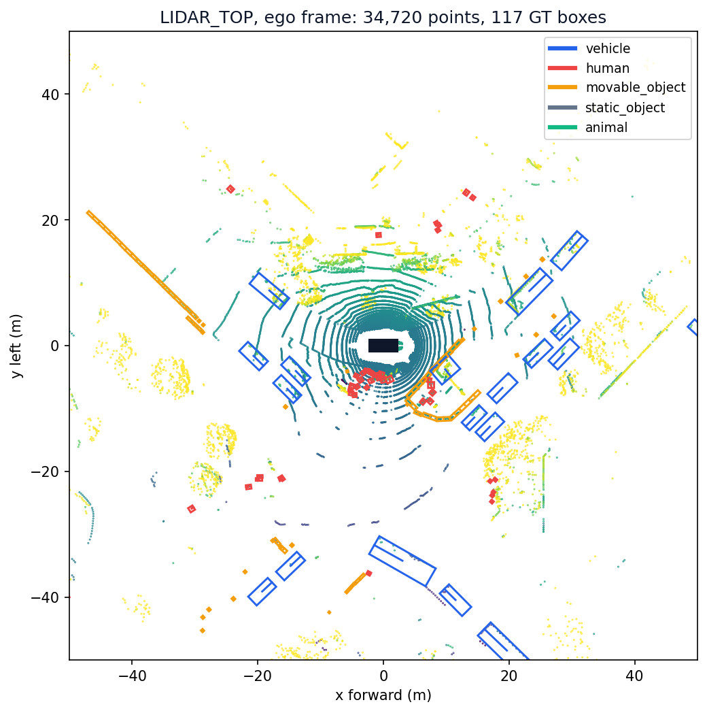

*One LIDAR_TOP sweep (34,720 points), ego frame, coloured by height, with the 117 annotated boxes. Density falls
off with range, and every car shows only the L-shaped side that faces the sensor.*

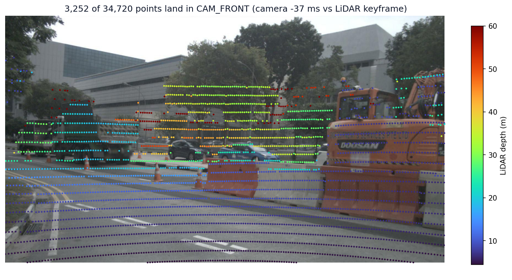

*The same sweep through the chain above into CAM_FRONT: only 3,252 points land in this camera. These sparse rows
are exactly the depth supervision BEVDepth-style models and our §2 occupancy model train on. The result matches
the devkit's own `map_pointcloud_to_image` (3,243 points with its slightly different near-clip).*

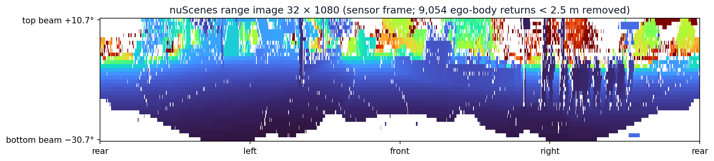

*The sweep as a 32 × 1080 range image: row = laser ring (ring 0 = −30.7°, ring 31 = +10.7°), column = azimuth.
Two traps:*
1. *Build it in the **sensor** frame. The ego frame's origin is the rear axle, 0.94 m behind and 1.84 m below the
   LiDAR, so azimuth and range computed there bend every near return.*
2. *Drop returns closer than ~2.5 m: 26 % of this raw sweep (9,054 points) hits the ego car itself. The white
   notch at the bottom is where the car body blocks the low beams.*

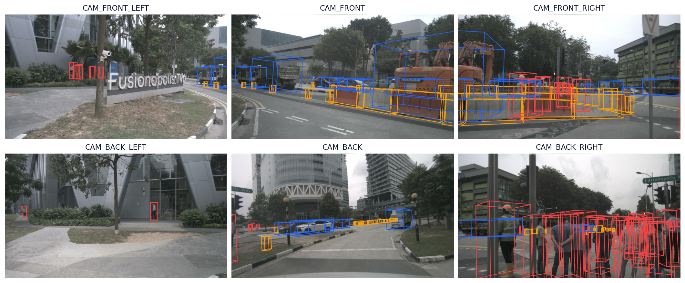

*All six cameras with the GT boxes projected (`nusc.get_sample_data` returns the boxes already in each camera's
frame). The crowd on the right of the range image is the pedestrian group in CAM_BACK_RIGHT.*

### 0.5 Waymo Open Dataset v2: read it with pyarrow

The v2 release is "modular": one parquet file per segment **per component**. Examples are `lidar`,
`lidar_calibration`, `lidar_box`, `camera_image`, `camera_calibration`, `lidar_camera_projection` and
`vehicle_pose`. You can join them on `key.segment_context_name` + `key.frame_timestamp_micros`. pandas/pyarrow in
the shared env are enough to read them; the `waymo_open_dataset` package from hpc3.md is optional.

```python
import pyarrow.parquet as pq, numpy as np
root, seg = '/data/cmpe249-fa26/datasets/waymo/v2.0/validation', '10203656353524179475_7625_000_7645_000'
li = pq.read_table(f'{root}/lidar/{seg}.parquet').to_pandas()
r = li[li['key.laser_name'] == 1].iloc[0]                       # laser 1 = TOP (64 beams); 2-5 = short-range
ri = np.asarray(r['[LiDARComponent].range_image_return1.values'], np.float32).reshape(
         r['[LiDARComponent].range_image_return1.shape'])        # (64, 2650, 4): range, intensity, elongation, NLZ
```

Unlike nuScenes, Waymo ships the LiDAR as **range images** (two returns per pulse). It also ships the camera
projection of every return, so you do not need your own calibration chain to overlay LiDAR on images.
Converting a range image to points is a useful exercise:

```python
rng  = ri[..., 0]; H, W = rng.shape                                  # range <= 0 means no return
incl = np.asarray(cal['[LiDARCalibrationComponent].beam_inclination.values'])[::-1]   # row 0 = HIGHEST beam
ext  = np.asarray(cal['[LiDARCalibrationComponent].extrinsic.transform']).reshape(4, 4)
az   = (W - np.arange(W) - 0.5) / W * 2 * np.pi - np.pi - np.arctan2(ext[1, 0], ext[0, 0])   # column -> azimuth
inc, azm = np.meshgrid(incl, az, indexing='ij')
p_sensor = np.stack([rng * np.cos(inc) * np.cos(azm), rng * np.cos(inc) * np.sin(azm), rng * np.sin(inc)], -1)
p_vehicle = p_sensor[rng > 0] @ ext[:3, :3].T + ext[:3, 3]          # (N, 3), vehicle frame
```

`viz/waymo_v2_views.py` does this and draws three figures:

```bash
python -m DeepDataMiningLearning.ngperception.viz.waymo_v2_views \
    --root /data/cmpe249-fa26/datasets/waymo/v2.0/validation \
    --segment 10203656353524179475_7625_000_7645_000 --frame 100 --out figures
```

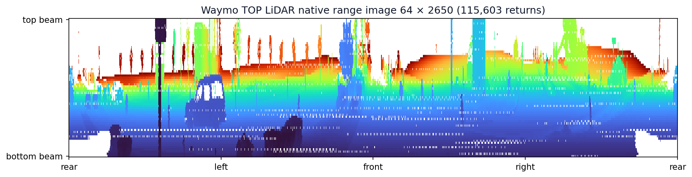

*The TOP LiDAR's native 64 × 2650 range image: 115,603 first returns in one frame, three times a nuScenes sweep.
There are no ego-body returns in it.*

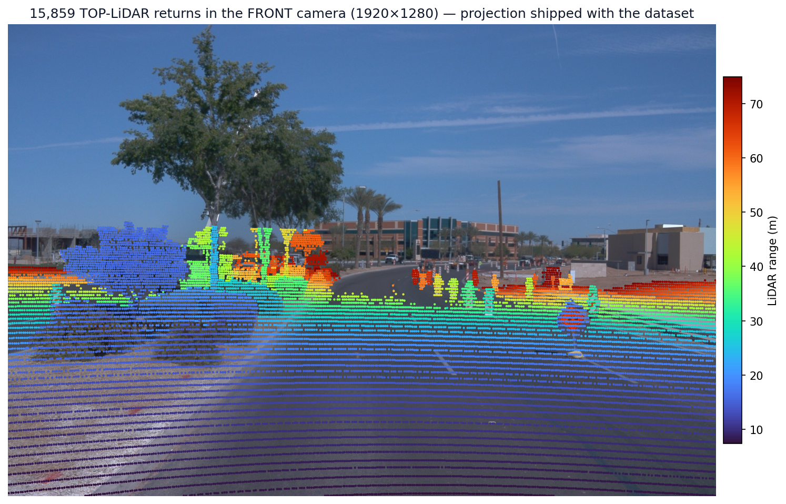

*15,859 returns in the 1920 × 1280 FRONT camera, drawn straight from `lidar_camera_projection`: (camera, x, y) for
up to two cameras per return. No calibration code of ours is involved.*

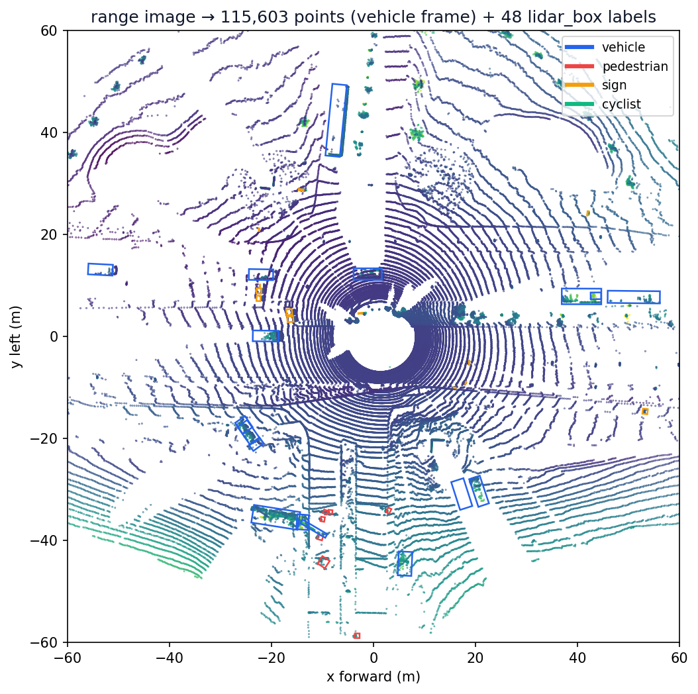

*Our own range-image → point conversion in the vehicle frame, with the 48 `lidar_box` labels of the frame. The
points sit inside the boxes, which checks the beam order, the azimuth convention and the extrinsic. This view
ignores the per-pixel `lidar_pose` motion compensation (a few cm at city speed).*

| | nuScenes | Waymo v2 |
|---|---|---|
| LiDAR | 1 × 32-beam, 20 Hz | 1 × 64-beam TOP + 4 short-range, 10 Hz |
| LiDAR storage | point list `(x, y, z, intensity, ring)`, sensor frame | range images `[64, 2650, 4]`, 2 returns |
| Cameras | 6 × 1600 × 900, 360° | 5 cameras (front 1920 × 1280), no rear camera |
| LiDAR → pixel | sensor → ego(t_l) → global → ego(t_c) → camera → K | `lidar_camera_projection`, per return |
| Typical bug | skipping the ego-pose step; ego-frame range images | flipped row order; mixing returns 1 and 2 |

### 0.6 Occ3D-nuScenes labels

Each keyframe has a `labels.npz` with `semantics` (200 × 200 × 16 voxels of 0.4 m; classes 0–16, 17 = free) and
two visibility masks. The official metric scores only `mask_camera` voxels.

```bash
GTS=/data/cmpe249-fa26/derived/nuscenes/occ3d/gts
python -m DeepDataMiningLearning.ngperception.viz.occ3d_views --gts $GTS \
    --scene scene-0018 --token 2ff5689a089844f0a2097b1883916003 --out figures
python DeepDataMiningLearning/ngperception/occupancy/visualize_voxel3d.py \
    $GTS/scene-0018/2ff5689a089844f0a2097b1883916003/labels.npz figures/occ3d_gt_voxel3d.png --camera-mask
```

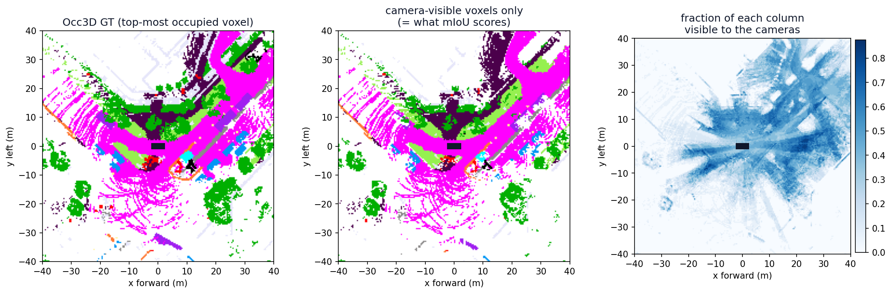

*Same frame as §0.4. Left: GT, top-most occupied voxel per column. Middle: only camera-visible voxels, which is
what mIoU scores. Right: how much of each column the cameras see. Only 17 % of the grid is camera-visible, and
45 % of this frame's occupied voxels (39,100 → 21,528) fall outside the mask.*

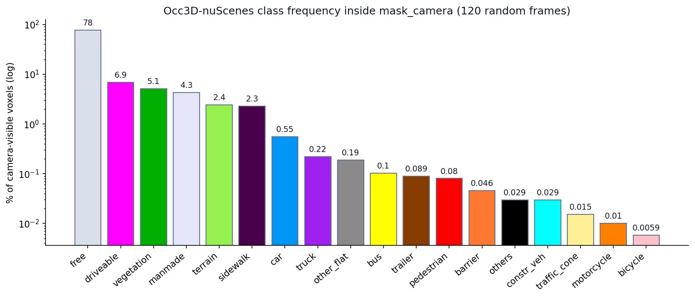

*Class frequency inside the mask over 120 random frames (log scale). Free space and flat surfaces dominate;
objects are a fraction of a percent. This is why the loss choice in §2.8.1 matters.*

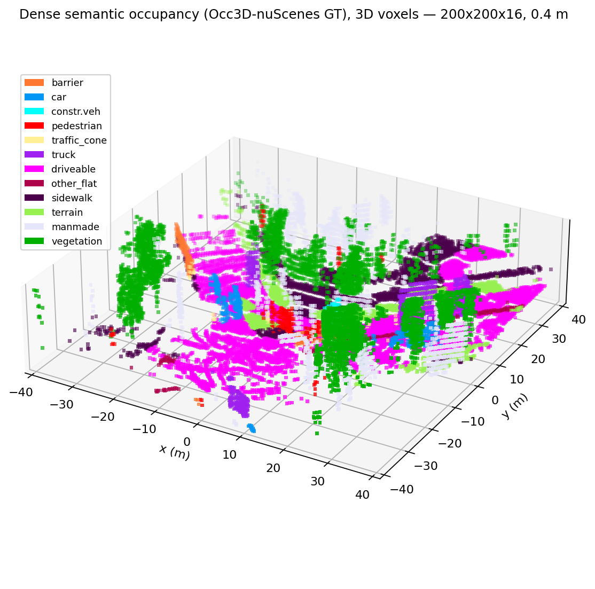

*The camera-visible GT as coloured 3D voxels (`visualize_voxel3d.py`, matplotlib only, no display needed).*

---

## 1. Monocular depth estimation & per-object distance

### 1.1 The task

Given one RGB image, predict a **depth** for every pixel. Two sub-flavors:

- **Relative depth** — the *ordering* of depths is correct but the global scale (and
  often a shift) is unknown. Models trained on huge mixed data (MiDaS, Depth-Anything)
  are relative: they generalize anywhere but can't tell you metres.
- **Metric depth** — absolute depth in **metres**. Needed for distance ("18 m away"),
  3D lifting, planning. Models are trained/fine-tuned per camera-domain (ZoeDepth-KITTI,
  Depth-Anything-V2-Metric-Outdoor).

Why does scale go missing? A single image is **scale-ambiguous** — a toy car up close and
a real car far away project to the same pixels. Metric models break the tie using learned
priors about object sizes and the specific camera; that is why they are domain-specific.

### 1.2 The model ladder (what we compare)

| era | model | type | idea |
|---|---|---|---|
| 2019 baseline | **MiDaS / DPT** (`Intel/dpt-hybrid-midas`, `Intel/dpt-large`) | relative | ViT/CNN hybrid trained on 10+ mixed datasets; robust relative depth |
| 2024 SOTA (rel) | **Depth-Anything-V2** (`-Small/-Base/-Large-hf`) | relative | DINOv2 encoder + 62M pseudo-labelled images; sharp, fast |
| metric | **ZoeDepth** (`Intel/zoedepth-kitti`) | metric | MiDaS backbone + a metric "bins" head fine-tuned on KITTI |
| metric (SOTA) | **Depth-Anything-V2-Metric** (`...-Metric-Outdoor-Small-hf`) | metric | DA-V2 encoder fine-tuned for metric KITTI |

All load through **one adapter** (`estimators/hf_depth.py`) via
`AutoModelForDepthEstimation` — add any of them with `--models hf_depth:<hub-id>`.

### 1.3 Ground truth from LiDAR (no manual labels)

KITTI ships a Velodyne scan + calibration per frame, so we *make* GT depth by projecting
the point cloud into the camera (`datasets.py`):

```
X_cam = R0_rect · Tr_velo_to_cam · X_velo      # LiDAR point -> rectified camera frame
[u v w]ᵀ = P2 · [X_cam; 1];  u/=w, v/=w        # -> pixel
depth(v,u) = X_cam.z                            # metres; keep nearest on collision
```

This yields a **sparse** map (~4–5 % of pixels — LiDAR is far sparser than the image),
which is exactly what the KITTI depth benchmark scores against.

### 1.4 The metrics — where they come from, with formulas

All metrics compare a predicted depth $\hat d_i$ to GT $d_i$ over the $N$ valid (LiDAR)
pixels $i$. They are the **Eigen et al. (2014)** set — the standard since the first deep
single-image depth paper — split into *error* metrics (lower better) and *threshold
accuracy* (higher better).

**Error metrics.**

$$
\text{AbsRel}=\frac{1}{N}\sum_i \frac{|\hat d_i-d_i|}{d_i}
\qquad
\text{SqRel}=\frac{1}{N}\sum_i \frac{(\hat d_i-d_i)^2}{d_i}
$$

$$
\text{RMSE}=\sqrt{\frac{1}{N}\sum_i (\hat d_i-d_i)^2}
\qquad
\text{RMSE}_{\log}=\sqrt{\frac{1}{N}\sum_i (\log \hat d_i-\log d_i)^2}
$$

Why four? They weight errors differently — picking one hides failure modes:

- **AbsRel** divides by $d_i$, so a 1 m error on a 5 m car and on a 50 m truck count
  *proportionally*. This scale-free property makes it the headline number.
- **SqRel** squares the numerator → punishes a few large blunders much harder than many
  small ones (sensitive to outliers).
- **RMSE** is in **metres** and is *not* normalized by depth, so it is dominated by the
  **far** field (a 10 % error at 60 m hurts 12× more than at 5 m). Good for "how many
  metres off on average", bad at seeing near-field quality.
- **RMSE_log** measures error in **log space**: $\log\hat d-\log d=\log(\hat d/d)$ is a
  *ratio* error, so near and far contribute evenly — the complement to plain RMSE.

**Threshold accuracy** ($\delta_k$). The fraction of pixels whose prediction is within a
factor $1.25^k$ of GT:

$$
\delta_k=\frac{1}{N}\Big|\Big\{\,i:\ \max\!\Big(\tfrac{\hat d_i}{d_i},\ \tfrac{d_i}{\hat d_i}\Big)<1.25^{\,k}\,\Big\}\Big|,\quad k\in\{1,2,3\}
$$

The $\max(\hat d/d,\,d/\hat d)$ is a symmetric ratio (penalizes over- and under-estimates
equally); $1.25^1=1.25$ (within 25 %), $1.25^2\approx1.56$, $1.25^3\approx1.95$.
$\delta_1$ ("percent of pixels essentially correct") is the most cited accuracy number.

**The "Garg crop".** LiDAR returns are unreliable at the image top (sky) and edges, so
the field standardized on **Garg et al. (2016)**'s center crop
($y\in[0.408,0.992]H$, $x\in[0.036,0.964]W$) — we evaluate only inside it for
comparability with published numbers.

### 1.4.1 The alignment subtlety (relative vs metric)

A **relative** model predicts depth only up to a global scale $s$: it outputs
$\hat d_i = d_i/s$ for some unknown $s$. Scoring that directly is meaningless, so we first
estimate $s$ and rescale. We use **median scaling** (the Monodepth2 protocol):

$$
\hat d_i \leftarrow \hat d_i\cdot\frac{\operatorname{median}(d)}{\operatorname{median}(\hat d)}
$$

The median is a *robust* scale estimate (insensitive to a few wild pixels). This is what
"aligned" means in the results table; **metric** models are scored **as-is** (no $s$
given). The honest reading: a relative model is handed a free global scale, a metric model
must be right outright — which is exactly why the two columns can disagree (§1.5).

### 1.5 Results — inference comparison

> Run: `python -m DeepDataMiningLearning.ngperception.depth.run_eval --models … --max-images 60 --stride 40`

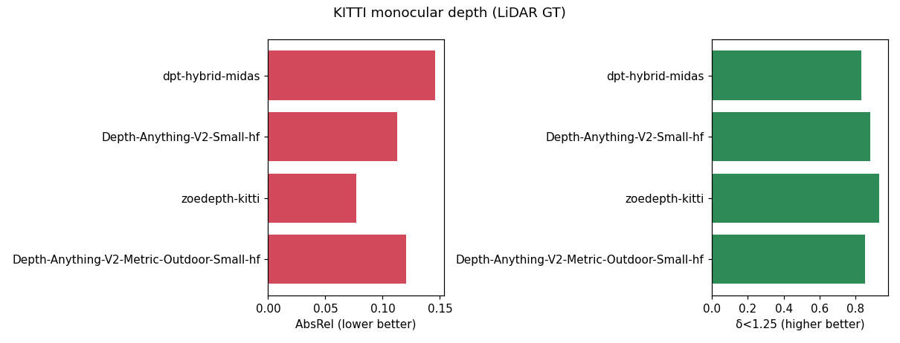

60 KITTI frames, LiDAR GT, Garg crop. **Aligned** = median scale-invariant (fair for all);
**Metric** = true metres (no alignment — only meaningful for metric models):

| model | type | aligned AbsRel↓ | aligned δ1↑ | metric AbsRel↓ | metric δ1↑ |
|---|---|---|---|---|---|
| `Intel/dpt-hybrid-midas` (2019) | relative | 0.146 | 0.832 | — | — |
| `Depth-Anything-V2-Small` (2024) | relative | 0.113 | 0.882 | — | — |
| `Intel/zoedepth-kitti` | metric | **0.077** | **0.933** | 0.853 | 0.000 |
| `Depth-Anything-V2-Metric-Outdoor-Small` | metric | 0.121 | 0.853 | **0.122** | **0.833** |

Three lessons fall out of this one table:

1. **Basic → SOTA (relative):** Depth-Anything-V2 (0.113) clearly beats the 2019 DPT
   baseline (0.146) on the same scale-invariant metric.
2. **Domain specialization wins on accuracy:** ZoeDepth, *fine-tuned on KITTI*, has the
   best **aligned** score of all (0.077, δ1 0.933) — a strong argument for the fine-tuning
   we do next.
3. **"Metric" is a property of the checkpoint, not just the architecture.** Look at the
   metric columns: `Depth-Anything-V2-Metric-Outdoor` gives genuine metres (AbsRel 0.122),
   but the HF `zoedepth-kitti` port is **mis-scaled** — it outputs ~0.6–9.5 instead of
   ~4–80 m, so as-metric it collapses (δ1 = 0.000) even though its *shape* is excellent
   (aligned 0.077). **Always validate a metric model's absolute range against GT before
   trusting its metres** — the framework prints both columns precisely so this can't hide.

### 1.6 Composable add-on — per-object distance

Depth becomes a *downstream head of detection*: run an ngdet detector, then read the
depth map inside each box (`fusion.py`, median over the central 60 % to avoid box-edge
background). Use a **correctly-calibrated metric** model so the numbers are real metres:

```bash
python -m DeepDataMiningLearning.ngperception.depth.run_eval \
    --models hf_depth:depth-anything/Depth-Anything-V2-Metric-Outdoor-Small-hf \
    --max-images 5 --viz --detector hf_detr:facebook/detr-resnet-50
# -> output/depth/viz/fuse_*.png : boxes labelled "vehicle 24m" over a depth colormap
```

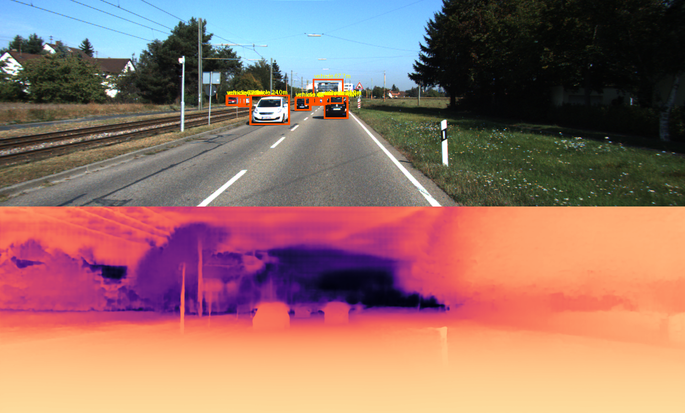

Top: DETR boxes annotated with per-object distance; bottom: the metric depth map (bright =
near). The two oncoming cars read ~12 m and ~24 m. `--viz` is restricted to metric models —
running it on a relative model would print meaningless (un-scaled) distances.

Add `--video` to render the same fusion as an **mp4** over consecutive frames
(`output/depth/depth_fusion_<model>.mp4`, 1224×740, distance-annotated RGB over depth):

```bash
python -m DeepDataMiningLearning.ngperception.depth.run_eval \
    --models hf_depth:depth-anything/Depth-Anything-V2-Metric-Outdoor-Small-hf \
    --max-images 30 --stride 1 --video --video-frames 30 --fps 5 \
    --detector hf_detr:facebook/detr-resnet-50
```

This is the whole point of `ngperception`: detection answers *what & where (2D)*, depth
adds *how far*, and together they are the first step toward 3D perception.

### 1.7 Fine-tuning Depth-Anything, and mixing KITTI + Waymo + nuScenes

**Is Depth-Anything easy to fine-tune?** Yes. It is a standard model — a DINOv2 encoder
+ a DPT regression head — so it trains like any HF `AutoModelForDepthEstimation`: a
supervised loop with a depth loss, masked to the sparse LiDAR-GT pixels. You can LoRA the
DINOv2 encoder (cheap, like ngdet §21–22) or full-tune the head. No bespoke decoder, no
custom kernels — much easier than the detection VLMs.

The standard loss is the **scale-invariant log loss (SiLog)** from Eigen et al., over the
valid pixels with $g_i=\log\hat d_i-\log d_i$:

$$
\mathcal{L}_{\text{SiLog}}=\sqrt{\;\frac{1}{N}\sum_i g_i^{2}\;-\;\frac{\lambda}{N^{2}}\Big(\sum_i g_i\Big)^{2}}\,,\qquad \lambda\in[0,1]\ (\approx0.85)
$$

The first term is the log-error; the **second term subtracts the mean log-error squared**,
which removes a constant per-image scale ($\hat d\!\to\!s\hat d$ shifts every $g_i$ by
$\log s$, and the second term cancels it). So $\lambda\!\to\!1$ trains *relative* depth and
$\lambda\!=\!0$ trains *metric* depth — SiLog is the training-time twin of the median
alignment we use at eval (§1.4.1).

**Can we mix KITTI + Waymo + nuScenes?** Yes — and it is the right move for generalization
— but with one crucial caveat:

- **Scale-invariant (relative) fine-tuning on the mix is clean.** SiLog with $\lambda\!\approx\!1$
  is camera-agnostic, so pooling three domains just makes the model more robust (same idea
  as ngdet's mixed dataset, §17).
- **Metric fine-tuning on a mix is subtle — cameras differ.** Metric depth depends on the
  **intrinsics**: a car at 20 m fills different pixel heights under KITTI's ($f\!\approx\!720$ px),
  Waymo's, and nuScenes' ($f\!\approx\!1260$ px) focal lengths. Train metric depth on pooled
  cameras naively and the model sees contradictory targets. The fixes are what ZoeDepth /
  **Metric3D** do: condition on intrinsics or warp to a **canonical camera** (rescale depth
  by $f_{\text{canon}}/f_{\text{cam}}$). So: mix freely for relative; for metric, either
  fine-tune per-camera-domain or add intrinsic conditioning.

**Dataset availability for depth GT** (LiDAR projected to camera, as in §1.3):

| dataset | LiDAR + calib here? | depth GT status |
|---|---|---|
| KITTI | ✅ `velodyne` + `calib` | **wired** (`KITTIDepthDataset`) |
| nuScenes | ✅ `samples/LIDAR_TOP` + `v1.0-trainval` calib | buildable (project via ego-pose + calibrated_sensor) |
| Waymo | ⚠️ this subset has camera only (no `lidar*` parquets) | needs the LiDAR + `lidar_camera_projection` components downloaded |
| nuImages | ❌ 2D annotations only, no LiDAR | not possible (use full nuScenes) |

So the eval/training **already runs on KITTI**, extends cleanly to **nuScenes** (LiDAR is
present — just needs the projection wired), and needs the **Waymo LiDAR** parquets before
Waymo depth GT can be built. That is the next build.

---

## 2. 3D semantic occupancy — and how far depth alone gets you

Occupancy prediction is the current frontier of camera perception: instead of boxes, you
predict a **dense 3D voxel grid** of semantics around the car (Occ3D-nuScenes:
$200\times200\times16$ voxels at 0.4 m, 17 classes + free). It handles arbitrary shapes and
unknown objects, and is the representation behind Tesla-style occupancy networks.

Depth is the natural bridge to it — so before training a heavy occupancy net, we ask a
concrete question: **how far does a depth foundation model + 2D segmentation get you,
with no occupancy training at all?** This is the ViPOcc "vision priors" question, and it
gives a measured baseline the learned nets must beat.

### 2.1 The depth→occupancy baseline

For each of the **6 surround cameras** (`predictors/depth_lift.py`):

1. metric depth (Depth-Anything-V2-Metric) → per-pixel range;
2. back-project every pixel to a 3D point, $X_{\text{cam}}=d\,K^{-1}[u,v,1]^\top$;
3. lift to the ego frame, $X_{\text{ego}}=R_{c\to e}X_{\text{cam}}+t_{c\to e}$
   (the Occ3D grid is in the **ego frame** — verified by projecting the LiDAR sweep, §2.2);
4. tag each point with a **Cityscapes** segmentation label (SegFormer), mapped to the 18
   Occ3D classes; sky and far/zero depth are dropped;
5. **splat** points into voxels → a predicted semantic grid.

No training — pure geometry + 2D priors. Metric: official Occ3D **mIoU over 17 classes on
camera-visible voxels** (`mask_camera`), plus a class-agnostic **geometric IoU**.

### 2.2 Validating the geometry (and an honest ceiling)

The Occ3D GT is **densified** (aggregated multi-sweep + completion) — ~30–42 k occupied
voxels per frame. A *single* LiDAR sweep fills only ~6 k voxels, so projecting the real
LiDAR scores just **geo-IoU ≈ 0.17** (≈97 % precise, but ~15 % recall — it physically can't
see the densified GT). That number is the **single-shot geometric ceiling**, and it tells
us up front that any single-frame lift (LiDAR or depth) is recall-bound; the headroom above
it is exactly what learned occupancy nets buy by *hallucinating* the dense, occluded grid.

### 2.3 Results — runnable baselines vs the SOTA target

Evaluated on the **official Occ3D val split** (`annotations.json` val scenes), 30 samples,
6 cameras, `SegFormer-b2` (Cityscapes) semantics, camera-mask mIoU:

| method | mIoU↑ | geo-IoU↑ | runnable here? |
|---|---|---|---|
| LiDAR oracle (single sweep, geometry) | — | **0.167** | ✅ |
| depth→occ, DA-V2-Metric-**Small** + seg | **0.014** | 0.093 | ✅ |
| depth→occ, DA-V2-Metric-**Base** + seg | 0.011 | 0.085 | ✅ |
| — *published SOTA (learned, camera-only)* — | | | |
| CTF-Occ (Occ3D paper) | 28.5 | — | ✗ (mmdet3d) |
| FlashOcc | ~32 | — | ✗ |
| **Dr.Occ (depth-guided)** | **43.4** | — | ✗ |
| EFFOcc (18.4 M params) | 50.5 | — | ✗ |

(`run_eval` prints the SOTA reference table after every run; the learned nets need
mmdetection3d, which is incompatible with this env's torch 2.10, so they are cited, not
re-run.) Three things to read off:

1. **A bigger depth model does *not* help** — DA-V2-Metric-Base is slightly *worse* than
   Small (mIoU 0.011 vs 0.014). Depth *quality* is not the bottleneck; the **single-shot
   lift** is. This is the key negative result of the sweep.
2. **Geometry:** depth recovers ~56 % of the single-sweep LiDAR's geo-IoU (0.093 vs 0.167).
   Monocular depth is *dense but imprecise* — a small metric error splats a voxel into the
   wrong cell, so it loses to even a sparse-but-exact LiDAR sweep.
3. **The gap is ~20–35× in mIoU** (≈1.4 → 28–50). Only the large static surfaces survive in
   the baseline (`terrain`, `driveable_surface`, `manmade`, `vegetation` ~0.04–0.07);
   small/dynamic classes are ≈0. That gap is the whole research opportunity — and the
   strongest learned nets that close it (Dr.Occ, 43.4) are **depth-guided**, confirming
   depth is a valuable *signal* even though depth *alone* is far from enough.

### 2.4 What this says about the direction

A depth-foundation baseline is **dense but imprecise** (depth errors splat voxels into the
wrong cell) and **single-shot** (no memory of occluded space), so it sits well below
learned occupancy nets (SOTA Occ3D mIoU is ~0.4+). That gap is the research opportunity,
and it points at concrete, fundable work:

- **Depth as supervision / prior** for a learned BEV→voxel head (BEVDepth / ViPOcc idea):
  start from this baseline's geometry, learn the occluded completion.
- **Temporal fusion**: aggregate several frames' lifts (ego-motion compensated) to close
  the recall gap the single-sweep ceiling exposes.
- **Better metric depth across cameras** (§1.7 canonical-camera): the 6 nuScenes cams have
  very different intrinsics, so metric error directly becomes voxel error.

The point of the baseline is not to win — it is to **quantify the headroom** and make the
case for the learned model concrete, on data you already have.

### 2.5 Case study — running a real (self-supervised) occupancy net: GaussianOcc

The learned SOTA nets in §2.3 need mmdetection3d (incompatible with modern torch). The one
we *did* get running is **GaussianOcc** (ICCV'25) — a **fully self-supervised** 3D-Gaussian-
Splatting method. It's the cleanest to install (no mmcv; the 3DGS rasterizer + simple-knn),
and on Occ3D-nuScenes `val_tiny` (30 samples) it scores **mIoU ≈ 8.4** — ~6× our depth-lift
baseline, but far below the supervised nets (28–50). That gap is the price of using *no 3D
labels*. (Setup is fiddly: ~9 source patches — see the internal notes.)

**How it works — and where the "Gaussians" come from.** The key idea: represent the scene
as a set of **3D Gaussians** (each has a position, scale, rotation, opacity, and a semantic
class), and the **network predicts those Gaussians directly from the 6 surround images**.
There is no pre-built scene — the Gaussians *are* the network's output:

```
6 camera images ──encoder──► image features ──lift/decoder──► a set of 3D Gaussians
                                                              (the predicted "scene")
        ┌──────────────────────────────────────────────┴───────────────────┐
   (a) Gaussian-splat the Gaussians back into each camera                   │
       → rendered DEPTH + rendered 2D SEMANTICS         (training signal)    │
   (b) query the Gaussian field at the 200×200×16 voxel centres             │
       → per-voxel class = the OCCUPANCY output         (what we evaluate)   ▼
```

**Self-supervision (no 3D GT).** Training never sees occupancy labels. It minimizes:
(1) **photometric/depth consistency** — splatting the Gaussians into one frame should
reproduce what the *other* cameras/adjacent timestamps actually saw; (2) **2D semantic
consistency** — the rendered semantics should match 2D labels (from GroundedSAM). So the
only supervision is "your Gaussians, when rendered, must look like the images" — and the 3D
occupancy falls out of the same Gaussians. (This is exactly the *rendering supervision* idea
we flagged as a v2 upgrade for our own LSS head.)

**Why it's noisy (mIoU 8.4).** Rendering only constrains what the cameras *see*. Behind
objects and far away the Gaussians are under-determined, so the model **over-fills along
camera rays** — the characteristic radial "fan" in the 3D render below. Supervised nets,
trained on the densified Occ3D GT, learn to *complete* that occluded space; that completion
is most of the 8 → 40 mIoU gap.

### 2.6 Visualizing occupancy: open3d, not mayavi

GaussianOcc renders **depth** as an image (it's a depth-rendering method), but the
**occupancy** is a raw voxel grid (`probability`, shape `(18,200,200,16)` → `argmax` →
class per voxel). To *see* it you need a 3D renderer. The papers use **mayavi** (VTK + Qt,
painful headless). We use **open3d** instead — newer, `pip`-installable, and its
`OffscreenRenderer` runs **headless via EGL** out of the box (works on this WSL box). Build
a coloured `VoxelGrid` from the occupied voxel centres and render from an oblique BEV angle:

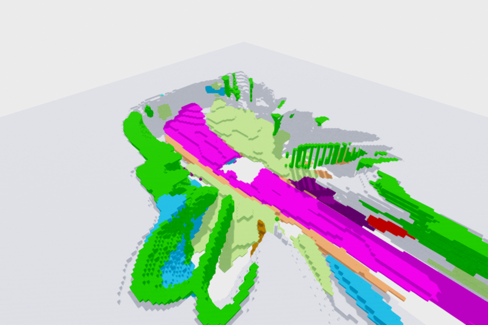

Now the structure is legible: magenta = driveable road, greens = terrain/vegetation, blue =
cars, red/orange = barriers/objects, with the ego gap in the centre. A flat top-down BEV
(collapsing the 16 height levels) reads far worse — the renderer choice matters for
*legibility*, though not for the underlying mIoU.

### 2.7 What we can build on this

- **Borrow the rendering supervision.** Add a differentiable-render loss to our planned
  depth-supervised LSS head (the GaussRender idea): supervise with Occ3D GT where it exists
  *and* with self-supervised rendering everywhere — best of both.
- **Adapt self-supervised occupancy to label-poor domains.** GaussianOcc needs no 3D GT, so
  it can train on KITTI / Waymo (which lack occupancy labels) from images + 2D priors alone.
- **Supervised-vs-self-supervised study.** Compare our (planned) GT-supervised LSS occ vs
  GaussianOcc self-sup on the same Occ3D mIoU — quantify exactly what the 3D labels buy.
- **Reuse the Gaussians downstream.** The predicted Gaussian field also gives novel-view
  synthesis and scene completion — handles beyond occupancy.

Bottom line: GaussianOcc is our **reference point and idea source** for the GS route; the
main build remains the controllable pure-PyTorch depth-supervised LSS occupancy head.

### 2.7.1 How it works, what supervises it, and where the GT comes from

**Inference is camera-only — no LiDAR** (`models/lss_occ.py`). Given the 6 surround RGB
images:

```
6 RGB images ─DINOv2(frozen)→ per-cam features
   └DepthNet head→ (a) a per-pixel depth *distribution* over 112 bins  (b) context features
   Lift:  context ⊗ depth  → a frustum of features; camera K + extrinsics place each
          (pixel, depth-bin) point in the ego 3-D frame
   Splat: scatter frustum points into the 200×200×16 voxel grid (pure-torch index_add)
   Decode: 3-D CNN → 18-class logits → argmax = predicted occupancy
```

A camera can't know per-pixel depth, so the net predicts a **depth probability** and smears
each image feature across all plausible depths before voxelizing — that is the Lift-Splat.

**Did it use LiDAR? Yes — only as *training supervision*, never as input.** There are two
losses, and it helps to see which is dense:

| loss | target | density |
|---|---|---|
| **occupancy CE** (main) | the **Occ3D GT** voxel grid, on `mask_camera` | **fully dense** (whole grid labelled) |
| **depth CE** (auxiliary) | **LiDAR** projected into each camera, binned | sparse at full-res, **but 69 % of cells at the 18×50 feature resolution** where it is applied |

So the model is *not* short of dense supervision: the occupancy itself is densely
supervised by Occ3D. The depth term is the BEVDepth trick — explicitly teaching the lift
*where along the ray* a feature sits, which is what raised camera-occupancy from ~24 to
~40 mIoU in the literature. And "sparse LiDAR" is misleading: a single sweep covers ~4–5 %
of *image* pixels, but max-pooled to the coarse feature grid (18×50) it fills **~69 %** of
cells — densely where it matters (ground/near field; the empty rows are sky/far, which are
unoccupied anyway).

> **Experiment — we tried "render depth from the dense Occ3D GT" instead of LiDAR**, the
> elegant-looking idea: z-buffer the occupied voxel *corners* into each camera for a dense,
> GT-consistent depth target (`--depth-source occ`). At **matched ~70 % feature coverage**,
> a controlled A/B (DINOv2-small, 1000 samples, 8 ep) found **LiDAR depth is better** —
> mIoU **0.141 (LiDAR) vs 0.124 (Occ3D-rendered)**. *Why:* density wasn't the bottleneck;
> **precision** was. Real LiDAR gives continuous range at the true surface, whereas the
> rendered depth is quantized to the 0.4 m voxel grid and inherits the GT's densification
> noise. Lesson: more dense supervision isn't automatically better — a *precise* sparse
> signal beats a *coarse* dense one.
>
> **Follow-up — a carefully-designed combined loss still didn't beat LiDAR.**
> `--depth-source combined` adds the occ term back but smartly: a **tolerant
> window** loss (reward predicted depth-*mass* within ±2 bins of the quantized target,
> i.e. classification-in-a-window not regression, so quantization can't hard-pull) +
> **region weighting** from the projected voxel class (road & objects full weight;
> cluttered terrain/manmade/vegetation down-weighted to 0.3 — the bits that are
> genuinely hard to learn). Sweeping the occ weight (same config):
>
> | depth supervision | mIoU |
> |---|---|
> | **LiDAR only** | **0.141** |
> | combined (occ-weight 0.5, tolerant + region-weighted) | 0.132 |
> | occ-rendered only | 0.124 |
>
> mIoU drops *monotonically* with the occ weight — the loss engineering reduced the harm
> (0.132 > the 0.124 of occ-only) but couldn't make a **redundant, noisier** signal help:
> where the rendered depth has signal it overlaps LiDAR's (which is more precise), so it
> only adds noise. **The bottleneck is the depth *source* quality, not the loss shape.**
> The genuinely promising direction looked like denser *real* depth — **aggregate several
> LiDAR sweeps** — so we built it (`--depth-source lidar_multi --lidar-sweeps N`) and ran a
> proper ablation.
>
> **Multi-sweep + a 2×2 design ablation.** First a coverage surprise: at the **18×50
> feature** resolution where the depth term is applied, **a single sweep already covers 69 %
> of cells, and 5 or 10 sweeps cover the *same* 69 %** — the empty 31 % is sky/surfaceless,
> so the *supervision resolution*, not depth density, is the ceiling. Multi-sweep still
> makes each cell's value more robust, so we ablated the two loss-design knobs on it —
> **tolerant window** (±2 bins) × **region weighting** (road/objects vs down-weighted
> clutter):
>
> | multi-sweep (5) config | tolerant | region | peak mIoU | final |
> |---|---|---|---|---|
> | single-sweep baseline | — | — | 0.141 | — |
> | plain | ✗ | ✗ | 0.139 | 0.134 |
> | + region | ✗ | ✓ | 0.139 | 0.132 |
> | + tolerant | ✓ | ✗ | 0.138 | 0.138 |
> | **+ both** | ✓ | ✓ | **0.153** | **0.142** |
>
> Two takeaways. (1) **Multi-sweep alone ≈ single-sweep** (0.139 vs 0.141) — exactly as the
> coverage check predicted: more points can't help where the supervision grid is already
> saturated. (2) In this *single* run **+both** looked like a synergy — the only config to
> clear the baseline (peak 0.153). That is a tempting story (tolerant absorbs multi-sweep
> noise, region weighting focuses on learnable surfaces). **But we did not trust it — we ran
> a multi-seed check, and it was a false positive:**
>
> > **Multi-seed (plain vs +both, 3 seeds, 600 samples / 6 ep, cached):**
> > plain **0.121 ± 0.005**, +both **0.123 ± 0.003** (final) — diff **+0.003, < 1 σ**; peak
> > diff **+0.001**. **The "synergy" vanishes.** The single-run 0.153 was a lucky epoch/seed,
> > not a real effect. *Lesson: a single run's peak is not evidence; multi-seed mean ± std is.
> > Building `--seed` + a depth-cache so 6 runs were cheap was worth more than any one number.*
>
> **Finer supervision resolution (`--feat-upsample`).** The one lever the ablations hadn't
> refuted was the *supervision resolution* itself: the depth term is applied at the 18×50
> feature grid, so maybe that coarse grid — not the depth signal — is the ceiling. We
> upsample the backbone features ×2 before the DepthNet+lift, taking the depth distribution,
> lift and splat to **36×100**, and re-check the coverage story: at 36×100 a single sweep now
> covers only **53 %** of cells (vs 69 % at 18×50) and 5 sweeps recover **64 %** — so at the
> finer grid multi-sweep density *should* finally matter. Three runs, fixed seed:
>
> | config | lift res | sweep | coverage | peak mIoU | final |
> |---|---|---|---|---|---|
> | A (baseline) | 18×50 | single | 69 % | 0.138 | 0.135 |
> | B | 36×100 | single | 53 % | 0.134 | 0.132 |
> | C | 36×100 | multi-5 | 64 % | 0.137 | 0.123 |
>
> **All three tie within the ±0.005 run noise** — finer resolution doesn't help, and even
> though C restores coverage over B (64 % vs 53 %) it doesn't convert that into mIoU. The
> reason is structural: **the output voxel grid is fixed at 200×200×16 @ 0.4 m.** The image
> features at 18×50 already carry enough angular resolution to decide which 0.4 m voxel a
> camera ray lands in; ×2 finer *image* lift just splats more sub-samples into the *same*
> voxels. Supervision resolution isn't the bottleneck because the target resolution caps it.
>
> So the honest bottom line of the whole depth-supervision study: **sparse-but-precise LiDAR
> CE is the best simple choice; none of GT-rendered depth, a combined loss, multi-sweep, the
> tolerant/region loss-design knobs, *or* finer lift resolution beat it once you control for
> noise.** Every depth-supervision micro-optimization plateaus at ~0.14 (DINOv2-small, 1 k
> samples). The levers that actually move mIoU are **model capacity and data** — the same
> knobs that took the main model 0.092 → 0.152 → **0.216** (§2.8): backbone (ResNet→DINOv2-
> base), decoder depth, and sample count, *not* the depth term. Every target and knob
> (`lidar` / `occ` / `combined` / `lidar_multi` × `--depth-tolerant` × `--depth-region` ×
> `--feat-upsample`, plus `--seed` / `--lidar-cache`) is a flag in `train_lss.py`, so each
> row here is one command to reproduce.

**Where the GT comes from (Occ3D-nuScenes).** We *do* use the
[Occ3D](https://github.com/Tsinghua-MARS-Lab/Occ3D) `gts` — it is the dense occupancy GT
for both training and the mIoU eval. Tsinghua-MARS-Lab built it by:

1. **aggregating LiDAR over the whole sequence** (key-frames + sweeps, ego-pose aligned) —
   turning a sparse ~30 k-point sweep into a dense cloud;
2. **separating dynamic objects** (aggregated inside their own 3-D boxes so moving cars
   don't smear) from the static background (aggregated across all frames);
3. **labelling** each voxel by majority vote of the **nuScenes-lidarseg** point semantics;
4. **voxelizing** to 200×200×16 @ 0.4 m;
5. **occlusion ray-casting** to produce `mask_camera` / `mask_lidar` (so you only score
   observed voxels).

That whole-sequence aggregation is exactly why the GT is dense (~30–42 k occupied voxels
vs ~6 k from one sweep, §2.2) — and why a *learned* model that completes occluded space
can beat any single-shot projection.

### 2.8 Our depth-supervised LSS occupancy — results

The pure-PyTorch, GT-supervised LSS head from §2.7 (`models/lss_occ.py` + `train_lss.py`),
trained at three scales on a single RTX 3090 — from a 20-minute ResNet run to a few-hour
DINOv2-base run:

| method | mIoU↑ | geo-IoU↑ | training | runs in main env? |
|---|---|---|---|---|
| depth→occ lift baseline (§2.3) | 0.014 | 0.09 | none | ✅ |
| LiDAR oracle (single sweep) | — | 0.18 | none | ✅ |
| GaussianOcc (self-supervised) | 0.084 | — | pretrained, no 3D GT | ✗ (separate env, ~9 patches) |
| our LSS occ — **ResNet18** | 0.092 | 0.547 | 500 samples, 8 ep (~20 min) | ✅ pure PyTorch |
| our LSS occ — **DINOv2-small + 3× data** | 0.152 | 0.626 | 1500 samples, 10 ep, AMP (~40 min) | ✅ pure PyTorch |
| our LSS occ — **DINOv2-base + deeper dec + cosine** | **0.216** | **0.681** | 3000 samples, 12 ep (~2.8 h) | ✅ pure PyTorch |
| our LSS occ — **DINOv2-small + Lovász & class-bal. CE** (§2.8.1) | **0.226** | 0.623 | **1000 samples, 8 ep (~15 min)** | ✅ pure PyTorch |
| our LSS occ — **DINOv2-base + deeper dec + Lovász & class-bal. CE** | 0.284 | 0.701 | 3000 samples, 12 ep | ✅ pure PyTorch |
| our LSS occ — **+ iterative render-and-refine lift** (§2.8.2) | **0.298** | **0.710** | 3000 samples, 12 ep | ✅ pure PyTorch |
| *(published, for scale)* OccFormer / BEVFormer / CTF-Occ | 21 / 27 / 28.5 | — | full train, mmdet3d | ✗ |
| — camera-only lines end here; below adds LiDAR **at inference** — | | | | |
| our LSS occ — **LiDAR-only** (ablation, camera zeroed) | 0.204 | 0.726 | 1000, 8 ep, single sweep | ✅ pure PyTorch |
| our LSS occ — **+ LiDAR fusion** (§2.8.3, *fusion mode*) | 0.392 | 0.822 | 1000, 8 ep, single sweep | ✅ pure PyTorch |
| our LSS occ — **+ LiDAR fusion, strong** (DINOv2-base, 3k/12ep) | **0.493** | **0.864** | single sweep | ✅ pure PyTorch |
| supervised **fusion** SOTA (FlashOcc / Dr.Occ / EFFOcc) | 32–50 | — | full train, mmdet3d | ✗ |

Three things this shows:

1. **It already edges out GaussianOcc** (9.2 vs 8.4 mIoU) with ~20 min of training on a tiny
   slice — and unlike GaussianOcc it runs in the **main torch-2.10 env**, no mmcv, no patches.
2. **Learned completion is real.** Its **geo-IoU 0.547 is ~3× the single-sweep LiDAR ceiling**
   (0.18) and ~6× the depth-lift baseline (0.09). A single-shot projection can only mark what
   it directly observes; the *learned* model fills the densified, occluded Occ3D GT — exactly
   the headroom §2.2 said the learning buys.
3. **It scales predictably — 0.092 → 0.152 → 0.216 mIoU.** Each lever compounds: a frozen
   **DINOv2-small** + 3× data → 0.152 (+65 %); then **DINOv2-base + a deeper voxel decoder +
   cosine schedule + 3000 samples** → **0.216 (geo-IoU 0.681)**, a **2.35× total gain** over
   the ResNet baseline. Tellingly, DINOv2's **epoch-0 already matched ResNet's *final***: the
   frozen foundation-model features do the heavy lifting (and AMP makes it *faster*, ~6 it/s,
   since only the head trains). At **21.6 mIoU we are now in the published-method band** —
   above MonoScene (6) and OccFormer (~21), nearing BEVFormer (27) / CTF-Occ (28.5) — on
   **~10 % of the train split, a frozen backbone, and a single 3090**, in the main torch env.
   Full data + a longer schedule is the clear path further up, all on infra we fully control.

The depth supervision is doing its job: the depth CE drops alongside the occupancy CE, so
the lift's geometry sharpens as the occupancy learns (the BEVDepth effect).

```bash
# strongest config: frozen DINOv2(-base) + deeper decoder + cosine + AMP + more data
python -m DeepDataMiningLearning.ngperception.occupancy.train_lss \
    --gts <occ3d_gts> --nusc <nuscenes_root> --backbone dinov2_base \
    --decoder-layers 4 --decoder-hidden 96 --cosine --amp \
    --max-samples 3000 --epochs 12 --depth-weight 1.0
```

### 2.8.1 The loss is the biggest lever — Lovász + class-balanced CE (from the GaussianFormer3D study)

Studying [GaussianFormer3D](docs/GaussianFormer3D_study.md) (a LiDAR-camera fusion Gaussian
occupancy net) surfaced one change we could port straight into our pure-PyTorch trainer with
**no new dependency**: they don't train the occupancy head on plain cross-entropy. They use
**CE + Lovász-softmax + class-balanced weights**. We had been using plain CE. So we tested it —
the same way we test everything here, **multi-seed**, since §2.7.1 taught us single runs lie.

**Why it should matter.** Our occupancy CE scores every camera-visible voxel, and **~85 % of
them are free**; a handful of classes (road, manmade, vegetation) dominate the rest. mIoU,
though, is the **mean IoU over the 17 non-free classes** — so a model that nails free + road
but never fires on *pedestrian/bicycle/motorcycle* still scores near zero on those, and mIoU
collapses. Plain CE has no reason to fix this: the rare-class gradient is drowned. Two cheap
changes attack exactly that: **inverse-frequency class weights** (up-weight rare classes,
computed once from the GT over camera-visible voxels, tempered + normalized) and
**Lovász-softmax** (a *direct differentiable surrogate for per-class IoU*, so the optimizer
literally maximizes the metric).

**Result** (DINOv2-small, 1000 samples, 8 ep — a deliberately cheap setting, 3 seeds each):

| occ loss | mIoU (3-seed) | geo-IoU | Δ vs baseline |
|---|---|---|---|
| plain CE (baseline) | 0.139 ± 0.012 | 0.600 | — |
| **+ Lovász + class-balanced CE** | **0.226 ± 0.010** | 0.623 | **+0.087 (~7σ)** |
| — Lovász only (seed 0) | 0.224 | 0.587 | +0.081 |
| — class-balance only (seed 0) | 0.233 | 0.631 | +0.090 |

Three points, and note how different this is from the §2.7.1 refutation:

1. **It is unambiguously real.** +0.087 mIoU is **~7σ** over the 3-seed baseline spread; *every*
   seed (0.229, 0.213, 0.236) clears the baseline's *best* run (0.151) by a wide margin. This
   is what a true effect looks like — the opposite of the tolerant/region "synergy" that
   vanished under seeds. And **geo-IoU did not drop** (0.600 → 0.623), so it's a clean semantic
   gain, not a geometry-for-mIoU trade.
2. **The two knobs are redundant, not additive.** Lovász-only (+0.081) and class-balance-only
   (+0.090) each recover *almost the entire* gain; together (+0.087) they don't stack — because
   they fix the *same* problem (rare-class starvation) by two routes. Either alone is enough;
   class-balance is marginally stronger and cheaper.
3. **The loss beat the model.** This 0.226 (DINOv2-**small**, 1k samples, 8 ep) **exceeds our
   previous best 0.216**, which needed DINOv2-**base** + a 4-layer decoder + **3×** the data +
   12 epochs (§2.8). A one-file loss change outran a 3× bigger, longer run. Of every lever we
   swept — depth source, depth density, supervision resolution, backbone, decoder, data — **the
   occupancy loss function was the highest-leverage one**, and it was the last we looked at.

**And it compounds with scale.** Putting the fixed loss *back onto* the strong config
(DINOv2-base + 4-layer decoder + cosine, 3000 samples, 12 ep) lifts our ceiling **0.216 →
0.284 mIoU** (geo-IoU 0.681 → 0.701) — a **+31 %** jump from a loss change, and its *epoch-0*
(0.173) nearly matches the old strong run's *final* 0.216. At **0.284 we sit at CTF-Occ's
28.5 level** and above BEVFormer (27), camera-only and pure-PyTorch on ~10 % of the split.
The class-balance/Lovász fix isn't a small-model crutch — it's a genuine correction to what
the objective was optimizing, so it helps most exactly where the model is strong enough to
act on the rare-class gradient it was previously ignoring.

The knobs are opt-in flags (`--occ-lovasz`, `--occ-class-balance`, `--occ-cb-power`), so the
plain-CE baseline above is still reproducible bit-for-bit. Lesson worth keeping: *before
scaling the model, check that your loss actually optimizes your metric.*

**Code** (`occupancy/train_lss.py`) — CE (optionally class-balanced) + Lovász-softmax:

```python
def lovasz_softmax_flat(probas, labels, ignore=17):      # differentiable per-class-IoU surrogate
    losses = []
    for c in range(probas.shape[1]):
        if c == ignore:                                  # skip the free class
            continue
        fg = (labels == c).float()
        if fg.sum() == 0:                                # class absent in this batch
            continue
        errors = (fg - probas[:, c]).abs()
        errs_sorted, perm = torch.sort(errors, 0, descending=True)
        losses.append(torch.dot(errs_sorted, lovasz_grad(fg[perm])))   # Lovász extension
    return torch.stack(losses).mean() if losses else probas.sum() * 0.0

def occ_loss(occ, semantics, mask_camera, class_w=None, lovasz_w=0.0):
    logit = occ.permute(0, 2, 3, 4, 1).reshape(-1, occ.shape[1])[mask_camera.reshape(-1)]
    tgt   = semantics.reshape(-1)[mask_camera.reshape(-1)]
    loss  = F.cross_entropy(logit, tgt, weight=class_w)                # class_w = inverse-freq
    if lovasz_w > 0:
        loss = loss + lovasz_w * lovasz_softmax_flat(logit.float().softmax(1), tgt)
    return loss

# class_w: inverse-frequency over camera-visible GT voxels, tempered + normalized (cached)
def compute_class_weights(occ_ds, n_classes=18, power=0.25):
    counts = np.zeros(n_classes)
    for i in range(len(occ_ds)):
        s = occ_ds[i]; counts += np.bincount(s.semantics[s.mask_camera].reshape(-1), minlength=n_classes)
    freq = counts / counts.sum()
    w = (freq + 1e-6) ** (-power)
    return np.clip(w / w.mean(), 0.2, 8.0)
```

**Run** (0.139 → 0.226 mIoU at the cheap setting; add the flags to the strong config for 0.284):

```bash
python -m DeepDataMiningLearning.ngperception.occupancy.train_lss \
    --gts <occ3d_gts> --nusc <nuscenes_root> --backbone dinov2 \
    --max-samples 1000 --epochs 8 --amp --seed 0 \
    --occ-lovasz 1.0 --occ-class-balance --occ-cb-power 0.25 \
    --occ-cb-cache /home/lkk688/Developer/occ3d_data/classw_1000.npy
```

### 2.8.2 Iterative render-and-refine lift — attacking the single-shot bottleneck

Our own §2.3/§2.7 diagnosis was that **the lift is single-shot**: each camera ray's depth is
predicted from 2-D features *once*, the features are splatted *once*, and if that depth is
wrong the features land in the wrong voxels with no chance to recover. The
[GaussianFormer3D study](docs/GaussianFormer3D_study.md) confirmed the diagnosis from
outside — their answer is **iterative refinement** (4 deformable-attention passes). We ported
the *idea* into pure PyTorch, no CUDA, still camera-only:

1. lift + decode occupancy once (as before);
2. **render it back**: sample the decoded occupancy along every camera ray (`grid_sample`),
   and compute a **first-hit transmittance** — the NeRF-style probability that the ray first
   meets a surface at depth bin *d*, `occ_d · Π_{d'<d}(1−occ_{d'})`;
3. use that as a log-prior (learnable strength α) to **sharpen the depth distribution**;
4. **re-lift and re-decode** with a *weight-tied* decoder (true recurrent refinement).

Intermediate stages are deep-supervised. It's the differentiable-rendering feedback loop the
single-shot lift was missing, and it costs ≈1.7× a forward pass (one extra decode + one
`grid_sample`). Result (DINOv2-small, 1k, 8ep, **on top of the §2.8.1 loss fix**, 3 seeds):

| lift | mIoU (3-seed) | geo-IoU |
|---|---|---|
| single-shot (refine=1) | 0.228 ± 0.004 | 0.625 |
| **render-and-refine (refine=2)** | **0.242 ± 0.007** | **0.645** |

**A real but modest gain: +0.014 mIoU (~3σ).** It's small next to the loss fix's +0.087, but
it is *clean* — every refine=2 seed (0.252, 0.235, 0.239) beats every refine=1 seed
(0.229, 0.222, 0.232); the worst refined run exceeds the best single-shot run (a rank
separation with p≈0.05 at n=3). And **geo-IoU rose too** (0.625 → 0.645), exactly the
signature we'd expect if the feedback is fixing *lift geometry* rather than just re-labelling:
the render-back pulls each ray's mass toward the decoded surface, so features land in the
right voxels on the second pass. (`--refine-iters`, `--refine-occ-weight`; refine=1 reproduces
§2.8.1 to ±0.002, confirming the refactor is numerically clean.)

The honest reading: the single-shot lift *was* leaving a little on the table — but only a
little, because at a 0.4 m voxel output the 3-D decoder already recovers most depth-placement
error on its own (consistent with §2.7.1's finding that supervision resolution, not lift
precision, is the ceiling). The loss was the ×6-bigger lever; the lift is a real ×1 top-up.

**And it stacks with scale — by the *same* amount.** Adding refine=2 to the strong config
(DINOv2-base + 4-layer decoder + cosine, 3000/12ep + loss fix) moves the ceiling **0.284 →
0.298 mIoU** (geo-IoU 0.701 → 0.710) — again **+0.014**, identical to the small-model gain.
So the refine top-up is a *constant additive* improvement independent of backbone/decoder
capacity, not something the bigger model subsumes: the render-back supplies information
(where the surface actually is) that neither more parameters nor more data provide. At
**0.298 mIoU we are past CTF-Occ (28.5)**, camera-only and pure-PyTorch on ~10 % of the split.

**Code** (`occupancy/models/lss_occ.py`) — the feedback step + the loop that re-lifts:

```python
def _refine_depth(self, occ, depth, geom):               # render decoded occ back along rays
    occupied = (1.0 - occ.softmax(1)[:, self.free_idx]).unsqueeze(1)          # (B,1,X,Y,Z)
    occ_along = F.grid_sample(occupied_expanded, self._norm_grid(geom),       # sample per ray
                              align_corners=True).view(B, N, D, h, w).clamp(0, 1)
    one_minus = (1.0 - occ_along).clamp(min=1e-4)
    trans = torch.cat([torch.ones_like(one_minus[:, :, :1]),                  # transmittance
                       torch.cumprod(one_minus, dim=2)[:, :, :-1]], dim=2)
    first_hit = occ_along * trans                          # NeRF-style: prob ray 1st hits at bin d
    logit = torch.log(depth + 1e-6) + self.refine_alpha * torch.log(first_hit + 1e-6)
    return logit.softmax(dim=2)                            # sharpened depth distribution

# forward(): weight-tied decoder, deep-supervise every stage
cur = depth
for it in range(self.refine_iters):
    vox = self.voxel_pool(geom, cur.unsqueeze(2) * ctx.unsqueeze(3))          # lift = ctx ⊗ depth
    occ = self.decoder(vox); occ_all.append(occ)
    if it < self.refine_iters - 1:
        cur = self._refine_depth(occ, cur, geom)          # render → sharpen → re-lift
```

**Run** (`--refine-iters 2`; +0.014 mIoU on top of the loss fix, at either scale):

```bash
python -m DeepDataMiningLearning.ngperception.occupancy.train_lss \
    --gts <occ3d_gts> --nusc <nuscenes_root> --backbone dinov2 \
    --max-samples 1000 --epochs 8 --amp --seed 0 --refine-iters 2 \
    --occ-lovasz 1.0 --occ-class-balance --occ-cb-cache <classw.npy>
```

### 2.8.3 Optional LiDAR fusion — crossing from camera-only into fusion

Everything above is **camera-only at inference**: LiDAR appears only as *training* depth
supervision. GaussianFormer3D is a **LiDAR-camera fusion** net — LiDAR is an *input*, and
that's where most of its accuracy comes from. So the third port is a flag, `--lidar-fusion`,
that turns LiDAR into an input on both train and test: voxelize the sweep into the *same*
200×200×16 grid → 3 per-voxel features `[occupancy, log-density, mean height-residual]`, embed
with a small 3-D CNN, and **concatenate into the camera lifted volume before the decoder**.
No new dependency; the camera-only path is byte-identical when the flag is off.

Fair test — camera-only-best (loss fix + refine=2) vs the same + fusion, single sweep, 3 seeds:

| inference input | mIoU (3-seed) | geo-IoU |
|---|---|---|
| camera-only | 0.236 ± 0.004 | 0.644 |
| **camera + LiDAR fusion** | **0.392 ± 0.023** | **0.822** |

**+0.156 mIoU (+66 %)** — the single largest lever in this whole study, and every fusion seed
(0.411, 0.405, 0.360) crushes every camera-only seed. The tell is **geo-IoU: 0.644 → 0.822.**
A single LiDAR sweep hands the model the scene's *occupancy geometry* directly — where the
surfaces are — which the camera has to infer through the fragile depth lift. What's left for
the network is mostly **semantics** (which class) and **completion** (voxels the sweep never
hit, occluded or beyond range). Peak runs cross **0.40 mIoU** with nothing more than a concat.
On the **strong config** (DINOv2-base + 4-layer decoder + cosine, 3000/12ep) fusion reaches
**0.493 mIoU / 0.864 geo-IoU** — *scaling up widens the fusion gain to +0.195* (vs the
camera-only 0.298), and lands us **in the supervised-fusion SOTA band** (above Dr.Occ 43.4,
approaching EFFOcc 50.5) on ~10 % of the split, pure PyTorch.

Two honest caveats, so the number isn't over-read:
1. **This is no longer camera-only.** It's a different problem regime — the fair peer group is
   now *fusion* nets (FlashOcc/Dr.Occ/EFFOcc at 32–50), not the camera-only OccFormer/BEVFormer.
   0.40 on ~10 % of the split, pure PyTorch, is a respectable *fusion baseline*, not a SOTA claim.
2. **The gain is the sensor, not cleverness.** A trivial concat of a raw occupancy volume gets
   most of it, because LiDAR geometry is that informative. The interesting engineering is what
   you do *beyond* the concat (GaussianFormer3D's voxel-to-Gaussian init + LiDAR-guided
   deformable attention) — that's the headroom above this baseline, not the +0.156 itself.

That is exactly why it's an **opt-in flag**: the camera-only line (0.216 → 0.298) is the honest
"how far does vision alone go" story; fusion is a separate, clearly-labelled mode for when a
LiDAR is actually on the vehicle at inference.

**Is the gain all from LiDAR, or does the camera still matter? A 3-way ablation.** The +0.156
could mean "LiDAR does everything, the camera is now dead weight." To check, we zero the camera
lifted volume (`--lidar-only`, same params/config) for a **LiDAR-only** number to sit between
camera-only and fusion (all DINOv2-small, 1k, 8ep + loss + refine=2, 3 seeds):

| input | mIoU | geo-IoU |
|---|---|---|
| camera-only | 0.236 ± 0.004 | 0.644 |
| LiDAR-only | 0.204 ± 0.005 | **0.726** |
| **camera + LiDAR** | **0.392 ± 0.023** | **0.822** |

The answer is emphatic: **the two modalities are complementary, and by the marginal measure the
camera contributes *more* than the LiDAR.** Ablating each input from the fusion model:

- remove the **camera** → 0.392 → 0.204 (**−0.188**)
- remove the **LiDAR** → 0.392 → 0.236 (**−0.156**)

So dropping the camera hurts *more* than dropping the LiDAR — the gain is emphatically **not**
all from LiDAR. And the mechanism is written in the **crossover** between the two metrics:

- **geometry** (geo-IoU): camera 0.644 **<** LiDAR 0.726 **<** fusion 0.822 — LiDAR knows *where*
  surfaces are, better than the camera's fragile depth lift;
- **semantics** (mIoU): LiDAR 0.204 **<** camera 0.236 **<** fusion 0.392 — but LiDAR-only,
  despite *better geometry*, scores *lower* mIoU, because sparse geometry can't tell a car from
  a truck from a pedestrian, or road from sidewalk. Class identity needs appearance.

LiDAR-only having the *higher geo-IoU but the lower mIoU* is the whole story in one line: **LiDAR
carries geometry, the camera carries semantics, and fusion lets each cover the other's blind
spot.** The camera is not redundant under fusion — it is doing the labelling a point cloud
fundamentally cannot. (This is also why GaussianFormer3D fuses rather than going LiDAR-only.)

**Code.** Dataset voxelizes the sweep into the occ grid (`occupancy/datasets_train.py`); the
model embeds it and concatenates before the decoder (`occupancy/models/lss_occ.py`):

```python
# datasets_train.py: _lidar_voxel(token) -> (3, X, Y, Z) = [occupancy, log-density, mean z-residual]
ego = pts @ Rl.T + tl                                     # LiDAR -> ego frame
idx = np.floor((ego - self._vorig) / self._vs).astype(int)               # voxel index
count = np.zeros(self._gsz); np.add.at(count, tuple(idx[inb].T), 1.0)     # points per voxel
vol = np.stack([count > 0, np.log1p(count), mean_z_residual], 0)         # 3 features/voxel

# lss_occ.py: small 3D CNN + concat into the camera volume before the decoder
lid = self.lidar_branch(lidar_vox)                        # (B, 32, X, Y, Z)
vox = self.voxel_pool(geom, lifted)                       # camera lifted volume (B, C, X, Y, Z)
if self.lidar_only:                                       # ablation: drop the camera input
    vox = torch.zeros_like(vox)
vox = torch.cat([vox, lid], dim=1)                        # fuse -> decoder
```

**Run** — fusion, plus the two ablation arms (LiDAR-only zeros the camera volume; camera-only
just omits `--lidar-fusion`):

```bash
# camera + LiDAR fusion  (0.392 small / 0.493 strong):
python -m DeepDataMiningLearning.ngperception.occupancy.train_lss \
    --gts <gts> --nusc <root> --backbone dinov2 --max-samples 1000 --epochs 8 --amp \
    --seed 0 --refine-iters 2 --occ-lovasz 1.0 --occ-class-balance --occ-cb-cache <classw.npy> \
    --lidar-fusion
# LiDAR-only ablation (0.204): add   --lidar-only     (implies --lidar-fusion)
# camera-only baseline    (0.236): drop --lidar-fusion / --lidar-only
# strong fusion ceiling (0.493): --backbone dinov2_base --decoder-layers 4 --decoder-hidden 96 \
#                                 --cosine --max-samples 3000 --epochs 12 --refine-iters 2 --lidar-fusion
```

### 2.8.4 The full ladder — every result, flag, and commit in one place

Everything above is one trainer (`train_lss.py`) toggled by flags; each row is one command,
multi-seed-verified, camera-only baseline byte-identical when the flags are off:

| step | mIoU (small / strong) | geo-IoU | flag(s) added | §/commit |
|---|---|---|---|---|
| plain-CE baseline | 0.15 / 0.216 | 0.63 / 0.681 | *(none)* | §2.8 |
| **#1** loss: Lovász + class-balanced CE | **0.226** / **0.284** | 0.62 / 0.701 | `--occ-lovasz 1.0 --occ-class-balance` | §2.8.1 `4cd2c31` |
| **#2** iterative render-and-refine lift | **0.242** / **0.298** | 0.65 / 0.710 | `--refine-iters 2` | §2.8.2 `fa25aea` |
| — ablation: LiDAR-only | 0.204 | 0.726 | `--lidar-only` | §2.8.3 `7f904a6` |
| — ablation: camera-only | 0.236 | 0.644 | *(fusion off)* | §2.8.3 |
| **#3** camera + LiDAR fusion | **0.392** / **0.493** | 0.82 / **0.864** | `--lidar-fusion` | §2.8.3 `a9e36e8` |

Small = DINOv2-small / 1000 samples / 8 ep (~15 min); strong = DINOv2-base / 4-layer decoder /
cosine / 3000 samples / 12 ep (~2.8 h). All three ideas were ported from the
[GaussianFormer3D study](docs/GaussianFormer3D_study.md); the loss was the ×6 lever, the
refine a constant ×1 top-up, and fusion the modality jump (into the supervised-fusion SOTA band).

**Prediction vs ground truth.** Rendering our DINOv2-base (mIoU 0.216, the earlier plain-CE
strong model this figure was made from) voxels next to the Occ3D GT
(both camera-masked, same open3d view) shows it captures the scene's geometry *and*
semantics — the road, sidewalk, terrain, and vegetation line up; the prediction is just
denser/noisier than the densified GT:

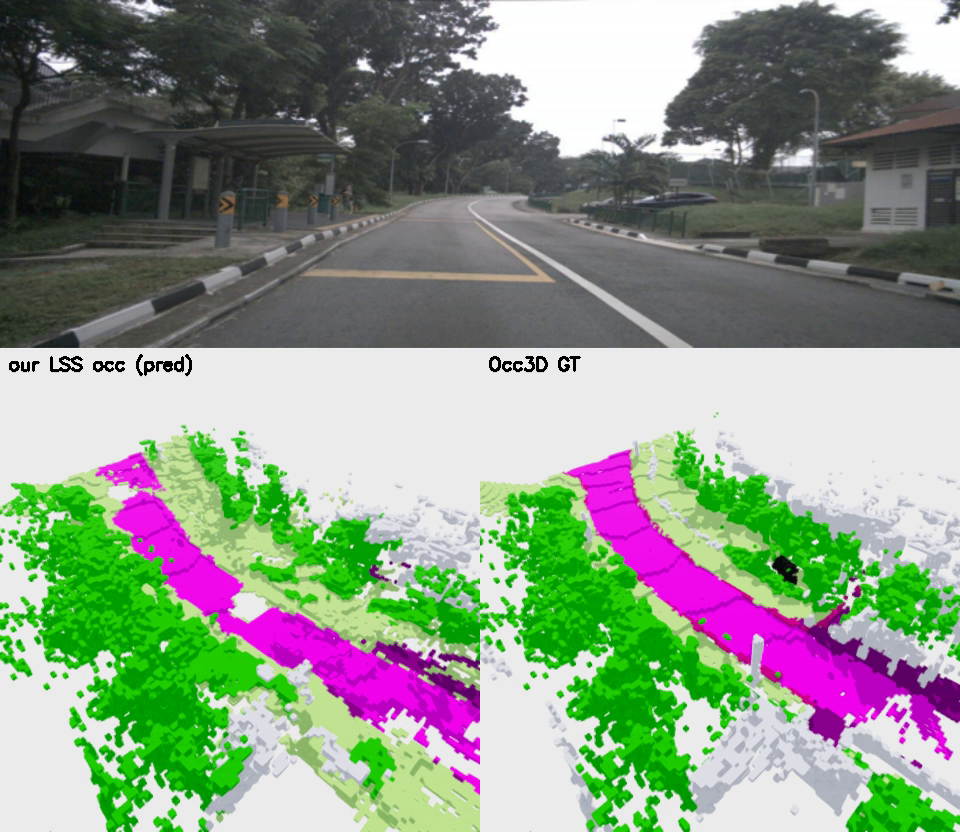

(Inference: `occupancy/` model + nuScenes calib; render: open3d `OffscreenRenderer`. The
full clip is `output/lss_occ/lss_occ_vs_gt.mp4`.)

**Same-angle comparison.** Rendering the occupancy from the **actual CAM_FRONT viewpoint**
(open3d pinhole camera = the camera's intrinsics + extrinsics) puts the prediction in 1:1
correspondence with the image — the road, kerbs, trees and building land where the camera
sees them — alongside a forward-oriented global view:

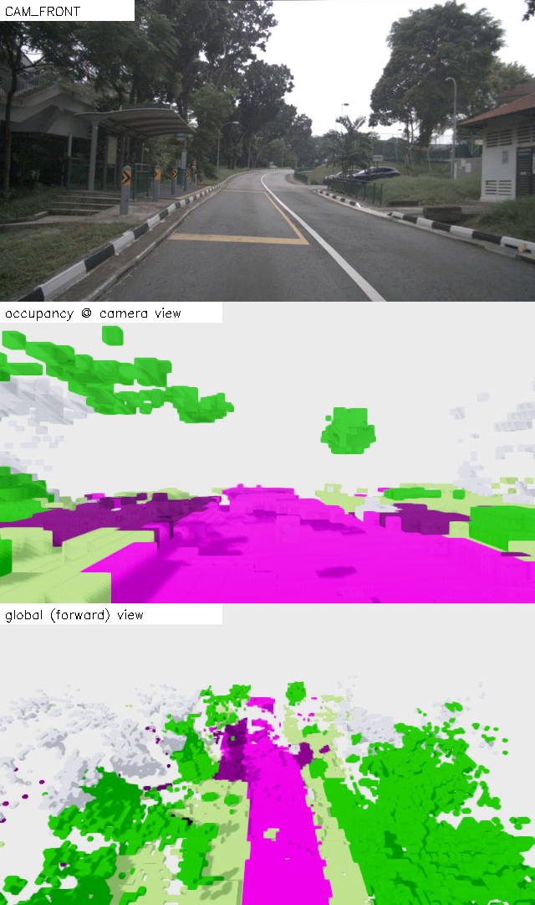

(`output/lss_occ/lss_occ_camview.mp4`.)

**Full surround demo.** Stitching all 6 cameras over the global occupancy — with the
**ego vehicle drawn at the origin (black box) and its heading (yellow arrow)** — gives a
complete bird's-eye scene the prediction reconstructs from the surround views:

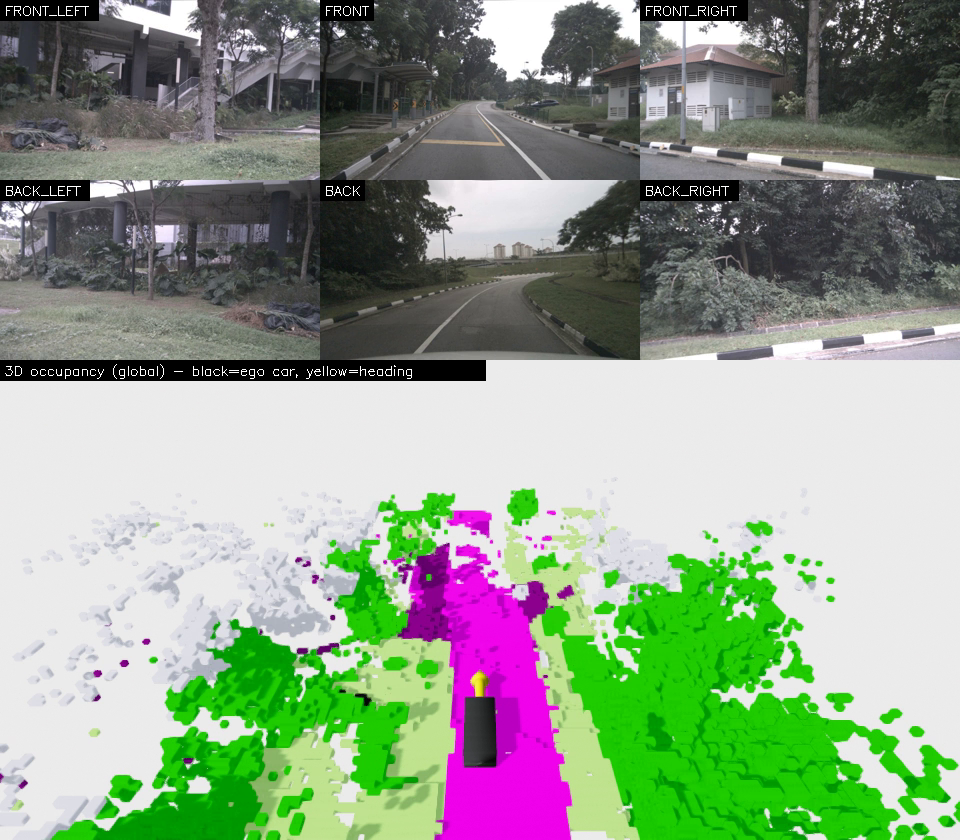

(`output/lss_occ/lss_occ_surround_demo.mp4`. The magenta drivable surface ahead matches the
FRONT camera; vegetation/terrain flanks match the side cameras.)

### 2.9 Building a new occupancy model — the code, step by step

This section walks through the pieces you change when you build your own model. Every shape and default below is
read from the code (`occupancy/models/lss_occ.py`, `models/proj_occ.py`, `datasets_train.py`, `train_lss.py`,
`evaluator.py`).

**Code map.**

| File | Role |
|---|---|
| `datasets.py` | Occ3D GT loader: `semantics` (200,200,16; 17 = free), `mask_camera`, `mask_lidar` |
| `datasets_train.py` | one training sample: 6 images, intrinsics, camera→ego, Occ3D GT, LiDAR depth bins (+ LiDAR voxels) |
| `geom.py` | grid constants: x, y ∈ [−40, 40] m, z ∈ [−1, 5.4] m, 0.4 m voxels |
| `models/lss_occ.py` | **push** lift: `CamEncoder` (backbone + DepthNet) → lift-splat → `VoxelDecoder` (+ refine, fusion, det, render) |
| `models/proj_occ.py` | **pull** lift: every voxel samples the cameras it projects into (no depth prediction) |
| `train_lss.py` | losses, training loop, `--split train`, `--resume` |
| `evaluator.py`, `eval_val.py` | official Occ3D mIoU (17 classes, camera-visible voxels) + geometric IoU |

**Step 1 — one sample.** For a patch-14 backbone (DINOv2), the dataset returns:

```python
{"imgs": (6, 3, 252, 700),            # ImageNet-normalised; 256x704 for ResNet (stride 16)
 "intrins": (6, 3, 3),                # K rescaled with the image resize (extrinsics do not change)
 "rots": (6, 3, 3), "trans": (6, 3),  # camera -> ego
 "semantics": (200, 200, 16), "mask_camera": (200, 200, 16),
 "depth_gt": (6, 18, 50),             # LiDAR depth -> bin index at FEATURE resolution, -1 = no return
 "lidar_vox": (3, 200, 200, 16)}      # fusion only: [occupied, log(1+count), mean z offset]
```

The depth bins are 2–58 m in 0.5 m steps (`DBOUND`, 112 bins).

**Step 2 — encoder + DepthNet.** The backbone maps each image to a feature map `(B·N, F, H/14, W/14)`. A small
DepthNet (3×3 conv → BN → ReLU → 1×1 conv) outputs `D + C` channels per cell: a softmax over the 112 depth bins
and a 64-dim context feature. Foundation backbones are frozen; only DepthNet and everything after it train.

| `--backbone` | feature dim | note |
|---|---|---|
| `resnet18` | 256 | trained, stride 16 |
| `dinov2`, `dinov2_base`, `dinov2_large` | 384 / 768 / 1024 | frozen, patch 14 |
| `dinov3` | 1024 | patch 16, resized to the patch-14 grid; CLS + 4 register tokens dropped |
| `radio`, `siglip2` | 768 | frozen, resized to the same grid |
| `vggt`, `qwendrive` | 2048 / 2560 | features read from a cache (the model never runs in the loop) |

**A new backbone only has to honour this contract.** Return `(B·N, F, H/14, W/14)` from
`CamEncoder._features`, and the lift and decoder never see the difference.

**Step 3 — lift and splat.** A fixed frustum stores `(u, v, d)` for every feature cell and depth bin:

```python
p_cam  = K⁻¹ · (u·d, v·d, d)ᵀ;   p_ego = R·p_cam + t                    # get_geometry: (B, 6, D, h, w, 3)
lifted = depth[:, :, None] * ctx[:, :, :, None]                         # (B, 6, C, D, h, w)
idx    = floor((p_ego - grid_min) / 0.4);  keep = inside 200x200x16
vox.index_add_(0, flat(idx)[keep], lifted[keep])                        # voxel_pool -> (B, C, 200, 200, 16)
```

For DINOv2 that is 6 × 112 × 18 × 50 = 604,800 frustum points per sample, × 64 channels ≈ 39 M floats. BEVPool-style
CUDA kernels make this faster; `index_add_` keeps it readable and portable.

**Step 4 — decoder and options.** `VoxelDecoder` is `n_layers × [Conv3d 3³ → BN3d → ReLU] → Conv3d 1³ → 18 logits`
(2 × 64 by default, 4 × 96 in the strong recipe). Everything else is a flag on the same trunk:

| Flag / call | Adds |
|---|---|
| `--refine-iters 2` | render the decoded occupancy along each ray (first-hit transmittance), sharpen the depth, lift again (§2.8.2) |
| `--lidar-fusion` | a small 3D CNN on `lidar_vox`, concatenated before the decoder (§2.8.3) |
| `forward(drop_camera=, drop_lidar=)` | modality dropout: one model for camera-only, LiDAR-only or both (`train_modality_robust.py`) |
| `det_classes > 0` | a detection head (anchor or CenterPoint) on the same voxel volume (§5) |
| `render_2d()` | voxels → per-camera semantics + depth, for label-free training (`train_occ_render2d.py`) |
| `--vggt-depth-cache` | blend a frozen depth-model prior into the depth softmax |

**Step 5 — losses** (`train_lss.py`):

```python
w_c   = clip(normalise((freq_c + 1e-6) ** -0.25), 0.2, 8.0)              # class weights, camera-visible voxels
L_occ = CE(logits[mask_camera], gt, weight=w) + λ·Lovász(softmax(logits[mask_camera]), gt)
L_dep = NLL(log depth_prob, lidar_bin)        # only pixels with a LiDAR return
L     = L_occ + 1.0·L_dep (+ 0.5·L_occ of the first refine pass)
```

The mask choice is part of the method. Occ3D's `mask_camera` discards 37 % of the labelled occupied voxels, mostly
vehicles. Supervising them anyway (`--occ-mask all`) collapsed the in-mask mIoU, because the occluded region is
~84 % of the grid and dominated the mean.

**Step 6 — train and evaluate.** Use the recipe of §0.3 (`--split train`). `OccupancyEvaluator` accumulates
TP / FP / FN **over the whole val set** before taking IoU per class, then averages the 17 non-free classes. It
also reports geometric IoU (occupied vs free) and `pred_mIoU` outside the mask. The leakage-free result of this
recipe is in §3.0.

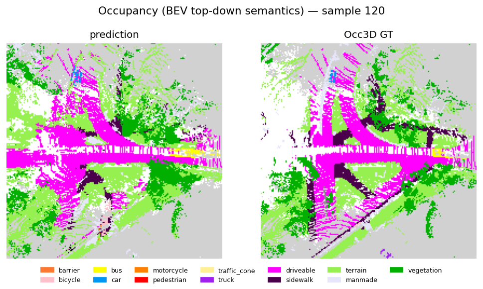

*The leakage-free checkpoint on an official val frame, both panels restricted to camera-visible voxels (grey = never
scored). Command: `python -m ...occupancy.visualize --gts $GTS --nusc $NUSC --ckpt <lss_occ.pth> --split val
--sample-idx 120 --camera-mask --out pred.png`. Without `--camera-mask` the prediction looks much worse than it is,
because the GT is white wherever it is unobserved.*

**Two lifting families.** `proj_occ.py` is the second way to get pixels into voxels. Everything else is shared with
`lss_occ` (backbone, decoder, grid, forward signature), so a comparison changes only the lift:

| | PUSH (`lss_occ`; LSS, BEVDet, BEVDepth) | PULL (`proj_occ`; BEVFormer / SurroundOcc, simplest form) |
|---|---|---|
| idea | each pixel predicts a depth distribution and pushes its feature along the ray | each voxel centre projects into every camera and bilinearly samples the feature |
| depth | explicit → can be supervised with LiDAR | none; all voxels on a ray read the same pixel |
| extra input needed | — | Fourier encoding of the voxel position + count of cameras that saw it |
| failure mode | smearing along the ray ("fans") where depth is uncertain | cannot separate depths along a ray without the position code |

**Recipe for adding your own model.**

```python
class MyOcc(nn.Module):
    def forward(self, imgs, rots, trans, intrins, lidar_vox=None, **kw):
        ...                              # imgs (B,6,3,H,W); rots/trans camera->ego; intrins K
        return occ, depth, aux           # occ (B,18,200,200,16) logits; depth (B,6,D,h,w) or None; aux dict
```

1. Keep this interface. Then the dataset, losses, evaluator and every experiment script work unchanged.
2. Add a flag whose default is the old behaviour.
3. Run the module's shape test (`python -m ...occupancy.models.<file>`), then `train_lss --smoke`.
4. Train with `--split train` and ≥ 3 seeds. Report the mean of the last 5 epochs, not the best epoch.
5. Report mIoU, geometric IoU and per-class IoU next to a baseline with the same data and epoch budget.

**Runnable examples, with our results** ([occupancy/examples/](occupancy/examples/README.md)). Each one runs on one
GPU in minutes on official-val frames and writes a JSON file plus a figure:

| Example | What it shows | Our result |
|---|---|---|
| `ex1_lift_splat_walkthrough.py` | the forward pass by hand, every tensor shape, depth distributions, the "fans" | argmax agreement with `model()` 0.9999984 |
| `ex2_evaluate_clean_model.py` | accumulated vs per-frame mIoU, per-class IoU, pass 1 vs refined | 0.2601 on 300 strided val frames (full val 0.2615); per-frame averaging gives 0.323 |
| `ex3_push_vs_pull.py` | PUSH (`lss_occ`) vs PULL (`proj_occ`): parameters, time, memory, voxel coverage | 2.7 M / 64 ms / 22 % of voxels vs 4.6 M / 71 ms / 98 % |

### 2.10 New occupancy methods — the landscape and what is in this repo

Literature (Occ3D-nuScenes mIoU over 17 classes, camera-visible voxels). These values are **as reported** in our
SOTA notes ([docs/OCC3D_SOTA_AND_VGGT_DIRECTION.md](docs/OCC3D_SOTA_AND_VGGT_DIRECTION.md)); compare within a column only:

| Camera-only | mIoU | idea |
|---|---|---|
| MonoScene | 6.1 | monocular semantic scene completion |
| CTF-Occ (Occ3D) | 28.5 | coarse-to-fine voxel transformer, the Occ3D baseline |
| FlashOcc R50 / 4D-stereo | 31.95 / 37.84 | keep BEV 2D; channel-to-height at the end (we run the official checkpoints, [TUTORIAL_FlashOcc](docs/TUTORIAL_FlashOcc.md)) |
| PanoOcc | 42.1 | panoptic + temporal |
| COTR / SHTOcc | ~44.5 | compact / sparse temporal; camera-only SOTA |
| **Camera + LiDAR** | | |
| DAOcc | 53.8 | |
| FusionOcc (ACM MM 2024) | 56.6 | |

Trends: temporal multi-frame fusion; sparse voxels and RayIoU (SparseOcc); Gaussian occupancy and
self-/weak supervision (GaussianFormer, GaussianOcc §2.5); geometry foundation backbones (VGGT family).

In this repo, beyond the lift-splat model of §2.7–§2.9:

| Method | Where | Status / lesson |
|---|---|---|
| GaussianOcc (self-supervised, ICCV 2025) | §2.5 | reproduced: 11.26 mIoU, matches the paper |
| FlashOcc (BEVDet-Occ) | [docs/TUTORIAL_FlashOcc.md](docs/TUTORIAL_FlashOcc.md) | official checkpoints, `bev_pool_v2` built on H100 |
| Projection ("pull") lift | `models/proj_occ.py` | the controlled alternative to LSS (§2.9) |
| Label-free voxel teacher (LiDAR geometry + FM semantics) | [docs/LABEL_FREE_OCC_TO_DETECTION.md](docs/LABEL_FREE_OCC_TO_DETECTION.md) | no Occ3D labels; best camera student ~0.10 mIoU |
| Label-free render pre-training | `train_occ_render2d.py` | voxels rendered to 2D, matched to FM pseudo-labels + LiDAR depth |
| Modality-robust occ + det | `train_modality_robust.py` | modality dropout: one trunk for any sensor subset |
| Joint occ + det | `train_multitask_joint.py` | PCGrad beats naive joint fine-tuning on both tasks (relative, leaked trunk) |
| Domain adaptation to sim renders | `xdomain/train_lss_av2ft.py` | foreground-box loss + frozen-teacher KD: held-out obstacle recall 0.38 → 0.71 (§4.4) |

## 3. Scaling to full data on H100 — realized

> These are the lab's research runs on a large GPU. For class jobs use the P100 recipe of §0.3.

Every number in §2.8 was produced on a **single RTX 3090**, a **frozen** backbone, and
**~10 % of the nuScenes train split** (3000 / 34149 samples, ≤12 epochs). That was deliberate:
the 3090 is for **cheap, multi-seed ablation** — deciding *which* idea clears the noise (§2.7.1,
§2.8.1–2.8.3) before spending real compute. The ideas being validated, we then ran the winning
configs at **full scale on a single H100 NVL (95 GB)**: the **entire 34149-frame train split**,
**24 epochs**, DINOv2-base + 4-layer decoder + cosine + AMP + refine-2 + Lovász/class-balanced CE.
Because the whole stack is **pure PyTorch (no mmcv, no custom CUDA)**, this was an environment +
data-staging step, not the build/version fight every mmlab occupancy repo forces (§2.5).

### 3.0 ⚠ Read this first: the full-data numbers below are leaked; here are the clean ones

The full-data runs in §3.1 used `--max-samples 34149`, which is **every** Occ3D frame, including the 150 official
**val** scenes. Their "val" scores (0.302 camera / 0.558 fusion internal val; 0.328 camera on official val) are
therefore **upper bounds, not results**. Do not quote them. We found this ourselves and re-ran the camera recipe
leakage-free with `--split train`, which takes the official scene lists from `nuscenes.utils.splits`:

| Camera-only, DINOv2-base + 4×96 decoder + refine-2 + Lovász + class-balanced CE, 24 epochs | official val mIoU | geo-IoU |
|---|---|---|
| **leakage-free: 700 train scenes only** (2026-10-18; ~2 days on one lab GPU incl. restarts) | **0.2615** | **0.616** |
| same recipe, val scenes inside the training set (§3.1) | 0.328 | — |

The leakage inflated camera-only mIoU by about a quarter. The fusion run has not been re-done clean yet.

The occupancy-pre-training → detection result (detection/TUTORIAL.md §13) was also re-run from the clean
encoder. Camera-only CenterPoint head, official nuScenes val; 3 seeds at 2k/4k, 2 vs 1 at 8k:

| labelled frames | occupancy-pretrained | from scratch | gain | ratio |
|---|---|---|---|---|
| 2k | 0.1438 ± 0.0058 | 0.1223 ± 0.0026 | +0.0215 (p = 0.012) | 1.18× |
| 4k | 0.1630 ± 0.0047 | 0.1498 ± 0.0036 | +0.0132 (p = 0.020) | 1.09× |
| 8k | 0.1832 | 0.1768 | +0.0064 (indicative) | 1.04× |

The gain shrinks as labels grow, which is the evidence for label efficiency. The leaked encoder had shown
1.31× / 1.22×. The cleaned result is real but modest, and clean @2k does not match scratch @4k (p = 0.22), so there
is no "worth twice the labels" claim. Full audit: [docs/RESULTS_FULLDATA_H100.md](docs/RESULTS_FULLDATA_H100.md).

### 3.1 Results — full split vs the 3090 ablation ceiling (⚠ leaked — see §3.0)

| config | 3090 ref (3k/12ep) | **full data (34k/24ep, H100)** | Δ |
|---|---|---|---|
| camera-only (loss + refine) | 0.298 | **mIoU 0.302 / geo-IoU 0.669** | +0.004 |
| **camera + LiDAR fusion** | 0.493 | **mIoU 0.558 / geo-IoU 0.838** | **+0.065** |

The camera-only line barely moves (0.298 → 0.302) — at ~10 % data it was **already near its
capacity ceiling** for this backbone/decoder, exactly as §2.8's "epoch-0 matches ResNet's final"
foreshadowed; more *data* can't buy what the frozen-DINOv2 + 2.8 M-param head can't represent.
**Fusion, by contrast, gains a full +0.065** (0.493 → 0.558) — the LiDAR-geometry input has real
headroom to exploit more data, and it lands us **firmly in the supervised-fusion SOTA band**
(above Dr.Occ 43.4, approaching EFFOcc 50.5), pure PyTorch. The mIoU trajectory is a clean climb —
camera-only ep0 0.222 → ep23 0.302; fusion ep0 0.385 → ep7 0.495 (crossing the old 0.493 ceiling)
→ ep23 0.558 — and the modality crossover from §2.8.3 holds at scale: fusion geo-IoU 0.838 vs
camera-only 0.669 (LiDAR carries geometry, the camera carries semantics).

The sibling **3D detection** task was trained on the **same H100 at the same time** (full nuScenes,
PointPillars-res, 10-class CBGS, 40 ep) → **car center-distance AP 0.467** — see
[detection/TUTORIAL.md §9.1](detection/TUTORIAL.md). Two occupancy runs + one detection run shared
the one GPU (≤49 GB combined) with no contention beyond wall-clock.

**Commands** (the exact full-data invocations; the camera-only baseline is byte-identical with
`--lidar-fusion` dropped):

```bash
# camera-only  ->  mIoU 0.302 / geo-IoU 0.669
python -m DeepDataMiningLearning.ngperception.occupancy.train_lss \
    --gts <gts> --nusc <nuscenes> \
    --backbone dinov2_base --decoder-layers 4 --decoder-hidden 96 \
    --cosine --amp --refine-iters 2 --occ-lovasz 1.0 --occ-class-balance \
    --occ-cb-cache output/classw_full.npy \
    --max-samples 34149 --val-samples 300 --epochs 24 --batch-size 8 \
    --lr 2e-3 --depth-weight 1.0 --num-workers 8 --seed 0 \
    --out-dir output/lss_occ_full

# camera + LiDAR fusion  ->  mIoU 0.558 / geo-IoU 0.838   (add the two --lidar-* flags)
python -m DeepDataMiningLearning.ngperception.occupancy.train_lss \
    ... (identical) ... \
    --lidar-fusion --lidar-cache output/lidar_cache \
    --out-dir output/lss_occ_full_fusion
```

### 3.2 Two engineering fixes the full-data scale forced

Neither showed up at 3090/3k-sample scale; both are now fixed in `train_lss.py` (the camera-only
path is unchanged by either):

1. **Class-weight precompute — a Python GC pathology.** `compute_class_weights` iterates all
   34149 GT files once to build the inverse-frequency weights. At full scale this stalled for
   **>1 hour** — yet a fresh process does the same pass in **44 s**. Cause: the loop allocates an
   `NpzFile` + arrays per iteration, triggering gen-0 cyclic GC, and because the process holds the
   full nuScenes-trainval object graph resident (~10 M objects, 14 GB RSS), **every GC pass
   rescans that whole graph** → a ~250× slowdown. Fix: `gc.disable()` around the loop (the
   per-iteration garbage is refcount-freed anyway) — O(files) again. Lesson: an allocation-heavy
   loop next to a large resident object graph is a latent quadratic; disable GC or don't allocate.

2. **Fusion divergence → NaN — gradient clipping.** The fusion run trained well for 2 epochs
   (mIoU 0.398 → 0.409) then the loss climbed (4.13 → 4.32 → 4.49) and **blew up to NaN at
   ep3**, collapsing val mIoU to 0.000 thereafter. It diverged *early* because the cosine LR is
   near its 2e-3 peak in the first epochs, and the heavier fusion model (extra LiDAR branch +
   concatenated volume) is less stable than camera-only — which survived the same LR. The trainer
   had no gradient clipping. Fix: `clip_grad_norm_(model.parameters(), 5.0)` with the correct
   `GradScaler.unscale_` ordering; `max_norm=5.0` only bites on the pathological spikes. The
   restart then ran **NaN-free end-to-end** to 0.558. Lesson: AMP's loss-scaler catches *overflow*
   in grads, not *divergence* from a too-hot LR — clip for the latter.

```python
# train_lss.py — grad clipping in the AMP step (unscale -> clip -> step)
opt.zero_grad(); scaler.scale(loss).backward()
scaler.unscale_(opt)
torch.nn.utils.clip_grad_norm_(model.parameters(), 5.0)   # guard vs fusion divergence -> NaN
scaler.step(opt); scaler.update()
```

### 3.3 Remaining scaling paths (still open)

Full-data + longer-schedule (path 1) is now **done**; the levers above it are untouched:

1. **Bigger backbone / finer voxels.** DINOv2-**large**, and a **0.4 m → 0.2 m** voxel grid.
   §2.7.1 showed the *output voxel resolution* — not the supervision resolution — is the true
   ceiling (and it caps the camera-only 0.302 plateau above); a finer grid + its 3-D decoder only
   fits in H100 memory.
2. **Multi-sweep + temporal fusion.** Denser LiDAR occupancy volumes (fusion doesn't saturate the
   way depth supervision did — §2.7.1), and BEV **temporal aggregation** (ego-motion-warped
   multi-frame), a known large lever we haven't touched.
3. **Beyond-concat fusion.** The 0.558 fusion is still a *naive concat* of a raw occupancy volume.
   The headroom above it is GaussianFormer3D's **voxel-to-Gaussian init + LiDAR-guided deformable
   attention** ([study](docs/GaussianFormer3D_study.md)).
4. **DDP + checkpoint/resume.** Today it's a single-GPU loop (AMP in); multi-GPU + resume is the
   prerequisite for the larger-backbone/finer-voxel jobs above.

The division of labor held up: **prototype and de-risk on the 3090, scale the winners on H100** —
and the two bugs above are the reminder that "just run it bigger" still surfaces real engineering.
A full per-epoch log of these runs is in [docs/RESULTS_FULLDATA_H100.md](docs/RESULTS_FULLDATA_H100.md).

## 3D object detection → see §8

3D object detection (pure-PyTorch PointPillars/CenterPoint, the mmdetection3d model zoo, BEVFusion, camera
detectors and newer methods) now lives in **§8**. The from-scratch walkthrough is
**[detection/TUTORIAL.md](detection/TUTORIAL.md)**.

## 5. Full-stack multi-task — occupancy + detection on one encoder (M3)

Occupancy (§2) and detection (§8) are the *same shape of problem* — encode the scene into a
BEV/voxel volume, attach a head — so the payoff is to **share the encoder**. M3 does exactly
that: the `LSSOccupancy` **fused camera+LiDAR voxel volume** (the thing that reached occ
mIoU 0.298 camera-only / 0.493 fusion, §2.8.3) now feeds **two heads**:

```
6 cameras ─LSS lift──┐
                     ├─► fused voxel volume (B,C,200,200,16) ──┬─► occupancy head  (18-class 3-D decoder)
LiDAR ─voxelize──────┘   (shared encoder, modality-gated)      └─► detection head (VoxelDetHead: Z→BEV
                                                                    → 2-D backbone → anchor head → 3-D boxes)
```

`occupancy/det_head.py`'s `VoxelDetHead` collapses the voxel volume's Z into the channel dim,
runs a BEV backbone + the detection anchor head (reused from `detection/`), and emits 3-D boxes
in the *same* ego grid the occupancy uses. `LSSOccupancy(det_classes=1)` builds it on the fused
`vox` and returns `aux['det']`; `train_multitask.py` trains both heads jointly
(occ CE + LiDAR depth CE + detection loss) on nuScenes — Occ3D occupancy GT **and** nuScenes car
boxes transformed **LiDAR→ego** to match the grid frame.

Verified end-to-end on real data (one encoder, two heads, 5 M params): both heads train
together and **occupancy learns** (mIoU 0.015→0.079, geo-IoU 0.32→0.65 in a 16-sample smoke,
climbing toward the §2.8 numbers with scale); the detection head produces boxes off the shared
volume. Gradients flow to the shared encoder from *both* losses — the defining property of a
multi-task model.

**The free lunch:** because detection hangs off the occupancy encoder, the
**camera / LiDAR / fusion ablation is inherited** — `--lidar-fusion` / `--lidar-only` are the
same knobs that moved occ 0.298→0.493, and they now gate *detection* too, at no extra code. That
is M4 (modality ablation for detection) delivered by construction.

Honest scope: this is the **architecture**, verified to train jointly on real nuScenes. Real
detection numbers are bounded by the nuScenes single-class ceiling (detection/TUTORIAL.md §9.1),
and full occupancy mIoU needs the strong config's data/schedule — a full-scale joint run is the
H100 job. But the *full-stack skeleton* — surround cameras + LiDAR → one shared encoder →
occupancy **and** detection, pure PyTorch, no spconv/mmcv — is in place.

```bash
python -m DeepDataMiningLearning.ngperception.occupancy.train_multitask \
    --gts <occ3d_gts> --nusc <nuscenes> --lidar-fusion --max-samples 400 --epochs 8   # occ + car det
```

## 6. Lane detection & prediction (`lane/`) — the road layout

Depth (§1) gives geometry, occupancy (§2) gives dense what-is-where, detection (§8) gives objects
as boxes — **lanes** give the *road structure*: where can I drive, which lane am I in, where do the
markings go. The `lane/` module starts by **running SOTA lane models** on the road images we
already have (nuScenes/KITTI front cameras), pure PyTorch. First backend: **YOLOPv2** — a
self-contained TorchScript that does **lane lines + drivable area + vehicle detection in one
forward**, no mmcv. Full walkthrough — the five lane-detection paradigms (segmentation, row-wise,
keypoint, curve, anchor-line), the CULane/OpenLane SOTA landscape, datasets, metrics, and the
roadmap to 3-D lanes — is in **[lane/TUTORIAL.md](lane/TUTORIAL.md)**.

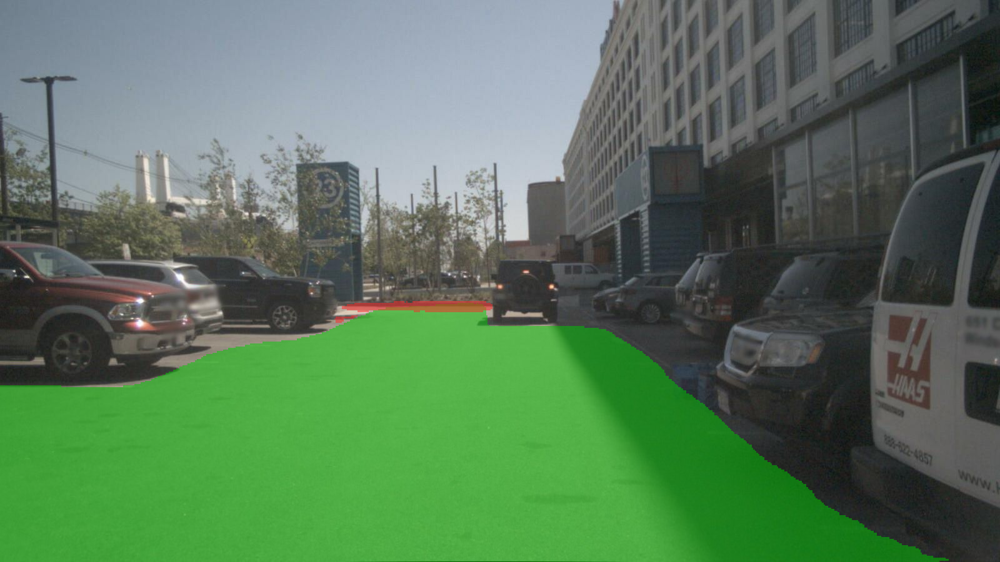

## 4. Cross-domain evaluation — does nuScenes occupancy transfer to the closed-loop renders?

The closed-loop AV2 driving simulator (NuRec 3DGS reconstructions of Argoverse-2) is *out of domain*
for every occupancy model here — they are all trained on real nuScenes cameras. Before feeding an occ
model to the closed loop, we ask: **how much does a nuScenes-trained occupancy model degrade on the
AV2 renders, and which model transfers best?** That best transferer is the right base to fine-tune.

### 4.1 The harness (`occupancy/xdomain/`)
1. **Render AV2 surround** (`closedloop_occ/run_av2_surround_render.sh` + camera config `av2_surround`):
   a GT-replay renders all **7 AV2 ring cameras** (front/side/rear) from the recon along the recorded
   trajectory. The recon exposes each camera's OpenCV intrinsics + pose, so no calibration guessing.
2. **Extract** (`av2_extract.py`): per frame → 7 JPEGs + intrinsics + camera→ego extrinsics + the
   ego pose + actor boxes (dynamic + static, with sizes; AV2 boxes carry **no semantic class**).
3. **GT**: voxelize the dynamic actor boxes into the Occ3D ego grid (200×200×16) = a *class-agnostic*
   object-occupancy target. (Full dense geometric GT would need a rendered-LiDAR pass; the AV2 renders
   have no dense semantic labels, so we score geometry/objects, not 18-class mIoU.)
4. **Run + score** (`av2_run_lss.py`, `metrics.py`): feed the 7 cameras to a baseline → predicted occ →
   **object recall** (does it put occupancy where the objects are — robust to over-prediction),
   precision, and object-occ IoU.

### 4.2 First result — our camera-only LSS
| metric | nuScenes (in-domain) | AV2 surround (cross-domain) |
|---|---|---|
| object recall (occ ∩ object / object) | **0.755** | **0.546** |
| predicted occupied fraction | 0.49 | 0.36 |

The camera-only LSS **still detects objects on the AV2 renders** (recall 0.55, well above chance) but
drops ~28% relative — a real but not catastrophic domain gap. Its very low precision (it over-predicts
occupancy everywhere, occ-frac 0.36–0.49 vs GT ~0.05) is a *model* property, consistent across domains,
so recall is the honest transfer signal here. This is the weakest baseline; the calibrated teachers
(FlashOcc 0.381, OPUSv2 0.386) are next (§4.3) and give the informative transfer ranking.

### 4.3 The baseline transfer table — self-supervised models transfer, supervised-ResNet50 models collapse

We evaluate four nuScenes-trained **camera-only** occ teachers on **4 AV2 scenes** (`00a6ffc1`,
`06e5ac08`, `0d37aee4`, `106d962b`; 48 surround keyframes total), each against a matched in-domain
nuScenes-Occ3D reference. **Airtight controls:** every model gets the *same* 6 AV2 cameras
(`av2_common.AV2_6`; all three were trained on 6 cams and OPUS/FusionOcc hardcode `//6`), the *same*
anisotropic full-resize to 256×704 (no crop — AV2's portrait `front_center` would lose most content
under the nuScenes width-resize+bottom-crop; the projection was validated by re-projecting actor-box
centers, 55/60 land in-frame vs 6/60 with the buggy crop), and the *same* actor-box GT + metric.

Dense-semantic occ fills the whole static scene, so raw "occupied recall" is inflated by
over-prediction. The over-prediction-robust headline is **FG_REC** — of the voxels inside a real object,
the fraction labeled a *foreground object class* (car/truck/ped/…), chance level `fg_frac`≈0.01.
Harness (`xdomain/`): `av2_extract_temporal.py` (8-frame windows from a rollout), `av2_transfer_table.py`
(LSS+FlashOcc), `av2_run_opus.py`, `av2_run_gaussianocc.py`, `av2_run_flashocc.py`; matched references
`*_indomain_ref.py` (incl. `fusionocc_indomain_ref.py`); shared `av2_common.py` (6-camera choice + metrics)
and `metrics.py`; all assembled by `aggregate_table.py`.

| model | backbone / pretraining | in-domain FG_REC | AV2 FG_REC | occ_frac in→AV2 | **FG retention** |
|---|---|---|---|---|---|
| **GaussianOcc** — self-sup, 1-frame | **self-supervised** (no labels) | 0.297 | 0.185 | 0.40 → 0.63 | **62 %** ⟵ robust |
| **our LSS** — DINOv2-base, 1-frame | **self-sup DINOv2** + occ head | 0.645 | **0.382** | 0.20 → 0.32 | **59 %** ⟵ robust |
| **FlashOcc** — R50 + temporal-stereo, 3-frame | supervised ImageNet R50 | 0.525 | 0.105 | 0.19 → **0.68** | 20 % ⟵ over-predicts |
| **OPUSv2-L** — R50 sparse-query, 8-frame | supervised ImageNet R50 | 0.618 | 0.036 | 0.19 → **0.04** | 6 % ⟵ under-predicts |

**The finding.** On the 3DGS render domain the four models split cleanly by **pretraining**, not by
architecture, temporal depth, or in-domain accuracy:
- **The two self-supervised / foundation-feature models retain the most** — GaussianOcc 62 %, DINOv2 LSS
  59 % — even though GaussianOcc is a much *weaker* model at home (in-domain FG_REC 0.297). Its
  robustness generalizes the result beyond DINOv2: it is **self-supervision itself**, not one specific
  backbone, that survives the render gap.
- **The two supervised-ResNet50 models collapse**, in opposite failure modes: **OPUSv2 under-predicts to
  near-empty** (occ_frac 0.19→0.04 — sparse queries lose confidence, the score threshold prunes them, the
  scene vanishes; 6 % retained) and **FlashOcc over-predicts** (occ_frac 0.19→0.68 — the camera-aware
  DepthNet floods the grid and paints obstacles as *background* road/terrain/building; 20 % retained).

**Two readings, one recommendation.** By *retention* (fraction of home ability kept) GaussianOcc leads,
which is the cleanest evidence for the self-supervision claim. But for the **fine-tuning base** what
matters is *absolute* AV2 object recognition — and there **the DINOv2 LSS wins decisively (AV2 FG_REC
0.382, 2× GaussianOcc's 0.185) while also being robust (59 %)**. So: the paper's *scientific* claim is
"self-supervised pretraining dominates in-domain accuracy for render transfer"; the *engineering* choice
for Phase-4 fine-tuning is the **DINOv2 LSS**.

**Confounds ruled out.** (1) FlashOcc's collapse is not the temporal adapter — a degenerate zero-baseline
stereo window (frame ×3) reproduces occ_frac 0.83 / FG_REC 0.06. (2) OPUS's collapse is not the AV2
`ego2img` adapter — its *in-domain* run (0.618, native loader) proves the model works, and every AV2
adapter is **geometrically validated** by re-projecting actor-box centers (OPUS 55/60 in-frame;
GaussianOcc 407/407 = 100 %; each self-sup/supervised model gets a matched in-domain reference proving the
model+checkpoint are sound). (3) The preprocessing is identical across models, so the ranking is not a
preprocessing artifact. (4) Each model reuses its *own* training preprocessing where possible (GaussianOcc
runs through its native dataset/rasterizer, OPUS/FusionOcc via their native loaders in-domain), so the
collapse is a property of the models, not our harness.

**Scope / honesty.** 4 AV2 scenes, 48 keyframes; object-focused FG_REC/obj_IoU (no dense geometric GT —
that needs the rendered-LiDAR Option-A pass). In-domain uses each model's *native* preprocessing (its true
home performance) while AV2 uses the shared anisotropic resize (unavoidable — AV2 aspect ratios differ),
so retention folds in a small preprocessing component; the cross-model *ranking* is unaffected.

**GaussianOcc** (self-supervised, camera-only) is added as the fourth camera row — the key test of
whether the robustness is about *self-supervision in general* or specifically the DINOv2 features.

**FusionOcc** (camera+LiDAR, Swin-B) is **validated in-domain (FG_REC 0.812** — best of all, LiDAR gives
precise geometry) but its AV2 row is **deferred to Phase 4**. Two reasons: (1) the sim renders GT LiDAR
(`send_lidar`) but pushes it to the driver *without logging it to `rollout.asl`*, so extraction needs a
sim-recorder change — which is the same rendered-LiDAR work Phase 4 needs anyway for dense *geometric*
occ GT; and (2) the only available LiDAR is Option-A GT geometry (near-perfect), so a FusionOcc number is
a *perfect-LiDAR upper bound* ("does robust LiDAR rescue the camera-domain collapse"), not a clean
camera-domain-gap measurement — it belongs with the Phase-4 rendered-LiDAR study, not this camera table.

### 4.4 Phase 4 — domain-adapting the DINOv2 LSS on renders nearly *doubles* held-out obstacle recall

We fine-tune the winning DINOv2 LSS on AV2 renders. The obstacle is that renders give **class-agnostic
object boxes** (GT locations, no class) but **no dense semantic GT**, so a naive box-only loss has no
free-space signal and drifts into FlashOcc-style over-prediction. Our objective (`train_lss_av2ft.py`)
avoids that with two terms:
- **Foreground loss** at object-box voxels: `-log Σ_{c∈OBJ} softmax(c)` — maximize the probability the
  voxel is *some* foreground object class. Adapts the encoder to render-domain object appearance.
- **Frozen-teacher KD** at every other voxel: `KL(student ‖ pretrained-teacher)` anchors the pretrained
  road/free/background behavior (anti-forgetting), so total occupancy cannot balloon.

**Protocol.** 16 training scenes rendered (480 keyframes), **disjoint** from the 4 eval scenes; 4 epochs,
lr 1e-5. Training is clean: foreground loss 1.92→0.57 (P(fg) at boxes ~0.15→0.56), KD flat ~0.37.
Evaluated on the **held-out** 4 scenes:

| metric | pretrained | **+ AV2 fine-tune** | Δ |
|---|---|---|---|
| **FG_REC** (obstacle recall) | 0.382 | **0.706** | **+0.324 (+85 %)** |
| occ_recall (geometric) | 0.471 | 0.750 | +0.279 |
| occ_frac (total occupancy) | 0.320 | 0.314 | −0.006 ✓ no over-prediction |
| obj_IoU (foreground precision) | 0.098 | 0.048 | −0.050 |
| fg_frac (foreground share) | 0.018 | 0.068 | +0.050 |

**Result.** Held-out obstacle recall **nearly doubles (0.382→0.706)** — closing most of the domain gap —
while total occupancy stays flat (occ_frac 0.320→0.314): the KD held the geometry, the foreground loss
re-labeled occupied voxels background→foreground. Every eval scene improved (e.g. `0d37aee4` 0.567→0.877,
`106d962b` 0.292→0.767). This validates the arc: **identify the gap → pick the domain-robust model (DINOv2
LSS) → close most of it with only weak object-box supervision.**

**Video.** `docs/media/occ_temporal_0d37aee4.mp4` (still: `docs/media/occ_temporal_still.png`) — the
fine-tuned model frame-by-frame on a held-out clip. Left: `ring_front_center` render; right: predicted
occupancy in a **camera-aligned chase view** (ego at bottom-center, +x forward into the scene; black
box + yellow heading), so it lines up with the front camera — the bus ahead ↔ blue voxels ahead, the
right-side wall ↔ grey `manmade`, the road ↔ magenta `drivable`. **Honest caveat:** the dense semantic
prediction is visibly *noisy* on the render domain — we optimized/measured obstacle recall (FG_REC), never
clean dense semantics, so the voxel map is speckled and occasionally misclassifies (a clean-occupancy
objective or the rendered-LiDAR geometry of §4.5 would be needed to fix it). Generate:
`occupancy/xdomain/predict_occ_sequence.py` → `occupancy/occ_video.py` (headless pyvista/vtk-osmesa vizenv).

**The tradeoff, and a precision term.** The box-only gain is pure *recall*: foreground precision drops
(obj_IoU 0.098→0.048, above-chance enrichment 21×→10×) because the loss rewards recall only. Since the
sim's object GT is **complete**, any foreground predicted *outside* a box is a true false positive, so we
add a precision term — `-log(1-P_fg)` at non-box voxels (self-balancing: ~0 where already correct, large
only on false positives). Re-fine-tuned:

| model | FG_REC | occ_frac | fg_frac | obj_IoU | enrichment |
|---|---|---|---|---|---|
| pretrained | 0.382 | 0.320 | 0.018 | 0.098 | 20.8× |
| + box-only fine-tune | **0.706** | 0.314 | 0.068 | 0.048 | 10.3× |
| + box + **precision** term | 0.695 | 0.309 | 0.060 | **0.054** | 11.6× |

The precision term tightens foreground (fg_frac 0.068→0.060, enrichment 10.3→11.6×, obj_IoU +12 %) while
holding the recall gain (0.695 ≈ 0.706). The effect is modest — the recall/precision tradeoff is
fundamental (the pretrained model's high precision comes from barely predicting foreground at all) — but
it confirms the mechanism, and for the closed-loop *"does the reflex see the obstacle?"* question recall
is the safety-critical axis. Harness: `train_lss_av2ft.py`, `eval_lss_ckpt.py`; checkpoints
`output/lss_occ_av2ft{,_prec}/`.

### 4.5 The rendered-LiDAR path — infrastructure works, GT LiDAR is ground-mesh-dominated

> **Correction (2026-09-27).** The diagnosis below is wrong. The "dense flat ground disk right at the ego" was not
> caused by `--use-ground-mesh=true`. Our LiDAR render request placed the sensor at the **rig origin** (rear axle,
> ground level) instead of its roof mount: `construct_lidar_render_request` passed the ego pose with no sensor
> offset, while cameras do get their `rig_to_camera` offset. Rays that start at ground level hit the ground mesh and
> the ego body immediately. The fix renders from `ego_pose @ T_sensor_rig`, where `T_sensor_rig` is the per-scene
> LiDAR calibration in the scene USDZ (`rig_trajectories.json → lidar_calibrations`), and maps the returned points
> back to the rig frame. After it, ego self-hits drop from ~34 % to 0 % and the cloud shows normal ring structure and
> range. `lidar_dense_gt.lidar_occ_free` must then ray-march from the sensor origin, not (0, 0, 0). Anything built on
> the old dumps (free-space labels, LiDAR teachers, geometric occupancy gates) should be regenerated.

For a *geometric* (rather than box-complement) precision signal we wired the sim's GT LiDAR out: the
`send_lidar` render pushes points to the driver but logs nothing, so we added a localized dump in the
render event (`events/camera.py`, `<logdir>/lidar_dump/lidar_<t>_<cam>.npy`) — this **works** (56 k
points/frame, rig frame, extractable, dense-GT builder in `lidar_dense_gt.py`). But the physics
backend runs with `--use-ground-mesh=true`, so the GT LiDAR is **dominated by a dense flat ground disk
right at the ego** (≈90 % of returns within 2.7 m at z≈0) with only sparse far geometry — ray-traversed
free space is too sparse (≈1 %) to supervise cleanly. The box-complement precision term above sidesteps
this. A proper rendered-LiDAR free-space / FusionOcc-fusion study needs a real LiDAR-sensor model (no
ground-mesh self-hits) — that is the open Phase-4 item, and it is where the deferred **FusionOcc** row
(validated in-domain FG_REC 0.812) also belongs.

### 4.6 Is temporal/recurrent occupancy worth it? A go/no-go probe — and an honest negative

Occupancy *should* be a persistent belief updated frame-by-frame (occlusions fill in as the ego moves,
predictions stop flickering). Before building a learned recurrent state (an SSM/Mamba-style occupancy
world-model — constant memory vs a growing KV-cache), we ran the cheap baseline it must beat: a
hand-coded ego-warp + EMA temporal filter over the fine-tuned LSS's per-frame occupancy
(`temporal_filter_probe.py`, dense 0.13 s clips, 456 scored frames):

| filter | FG_REC | occ_frac | obj_IoU | flicker (fg-IoU) |
|---|---|---|---|---|
| **single-frame** | **0.719** | 0.308 | 0.053 | 0.682 |
| naive ego-warp + EMA | 0.676 | 0.247 | 0.063 | 0.671 |
| **class-aware warp** (static warped, dynamics from current frame) | 0.715 | 0.255 | 0.055 | 0.693 |

**The naive filter *hurts* recall (0.719→0.676)** — a rigid ego-warp is correct for the static world but
**misplaces dynamic objects** (they move independently of the ego), so the EMA averages a smear. This
reproduces a prior nuScenes finding ("rigid-warp temporal −23%"). The **class-aware warp** (ego-warp only
the static classes; take the foreground classes from the current frame) **recovers recall to parity**
(0.715 ≈ 0.719) — confirming dynamics was the cause — but it does **not beat** single-frame; the
occlusion-fill benefit is real but small and is cancelled by warp diffusion/edge erosion (occ_frac still
drops).

**Honest conclusion.** On *open-loop occupancy accuracy*, temporal fusion is **neutral at best** — a
learned SSM would fight the same headwind, and framing it as a mIoU/recall win would be a red-ocean
grind. Temporal/recurrent occupancy earns its place only through capabilities the single-frame model
*cannot* have: (1) **forecasting** — a recurrent state that models motion can roll forward with no new
image (a new capability, the world-model/VLA angle), and (2) **closed-loop stability** — whether
temporal consistency lowers the reactivity tax, which open-loop metrics can't measure. That reframing
(world-model + closed-loop, not accuracy) is what launched the `closedloop_occ/worldmodel_occ/` project;
see its `PLAN.md`.

---

## 7. Visualization cookbook — how every figure in this tutorial is made

Every tool writes PNGs with matplotlib (`Agg` backend), so no display is needed: run them on a CPU node or inside a
batch job. Set `NUSC=/data/cmpe249-fa26/datasets/nuscenes/v1.0-trainval` and
`GTS=/data/cmpe249-fa26/derived/nuscenes/occ3d/gts`, and run from the repository root.

| Figure | Tool | Command (abridged) | Needs |
|---|---|---|---|
| LiDAR BEV + GT boxes, LiDAR on camera, range image, surround boxes | `viz/nuscenes_views.py` | `python -m ...ngperception.viz.nuscenes_views --sample <token>` | nuScenes |
| Waymo range image, dataset projection, range → points + boxes | `viz/waymo_v2_views.py` | `python -m ...ngperception.viz.waymo_v2_views --segment <seg> --frame 100` | Waymo v2 |
| Occ3D GT BEV / camera mask / class frequency | `viz/occ3d_views.py` | `python -m ...ngperception.viz.occ3d_views --gts $GTS` | Occ3D |
| Occupancy as 3D voxels | `occupancy/visualize_voxel3d.py` | `visualize_voxel3d.py labels.npz out.png --camera-mask [--mode voxels]` | a `labels.npz` or `pred.npy` |
| Prediction vs GT (BEV) | `occupancy/visualize.py` | `--ckpt <pth> --split val --sample-idx i --camera-mask` | checkpoint + GPU |
| Several checkpoints / modalities side by side | `occupancy/visualize.py` | `--compare camera:<pth> fusion:<pth>` or `--modality-compare` | checkpoints |
| **Occupancy videos (nuScenes): 6 cameras + top-down + 3D, prediction vs GT, 12 Hz sweeps, 360° orbit** | `viz/occ_video.py` | `python -m ...ngperception.viz.occ_video --mode sweeps --scene scene-0107 --ckpt <pth> --gts $GTS --nusc $NUSC --out x.mp4` (§7.1) | checkpoint + GPU; `pyvista`, `imageio-ffmpeg` |
| Occupancy + front camera video (AV2 renders, §4) | `occupancy/xdomain/predict_occ_sequence.py` → `occupancy/occ_video.py` | frames → `occ_video.py --frames <dir> --out x.mp4` | `pyvista`, `imageio` (venv) |
| Detection boxes in BEV (occupancy-backbone detector) | `occupancy/visualize_det.py` | `--ckpt <det_abl.pth> --sample-idx i` or `--compare a:<pth> b:<pth>` | checkpoint |
| Several detectors on one frame (PETR / BEVFusion-L / -LC) | `detection/visualize_multiexpert.py` | `--preds "PETR:<results_nusc.json>" "LC:<...>"` | mmdet3d result JSONs (§8.2) |
| Depth maps + per-object distance | §1.6 (`fuse_*` outputs) | see §1.6 | images |

Rules we learned the hard way, all of which changed a figure in this tutorial:

1. **Draw what the metric scores.** Occ3D mIoU only scores `mask_camera` voxels. A prediction panel without
   `--camera-mask` compares a full prediction with a GT that is white wherever it is unobserved, and looks far
   worse than it is (§2.9 figure).
2. **Range images live in the sensor frame**, and ego-body returns must be removed first (§0.4).
3. **Overlay projections on the image before training anything that uses them.** A mirrored GT plus a mirrored LiDAR
   gave a plausible-looking AP of 0.36 in our detection work; fixing only one side dropped it to 0.013.
4. **Render predictions from the real camera pose** (intrinsics + extrinsics). Misalignments that barely change the
   metric become obvious.
5. **Label leaked or overlapping checkpoints on the figure.** Some older figures below come from the full-data
   checkpoints that saw val frames (§3.0). They are fine for intuition, not as evidence.

Examples from earlier sections:


*All six cameras around our model's global occupancy (qualitative; older full-data checkpoint).*

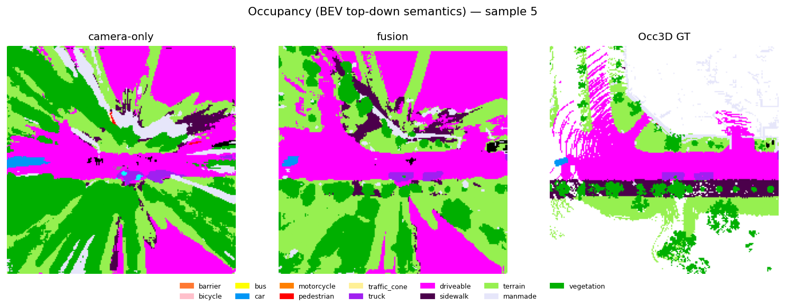

*Camera-only vs camera + LiDAR vs GT, BEV (§2.8.3; leaked full-data checkpoints, qualitative only). Note the radial
"fans" of the camera-only model: lift-splat smears features along rays where its depth is uncertain.*

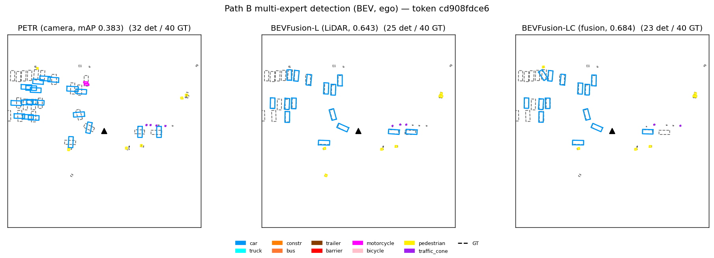

*PETR (camera), BEVFusion-L and BEVFusion-LC on the same nuScenes frame (`visualize_multiexpert.py`, §8).*

### 7.1 Occupancy videos (`viz/occ_video.py`)

One command turns a checkpoint and a nuScenes scene into a 1920×1080 video. Each frame has three parts:

- the six cameras;
- a top-down map;
- 3D voxels with thin edges, lit, and seen from behind the car (black box with a yellow heading cone).

Three modes:

| `--mode` | What it shows | Frames |
|---|---|---|
| `keyframes` | prediction next to the Occ3D GT, both restricted to camera-visible voxels (what mIoU scores); the 3D camera sways gently between keyframes | 2 Hz keyframes × `--hold 3` |
| `sweeps` | the prediction on every 12 Hz camera sweep. There is no GT between keyframes, so the drawn voxels are the nearest keyframe's camera mask, warped by ego motion (visibility only, no GT classes). Use `--sweep-mask raycast` on unlabeled data: visibility then comes from ray casting the prediction itself. | 12 Hz |
| `orbit` | one keyframe; the camera circles the car 360°, prediction next to GT | `--orbit-frames 240` |

```bash
python -m DeepDataMiningLearning.ngperception.viz.occ_video --mode sweeps --scene scene-0107 \
    --ckpt <lss_occ.pth> --gts $GTS --nusc $NUSC --out occ_scene-0107_sweeps.mp4
# --mode keyframes --scene scene-0910     (rain)    |   --mode orbit --scene scene-0275 --still-at 15
```

The tool runs in two stages:

1. **Predict.** The model runs once per frame and caches the prediction, the visibility mask and the camera mosaic
   in `<out>_cache/`.
2. **Render.** A separate process renders the 3D views.

Rendering is kept out of the process that holds CUDA and the nuScenes tables. When they shared a process, VTK
rendering stalled for about 20 s per frame. Several render processes on one GPU were about 70× slower than one, so
`--workers` stays at 1.

On a GPU node the renderer is headless (EGL), so `DISPLAY` is not needed. You also need `pip install imageio-ffmpeg`.

Timings for one scene: model + cache about 1 min (keyframes) or 3 min (231 sweeps); rendering about 30 s.

Our videos use the leakage-free checkpoint on official **val** scenes, which the model never saw. Videos are not
kept in git (`docs/media/` is ignored). On the course HPC they are in `/data/cmpe249-fa26/examples/occ_videos/`:
1080p originals plus `_960` copies (2–5 MB) that are easy to download.

| Scene | Video (`/data/cmpe249-fa26/examples/occ_videos/`) | Length |
|---|---|---|
| scene-0107, Boston, busy intersection, 12 Hz sweeps | `occ_scene-0107_sweeps.mp4` | 231 frames, 19 s |
| scene-0910, rain + construction, prediction vs GT | `occ_scene-0910_rain_pred_vs_gt.mp4` | 40 keyframes, 20 s |
| scene-1062, night, prediction vs GT | `occ_scene-1062_night_pred_vs_gt.mp4` | 40 keyframes, 20 s |
| scene-0275, Singapore, 360° orbit | `occ_scene-0275_orbit.mp4` | 240 frames, 8 s |

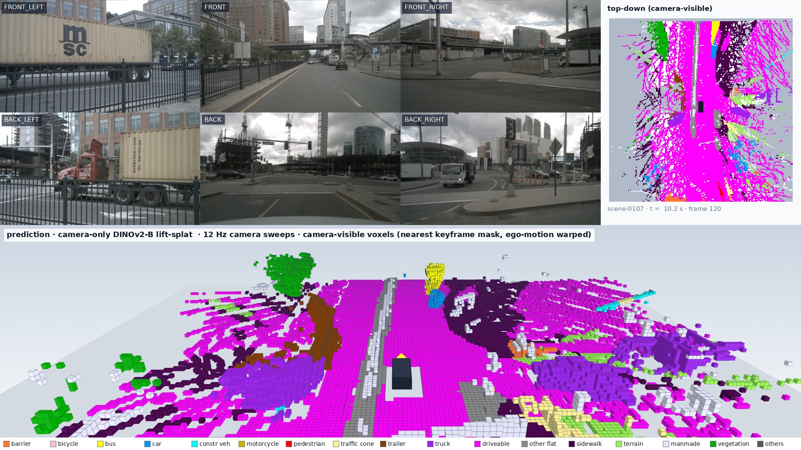

*12 Hz sweeps, scene-0107. The container truck and trailer on the left come out as purple `truck` and brown
`trailer` voxels. The far voxels are noisier. Watch the video: objects move smoothly between keyframes, but the
surfaces flicker, because every sweep is predicted independently (no temporal model).*

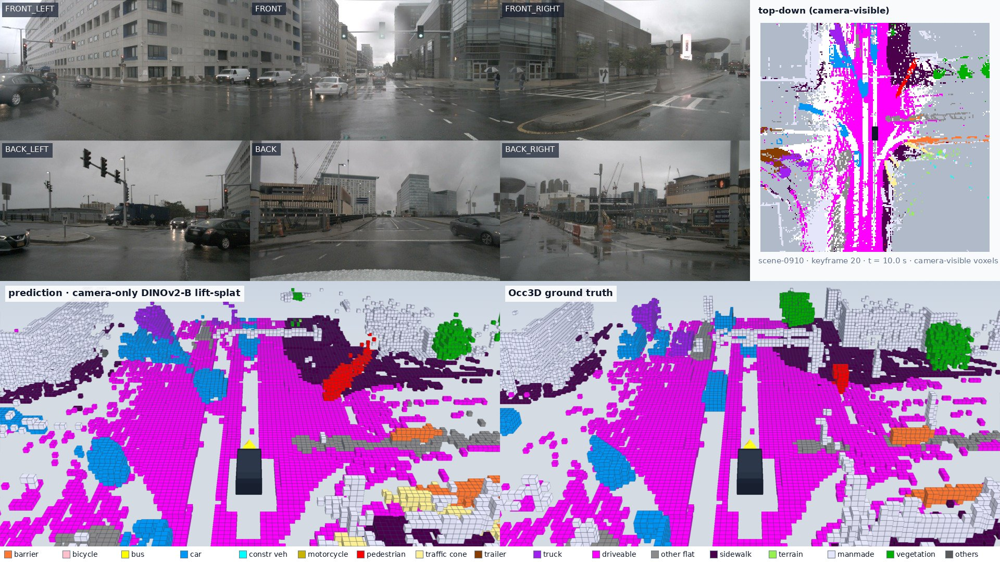

*Rain (scene-0910), prediction vs Occ3D GT. Road, sidewalks, cars and the tree match the GT well. The pedestrian on
the right is a **radial streak**: lift-splat spreads its feature along the camera ray wherever the depth is
uncertain (the same "fans" as in §2.8). The cones and barriers behind the car are only partly found.*

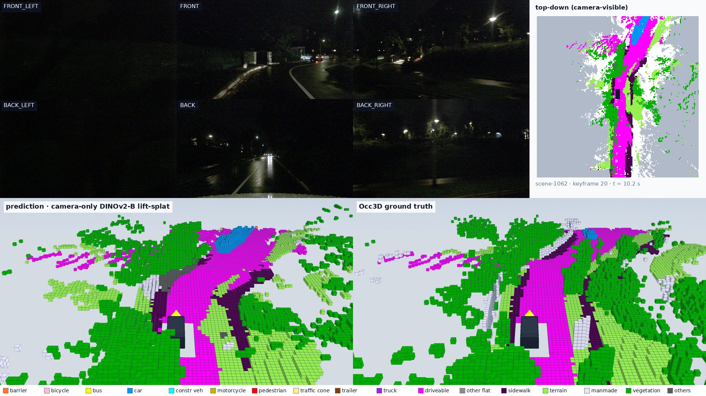

*Night (scene-1062). The left cameras are nearly black, yet the road, vegetation and terrain layout closely
matches the GT. Wall (`manmade`) voxels next to the road are missed, and the car ahead is too long along the
viewing ray.*

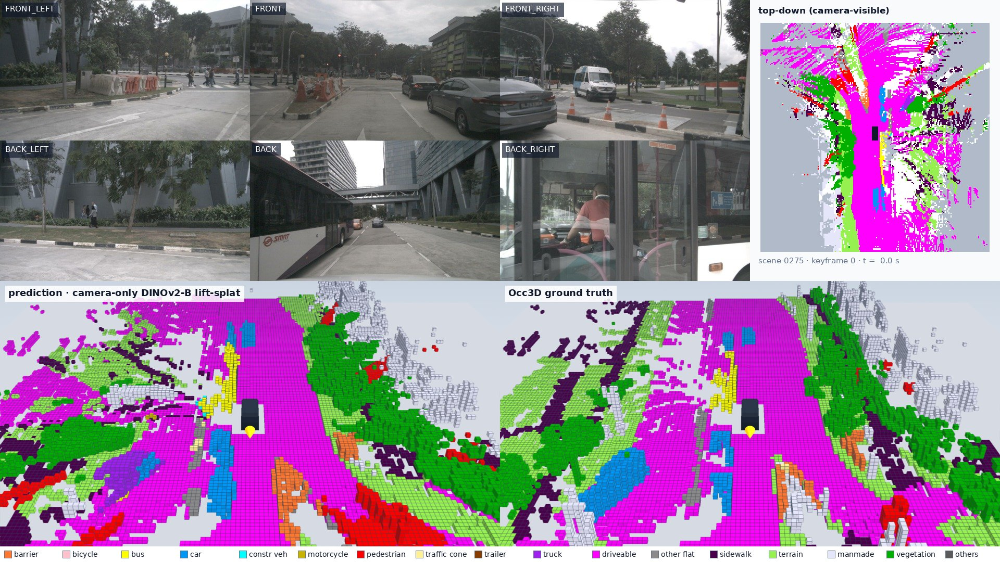

*Orbit (scene-0275), first frame, seen from the front. The prediction contains a large false `pedestrian` blob in
front of the car and a false `truck` on the left. The GT shows that these are cones/barriers and a car. Rare
objects are where this model fails (§2.9, Example 2: pedestrian IoU 0.13).*


---

## 8. 3D object detection — from scratch, mmdetection3d, BEVFusion and newer methods

There are three routes to 3D detection in this repo:

1. **From scratch, pure PyTorch:** PointPillars, CenterPoint and a BEV transformer with no spconv/mmcv, KITTI → nuScenes.
   See [detection/TUTORIAL.md](detection/TUTORIAL.md). This is the route to read if you want to understand every line.
2. **On top of the occupancy encoder:** §5 here, and detection/TUTORIAL.md §13.
3. **mmdetection3d model zoo + BEVFusion** (this section): the reference implementations, run in the course
   environment on the course data.

### 8.1 mmdetection3d on the course cluster

The shared env already contains mmengine 0.10.4, mmcv 2.1.0 (built for `sm_60…sm_90`), mmdet 3.2.0 and
mmdet3d 1.4.0. You only need the matching `tools/` and `configs/`, plus symlinks to the data. The course nuScenes
folder already contains mmdetection3d 1.4 info files (`nuscenes_infos_{train,val}.pkl`), so no `create_data.py`
run is needed:

```bash
cd /data/cmpe249-fa26/students/$USER
git clone -b v1.4.0 --depth 1 https://github.com/open-mmlab/mmdetection3d.git
cd mmdetection3d && mkdir -p data ckpts
ln -s /data/cmpe249-fa26/datasets/nuscenes/v1.0-trainval data/nuscenes     # info files store ./data/nuscenes/... paths
source /data/cmpe249-fa26/students/$USER/venv/bin/activate                  # the venv of §0.2 (on top of the shared env)
export PYTHONPATH=$PWD:$PYTHONPATH                                          # so configs can import projects/*
```

### 8.2 Evaluate a model-zoo detector

Inside a batch job (§0.3 template, `--gres=gpu:p100:1`):

```bash
mim download mmdet3d --config pointpillars_hv_secfpn_sbn-all_8xb4-2x_nus-3d --dest ckpts/
python tools/test.py ckpts/pointpillars_hv_secfpn_sbn-all_8xb4-2x_nus-3d.py ckpts/hv_pointpillars_*.pth
#   nuScenes val: mAP 0.337, NDS 0.486 (our run; car AP 0.787, bicycle 0.008)

# keep the predictions for plotting (§7, detection/visualize_multiexpert.py):
python tools/test.py <config> <checkpoint> --cfg-options \
    test_evaluator.jsonfile_prefix=work_dirs/pp_val test_evaluator.format_only=True
```

The nuScenes metric matches boxes by **centre distance** (0.5 / 1 / 2 / 4 m), not IoU. The logs call the 6,019-frame
evaluation "test", but it is the val split.

### 8.3 BEVFusion (LiDAR + camera)

BEVFusion (Liu et al., ICRA 2023) converts both sensors to one bird's-eye-view grid:
- **camera:** Swin-T → LSS lift with a fast BEV pooling kernel;
- **LiDAR:** voxels → SECOND sparse convolutions → BEV;
- **fusion:** concatenate both maps → a conv fuser → a TransFusion head.

mmdetection3d ships it as a **project** with two custom CUDA ops (`bev_pool`, `voxel_layer`) that you must compile.

**Gotcha: the stock build fails on our GPUs.** `projects/BEVFusion/setup.py` hard-codes `-gencode` for
`sm_70, 75, 80, 86` only, and ignores `TORCH_CUDA_ARCH_LIST`. Built as shipped, BEVFusion crashes on the class P100s
(`sm_60`) and on newer GPUs (`sm_90`) with `CUDA error: no kernel image is available for execution on the device`
inside `bev_pool`. We hit exactly this. Add the two architectures, then build into your venv (the shared env is
read-only, so `setup.py develop` must run from your venv):

```bash
cd /data/cmpe249-fa26/students/$USER/mmdetection3d
python - <<'EOF'
p = 'projects/BEVFusion/setup.py'; s = open(p).read()
s = s.replace("'-gencode=arch=compute_70,code=sm_70',", "'-gencode=arch=compute_60,code=sm_60',\n            '-gencode=arch=compute_70,code=sm_70',")
s = s.replace("'-gencode=arch=compute_86,code=sm_86',", "'-gencode=arch=compute_86,code=sm_86',\n            '-gencode=arch=compute_90,code=sm_90',")
open(p, 'w').write(s)
EOF
export CUDA_HOME=/data/cmpe249-fa26/envs/cuda-11.8 PATH=/data/cmpe249-fa26/envs/cuda-11.8/bin:$PATH
FORCE_CUDA=1 python projects/BEVFusion/setup.py develop      # FORCE_CUDA lets it build on a CPU node too
ls projects/BEVFusion/bevfusion/ops/*/*.so                     # bev_pool_ext*.so  voxel_layer*.so
```

**Evaluate the official LiDAR + camera checkpoint** (batch job, one GPU):

```bash
wget -P ckpts https://download.openmmlab.com/mmdetection3d/v1.1.0_models/bevfusion/bevfusion_lidar-cam_voxel0075_second_secfpn_8xb4-cyclic-20e_nus-3d-5239b1af.pth
python tools/test.py projects/BEVFusion/configs/bevfusion_lidar-cam_voxel0075_second_secfpn_8xb4-cyclic-20e_nus-3d.py \
    ckpts/bevfusion_lidar-cam_voxel0075_second_secfpn_8xb4-cyclic-20e_nus-3d-5239b1af.pth
```

We ran exactly these commands in the course environment on the course nuScenes copy (one lab GPU, inference ≈ 16 min
for the 6,019 val frames; expect several times longer on a P100). Inference peaked at about 2.3 GB of GPU memory,
so it fits a P100:

| BEVFusion, nuScenes val | mAP | NDS |
|---|---|---|
| model zoo, LiDAR only (README) | 64.9 | 69.6 |
| model zoo, LiDAR + camera (README) | 68.6 | 71.4 |
| ours, LiDAR + camera, course env + course data (2026-10-22) — per class: car 0.894, ped 0.879, bicycle 0.626 | **68.4** | **71.1** |

**Training** follows the project README. First train the LiDAR-only model, then train LiDAR + camera starting from
it and from the Swin-T nuImages weights:

```bash
python tools/train.py projects/BEVFusion/configs/bevfusion_lidar_voxel0075_second_secfpn_8xb4-cyclic-20e_nus-3d.py
python tools/train.py projects/BEVFusion/configs/bevfusion_lidar-cam_voxel0075_second_secfpn_8xb4-cyclic-20e_nus-3d.py \
    --cfg-options load_from=<lidar ckpt> model.img_backbone.init_cfg.checkpoint=<swint-nuimages-pretrained.pth>
```

The configs assume 8 GPUs × 4 samples. On one GPU, budget days, not hours. For a course project, start from the
zoo checkpoints and fine-tune or evaluate under changed inputs (§8.6), rather than training from scratch.

### 8.4 Camera-only detectors: PETR and StreamPETR

- **PETR** is in mmdetection3d v1.4.0 (`projects/PETR`). It adds a 3D position embedding of each pixel's camera ray
  to the image features, so plain DETR cross-attention becomes 3D-aware. Our run (VoVNet-99, 800×320) on nuScenes
  val: **mAP 0.383 / NDS 0.391**, matching the published numbers.
- **StreamPETR** is not in upstream mmdetection3d (it has its own official repository). It keeps the top-K object
  queries of each frame in a memory queue and propagates them to the next frame. Our port reached
  **0.4825 / 0.5713** (published 0.482 / 0.571), but only after one fix: timestamps had been stored as float32.
  A Unix time of ~1.5·10⁹ s in float32 has a resolution of about 128 s, so the 0.5 s gap between frames
  became 0 or 128 s, and the temporal alignment was garbage. **0.292 mAP before the fix.**

In our experiments, distilling a BEVFusion teacher into a PETR student gave +6 % mAP with feature distillation and
−24 % with box (pseudo-label) distillation.

### 8.5 Newer methods (2022 → 2026): what moved, and what to try

Numbers are **as reported in each paper's own tables** (nuScenes **test** unless marked). Backbones, test-time
tricks and future frames differ, so compare within a column only.

| Method (year) | Sensor | Key idea | nuScenes mAP / NDS | In mmdet3d v1.4? |
|---|---|---|---|---|
| CenterPoint (2021) | LiDAR | objects as centre heatmaps (the default head) | 58.0 / 65.5 | yes (configs) |
| TransFusion-L (2022) | LiDAR | heatmap-initialised object queries, no NMS | 65.5 / 70.2 | via BEVFusion head |
| DSVT (2023) | LiDAR | sparse voxel transformer, equal-size sets → TensorRT | 68.4 / 72.7 | `projects/DSVT` |
| VoxelNeXt (2023) | LiDAR | fully sparse, boxes from voxels, no dense BEV | 64.5 / 70.0 | official repo |
| SAFDNet (2024) | LiDAR | fully sparse + adaptive feature diffusion | 68.3 / 72.3 | official repo |
| LION / UniMamba (2024 / 25) | LiDAR | linear-time (Mamba) context over serialised voxels | 69.8 / 73.9 · 70.2 / 74.0 | official repos |
| PETR (2022) | camera | 3D position embedding | 44.1 / 50.4 | `projects/PETR` |
| BEVFormer (2022) | camera | BEV queries, spatial + temporal attention | 48.1 / 56.9 | official repo |
| StreamPETR (2023) | camera | streaming object queries | 55.0 / 63.6 (V2-99) · 62.0 / 67.6 (ViT-L) | official repo |
| Sparse4D v3 (2023) | camera | sparse 4D sampling + temporal denoising (Horizon) | 57.0 / 65.6 (V2-99) | official repo |
| Far3D (2024) | camera | 2D-prior queries for 150 m range (AV2) | 63.5 / 68.7 (ViT-L) | official repo |
| BEVFusion (2022) | L + C | both sensors to BEV, conv fuser | 70.2 / 72.9 | `projects/BEVFusion` |
| CMT (2023) | L + C | cross-modal tokens, no view transform | 72.0 / 74.1 | official repo |
| IS-Fusion (2024) | L + C | scene + instance-guided fusion | 73.0 / 75.2 | official repo |
| SparseLIF (2024) | L + C | sparse queries, uncertainty-aware, **temporal** | 74.4 / 77.0 | official repo |

Trends:
- LiDAR heads went from anchors to centres to queries.
- LiDAR backbones went from dense BEV to fully sparse, then to linear-time sequence models. These win at long
  range: Argoverse 2 mAP roughly doubled from 2022 to 2025.
- Camera models went sparse and streaming.
- On nuScenes, recent single-digit gains often come from bigger backbones and temporal input. Ask for seeds before
  believing a half-point difference.

### 8.6 Why LiDAR + camera fusion adds so little — and how to test it

Our BEVFusion reproduction on val: LiDAR-only **0.691 NDS**, LiDAR + camera **0.712**, i.e. **+0.021**. The paper's own
val numbers show the same gap (69.3 → 71.4), and over a strong LiDAR baseline published fusion methods add about
3–8 mAP but only 1.5–5 NDS. Six reasons, each documented in the literature:

1. **Modality imbalance.** Joint training fits the easier modality (LiDAR) first and starves the camera branch.
2. **Camera depth.** To reach BEV the camera must guess depth, so its features smear along rays exactly where LiDAR is
   already precise.
3. **Alignment.** Calibration drift and unsynchronised exposures misplace camera features. BEVFusion's fuser is a
   fixed `concat → 3×3 conv → BN → ReLU`, with no way to down-weight a bad modality.
4. **Metric saturation.** NDS adds translation / scale / orientation / velocity errors that multi-sweep LiDAR already
   gets right. The camera's gains (small, far and thin objects; rain, night) are averaged away.
5. **Asymmetric robustness.** Trained with LiDAR always present, the model learns to depend on it.
6. **Cost.** In the BEVFusion paper, 119 ms vs CenterPoint's 81 ms, plus calibration upkeep on the vehicle.

**Test it with the two-ablation audit** ([bevdet/robustness/README.md](../bevdet/robustness/README.md)): corrupt one
sensor's *input* and, separately, zero its *features*. A branch that does real work hurts under both; a branch that is
an input-independent constant hurts under neither.

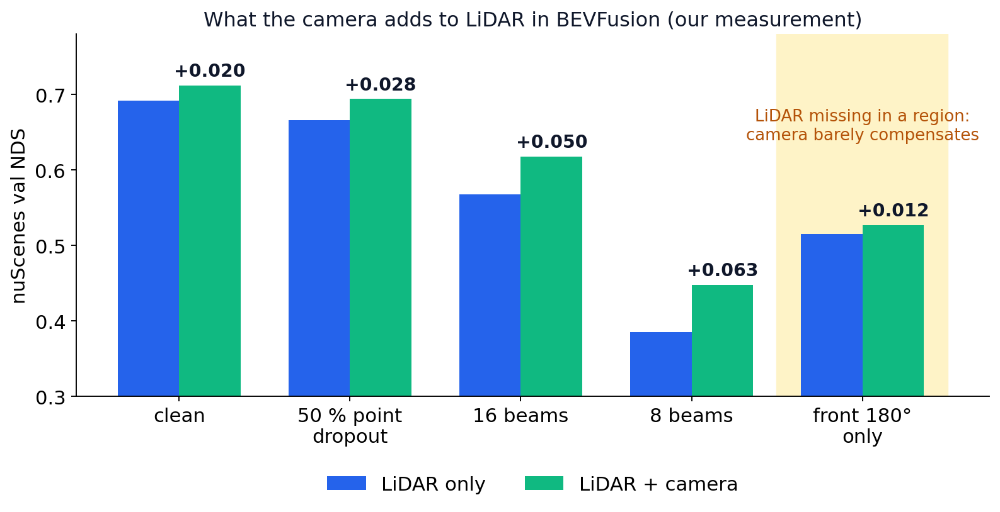

*Same BEVFusion checkpoints, one LiDAR degradation at a time, with the LiDAR-only model as the floor:*
- *The camera's value grows as LiDAR degrades **uniformly**: +0.020 → +0.063 NDS (8 beams), +0.090 (95 % dropout).*
- *Where LiDAR is **missing in a region** (front 180° only) it adds just +0.012, although three rear cameras see that
  region.*
- *Blacking out all cameras drops the fused model to 0.670, **below** LiDAR-only (0.692).*
- *In two of our three custom fusion models, the camera branch turned out to be an input-independent constant.*

