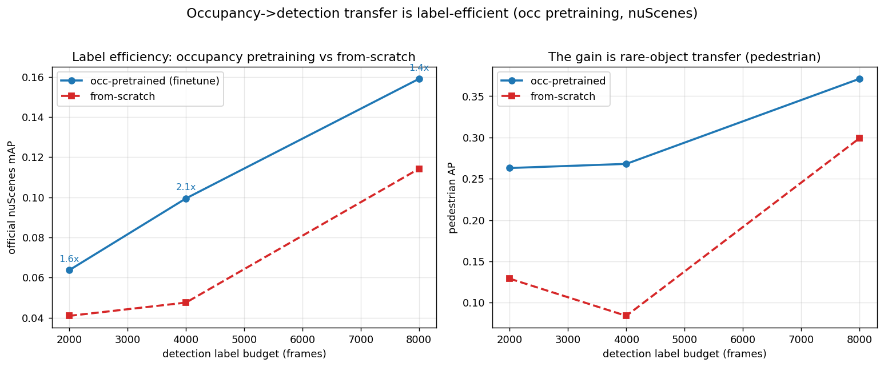

# Label-efficient / label-free AD perception — what we have, and the publication plan

A consolidation of the occupancy + detection experiments in this repo, and a concrete plan for a
publishable paper. Companion to [OCC3D_SOTA_AND_VGGT_DIRECTION.md](OCC3D_SOTA_AND_VGGT_DIRECTION.md),
[RESULTS_FULLDATA_H100.md](RESULTS_FULLDATA_H100.md), and the occupancy/detection tutorials.

---

## 1. Everything we measured (one table)

**Occupancy, Occ3D-nuScenes val, mIoU** (our runs are the 2000-frame / 15-epoch ablation harness
unless noted; ⚠️ = trained-on-val leakage in the full-data numbers):

| setting | supervision | mIoU | note |
|---|---|---|---|
| camera SOTA (COTR/SHTOcc) | full labels | ~44.5 | temporal, published |
| our LSS full-data ⚠️ | full labels | 0.302 | leaked; ~CTF-Occ tier |
| our LSS 2k-frame baseline (DINOv2, LiDAR-dep sup) | full labels | **0.293** | the A/B reference |
| **GaussianOcc (reproduced)** | **NONE (self-sup)** | **11.26** | no labels, no GT poses |

**Geometry-only, training-free (class-agnostic geo-IoU):**

| method | geo-IoU | |
|---|---|---|
| Depth-Anything mono lift | 0.093 | prior camera geometry |
| **frozen VGGT depth-lift** | **0.140** | +51%, = 84% of LiDAR |
| LiDAR single-sweep oracle | 0.167 | |

**VGGT integration ablations (trained, 2k/15ep, vs the 0.293 / 0.262 baselines):**

| # | what | regime | baseline | VGGT | verdict |
|---|---|---|---|---|---|
| #2 | depth **prior** | with LiDAR sup | 0.293 | 0.287 | no gain |
| #3 | depth **prior** | no LiDAR sup (occ-dep) | 0.262 | 0.263 | tied (noise) |
| #4 | **features** backbone | with LiDAR sup | 0.293 | 0.196 | **−33% (worse)** |

**Detection — the label-efficiency curve (the positive result, official nuScenes mAP):**
occ-pretrained (finetune) vs from-scratch, matched fp32 config, official val (6019 frames):

> ⚠ **SUPERSEDED (corrected 2026-09-05).** The "1.4–2.1×" headline quoted downstream (and into
> memory) comes from `output/det_curveF/`, a **different experiment**, not merely an earlier one:
> `--lidar-fusion` + the default **anchor** det head + `--occ-weight 0.1` (an occ auxiliary loss kept
> *during* detection training). The current runs (`output/label_eff/`) are camera-only, `--det-head
> center`, and **no occ auxiliary loss** — clean sequential transfer.
>
> The head change lifted the *from-scratch baseline* from 0.041 → 0.1205 mAP @2k (**2.9×**), and that
> is what compressed the ratio from 2.09× to 1.19×. **The pretraining gain did not disappear; the
> baseline caught up.** This is worth saying in the paper explicitly — a pretraining advantage
> measured against a weak baseline is inflated, and ours was.
>
> Live numbers: `results_occ3d.csv` + `results.csv` → **1.11–1.35×**. Corrected table below; the old
> one is kept only so the provenance of the 1.4–2.1× figure is traceable. **Do not mix the two.**

**Current numbers**, seed null complete on the control (`results_occ3d.csv` / `results.csv`, official
val 6019; mean ± sd, n in parentheses):

| det label budget | occ3d-pretrained mAP | from-scratch mAP | gap | ratio | Welch p |
|---|---|---|---|---|---|
| 2000 | **0.1603** (n=2) | 0.1223 ± 0.0026 (n=3) | +0.0381 | **1.31×** | **0.0059** |
| 4000 | **0.1833** (n=2) | 0.1498 ± 0.0036 (n=3) | +0.0335 | 1.22× | **0.0009** |
| 8000 | **0.1967** (n=1) | 0.1768 (n=1) | +0.0199 | 1.11× | — |

The benefit **decays with budget**, as a pretraining benefit should, and the gap is ~15× the
from-scratch seed sd at both measured budgets — **the main effect is not a seed artifact.**
From-scratch turned out *less* seed-sensitive than feared (sd 0.0026 / 0.0036, comparable to the
pretrained arm's 0.0045 / 0.0028), so the worry that motivated the null did not materialise — but the
null still changed three things, below and in §1's ρ table.

**Softened: "worth ≥2× the labels".** occ3d@2k (0.1603) vs scratch@4k (0.1498) is +0.0106 at
**Welch p = 0.053**. The seed ranges do not overlap ([0.1581, 0.1626] vs [0.1458, 0.1529]), but the
test sits exactly on the threshold — report as *suggestive with non-overlapping ranges*, not as
established. A third occ3d seed at 2k/4k would settle it. **Still do not quote** `ft@4k > scr@8k`
(0.005 margin, ~one seed spread).

Superseded early table (kept for provenance of the "1.4–2.1×" figure)

| det label budget | finetune mAP | scratch mAP | ratio | pedestrian AP (ft / scr) |
|---|---|---|---|---|
| 2000 | **0.064** | 0.041 | 1.56× | 0.263 / 0.129 |
| 4000 | **0.099** | 0.048 | **2.09×** | 0.268 / 0.084 |
| 8000 | **0.159** | 0.114 | 1.39× | 0.371 / 0.299 |

occ-pretraining wins at **every** budget (p = 0.006 / 0.0009 at 2k / 4k); occ3d @ 2k > scratch @ 4k
— *suggestive* of ≥2× label efficiency at the low end, but only p = 0.053, see above.

**The mechanism is rare-object transfer — now measured, and the old class list was wrong.**
Computed on **seed-averaged** per-class AP (3 scratch seeds × 2 occ3d seeds):

| budget | Spearman(val instance count, gain) | 5 rarest, summed-AP ratio | 5 commonest |
|---|---|---|---|
| 2000 | **ρ = −0.685, p = 0.029** | **1.93×** | 1.16× |
| 4000 | **ρ = −0.770, p = 0.009** | 1.49× | 1.13× |

Rarest 5 = bicycle (2 381 val instances), motorcycle (2 508), construction_vehicle (2 678),
bus (3 158), trailer (4 159). Commonest 5 = traffic_cone (15 597), truck (15 704), barrier (26 992),
pedestrian (34 347), car (80 004). "Summed-AP ratio" = Σ occ3d AP ÷ Σ scratch AP over the group.

> ⚠ **Two rules the seed null forced.**
> **(a) Aggregate with the summed-AP ratio, never a mean-of-ratios, never a single class.**
> Rare-class denominators are near zero, so per-class ratios explode: trailer's from-scratch AP moves
> 0.0092 → 0.0036 between seeds, swinging its "gain" 3.13× → **8.00×**; construction_vehicle swings
> 4.62× → 2.11×; the rarest-5 mean-of-ratios inherits it (2.77× → 3.40×). An earlier revision of this
> file quoted those extremes — **retracted**.
> **(b) Quote the seed-averaged ρ and disclose the pairing spread.** Across all 6 scratch×occ3d seed
> pairings ρ spans **[−0.770, −0.624] @2k** and **[−0.830, −0.491] @4k** (mean −0.707 at both), with
> one pairing at each budget failing significance (p = 0.054 @2k, p = 0.150 @4k). An earlier revision
> quoted **ρ = −0.818, p = 0.004** @4k — that was the best of six pairings, **retracted**. The effect
> is real but underpowered at n = 10 classes.

> ⚠ **Corrected 2026-09-05.** This document previously read *"pedestrian/cone/barrier 1.5–3×"*.
> That is wrong on both counts: pedestrian (34 347), barrier (26 992) and traffic_cone (15 597) are
> among the **most common** nuScenes classes, and they gain only **1.15× / 1.36× / 1.13×** at 2k —
> the *least* of any group. The claim "the pedestrian sub-curve is the story" is retracted. The
> effect is real and larger than previously stated, but it lives in bicycle / motorcycle /
> construction_vehicle / bus / trailer.

The gain decays monotonically with label budget — the signature of a genuine pretraining benefit
being competed away as supervision arrives. (ρ does not decay monotonically once seed-averaged:
−0.685 @2k vs −0.770 @4k; with n = 10 classes and a ±0.15 spread across seed pairings, do not read a
trend into ρ itself.) (Full-data anchor from
earlier work: [RESULTS_FULLDATA_H100.md] finetune 3.15× scratch at 8k. PETR/BEVFusion multi-expert
pipeline also built + evaluated on official metrics.) Reproduce — **note there is no `--occ-weight`;
`run_label_efficiency.sh` leaves it at 0.0, so this is clean sequential transfer, not joint
multi-task training** (`--pretrained` loads the occ encoder with `strict=False`; `det_head` stays
randomly initialised):
`train_det_ablation.py --backbone dinov2_base --decoder-layers 4 --decoder-hidden 96 --refine-iters 1 --det-head center --max-samples {2000,4000,8000} --epochs 12 --batch-size 8 --lr 2e-3 --cosine --seed N [--pretrained <occ.pth>]`
(fp32 — `--amp` triggers a BN collapse) → `eval_det_ablation_official.py` → `plot_label_efficiency.py`.

## 2. The findings

**Finding A — a geometry foundation model's label-free geometry does NOT transfer to trained
occupancy.** VGGT (CVPR'25) gives genuinely strong *label-free* geometry — a frozen, untrained
depth-lift reaches **84% of a LiDAR sweep** and +51% over the prior camera lift. Yet plugged into a
*trained* occupancy net it helps in **none of 4 integration ablations**: the **depth prior** is a
wash with *and* without LiDAR supervision (#2/#3 — redundant once a learned depth head + depth
supervision are present), and its **features backbone is 33% *worse* than DINOv2** (#4 — VGGT's
tokens are geometry-specialized, the wrong bias for a *semantic* occupancy head). Mechanism, not
just a null: **a geometry FM helps only where geometry is the bottleneck (the label-free /
no-supervision regime, i.e. GaussianOcc-style self-sup), not the supervised regime where semantics
and supervision dominate.** "Strong zero-shot geometry ≠ useful trained prior."

**Finding B — the label-free occupancy ceiling is ~11 mIoU.** We reproduced GaussianOcc
(ICCV'25, fully self-supervised, no labels/poses) *exactly* (11.26) and visualized it. That fixes a
concrete anchor: label-free 11 vs supervised ~30 (ours) vs SOTA ~44.5. The ~19-point gap is
structured — flat/large classes decent, rare/thin classes ≈0.

**Finding C (the POSITIVE) — occupancy pretraining is label-efficient for detection, via rare-object
transfer.** Occ-pretrained backbone → detection beats from-scratch at every label budget (§1 curve:
1.11–1.35× official mAP, decaying with budget; occ3d @ 2k > scratch @ 4k = ≥2× labels at the low
end, p = 0.053). Crucially the gain is **not uniform** — per-class gain correlates with class
**rarity** (seed-averaged Spearman ρ = −0.685 p = 0.029 @2k, −0.770 p = 0.009 @4k; rarest-5 summed-AP
ratio 1.93× vs commonest-5 1.16× @2k), while car is a wash. Interpretation: the occupancy encoder learns dense per-voxel
geometry for exactly the thin/rare structures where detection-from-scratch is data-starved, and
transfers it — and the benefit is competed away as labels arrive (ρ weakens monotonically with
budget). Report the correlation, not per-class ratios (see the warning in §1). This is the headline
claim; it is orthogonal to the leaderboard and robust to being below absolute SOTA.

## 3. Publication options

**Option A — Analysis / negative-results paper.** *"When does geometry-foundation transfer help
3D occupancy? A systematic study."* Contributions: (1) Finding A with the redundancy mechanism +
the training-free-vs-trained gap; (2) Finding B as the label-free anchor; (3) the reusable harness.
Fit: CVPR/ICCV workshops, WACV, or the analysis/negative-results tracks. Honest, self-contained,
already ~80% done.

**Option B — Positive paper (Finding C headline) with A/B as ablations.** *Label-efficient occupancy
pretraining that transfers to detection* — now backed by the **measured data-efficiency curve** (§1,
Finding C: rare-object transfer, ≥2× labels), with Findings A/B as the "what doesn't work / why" that
motivate *why occupancy* (not a geometry FM) is the right pretext. Stronger venue potential and the
positive is in hand.

**Recommendation:** **B is now the target** — the positive headline (Finding C curve) exists, and
A/B give it a rare "here's what fails and the mechanism" spine. A remains a clean fallback. The
VGGT/GaussianOcc negatives are the differentiator either way — the VGGT-occ space is crowded
(VG3T/DVGT/DriveVGGT), so *"the obvious VGGT-occ integration doesn't work, and why"* is a contribution
those papers don't make. Related work: MTA (cross-task alignment helps the long tail — parallels
Finding C), Sensor2Sensor (4DGS label-free data engine — parallels the label-free arc).

## 4. What's needed to get to submission

- [x] Ablation #4 (VGGT features backbone) — done, −33%; Finding A closed across 4 ablations.
- [ ] **Clean train-only retrain** (leakage-free occ numbers) — required for any headline occ claim.
- [x] **Data-efficiency curve** for occ→detection transfer (2k/4k/8k labels) — DONE (Finding C,
      §1): 1.11–1.35× mAP, ≥2× labels at the low end, rare-object-driven. **Next (blocking): scratch
      @2k/@4k seeds 2-3** — the control has one seed. Then a 16k/28k point (gap-narrowing
      high anchor) + a camera-only (no-LiDAR-fusion) variant for a stronger transfer story.
- [ ] One more VGGT lever if we want Finding A airtight: per-frame metric-scale head (removes the
      scale-drift confound before declaring the prior dead).
- [ ] Scale the GaussianOcc analysis: per-class label-free-vs-supervised gap → which classes are
      "learnable without labels" (flat/large) vs not (rare/thin) — a clean sub-result.
