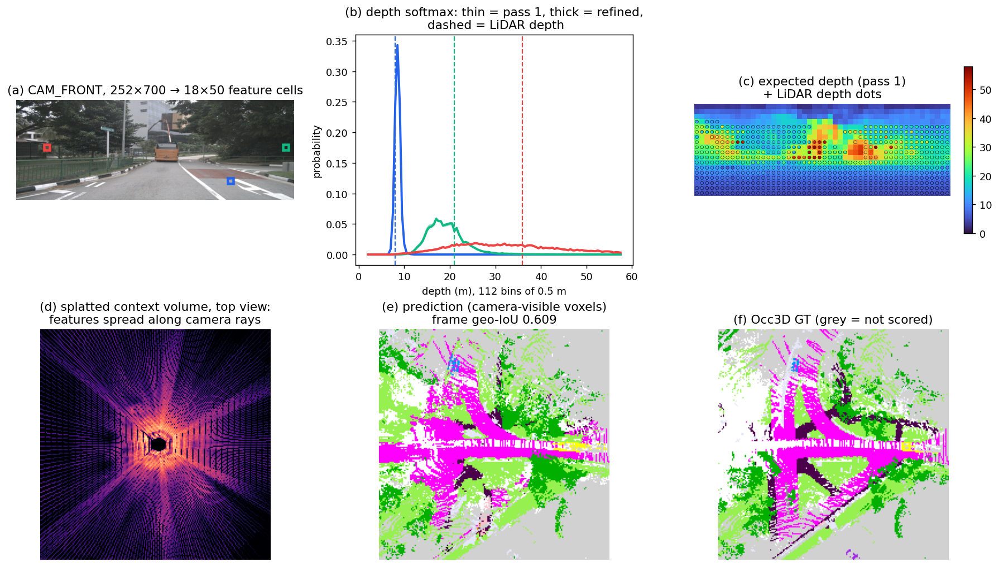
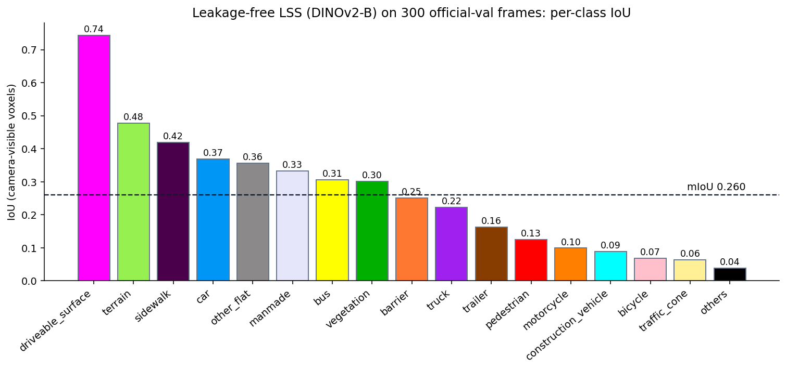

# Occupancy examples

Three short, runnable scripts that go with the "Build an occupancy model" part of the tutorial
([../../TUTORIAL.md](../../TUTORIAL.md)). Each one runs on a single GPU in minutes, uses **official
nuScenes val frames**, and writes a JSON file plus a figure. The results below are what we got.

| Script | What it shows | Needs a checkpoint |
|---|---|---|
| [ex1_lift_splat_walkthrough.py](ex1_lift_splat_walkthrough.py) | the lift-splat forward pass, stage by stage, with every tensor shape | yes |
| [ex2_evaluate_clean_model.py](ex2_evaluate_clean_model.py) | correct evaluation: accumulated vs per-frame mIoU, per-class IoU, pass 1 vs refined | yes |
| [ex3_push_vs_pull.py](ex3_push_vs_pull.py) | the two ways to lift pixels into voxels (`lss_occ` vs `proj_occ`): parameters, time, memory, coverage | no (untrained heads) |

## Setup

Use the course environment from the tutorial (§0). The paths below are the course share; replace them
with your own copies if needed. Run the commands from the repository root.

```bash
GTS=/data/cmpe249-fa26/derived/nuscenes/occ3d/gts
NUSC=/data/cmpe249-fa26/datasets/nuscenes/v1.0-trainval
CKPT=<path to lss_occ.pth>     # a model trained with: python -m ...occupancy.train_lss --split train ...
```

The checkpoint we used is the **leakage-free** lift-splat model: frozen DINOv2-base, 4 × 96 decoder,
two render-and-refine passes, trained on the 700 official train scenes for 24 epochs. On the full
official val split (6,019 frames) it scores **mIoU 0.2615, geometric IoU 0.616**. To train your own,
see the "Step 6 · Train and evaluate" recipe in the tutorial. Always pass `--split train` (split by
scene). Without it, the internal validation set overlaps the training set.

## Example 1: the forward pass by hand

```bash
python -m DeepDataMiningLearning.ngperception.occupancy.examples.ex1_lift_splat_walkthrough \
    --gts $GTS --nusc $NUSC --ckpt $CKPT --sample-idx 120 --out ex1_lift_splat.png
```

It re-implements `LSSOccupancy.forward` step by step:

1. encoder + DepthNet;
2. frustum geometry;
3. lift (depth ⊗ context);
4. splat (`index_add_`);
5. 3D decoder;
6. render-and-refine;
7. lift + decode again.

Result on official-val sample 120 ([results/ex1_lift_splat.json](results/ex1_lift_splat.json)):

```
imgs                       (1, 6, 3, 252, 700)
context                    (1, 6, 64, 18, 50)
depth (softmax over bins)  (1, 6, 112, 18, 50)
frustum geometry (ego xyz) (1, 6, 112, 18, 50, 3)
lifted = depth x context   (1, 6, 64, 112, 18, 50)
voxel volume (after splat) (1, 64, 200, 200, 16)
occupancy logits           (1, 18, 200, 200, 16)
argmax agreement vs model()  0.9999984     max relative difference 0.00019
pass 1:  geo-IoU 0.608, mIoU over present classes 0.245
refined: geo-IoU 0.609, mIoU over present classes 0.246
```

**Why the check is not exact equality.** `index_add_` on CUDA sums with float atomics, so two identical
forward calls differ in the last bits. In our run the difference was at most 0.13 on logits of about
650. The script therefore compares the decisions (argmax) and the relative size of the difference.



What the panels show:

- **(b)** Near cells get sharp depth peaks. A far cell (about 36 m) gets a broad one, so lift-splat
  smears its feature along the ray.
- **(d)** The splatted volume seen from above shows the camera "fans": only about 22 % of voxels
  receive any image feature.
- **(e)/(f)** Prediction vs Occ3D GT, restricted to the camera-visible voxels the metric scores.
  Grey means not scored.

## Example 2: evaluate it the right way

```bash
python -m DeepDataMiningLearning.ngperception.occupancy.examples.ex2_evaluate_clean_model \
    --gts $GTS --nusc $NUSC --ckpt $CKPT --n 300 --out ex2_eval
```

300 frames means every 20th of the 6,019 official-val frames, so all 150 scenes are covered. It took
162 s on one GPU. Results are in [results/ex2_eval.json](results/ex2_eval.json).

| Estimator | pass 1 | refined |
|---|---|---|
| **official mIoU** (TP/FP/FN accumulated over all frames, then IoU per class) | 0.2599 | **0.2601** |
| mean of per-frame mIoU (classes present in each frame) | 0.3235 | 0.3234 |
| geometric IoU | 0.6124 | 0.6141 |
| full official val (6,019 frames), for reference | | 0.2615 |



Lessons:

1. **Accumulate first, then take the IoU.** Averaging per-frame mIoU inflates the score by about 24 %,
   because rare and hard classes enter only the few frames that contain them.
2. **A strided subset is a good cheap estimate.** 300 strided frames land within 0.002 of the full
   val score.
3. **Read the per-class numbers.** Driveable surface reaches 0.74 and terrain 0.48, while bicycle is
   0.07, traffic cone 0.06 and "others" 0.04. Small object classes decide the mean.
4. **Refinement at test time adds about 0 on this model.** Pass 1 already scores 0.2599. With the
   refined pass in training, the refinement mainly acts as a training signal. (In an earlier
   relative study it gave +0.014.)

## Example 3: PUSH vs PULL

```bash
python -m DeepDataMiningLearning.ngperception.occupancy.examples.ex3_push_vs_pull --gts $GTS --nusc $NUSC
```

Both models use the same frozen DINOv2-base backbone and the same 4 × 96 decoder, on one official-val
frame. The heads are **untrained**, so this compares cost and coverage, not accuracy. Forward time is
the median of 10 synchronised calls on an idle H100. On a P100, expect it to be several times slower.

| Lift | trainable | forward | peak memory | decoder input channels | voxels with an image feature |
|---|---|---|---|---|---|
| PUSH `models/lss_occ.py` (lift-splat) | 2.73 M | 64 ms | 2.33 GB | 64 | 22.1 % |
| PULL `models/proj_occ.py` (projection) | 4.56 M | 71 ms | 2.65 GB | 92 (64 + Fourier position + #cameras) | 98.3 % |

How to read it:

- **PUSH** puts features only where the predicted depth puts probability mass. Its depth can be
  supervised with LiDAR.
- **PULL** fills every voxel inside a camera frustum, but all voxels on one ray read the same pixel.
  The decoder has to resolve depth from the position encoding.

**Exercise:** train both lifts with `--split train` for 8 epochs on 2k frames and compare mIoU and
geometric IoU.
